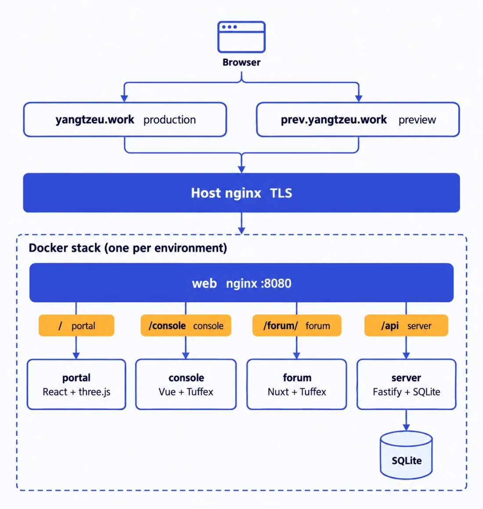

<div align="center">


# geek_main

### 长江大学极客班的官网、控制台、论坛与后端，放在一个仓库里

<p>官网给外面的人看，控制台给班里管事的人用，论坛给大家讨论，后端把这三样接到 GitHub 组织上。</p>

<p><b>English intro:</b> geek_main is the monorepo behind the Yangtze University Geek Class (YUGC): a 3D portal, a GitHub-backed admin console, an adopted Tuff Forum and a Fastify + SQLite server, shipped as two isolated Docker stacks.</p>

<p>
  <a href="README.md"><b>中文</b></a>
  &nbsp;|&nbsp;
  <a href="README.en.md"><b>English</b></a>
</p>

<p>
  <a href="https://yangtzeu.work"><b>正式站</b></a>
  &nbsp;·&nbsp;
  <a href="#快速开始"><b>快速开始</b></a>
  &nbsp;·&nbsp;
  <a href="#分支与发版"><b>分支与发版</b></a>
  &nbsp;·&nbsp;
  <a href="docs/README.md"><b>文档总入口</b></a>
  &nbsp;·&nbsp;
  <a href="docs/architecture/catalog/README.md"><b>项目地图</b></a>
  &nbsp;·&nbsp;
  <a href="AGENTS.md"><b>AGENTS 入口</b></a>
</p>

<sub>React + three.js · Vue + Tuffex · Nuxt · Fastify + SQLite · Docker · 公开仓库</sub>

</div>

---

<div align="center">


</div>

---

## 一句话

`geek_main` 是极客班的统一仓库：`app/` 下五个源码应用（含 Rust CLI），`docs/` 下全部规范，`deploy/` 下两套一模一样的 Docker 栈（正式、预发布）。包名沿用 `yzgc-admin`、`@yzgc/web`、`@yzgc/server`，不为改名而改名。

> [!IMPORTANT]
> **每个环境是一套互相隔离的完整 Docker 栈**：web、server（Fastify 与本环境的 SQLite）、forum。官网、控制台和论坛共用 GitHub 登录及 host-only `sid`；论坛发帖、回复、资料、通知等数据由核心 `/api/forum/*` 提供，并非只有浏览器存储。本机演示和只读快照是另外的运行模式，不作为真实认证或持久化证据。登录后的 3D Hub 尚未实现。当前线上运行的版本以目标环境 `/release.json` 和对应验收记录为准，不由当前分支或本页推断。

---

## 项目地图

正式入口是 [docs/architecture/catalog/](docs/architecture/catalog/README.md)，和代码一起维护：

- **人看关系**：[交互地图](docs/architecture/catalog/map.html)，在本机浏览器打开；在 GitHub 文件页下载原文件后打开即可。[文本总览](docs/architecture/catalog/CATALOG.md)可直接在线阅读。
- **Agent 查实现**：从[检索指引](docs/architecture/catalog/README.md#agent-按需检索)进入接口、数据模型、权限和业务流程，按需查询[结构化目录](docs/architecture/catalog/catalog.json)与源码证据。

## 现在有什么

| 服务 | 目录 | 做什么 | 技术 | 服务文档 |
|---|---|---|---|---|
| 官网 portal | `app/web` | 3D 书桌 → 开机进 YUGC OS 桌面；加入我们（信封投递）、论坛与 GitHub 场景、文档、意见箱、邀请落地 | React 18 · Vite 6 · three.js 0.186 | [web](docs/services/web/README.md) · [portal](docs/services/web/portal.md) |
| 控制台 console | `app/console` | 统一登录、权限节点与部门范围：投递、用户与权限、意见箱、操作记录、GitLab 运维 | Vue 3.5 · Tuffex 0.6 · Vite 7 | [console](docs/services/console/README.md) |
| 论坛 forum | `app/forum` | 基于 MIT 许可的 Tuff Forum，接核心论坛接口；本机另有演示与只读快照模式 | Nuxt 4 · Vue 3 · Tuffex 0.6 · Node ≥26 · pnpm 11.24.0 | [forum](docs/services/forum/README.md) |
| 后端 server | `app/server` | 统一账号与会话、权限节点、OIDC/GitLab 同步、投递、比赛、控制台与论坛接口 | Fastify 5 · better-sqlite3 · Node 22 | [server](docs/services/server/README.md) |
| 命令行 CLI | `app/cli` | `geek` 的 RFC 8628 登录、论坛/比赛/仓库命令与 Agent 技能；产物随 web 的 `/cli/` 分发，不另成运行容器 | Rust/Cargo，独立于两套 Node 工具链 | [CLI](docs/services/cli/README.md) |

| 状态 | 内容 |
|---|---|
| 已有 | 官网、控制台、后端及论坛读写接口；官网、论坛、控制台共用的 GitHub 登录；两套完整隔离的 Docker 栈（各自的 SQLite、密钥、域名），打 rc tag 自动部署预发布；分支守卫、PR 正文检查、tag 发版流水线（CI 与部署跑在 GitHub 托管 runner 上） |
| 工程目录 | 可重建的接口、数据、权限目录与交互地图；每个 PR 的宏观对齐声明及检查，远端启用状态见 CI/CD 文档 |
| 没有 | 登录后的 3D Hub；存量接口完整响应 Schema |

---

## 架构一览

<div align="center">



</div>

每个环境只有一个域名，按路径分：`/` 官网、`/console` 控制台、`/forum/` 论坛、`/api`/`/auth` 后端。上图记录迁移前链路；现行入口是香港 Caddy → `ssh -w` 隧道 → Arch web nginx → server。DNS 过渡期间旧 Nginx 只转发香港；Caddy 重建可信客户端地址，后端保持 `TRUST_PROXY=2`，Arch 不叠宿主 nginx。运行证据和限制见 [DEPLOY](docs/ops/DEPLOY.md)。

---

## 快速开始

### 1. 准备运行时

- 核心（web / console / server）：`.nvmrc` 里的 Node 22（至少 22.13），pnpm 9.15.9。
- 论坛：Node ≥26，pnpm 11.24.0，只经根目录的 `forum:*` 命令使用，不混进核心依赖。
- CLI：独立 Cargo 工具链，不是 Node workspace 包；根目录运行 `pnpm cli:build`、`pnpm cli:test`、`pnpm cli:dist`，源码、锁文件和内嵌技能都在 `app/cli/`。分发与安装见 [CLI 合同](docs/services/cli/README.md)。
- 切换 Node 后不要复用另一个版本编译出的 SQLite 二进制。论坛工具链的准备见 [TUFF-FORUM](docs/ops/TUFF-FORUM.md)。

### 2. 安装并打开

```bash
pnpm install --frozen-lockfile
pnpm dev:web        # 官网，本机开发态默认用样板数据，不需要 OAuth 或数据库
pnpm dev:console    # 控制台，默认连本机后端（真实 GitHub 登录）；地址加 ?__data=mock 用样板数据
pnpm forum:install && pnpm forum:start   # 论坛
```

| 打开 | 地址 |
|---|---|
| 官网 | `http://127.0.0.1:5173/sites/portal/` |
| 控制台 | `http://127.0.0.1:5186/console` |
| 论坛 | `http://127.0.0.1:3456/` |

`pnpm preview:local` 一次起官网 5173、后端 3000 和论坛 3456。要连真实 GitHub 登录，按 [本地环境模板](docs/ops/ENVIRONMENT.md) 自己填本机 `.env` 后用 `pnpm dev`；不要拿生产数据库或生产凭据做测试。

### 3. 提交前验证

```bash
pnpm catalog:generate # 重建内部工程目录，随后运行 pnpm docs:index
pnpm check:catalog  # 核对应用、接口、表、能力与目录生成物
pnpm check          # 运行时、环境契约、依赖边界、文档索引与链接、密钥扫描、类型检查
pnpm test           # 真实路由 + 内存 SQLite，外部服务全部模拟
pnpm build          # 官网、控制台、后端构建
pnpm verify         # 上面三步 + 论坛 check / generate
pnpm test:e2e       # 官网与控制台浏览器验证（Playwright）
pnpm forum:verify   # 论坛 CDP 行为测试与全路由烟测
```

类型检查、构建成功、mock 预览、浏览器验证、线上验收是五种不同的证据，不能互相顶替。见 [TESTING](docs/conventions/TESTING.md)。

---

## 仓库结构

```text
geek_main/
├── AGENTS.md                 唯一的 agent 入口：硬门禁 + 文档路由
├── README.md / README.en.md  给人看的首页（本文件）
├── app/
│   ├── web/                  @yzgc/web      官网 portal + shared 适配层（含 Dockerfile）
│   ├── console/              @yzgc/console  控制台，产物随 web 镜像发布
│   ├── server/               @yzgc/server   Fastify + SQLite（含 Dockerfile）
│   └── forum/                Tuff Forum 原仓，独立工具链与锁文件（含 Dockerfile、LICENSE）
├── deploy/
│   ├── env/                  .env.production / .env.preview：非密值写真实值，密钥留空
│   ├── compose/              两套栈的 compose
│   ├── nginx/                宿主 nginx server block
│   ├── remote/               目标机部署与回滚脚本
│   └── environments.json     环境身份：域名、GitHub environment
├── docs/                     全部规范、服务合同、架构、运维、决策
├── scripts/                  检查、文档索引、发版规划、task worktree
├── tests/                    vitest + playwright 回归
└── .github/                  CI、tag 发版、分支清理、issue 生命周期、PR 模板
```

`app/<service>` 与 `docs/services/<service>/README.md` 一一对应，新增服务两处缺一不算完成。

---

## 分支与发版

```text
issue ──▶ task/<issue>/<slug>（独立 worktree）──▶ PR → stage ──▶ 打 vX.Y.Z-rc.N ──▶ 预发布验收 ──▶ main 快进 ──▶ 打 vX.Y.Z
```

- 长期分支只有 `main`（正式）和 `stage`（预发布）。`stage` 必须包含 `main`，`main` 只能快进到 `stage` 上已有的提交。
- 一件事 = 一个 issue = 一条 `task/<issue>/<slug>` 分支 = 一个 worktree = 一个 PR。开工用 `node scripts/task.mjs start <issue> <slug>`，合并后分支删掉、issue 自动关闭。分支名不用 `-`，只用 `/` 分层。
- `dev/<github-username>` 是个人随便写的地方，不部署，也不能直接进 `stage`。
- **推分支不部署。** 发版只靠打 tag：`vX.Y.Z-rc.N` 打在 `stage` 的提交上发预发布，验收通过后，在同一提交上打 `vX.Y.Z` 发正式。打 tag 要有授权，已推送的 tag 不移动、不删除。
- 进 `stage` 的每个 PR 都要按 [CODE-REVIEW](docs/conventions/CODE-REVIEW.md) 写审查结论，正文十段按 [PULL-REQUESTS](docs/conventions/PULL-REQUESTS.md) 写，CI 会核对。

完整规则：[BRANCHING](docs/conventions/BRANCHING.md) · [RELEASES](docs/conventions/RELEASES.md) · [TRACKING](docs/conventions/TRACKING.md) · [ISSUES](docs/conventions/ISSUES.md) · [COMMITS](docs/conventions/COMMITS.md)。

---

## 部署

2026-10-26 两套原版 Linux Docker 栈已迁入 Arch，六容器健康；Arch 只作 Docker 宿主，目录、项目、网络、卷和应用密钥按环境分开。

| 环境 | Arch 正在运行 | 入口 | web 私有端口 |
|---|---|---|---|
| production | `v0.1.0` / `d4a24749d077` | `https://yangtzeu.work` | `10.66.0.2:18100` |
| preview | `v0.1.1-rc.25` / `02cb751c0b83` | `https://prev.yangtzeu.work` | `10.66.0.2:18200` |

- 原镜像、完整卷、会话与身份密钥分别保全并核对；Arch 为唯一写入源。旧应用及旧看护已停止，旧 VPS 只保留 HTTPS 转发、兼容跳转及恢复资料。
- DNS 未修改，由所有者后续指向香港 `156.238.244.78`，不是 Arch 私有地址。两域名新旧入口 52 项路径与 20 次交替 SNI 检查通过。
- GitHub 双环境已更新 10 项 SSH 配置并同步 22 项原应用 secret，补齐预发布 Google/OIDC/GitLab 配置；共享 `ssh-config` 生成的严格跳板配置已实测 SSH/SCP。个人私钥不进入 CI。
- 本机 `ssh yzgc`、维护者本机工具的 `service yzgc` 入口指向 Arch；后续发布不再使用旧 VPS。原版应用没有升级，新工作流源码仍待集成，未执行新 Actions 发布或补推 tag。
- 现有 task270 与 GitHub stage 相差 2,363 个文件，宏观声明同号冲突与历史 notes 门禁仍阻塞合并；未覆盖历史记录或降低检查。

操作合同：[DEPLOY](docs/ops/DEPLOY.md) · [ENVIRONMENTS](docs/ops/ENVIRONMENTS.md) · [CICD](docs/ops/CICD.md) · [平台备份/恢复](docs/ops/BACKUP.md) · [旁路 GitLab](docs/ops/GITLAB.md)。平台与 GitLab 备份分别验收，旧宿主看护含全局清理，不能原样装进 Arch timer。

### CLI 元数据与迁移验收

现行 CLI 在 `app/cli`，不以旧 `../geek_cli` 的实现替换。`--env` 优先于 `GEEK_ORIGIN`，每次调用独立选择，默认正式；预发布示例使用 `geek --env preview whoami --json`，不因先执行 preview login 就假定后续仍选 preview。该命令会访问服务端，本次文档任务未执行真实登录/API。

凭据优先系统 keyring，文件退路由系统配置目录决定：macOS 为 `~/Library/Application Support/geek/credentials`，Linux 默认 `~/.config/geek/credentials`（支持 XDG）。`GEEK_TOKEN` 不落盘；不复制个人凭据进行迁移。产物安装/hash、跨平台发布缺口、Cargo 包元数据和真实 harness 验收边界见 [CLI 合同](docs/services/cli/README.md)。

---

## 文档地图

| 想知道 | 去看 |
|---|---|
| 现有业务、应用、后端接口、数据结构和能力关系 | [项目目录](docs/architecture/catalog/README.md) |
| 所有规范、app ↔ docs 对照表 | [docs/README.md](docs/README.md)（完整目录 [INDEX](docs/INDEX.md) 是生成物） |
| Agent 接手这个仓库 | [AGENTS.md](AGENTS.md) → [AGENT-START](docs/conventions/AGENT-START.md) |
| 系统怎么拼起来、数据归谁 | [ARCHITECTURE](docs/architecture/ARCHITECTURE.md) · [API](docs/architecture/API.md) · [SECURITY](docs/architecture/SECURITY.md) |
| 界面规范、实际技术栈 | [DESIGN](docs/design/DESIGN.md) · [STACK](docs/design/STACK.md) · [Tuffex 使用政策](docs/components/tuffex/USAGE-POLICY.md) |
| 本机预览、论坛运行 | [LOCAL-PREVIEW](docs/ops/LOCAL-PREVIEW.md) · [TUFF-FORUM](docs/ops/TUFF-FORUM.md) |
| 老论坛数据的备份与核验 | [FORUM-DATA-CAPTURE](docs/ops/FORUM-DATA-CAPTURE.md) |
| 为什么这样选 | [ADR-0001 模块化单体](docs/decisions/0001-modular-monolith.md) · [ADR-0002 Tuffex](docs/decisions/0002-tuffex-ui-foundation.md) · [ADR-0003 采用 Tuff Forum](docs/decisions/0003-adopt-tuff-forum.md) |

改了文档标题、摘要或路径后跑 `pnpm docs:index`；`pnpm check:docs` 校验索引和相对链接。

---

## 几条硬规则

1. **先确认分支，再读规范，再动手。** `git branch --show-current` 是第一条命令。
2. **不直接往 `main` 写。** `main` 只从 `stage` 快进。
3. **密钥不进仓库、镜像、日志和 PR。** `.env` 模板里只有地址、端口、域名、开关。
4. **没验证就写「未验证」。** 每个改动带命令和真实输出；机器通过不等于人工验收。
5. **不放宽校验换绿色。** `|| true`、`continue-on-error`、`[skip ci]`、删断言都不行。

全文见 [AGENTS.md](AGENTS.md)。

---

## 许可与出处

私有项目；未经授权不发布内部代码、文档或凭据。论坛采用的 [Tuff Forum](https://github.com/talex-touch/tuff-forum) 原有版权与 MIT 许可证完整保留在 [app/forum/LICENSE](app/forum/LICENSE)，不因本项目私有而删除上游声明。README 配图由本机图片工具的 `mox_image_generate` 生成。

<div align="center">
<sub>长江大学极客班 · YUGC</sub>
</div>
