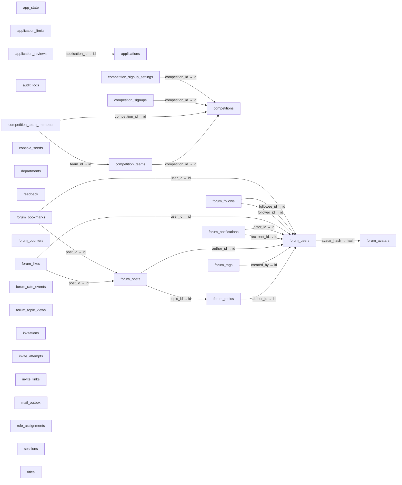

# 数据库结构目录

> 从真实建库函数产生的内存 SQLite 提取表、列、索引和物理外键；不读取业务记录。

状态：`current` · 更新：2026-10-18 · 自动生成，不手工编辑。

来源摘要：`6e752944da9e196c7d0b95ba3037551c28986ac8e1e6e7e3b865277d5e1c2128`。更新日期指目录声明版本，数据新鲜度由摘要和 `pnpm check:catalog` 核对。

[使用与维护](README.md) · [总览](CATALOG.md) · [接口](routes.md) · [数据](data-model.md) · [权限](permissions.md) · [机器目录](catalog.json)

## 物理外键关系

连线只表示数据库声明的 REFERENCES，不猜测命名相似的字段，也不推断业务所有权或基数。



## app_state

业务域：`platform`；结构来源：[app/server/src/lib/db.ts:17](../../../app/server/src/lib/db.ts#L17)。

预留表；当前没有业务读写消费者。存在表不代表已有业务能力。

| 列 | 类型 | NOT NULL | 主键序号 | 默认值 | 隐藏/生成标记 |
|---|---|---|---|---|---|
| `key` | `TEXT` | 0 | 1 | 未声明 | 0 |
| `value` | `TEXT` | 1 | 0 | 未声明 | 0 |
| `updated_at` | `INTEGER` | 1 | 0 | 未声明 | 0 |

NOT NULL 与主键分别保留 SQLite 元数据，不把主键标记当作 NOT NULL 标记。

| 索引 | 列 | 唯一 | 来源 | 部分索引 | SQL |
|---|---|---|---|---|---|
| `sqlite_autoindex_app_state_1` | `key` | 1 | pk | 0 | `SQLite 自动索引` |

<details><summary>建表 SQL</summary>

```sql
CREATE TABLE app_state (
  key TEXT PRIMARY KEY,
  value TEXT NOT NULL,
  updated_at INTEGER NOT NULL
);
```

</details>

## application_limits

业务域：`recruitment`；结构来源：[app/server/src/lib/db.ts:435](../../../app/server/src/lib/db.ts#L435)。

字段隐私、保留周期及读写范围需结合数据模型和业务实现核对，物理结构不能代替业务规则。

| 列 | 类型 | NOT NULL | 主键序号 | 默认值 | 隐藏/生成标记 |
|---|---|---|---|---|---|
| `bucket` | `TEXT` | 1 | 0 | 未声明 | 0 |
| `subject_hash` | `TEXT` | 1 | 0 | 未声明 | 0 |
| `created_at` | `INTEGER` | 1 | 0 | 未声明 | 0 |

NOT NULL 与主键分别保留 SQLite 元数据，不把主键标记当作 NOT NULL 标记。

| 索引 | 列 | 唯一 | 来源 | 部分索引 | SQL |
|---|---|---|---|---|---|
| `idx_application_limits_at` | `created_at` | 0 | c | 0 | `CREATE INDEX idx_application_limits_at ON application_limits(created_at)` |
| `idx_application_limits_subject` | `bucket`、`subject_hash`、`created_at` | 0 | c | 0 | `CREATE INDEX idx_application_limits_subject ON application_limits(bucket, subject_hash, created_at)` |

<details><summary>建表 SQL</summary>

```sql
CREATE TABLE application_limits (
  bucket TEXT NOT NULL CHECK (bucket IN ('source','device')),
  subject_hash TEXT NOT NULL,
  created_at INTEGER NOT NULL
);
```

</details>

## application_reviews

业务域：`recruitment`；结构来源：[app/server/src/lib/db.ts:171](../../../app/server/src/lib/db.ts#L171)。

字段隐私、保留周期及读写范围需结合数据模型和业务实现核对，物理结构不能代替业务规则。

| 列 | 类型 | NOT NULL | 主键序号 | 默认值 | 隐藏/生成标记 |
|---|---|---|---|---|---|
| `id` | `INTEGER` | 0 | 1 | 未声明 | 0 |
| `application_id` | `TEXT` | 1 | 0 | 未声明 | 0 |
| `from_status` | `TEXT` | 1 | 0 | 未声明 | 0 |
| `to_status` | `TEXT` | 1 | 0 | 未声明 | 0 |
| `note` | `TEXT` | 0 | 0 | 未声明 | 0 |
| `reviewer` | `TEXT` | 1 | 0 | 未声明 | 0 |
| `created_at` | `INTEGER` | 1 | 0 | 未声明 | 0 |

NOT NULL 与主键分别保留 SQLite 元数据，不把主键标记当作 NOT NULL 标记。

| 外键列 | 引用 | ON UPDATE | ON DELETE |
|---|---|---|---|
| `application_id` | `applications.id` | NO ACTION | CASCADE |

| 索引 | 列 | 唯一 | 来源 | 部分索引 | SQL |
|---|---|---|---|---|---|
| `idx_application_reviews_app` | `application_id`、`created_at DESC` | 0 | c | 0 | `CREATE INDEX idx_application_reviews_app ON application_reviews(application_id, created_at DESC)` |

<details><summary>建表 SQL</summary>

```sql
CREATE TABLE application_reviews (
  id INTEGER PRIMARY KEY AUTOINCREMENT,
  application_id TEXT NOT NULL REFERENCES applications(id) ON DELETE CASCADE,
  from_status TEXT NOT NULL,
  to_status TEXT NOT NULL,
  note TEXT,
  reviewer TEXT NOT NULL,
  created_at INTEGER NOT NULL
);
```

</details>

## applications

业务域：`recruitment`；结构来源：[app/server/src/lib/db.ts:85](../../../app/server/src/lib/db.ts#L85)。

包含候选人个人信息。具体读取范围、字段下发和取消规则见业务文档；目录不包含记录。

| 列 | 类型 | NOT NULL | 主键序号 | 默认值 | 隐藏/生成标记 |
|---|---|---|---|---|---|
| `id` | `TEXT` | 0 | 1 | 未声明 | 0 |
| `name` | `TEXT` | 1 | 0 | 未声明 | 0 |
| `class_name` | `TEXT` | 1 | 0 | 未声明 | 0 |
| `email` | `TEXT` | 1 | 0 | 未声明 | 0 |
| `strengths` | `TEXT` | 1 | 0 | 未声明 | 0 |
| `source_ip` | `TEXT` | 0 | 0 | 未声明 | 0 |
| `user_agent` | `TEXT` | 0 | 0 | 未声明 | 0 |
| `status` | `TEXT` | 1 | 0 | `'received'` | 0 |
| `created_at` | `INTEGER` | 1 | 0 | 未声明 | 0 |

NOT NULL 与主键分别保留 SQLite 元数据，不把主键标记当作 NOT NULL 标记。

| 索引 | 列 | 唯一 | 来源 | 部分索引 | SQL |
|---|---|---|---|---|---|
| `idx_applications_email` | `email` | 0 | c | 0 | `CREATE INDEX idx_applications_email ON applications(email)` |
| `idx_applications_status_created` | `status`、`created_at DESC` | 0 | c | 0 | `CREATE INDEX idx_applications_status_created ON applications(status, created_at DESC)` |
| `sqlite_autoindex_applications_1` | `id` | 1 | pk | 0 | `SQLite 自动索引` |

<details><summary>建表 SQL</summary>

```sql
CREATE TABLE applications (
  id TEXT PRIMARY KEY,
  name TEXT NOT NULL,
  class_name TEXT NOT NULL,
  email TEXT NOT NULL,
  strengths TEXT NOT NULL,
  source_ip TEXT,
  user_agent TEXT,
  status TEXT NOT NULL DEFAULT 'received',
  created_at INTEGER NOT NULL
);
```

</details>

## audit_logs

业务域：`audit`；结构来源：[app/server/src/lib/db.ts:98](../../../app/server/src/lib/db.ts#L98)。

字段隐私、保留周期及读写范围需结合数据模型和业务实现核对，物理结构不能代替业务规则。

| 列 | 类型 | NOT NULL | 主键序号 | 默认值 | 隐藏/生成标记 |
|---|---|---|---|---|---|
| `id` | `INTEGER` | 0 | 1 | 未声明 | 0 |
| `org` | `TEXT` | 0 | 0 | 未声明 | 0 |
| `actor` | `TEXT` | 1 | 0 | 未声明 | 0 |
| `action` | `TEXT` | 1 | 0 | 未声明 | 0 |
| `target` | `TEXT` | 0 | 0 | 未声明 | 0 |
| `details` | `TEXT` | 0 | 0 | 未声明 | 0 |
| `ip` | `TEXT` | 0 | 0 | 未声明 | 0 |
| `created_at` | `INTEGER` | 1 | 0 | 未声明 | 0 |

NOT NULL 与主键分别保留 SQLite 元数据，不把主键标记当作 NOT NULL 标记。

| 索引 | 列 | 唯一 | 来源 | 部分索引 | SQL |
|---|---|---|---|---|---|
| `idx_audit_org_created` | `org`、`created_at DESC` | 0 | c | 0 | `CREATE INDEX idx_audit_org_created ON audit_logs(org, created_at DESC)` |
| `idx_audit_signin_actor` | `actor` | 0 | c | 1 | `CREATE INDEX idx_audit_signin_actor ON audit_logs(actor) WHERE action = 'auth.signin'` |

<details><summary>建表 SQL</summary>

```sql
CREATE TABLE audit_logs (
  id INTEGER PRIMARY KEY AUTOINCREMENT,
  org TEXT,
  actor TEXT NOT NULL,
  action TEXT NOT NULL,
  target TEXT,
  details TEXT,
  ip TEXT,
  created_at INTEGER NOT NULL
);
```

</details>

## competition_signup_settings

业务域：`competitions`；结构来源：[app/server/src/lib/db.ts:207](../../../app/server/src/lib/db.ts#L207)。

比赛报名设置。控制报名开关、参赛形式（个人/组队）与队伍人数限制；不含个人信息。

| 列 | 类型 | NOT NULL | 主键序号 | 默认值 | 隐藏/生成标记 |
|---|---|---|---|---|---|
| `competition_id` | `TEXT` | 0 | 1 | 未声明 | 0 |
| `enabled` | `INTEGER` | 1 | 0 | `0` | 0 |
| `participation` | `TEXT` | 1 | 0 | 未声明 | 0 |
| `team_min` | `INTEGER` | 0 | 0 | 未声明 | 0 |
| `team_max` | `INTEGER` | 0 | 0 | 未声明 | 0 |
| `updated_at` | `INTEGER` | 1 | 0 | 未声明 | 0 |
| `updated_by` | `TEXT` | 1 | 0 | 未声明 | 0 |

NOT NULL 与主键分别保留 SQLite 元数据，不把主键标记当作 NOT NULL 标记。

| 外键列 | 引用 | ON UPDATE | ON DELETE |
|---|---|---|---|
| `competition_id` | `competitions.id` | NO ACTION | CASCADE |

| 索引 | 列 | 唯一 | 来源 | 部分索引 | SQL |
|---|---|---|---|---|---|
| `sqlite_autoindex_competition_signup_settings_1` | `competition_id` | 1 | pk | 0 | `SQLite 自动索引` |

<details><summary>建表 SQL</summary>

```sql
CREATE TABLE competition_signup_settings (
  competition_id TEXT PRIMARY KEY REFERENCES competitions(id) ON DELETE CASCADE,
  enabled INTEGER NOT NULL DEFAULT 0 CHECK (enabled IN (0, 1)),
  participation TEXT NOT NULL CHECK (participation IN ('individual', 'team')),
  team_min INTEGER,
  team_max INTEGER,
  updated_at INTEGER NOT NULL,
  updated_by TEXT NOT NULL,
  CHECK ((participation = 'individual' AND team_min IS NULL AND team_max IS NULL)
      OR (participation = 'team' AND team_min IS NOT NULL AND team_max IS NOT NULL
          AND team_min BETWEEN 1 AND 20 AND team_max BETWEEN team_min AND 20))
);
```

</details>

## competition_signups

业务域：`competitions`；结构来源：[app/server/src/lib/db.ts:220](../../../app/server/src/lib/db.ts#L220)。

比赛报名记录。按 account_id 关联参赛人员，存储找队意向及参赛备注；软删除（cancelled）。

| 列 | 类型 | NOT NULL | 主键序号 | 默认值 | 隐藏/生成标记 |
|---|---|---|---|---|---|
| `id` | `TEXT` | 0 | 1 | 未声明 | 0 |
| `competition_id` | `TEXT` | 1 | 0 | 未声明 | 0 |
| `account_id` | `TEXT` | 1 | 0 | 未声明 | 0 |
| `status` | `TEXT` | 1 | 0 | 未声明 | 0 |
| `looking_for_team` | `INTEGER` | 1 | 0 | `0` | 0 |
| `note` | `TEXT` | 1 | 0 | `''` | 0 |
| `created_at` | `INTEGER` | 1 | 0 | 未声明 | 0 |
| `updated_at` | `INTEGER` | 1 | 0 | 未声明 | 0 |
| `cancelled_at` | `INTEGER` | 0 | 0 | 未声明 | 0 |

NOT NULL 与主键分别保留 SQLite 元数据，不把主键标记当作 NOT NULL 标记。

| 外键列 | 引用 | ON UPDATE | ON DELETE |
|---|---|---|---|
| `competition_id` | `competitions.id` | NO ACTION | CASCADE |

| 索引 | 列 | 唯一 | 来源 | 部分索引 | SQL |
|---|---|---|---|---|---|
| `idx_competition_signups_account` | `account_id` | 0 | c | 0 | `CREATE INDEX idx_competition_signups_account ON competition_signups(account_id)` |
| `sqlite_autoindex_competition_signups_1` | `id` | 1 | pk | 0 | `SQLite 自动索引` |
| `sqlite_autoindex_competition_signups_2` | `competition_id`、`account_id` | 1 | u | 0 | `SQLite 自动索引` |

<details><summary>建表 SQL</summary>

```sql
CREATE TABLE competition_signups (
  id TEXT PRIMARY KEY,
  competition_id TEXT NOT NULL REFERENCES competitions(id) ON DELETE CASCADE,
  account_id TEXT NOT NULL,
  status TEXT NOT NULL CHECK (status IN ('active', 'cancelled')),
  looking_for_team INTEGER NOT NULL DEFAULT 0 CHECK (looking_for_team IN (0, 1)),
  note TEXT NOT NULL DEFAULT '' CHECK (length(note) <= 200),
  created_at INTEGER NOT NULL,
  updated_at INTEGER NOT NULL,
  cancelled_at INTEGER,
  UNIQUE (competition_id, account_id)
);
```

</details>

## competition_team_members

业务域：`competitions`；结构来源：[app/server/src/lib/db.ts:251](../../../app/server/src/lib/db.ts#L251)。

队伍成员状态机。双向确认流转（applied/invited/active/declined/withdrawn/left/removed/disbanded）。

| 列 | 类型 | NOT NULL | 主键序号 | 默认值 | 隐藏/生成标记 |
|---|---|---|---|---|---|
| `id` | `TEXT` | 0 | 1 | 未声明 | 0 |
| `team_id` | `TEXT` | 1 | 0 | 未声明 | 0 |
| `competition_id` | `TEXT` | 1 | 0 | 未声明 | 0 |
| `account_id` | `TEXT` | 1 | 0 | 未声明 | 0 |
| `role` | `TEXT` | 1 | 0 | 未声明 | 0 |
| `status` | `TEXT` | 1 | 0 | 未声明 | 0 |
| `message` | `TEXT` | 1 | 0 | `''` | 0 |
| `created_by` | `TEXT` | 1 | 0 | 未声明 | 0 |
| `decided_by` | `TEXT` | 0 | 0 | 未声明 | 0 |
| `created_at` | `INTEGER` | 1 | 0 | 未声明 | 0 |
| `decided_at` | `INTEGER` | 0 | 0 | 未声明 | 0 |
| `updated_at` | `INTEGER` | 1 | 0 | 未声明 | 0 |

NOT NULL 与主键分别保留 SQLite 元数据，不把主键标记当作 NOT NULL 标记。

| 外键列 | 引用 | ON UPDATE | ON DELETE |
|---|---|---|---|
| `competition_id` | `competitions.id` | NO ACTION | CASCADE |
| `team_id` | `competition_teams.id` | NO ACTION | CASCADE |

| 索引 | 列 | 唯一 | 来源 | 部分索引 | SQL |
|---|---|---|---|---|---|
| `idx_team_members_account` | `account_id`、`status` | 0 | c | 0 | `CREATE INDEX idx_team_members_account ON competition_team_members(account_id, status)` |
| `idx_team_members_team` | `team_id`、`status` | 0 | c | 0 | `CREATE INDEX idx_team_members_team ON competition_team_members(team_id, status)` |
| `sqlite_autoindex_competition_team_members_1` | `id` | 1 | pk | 0 | `SQLite 自动索引` |
| `uq_team_members_active` | `competition_id`、`account_id` | 1 | c | 1 | `CREATE UNIQUE INDEX uq_team_members_active   ON competition_team_members(competition_id, account_id) WHERE status = 'active'` |
| `uq_team_members_pending` | `team_id`、`account_id` | 1 | c | 1 | `CREATE UNIQUE INDEX uq_team_members_pending   ON competition_team_members(team_id, account_id) WHERE status IN ('applied', 'invited')` |

<details><summary>建表 SQL</summary>

```sql
CREATE TABLE competition_team_members (
  id TEXT PRIMARY KEY,
  team_id TEXT NOT NULL REFERENCES competition_teams(id) ON DELETE CASCADE,
  competition_id TEXT NOT NULL REFERENCES competitions(id) ON DELETE CASCADE,
  account_id TEXT NOT NULL,
  role TEXT NOT NULL CHECK (role IN ('leader', 'member')),
  status TEXT NOT NULL CHECK (status IN
    ('applied', 'invited', 'active', 'declined', 'withdrawn', 'left', 'removed', 'disbanded')),
  message TEXT NOT NULL DEFAULT '' CHECK (length(message) <= 100),
  created_by TEXT NOT NULL,
  decided_by TEXT,
  created_at INTEGER NOT NULL,
  decided_at INTEGER,
  updated_at INTEGER NOT NULL
);
```

</details>

## competition_teams

业务域：`competitions`；结构来源：[app/server/src/lib/db.ts:234](../../../app/server/src/lib/db.ts#L234)。

比赛队伍记录。存储队名、口号、队长 account_id 及组队锁定状态（recruiting/locked/disbanded）。

| 列 | 类型 | NOT NULL | 主键序号 | 默认值 | 隐藏/生成标记 |
|---|---|---|---|---|---|
| `id` | `TEXT` | 0 | 1 | 未声明 | 0 |
| `competition_id` | `TEXT` | 1 | 0 | 未声明 | 0 |
| `name` | `TEXT` | 1 | 0 | 未声明 | 0 |
| `name_key` | `TEXT` | 1 | 0 | 未声明 | 0 |
| `slogan` | `TEXT` | 1 | 0 | `''` | 0 |
| `leader_account_id` | `TEXT` | 1 | 0 | 未声明 | 0 |
| `status` | `TEXT` | 1 | 0 | 未声明 | 0 |
| `locked_at` | `INTEGER` | 0 | 0 | 未声明 | 0 |
| `disbanded_at` | `INTEGER` | 0 | 0 | 未声明 | 0 |
| `created_at` | `INTEGER` | 1 | 0 | 未声明 | 0 |
| `updated_at` | `INTEGER` | 1 | 0 | 未声明 | 0 |

NOT NULL 与主键分别保留 SQLite 元数据，不把主键标记当作 NOT NULL 标记。

| 外键列 | 引用 | ON UPDATE | ON DELETE |
|---|---|---|---|
| `competition_id` | `competitions.id` | NO ACTION | CASCADE |

| 索引 | 列 | 唯一 | 来源 | 部分索引 | SQL |
|---|---|---|---|---|---|
| `idx_competition_teams_competition` | `competition_id`、`status` | 0 | c | 0 | `CREATE INDEX idx_competition_teams_competition ON competition_teams(competition_id, status)` |
| `sqlite_autoindex_competition_teams_1` | `id` | 1 | pk | 0 | `SQLite 自动索引` |
| `uq_competition_teams_name` | `competition_id`、`name_key` | 1 | c | 1 | `CREATE UNIQUE INDEX uq_competition_teams_name   ON competition_teams(competition_id, name_key) WHERE status <> 'disbanded'` |

<details><summary>建表 SQL</summary>

```sql
CREATE TABLE competition_teams (
  id TEXT PRIMARY KEY,
  competition_id TEXT NOT NULL REFERENCES competitions(id) ON DELETE CASCADE,
  name TEXT NOT NULL,
  name_key TEXT NOT NULL,
  slogan TEXT NOT NULL DEFAULT '',
  leader_account_id TEXT NOT NULL,
  status TEXT NOT NULL CHECK (status IN ('recruiting', 'locked', 'disbanded')),
  locked_at INTEGER,
  disbanded_at INTEGER,
  created_at INTEGER NOT NULL,
  updated_at INTEGER NOT NULL
);
```

</details>

## competitions

业务域：`competitions`；结构来源：[app/server/src/lib/db.ts:188](../../../app/server/src/lib/db.ts#L188)。

比赛信息。状态由起止时间与当前时间动态计算；不含个人信息。

| 列 | 类型 | NOT NULL | 主键序号 | 默认值 | 隐藏/生成标记 |
|---|---|---|---|---|---|
| `id` | `TEXT` | 0 | 1 | 未声明 | 0 |
| `name` | `TEXT` | 1 | 0 | 未声明 | 0 |
| `kind` | `TEXT` | 1 | 0 | 未声明 | 0 |
| `start_at` | `INTEGER` | 1 | 0 | 未声明 | 0 |
| `end_at` | `INTEGER` | 1 | 0 | 未声明 | 0 |
| `signup_deadline` | `INTEGER` | 0 | 0 | 未声明 | 0 |
| `url` | `TEXT` | 0 | 0 | 未声明 | 0 |
| `description` | `TEXT` | 1 | 0 | `''` | 0 |
| `offline` | `INTEGER` | 1 | 0 | `0` | 0 |
| `created_at` | `INTEGER` | 1 | 0 | 未声明 | 0 |
| `updated_at` | `INTEGER` | 1 | 0 | 未声明 | 0 |

NOT NULL 与主键分别保留 SQLite 元数据，不把主键标记当作 NOT NULL 标记。

| 索引 | 列 | 唯一 | 来源 | 部分索引 | SQL |
|---|---|---|---|---|---|
| `idx_competitions_offline_start` | `offline`、`start_at` | 0 | c | 0 | `CREATE INDEX idx_competitions_offline_start ON competitions(offline, start_at)` |
| `sqlite_autoindex_competitions_1` | `id` | 1 | pk | 0 | `SQLite 自动索引` |

<details><summary>建表 SQL</summary>

```sql
CREATE TABLE competitions (
  id TEXT PRIMARY KEY,
  name TEXT NOT NULL,
  kind TEXT NOT NULL CHECK (kind IN ('internal','external')),
  start_at INTEGER NOT NULL,
  end_at INTEGER NOT NULL,
  signup_deadline INTEGER,
  url TEXT,
  description TEXT NOT NULL DEFAULT '',
  offline INTEGER NOT NULL DEFAULT 0,
  created_at INTEGER NOT NULL,
  updated_at INTEGER NOT NULL,
  CHECK (end_at >= start_at),
  CHECK (url IS NULL OR url LIKE 'https://%'),
  CHECK (signup_deadline IS NULL OR signup_deadline <= end_at)
);
```

</details>

## console_seeds

业务域：`organization`；结构来源：[app/server/src/lib/db.ts:122](../../../app/server/src/lib/db.ts#L122)。

字段隐私、保留周期及读写范围需结合数据模型和业务实现核对，物理结构不能代替业务规则。

| 列 | 类型 | NOT NULL | 主键序号 | 默认值 | 隐藏/生成标记 |
|---|---|---|---|---|---|
| `name` | `TEXT` | 0 | 1 | 未声明 | 0 |
| `seeded_at` | `INTEGER` | 1 | 0 | 未声明 | 0 |

NOT NULL 与主键分别保留 SQLite 元数据，不把主键标记当作 NOT NULL 标记。

| 索引 | 列 | 唯一 | 来源 | 部分索引 | SQL |
|---|---|---|---|---|---|
| `sqlite_autoindex_console_seeds_1` | `name` | 1 | pk | 0 | `SQLite 自动索引` |

<details><summary>建表 SQL</summary>

```sql
CREATE TABLE console_seeds (
  name TEXT PRIMARY KEY,
  seeded_at INTEGER NOT NULL
);
```

</details>

## departments

业务域：`organization`；结构来源：[app/server/src/lib/db.ts:139](../../../app/server/src/lib/db.ts#L139)。

字段隐私、保留周期及读写范围需结合数据模型和业务实现核对，物理结构不能代替业务规则。

| 列 | 类型 | NOT NULL | 主键序号 | 默认值 | 隐藏/生成标记 |
|---|---|---|---|---|---|
| `id` | `TEXT` | 0 | 1 | 未声明 | 0 |
| `name` | `TEXT` | 1 | 0 | 未声明 | 0 |
| `tag` | `TEXT` | 1 | 0 | 未声明 | 0 |
| `icon` | `TEXT` | 1 | 0 | 未声明 | 0 |
| `tone` | `TEXT` | 1 | 0 | 未声明 | 0 |
| `description` | `TEXT` | 1 | 0 | `''` | 0 |
| `head_capabilities` | `TEXT` | 1 | 0 | 未声明 | 0 |
| `member_capabilities` | `TEXT` | 1 | 0 | `'[]'` | 0 |
| `sort_order` | `INTEGER` | 1 | 0 | `100` | 0 |
| `archived` | `INTEGER` | 1 | 0 | `0` | 0 |
| `created_at` | `INTEGER` | 1 | 0 | 未声明 | 0 |
| `updated_at` | `INTEGER` | 1 | 0 | 未声明 | 0 |

NOT NULL 与主键分别保留 SQLite 元数据，不把主键标记当作 NOT NULL 标记。

| 索引 | 列 | 唯一 | 来源 | 部分索引 | SQL |
|---|---|---|---|---|---|
| `sqlite_autoindex_departments_1` | `id` | 1 | pk | 0 | `SQLite 自动索引` |

<details><summary>建表 SQL</summary>

```sql
CREATE TABLE departments (
  id TEXT PRIMARY KEY,
  name TEXT NOT NULL,
  tag TEXT NOT NULL,
  icon TEXT NOT NULL,
  tone TEXT NOT NULL,
  description TEXT NOT NULL DEFAULT '',
  head_capabilities TEXT NOT NULL,
  member_capabilities TEXT NOT NULL DEFAULT '[]',
  sort_order INTEGER NOT NULL DEFAULT 100,
  archived INTEGER NOT NULL DEFAULT 0,
  created_at INTEGER NOT NULL,
  updated_at INTEGER NOT NULL
);
```

</details>

## feedback

业务域：`feedback`；结构来源：[app/server/src/lib/db.ts:65](../../../app/server/src/lib/db.ts#L65)。

字段隐私、保留周期及读写范围需结合数据模型和业务实现核对，物理结构不能代替业务规则。

| 列 | 类型 | NOT NULL | 主键序号 | 默认值 | 隐藏/生成标记 |
|---|---|---|---|---|---|
| `id` | `INTEGER` | 0 | 1 | 未声明 | 0 |
| `org` | `TEXT` | 1 | 0 | 未声明 | 0 |
| `content` | `TEXT` | 1 | 0 | 未声明 | 0 |
| `category` | `TEXT` | 0 | 0 | 未声明 | 0 |
| `contact` | `TEXT` | 0 | 0 | 未声明 | 0 |
| `submitter_login` | `TEXT` | 0 | 0 | 未声明 | 0 |
| `submitter_id` | `INTEGER` | 0 | 0 | 未声明 | 0 |
| `source_ip` | `TEXT` | 0 | 0 | 未声明 | 0 |
| `user_agent` | `TEXT` | 0 | 0 | 未声明 | 0 |
| `status` | `TEXT` | 1 | 0 | `'open'` | 0 |
| `reply` | `TEXT` | 0 | 0 | 未声明 | 0 |
| `replied_by` | `TEXT` | 0 | 0 | 未声明 | 0 |
| `replied_at` | `INTEGER` | 0 | 0 | 未声明 | 0 |
| `votes` | `INTEGER` | 1 | 0 | `0` | 0 |
| `created_at` | `INTEGER` | 1 | 0 | 未声明 | 0 |
| `updated_at` | `INTEGER` | 1 | 0 | 未声明 | 0 |

NOT NULL 与主键分别保留 SQLite 元数据，不把主键标记当作 NOT NULL 标记。

| 索引 | 列 | 唯一 | 来源 | 部分索引 | SQL |
|---|---|---|---|---|---|
| `idx_feedback_org_status` | `org`、`status`、`created_at DESC` | 0 | c | 0 | `CREATE INDEX idx_feedback_org_status ON feedback(org, status, created_at DESC)` |

<details><summary>建表 SQL</summary>

```sql
CREATE TABLE feedback (
  id INTEGER PRIMARY KEY AUTOINCREMENT,
  org TEXT NOT NULL,
  content TEXT NOT NULL,
  category TEXT,
  contact TEXT,
  submitter_login TEXT,
  submitter_id INTEGER,
  source_ip TEXT,
  user_agent TEXT,
  status TEXT NOT NULL DEFAULT 'open',
  reply TEXT,
  replied_by TEXT,
  replied_at INTEGER,
  votes INTEGER NOT NULL DEFAULT 0,
  created_at INTEGER NOT NULL,
  updated_at INTEGER NOT NULL
);
```

</details>

## forum_avatars

业务域：`forum`；结构来源：[app/server/src/lib/db.ts:283](../../../app/server/src/lib/db.ts#L283)。

字段隐私、保留周期及读写范围需结合数据模型和业务实现核对，物理结构不能代替业务规则。

| 列 | 类型 | NOT NULL | 主键序号 | 默认值 | 隐藏/生成标记 |
|---|---|---|---|---|---|
| `hash` | `TEXT` | 0 | 1 | 未声明 | 0 |
| `data` | `BLOB` | 1 | 0 | 未声明 | 0 |
| `created_at` | `INTEGER` | 1 | 0 | 未声明 | 0 |

NOT NULL 与主键分别保留 SQLite 元数据，不把主键标记当作 NOT NULL 标记。

| 索引 | 列 | 唯一 | 来源 | 部分索引 | SQL |
|---|---|---|---|---|---|
| `sqlite_autoindex_forum_avatars_1` | `hash` | 1 | pk | 0 | `SQLite 自动索引` |

<details><summary>建表 SQL</summary>

```sql
CREATE TABLE forum_avatars (
  hash TEXT PRIMARY KEY,
  data BLOB NOT NULL,
  created_at INTEGER NOT NULL
);
```

</details>

## forum_bookmarks

业务域：`forum`；结构来源：[app/server/src/lib/db.ts:354](../../../app/server/src/lib/db.ts#L354)。

字段隐私、保留周期及读写范围需结合数据模型和业务实现核对，物理结构不能代替业务规则。

| 列 | 类型 | NOT NULL | 主键序号 | 默认值 | 隐藏/生成标记 |
|---|---|---|---|---|---|
| `user_id` | `TEXT` | 1 | 1 | 未声明 | 0 |
| `post_id` | `TEXT` | 1 | 2 | 未声明 | 0 |
| `created_at` | `INTEGER` | 1 | 0 | 未声明 | 0 |

NOT NULL 与主键分别保留 SQLite 元数据，不把主键标记当作 NOT NULL 标记。

| 外键列 | 引用 | ON UPDATE | ON DELETE |
|---|---|---|---|
| `post_id` | `forum_posts.id` | NO ACTION | NO ACTION |
| `user_id` | `forum_users.id` | NO ACTION | NO ACTION |

| 索引 | 列 | 唯一 | 来源 | 部分索引 | SQL |
|---|---|---|---|---|---|
| `sqlite_autoindex_forum_bookmarks_1` | `user_id`、`post_id` | 1 | pk | 0 | `SQLite 自动索引` |

<details><summary>建表 SQL</summary>

```sql
CREATE TABLE forum_bookmarks (
  user_id TEXT NOT NULL REFERENCES forum_users(id),
  post_id TEXT NOT NULL REFERENCES forum_posts(id),
  created_at INTEGER NOT NULL,
  PRIMARY KEY (user_id, post_id)
);
```

</details>

## forum_counters

业务域：`forum`；结构来源：[app/server/src/lib/db.ts:278](../../../app/server/src/lib/db.ts#L278)。

字段隐私、保留周期及读写范围需结合数据模型和业务实现核对，物理结构不能代替业务规则。

| 列 | 类型 | NOT NULL | 主键序号 | 默认值 | 隐藏/生成标记 |
|---|---|---|---|---|---|
| `name` | `TEXT` | 0 | 1 | 未声明 | 0 |
| `value` | `INTEGER` | 1 | 0 | 未声明 | 0 |

NOT NULL 与主键分别保留 SQLite 元数据，不把主键标记当作 NOT NULL 标记。

| 索引 | 列 | 唯一 | 来源 | 部分索引 | SQL |
|---|---|---|---|---|---|
| `sqlite_autoindex_forum_counters_1` | `name` | 1 | pk | 0 | `SQLite 自动索引` |

<details><summary>建表 SQL</summary>

```sql
CREATE TABLE forum_counters (
  name TEXT PRIMARY KEY CHECK (name IN ('topic','post','notification','tag','guest')),
  value INTEGER NOT NULL
);
```

</details>

## forum_follows

业务域：`forum`；结构来源：[app/server/src/lib/db.ts:361](../../../app/server/src/lib/db.ts#L361)。

字段隐私、保留周期及读写范围需结合数据模型和业务实现核对，物理结构不能代替业务规则。

| 列 | 类型 | NOT NULL | 主键序号 | 默认值 | 隐藏/生成标记 |
|---|---|---|---|---|---|
| `follower_id` | `TEXT` | 1 | 1 | 未声明 | 0 |
| `followee_id` | `TEXT` | 1 | 2 | 未声明 | 0 |
| `created_at` | `INTEGER` | 1 | 0 | 未声明 | 0 |

NOT NULL 与主键分别保留 SQLite 元数据，不把主键标记当作 NOT NULL 标记。

| 外键列 | 引用 | ON UPDATE | ON DELETE |
|---|---|---|---|
| `followee_id` | `forum_users.id` | NO ACTION | NO ACTION |
| `follower_id` | `forum_users.id` | NO ACTION | NO ACTION |

| 索引 | 列 | 唯一 | 来源 | 部分索引 | SQL |
|---|---|---|---|---|---|
| `sqlite_autoindex_forum_follows_1` | `follower_id`、`followee_id` | 1 | pk | 0 | `SQLite 自动索引` |

<details><summary>建表 SQL</summary>

```sql
CREATE TABLE forum_follows (
  follower_id TEXT NOT NULL REFERENCES forum_users(id),
  followee_id TEXT NOT NULL REFERENCES forum_users(id),
  created_at INTEGER NOT NULL,
  PRIMARY KEY (follower_id, followee_id),
  CHECK (follower_id <> followee_id)
);
```

</details>

## forum_likes

业务域：`forum`；结构来源：[app/server/src/lib/db.ts:347](../../../app/server/src/lib/db.ts#L347)。

字段隐私、保留周期及读写范围需结合数据模型和业务实现核对，物理结构不能代替业务规则。

| 列 | 类型 | NOT NULL | 主键序号 | 默认值 | 隐藏/生成标记 |
|---|---|---|---|---|---|
| `post_id` | `TEXT` | 1 | 1 | 未声明 | 0 |
| `user_id` | `TEXT` | 1 | 2 | 未声明 | 0 |
| `created_at` | `INTEGER` | 1 | 0 | 未声明 | 0 |

NOT NULL 与主键分别保留 SQLite 元数据，不把主键标记当作 NOT NULL 标记。

| 外键列 | 引用 | ON UPDATE | ON DELETE |
|---|---|---|---|
| `user_id` | `forum_users.id` | NO ACTION | NO ACTION |
| `post_id` | `forum_posts.id` | NO ACTION | NO ACTION |

| 索引 | 列 | 唯一 | 来源 | 部分索引 | SQL |
|---|---|---|---|---|---|
| `sqlite_autoindex_forum_likes_1` | `post_id`、`user_id` | 1 | pk | 0 | `SQLite 自动索引` |

<details><summary>建表 SQL</summary>

```sql
CREATE TABLE forum_likes (
  post_id TEXT NOT NULL REFERENCES forum_posts(id),
  user_id TEXT NOT NULL REFERENCES forum_users(id),
  created_at INTEGER NOT NULL,
  PRIMARY KEY (post_id, user_id)
);
```

</details>

## forum_notifications

业务域：`forum`；结构来源：[app/server/src/lib/db.ts:369](../../../app/server/src/lib/db.ts#L369)。

字段隐私、保留周期及读写范围需结合数据模型和业务实现核对，物理结构不能代替业务规则。

| 列 | 类型 | NOT NULL | 主键序号 | 默认值 | 隐藏/生成标记 |
|---|---|---|---|---|---|
| `id` | `TEXT` | 0 | 1 | 未声明 | 0 |
| `recipient_id` | `TEXT` | 1 | 0 | 未声明 | 0 |
| `type` | `TEXT` | 1 | 0 | 未声明 | 0 |
| `actor_id` | `TEXT` | 1 | 0 | 未声明 | 0 |
| `topic_id` | `TEXT` | 0 | 0 | 未声明 | 0 |
| `post_id` | `TEXT` | 0 | 0 | 未声明 | 0 |
| `created_at` | `INTEGER` | 1 | 0 | 未声明 | 0 |
| `read` | `INTEGER` | 1 | 0 | `0` | 0 |

NOT NULL 与主键分别保留 SQLite 元数据，不把主键标记当作 NOT NULL 标记。

| 外键列 | 引用 | ON UPDATE | ON DELETE |
|---|---|---|---|
| `actor_id` | `forum_users.id` | NO ACTION | NO ACTION |
| `recipient_id` | `forum_users.id` | NO ACTION | NO ACTION |

| 索引 | 列 | 唯一 | 来源 | 部分索引 | SQL |
|---|---|---|---|---|---|
| `idx_forum_notifications_recipient` | `recipient_id`、`created_at DESC` | 0 | c | 0 | `CREATE INDEX idx_forum_notifications_recipient ON forum_notifications(recipient_id, created_at DESC)` |
| `sqlite_autoindex_forum_notifications_1` | `id` | 1 | pk | 0 | `SQLite 自动索引` |

<details><summary>建表 SQL</summary>

```sql
CREATE TABLE forum_notifications (
  id TEXT PRIMARY KEY,
  recipient_id TEXT NOT NULL REFERENCES forum_users(id),
  type TEXT NOT NULL CHECK (type IN ('reply','like','follow','mention','system')),
  actor_id TEXT NOT NULL REFERENCES forum_users(id),
  topic_id TEXT,
  post_id TEXT,
  created_at INTEGER NOT NULL,
  read INTEGER NOT NULL DEFAULT 0
);
```

</details>

## forum_posts

业务域：`forum`；结构来源：[app/server/src/lib/db.ts:334](../../../app/server/src/lib/db.ts#L334)。

字段隐私、保留周期及读写范围需结合数据模型和业务实现核对，物理结构不能代替业务规则。

| 列 | 类型 | NOT NULL | 主键序号 | 默认值 | 隐藏/生成标记 |
|---|---|---|---|---|---|
| `id` | `TEXT` | 0 | 1 | 未声明 | 0 |
| `topic_id` | `TEXT` | 1 | 0 | 未声明 | 0 |
| `author_id` | `TEXT` | 1 | 0 | 未声明 | 0 |
| `content` | `TEXT` | 1 | 0 | 未声明 | 0 |
| `created_at` | `INTEGER` | 1 | 0 | 未声明 | 0 |
| `edited_at` | `INTEGER` | 0 | 0 | 未声明 | 0 |
| `reply_to_post_id` | `TEXT` | 0 | 0 | 未声明 | 0 |
| `deleted` | `INTEGER` | 1 | 0 | `0` | 0 |

NOT NULL 与主键分别保留 SQLite 元数据，不把主键标记当作 NOT NULL 标记。

| 外键列 | 引用 | ON UPDATE | ON DELETE |
|---|---|---|---|
| `author_id` | `forum_users.id` | NO ACTION | NO ACTION |
| `topic_id` | `forum_topics.id` | NO ACTION | NO ACTION |

| 索引 | 列 | 唯一 | 来源 | 部分索引 | SQL |
|---|---|---|---|---|---|
| `idx_forum_posts_author` | `author_id`、`created_at` | 0 | c | 0 | `CREATE INDEX idx_forum_posts_author ON forum_posts(author_id, created_at)` |
| `idx_forum_posts_topic` | `topic_id`、`created_at` | 0 | c | 0 | `CREATE INDEX idx_forum_posts_topic ON forum_posts(topic_id, created_at)` |
| `sqlite_autoindex_forum_posts_1` | `id` | 1 | pk | 0 | `SQLite 自动索引` |

<details><summary>建表 SQL</summary>

```sql
CREATE TABLE forum_posts (
  id TEXT PRIMARY KEY,
  topic_id TEXT NOT NULL REFERENCES forum_topics(id),
  author_id TEXT NOT NULL REFERENCES forum_users(id),
  content TEXT NOT NULL,
  created_at INTEGER NOT NULL,
  edited_at INTEGER,
  reply_to_post_id TEXT,
  deleted INTEGER NOT NULL DEFAULT 0
);
```

</details>

## forum_rate_events

业务域：`forum`；结构来源：[app/server/src/lib/db.ts:389](../../../app/server/src/lib/db.ts#L389)。

字段隐私、保留周期及读写范围需结合数据模型和业务实现核对，物理结构不能代替业务规则。

| 列 | 类型 | NOT NULL | 主键序号 | 默认值 | 隐藏/生成标记 |
|---|---|---|---|---|---|
| `bucket` | `TEXT` | 1 | 0 | 未声明 | 0 |
| `subject` | `TEXT` | 1 | 0 | 未声明 | 0 |
| `created_at` | `INTEGER` | 1 | 0 | 未声明 | 0 |

NOT NULL 与主键分别保留 SQLite 元数据，不把主键标记当作 NOT NULL 标记。

| 索引 | 列 | 唯一 | 来源 | 部分索引 | SQL |
|---|---|---|---|---|---|
| `idx_forum_rate_events_at` | `created_at` | 0 | c | 0 | `CREATE INDEX idx_forum_rate_events_at ON forum_rate_events(created_at)` |
| `idx_forum_rate_events_subject` | `bucket`、`subject`、`created_at` | 0 | c | 0 | `CREATE INDEX idx_forum_rate_events_subject ON forum_rate_events(bucket, subject, created_at)` |

<details><summary>建表 SQL</summary>

```sql
CREATE TABLE forum_rate_events (
  bucket TEXT NOT NULL,
  subject TEXT NOT NULL,
  created_at INTEGER NOT NULL
);
```

</details>

## forum_tags

业务域：`forum`；结构来源：[app/server/src/lib/db.ts:310](../../../app/server/src/lib/db.ts#L310)。

字段隐私、保留周期及读写范围需结合数据模型和业务实现核对，物理结构不能代替业务规则。

| 列 | 类型 | NOT NULL | 主键序号 | 默认值 | 隐藏/生成标记 |
|---|---|---|---|---|---|
| `id` | `TEXT` | 0 | 1 | 未声明 | 0 |
| `slug` | `TEXT` | 1 | 0 | 未声明 | 0 |
| `name` | `TEXT` | 1 | 0 | 未声明 | 0 |
| `color` | `TEXT` | 1 | 0 | 未声明 | 0 |
| `created_by` | `TEXT` | 1 | 0 | 未声明 | 0 |
| `created_at` | `INTEGER` | 1 | 0 | 未声明 | 0 |

NOT NULL 与主键分别保留 SQLite 元数据，不把主键标记当作 NOT NULL 标记。

| 外键列 | 引用 | ON UPDATE | ON DELETE |
|---|---|---|---|
| `created_by` | `forum_users.id` | NO ACTION | NO ACTION |

| 索引 | 列 | 唯一 | 来源 | 部分索引 | SQL |
|---|---|---|---|---|---|
| `sqlite_autoindex_forum_tags_1` | `id` | 1 | pk | 0 | `SQLite 自动索引` |
| `sqlite_autoindex_forum_tags_2` | `slug` | 1 | u | 0 | `SQLite 自动索引` |

<details><summary>建表 SQL</summary>

```sql
CREATE TABLE forum_tags (
  id TEXT PRIMARY KEY,
  slug TEXT NOT NULL UNIQUE,
  name TEXT NOT NULL,
  color TEXT NOT NULL,
  created_by TEXT NOT NULL REFERENCES forum_users(id),
  created_at INTEGER NOT NULL
);
```

</details>

## forum_topic_views

业务域：`forum`；结构来源：[app/server/src/lib/db.ts:381](../../../app/server/src/lib/db.ts#L381)。

字段隐私、保留周期及读写范围需结合数据模型和业务实现核对，物理结构不能代替业务规则。

| 列 | 类型 | NOT NULL | 主键序号 | 默认值 | 隐藏/生成标记 |
|---|---|---|---|---|---|
| `topic_id` | `TEXT` | 1 | 1 | 未声明 | 0 |
| `ip` | `TEXT` | 1 | 2 | 未声明 | 0 |
| `viewed_at` | `INTEGER` | 1 | 0 | 未声明 | 0 |

NOT NULL 与主键分别保留 SQLite 元数据，不把主键标记当作 NOT NULL 标记。

| 索引 | 列 | 唯一 | 来源 | 部分索引 | SQL |
|---|---|---|---|---|---|
| `idx_forum_topic_views_at` | `viewed_at` | 0 | c | 0 | `CREATE INDEX idx_forum_topic_views_at ON forum_topic_views(viewed_at)` |
| `sqlite_autoindex_forum_topic_views_1` | `topic_id`、`ip` | 1 | pk | 0 | `SQLite 自动索引` |

<details><summary>建表 SQL</summary>

```sql
CREATE TABLE forum_topic_views (
  topic_id TEXT NOT NULL,
  ip TEXT NOT NULL,
  viewed_at INTEGER NOT NULL,
  PRIMARY KEY (topic_id, ip)
);
```

</details>

## forum_topics

业务域：`forum`；结构来源：[app/server/src/lib/db.ts:319](../../../app/server/src/lib/db.ts#L319)。

字段隐私、保留周期及读写范围需结合数据模型和业务实现核对，物理结构不能代替业务规则。

| 列 | 类型 | NOT NULL | 主键序号 | 默认值 | 隐藏/生成标记 |
|---|---|---|---|---|---|
| `id` | `TEXT` | 0 | 1 | 未声明 | 0 |
| `slug` | `TEXT` | 1 | 0 | 未声明 | 0 |
| `title` | `TEXT` | 1 | 0 | 未声明 | 0 |
| `category_id` | `TEXT` | 1 | 0 | 未声明 | 0 |
| `tag_ids` | `TEXT` | 1 | 0 | `'[]'` | 0 |
| `author_id` | `TEXT` | 1 | 0 | 未声明 | 0 |
| `created_at` | `INTEGER` | 1 | 0 | 未声明 | 0 |
| `last_activity_at` | `INTEGER` | 1 | 0 | 未声明 | 0 |
| `views` | `INTEGER` | 1 | 0 | `0` | 0 |
| `pinned` | `INTEGER` | 1 | 0 | `0` | 0 |
| `closed` | `INTEGER` | 1 | 0 | `0` | 0 |

NOT NULL 与主键分别保留 SQLite 元数据，不把主键标记当作 NOT NULL 标记。

| 外键列 | 引用 | ON UPDATE | ON DELETE |
|---|---|---|---|
| `author_id` | `forum_users.id` | NO ACTION | NO ACTION |

| 索引 | 列 | 唯一 | 来源 | 部分索引 | SQL |
|---|---|---|---|---|---|
| `idx_forum_topics_author` | `author_id`、`created_at` | 0 | c | 0 | `CREATE INDEX idx_forum_topics_author ON forum_topics(author_id, created_at)` |
| `sqlite_autoindex_forum_topics_1` | `id` | 1 | pk | 0 | `SQLite 自动索引` |

<details><summary>建表 SQL</summary>

```sql
CREATE TABLE forum_topics (
  id TEXT PRIMARY KEY,
  slug TEXT NOT NULL,
  title TEXT NOT NULL,
  category_id TEXT NOT NULL,
  tag_ids TEXT NOT NULL DEFAULT '[]',
  author_id TEXT NOT NULL REFERENCES forum_users(id),
  created_at INTEGER NOT NULL,
  last_activity_at INTEGER NOT NULL,
  views INTEGER NOT NULL DEFAULT 0,
  pinned INTEGER NOT NULL DEFAULT 0,
  closed INTEGER NOT NULL DEFAULT 0
);
```

</details>

## forum_users

业务域：`forum`；结构来源：[app/server/src/lib/db.ts:289](../../../app/server/src/lib/db.ts#L289)。

字段隐私、保留周期及读写范围需结合数据模型和业务实现核对，物理结构不能代替业务规则。

| 列 | 类型 | NOT NULL | 主键序号 | 默认值 | 隐藏/生成标记 |
|---|---|---|---|---|---|
| `id` | `TEXT` | 0 | 1 | 未声明 | 0 |
| `kind` | `TEXT` | 1 | 0 | 未声明 | 0 |
| `github_user_id` | `INTEGER` | 0 | 0 | 未声明 | 0 |
| `username` | `TEXT` | 1 | 0 | 未声明 | 0 |
| `display_name` | `TEXT` | 1 | 0 | 未声明 | 0 |
| `bio` | `TEXT` | 1 | 0 | `''` | 0 |
| `location` | `TEXT` | 1 | 0 | `''` | 0 |
| `website` | `TEXT` | 1 | 0 | `''` | 0 |
| `avatar_color` | `TEXT` | 1 | 0 | 未声明 | 0 |
| `github_avatar_url` | `TEXT` | 0 | 0 | 未声明 | 0 |
| `avatar_hash` | `TEXT` | 0 | 0 | 未声明 | 0 |
| `role` | `TEXT` | 1 | 0 | `'member'` | 0 |
| `title` | `TEXT` | 0 | 0 | 未声明 | 0 |
| `notify_reply` | `INTEGER` | 1 | 0 | `1` | 0 |
| `notify_like` | `INTEGER` | 1 | 0 | `1` | 0 |
| `notify_follow` | `INTEGER` | 1 | 0 | `1` | 0 |
| `joined_at` | `INTEGER` | 1 | 0 | 未声明 | 0 |
| `updated_at` | `INTEGER` | 1 | 0 | 未声明 | 0 |

NOT NULL 与主键分别保留 SQLite 元数据，不把主键标记当作 NOT NULL 标记。

| 外键列 | 引用 | ON UPDATE | ON DELETE |
|---|---|---|---|
| `avatar_hash` | `forum_avatars.hash` | NO ACTION | NO ACTION |

| 索引 | 列 | 唯一 | 来源 | 部分索引 | SQL |
|---|---|---|---|---|---|
| `sqlite_autoindex_forum_users_1` | `id` | 1 | pk | 0 | `SQLite 自动索引` |
| `sqlite_autoindex_forum_users_2` | `github_user_id` | 1 | u | 0 | `SQLite 自动索引` |
| `sqlite_autoindex_forum_users_3` | `username` | 1 | u | 0 | `SQLite 自动索引` |

<details><summary>建表 SQL</summary>

```sql
CREATE TABLE forum_users (
  id TEXT PRIMARY KEY,
  kind TEXT NOT NULL CHECK (kind IN ('member','guest','official')),
  github_user_id INTEGER UNIQUE,
  username TEXT NOT NULL UNIQUE COLLATE NOCASE,
  display_name TEXT NOT NULL,
  bio TEXT NOT NULL DEFAULT '',
  location TEXT NOT NULL DEFAULT '',
  website TEXT NOT NULL DEFAULT '',
  avatar_color TEXT NOT NULL,
  github_avatar_url TEXT,
  avatar_hash TEXT REFERENCES forum_avatars(hash),
  role TEXT NOT NULL DEFAULT 'member' CHECK (role IN ('admin','moderator','member')),
  title TEXT,
  notify_reply INTEGER NOT NULL DEFAULT 1,
  notify_like INTEGER NOT NULL DEFAULT 1,
  notify_follow INTEGER NOT NULL DEFAULT 1,
  joined_at INTEGER NOT NULL,
  updated_at INTEGER NOT NULL
);
```

</details>

## invitations

业务域：`invitations`；结构来源：[app/server/src/lib/db.ts:49](../../../app/server/src/lib/db.ts#L49)。

字段隐私、保留周期及读写范围需结合数据模型和业务实现核对，物理结构不能代替业务规则。

| 列 | 类型 | NOT NULL | 主键序号 | 默认值 | 隐藏/生成标记 |
|---|---|---|---|---|---|
| `id` | `INTEGER` | 0 | 1 | 未声明 | 0 |
| `org` | `TEXT` | 1 | 0 | 未声明 | 0 |
| `invite_link_token` | `TEXT` | 0 | 0 | 未声明 | 0 |
| `github_login` | `TEXT` | 0 | 0 | 未声明 | 0 |
| `email` | `TEXT` | 0 | 0 | 未声明 | 0 |
| `note` | `TEXT` | 0 | 0 | 未声明 | 0 |
| `source_ip` | `TEXT` | 0 | 0 | 未声明 | 0 |
| `user_agent` | `TEXT` | 0 | 0 | 未声明 | 0 |
| `github_invitation_id` | `INTEGER` | 0 | 0 | 未声明 | 0 |
| `status` | `TEXT` | 1 | 0 | 未声明 | 0 |
| `error_message` | `TEXT` | 0 | 0 | 未声明 | 0 |
| `created_at` | `INTEGER` | 1 | 0 | 未声明 | 0 |

NOT NULL 与主键分别保留 SQLite 元数据，不把主键标记当作 NOT NULL 标记。

| 索引 | 列 | 唯一 | 来源 | 部分索引 | SQL |
|---|---|---|---|---|---|
| `idx_invitations_org_created` | `org`、`created_at DESC` | 0 | c | 0 | `CREATE INDEX idx_invitations_org_created ON invitations(org, created_at DESC)` |

<details><summary>建表 SQL</summary>

```sql
CREATE TABLE invitations (
  id INTEGER PRIMARY KEY AUTOINCREMENT,
  org TEXT NOT NULL,
  invite_link_token TEXT,
  github_login TEXT,
  email TEXT,
  note TEXT,
  source_ip TEXT,
  user_agent TEXT,
  github_invitation_id INTEGER,
  status TEXT NOT NULL,
  error_message TEXT,
  created_at INTEGER NOT NULL
);
```

</details>

## invite_attempts

业务域：`invitations`；结构来源：[app/server/src/lib/db.ts:114](../../../app/server/src/lib/db.ts#L114)。

字段隐私、保留周期及读写范围需结合数据模型和业务实现核对，物理结构不能代替业务规则。

| 列 | 类型 | NOT NULL | 主键序号 | 默认值 | 隐藏/生成标记 |
|---|---|---|---|---|---|
| `id` | `TEXT` | 0 | 1 | 未声明 | 0 |
| `token` | `TEXT` | 1 | 0 | 未声明 | 0 |
| `recipient` | `TEXT` | 1 | 0 | 未声明 | 0 |
| `state` | `TEXT` | 1 | 0 | 未声明 | 0 |
| `github_invitation_id` | `INTEGER` | 0 | 0 | 未声明 | 0 |
| `created_at` | `INTEGER` | 1 | 0 | 未声明 | 0 |

NOT NULL 与主键分别保留 SQLite 元数据，不把主键标记当作 NOT NULL 标记。

| 索引 | 列 | 唯一 | 来源 | 部分索引 | SQL |
|---|---|---|---|---|---|
| `sqlite_autoindex_invite_attempts_1` | `id` | 1 | pk | 0 | `SQLite 自动索引` |
| `sqlite_autoindex_invite_attempts_2` | `token`、`recipient` | 1 | u | 0 | `SQLite 自动索引` |

<details><summary>建表 SQL</summary>

```sql
CREATE TABLE invite_attempts (
    id TEXT PRIMARY KEY, token TEXT NOT NULL, recipient TEXT NOT NULL,
    state TEXT NOT NULL, github_invitation_id INTEGER, created_at INTEGER NOT NULL,
    UNIQUE(token, recipient)
  );
```

</details>

## invite_links

业务域：`invitations`；结构来源：[app/server/src/lib/db.ts:34](../../../app/server/src/lib/db.ts#L34)。

包含能力令牌与加密上游凭据。目录不读取记录。

| 列 | 类型 | NOT NULL | 主键序号 | 默认值 | 隐藏/生成标记 |
|---|---|---|---|---|---|
| `token` | `TEXT` | 0 | 1 | 未声明 | 0 |
| `org` | `TEXT` | 1 | 0 | 未声明 | 0 |
| `created_by` | `TEXT` | 1 | 0 | 未声明 | 0 |
| `created_by_token_encrypted` | `TEXT` | 1 | 0 | 未声明 | 0 |
| `note` | `TEXT` | 0 | 0 | 未声明 | 0 |
| `max_uses` | `INTEGER` | 1 | 0 | 未声明 | 0 |
| `current_uses` | `INTEGER` | 1 | 0 | `0` | 0 |
| `expires_at` | `INTEGER` | 1 | 0 | 未声明 | 0 |
| `team_slug` | `TEXT` | 0 | 0 | 未声明 | 0 |
| `disabled` | `INTEGER` | 1 | 0 | `0` | 0 |
| `created_at` | `INTEGER` | 1 | 0 | 未声明 | 0 |

NOT NULL 与主键分别保留 SQLite 元数据，不把主键标记当作 NOT NULL 标记。

| 索引 | 列 | 唯一 | 来源 | 部分索引 | SQL |
|---|---|---|---|---|---|
| `idx_invite_links_org` | `org` | 0 | c | 0 | `CREATE INDEX idx_invite_links_org ON invite_links(org)` |
| `sqlite_autoindex_invite_links_1` | `token` | 1 | pk | 0 | `SQLite 自动索引` |

<details><summary>建表 SQL</summary>

```sql
CREATE TABLE invite_links (
  token TEXT PRIMARY KEY,
  org TEXT NOT NULL,
  created_by TEXT NOT NULL,
  created_by_token_encrypted TEXT NOT NULL,
  note TEXT,
  max_uses INTEGER NOT NULL,
  current_uses INTEGER NOT NULL DEFAULT 0,
  expires_at INTEGER NOT NULL,
  team_slug TEXT,
  disabled INTEGER NOT NULL DEFAULT 0,
  created_at INTEGER NOT NULL
);
```

</details>

## mail_outbox

业务域：`mail`；结构来源：[app/server/src/lib/db.ts:400](../../../app/server/src/lib/db.ts#L400)。

包含发信中的个人信息；application_id、review_id 不是数据库外键。具体保留规则见 mail.md。

| 列 | 类型 | NOT NULL | 主键序号 | 默认值 | 隐藏/生成标记 |
|---|---|---|---|---|---|
| `id` | `INTEGER` | 0 | 1 | 未声明 | 0 |
| `event_key` | `TEXT` | 1 | 0 | 未声明 | 0 |
| `kind` | `TEXT` | 1 | 0 | 未声明 | 0 |
| `application_id` | `TEXT` | 0 | 0 | 未声明 | 0 |
| `review_id` | `INTEGER` | 0 | 0 | 未声明 | 0 |
| `recipient` | `TEXT` | 0 | 0 | 未声明 | 0 |
| `recipient_hash` | `TEXT` | 1 | 0 | 未声明 | 0 |
| `limit_hash` | `TEXT` | 1 | 0 | 未声明 | 0 |
| `source_hash` | `TEXT` | 0 | 0 | 未声明 | 0 |
| `subject` | `TEXT` | 1 | 0 | 未声明 | 0 |
| `html` | `TEXT` | 0 | 0 | 未声明 | 0 |
| `text` | `TEXT` | 0 | 0 | 未声明 | 0 |
| `reply_to` | `TEXT` | 0 | 0 | 未声明 | 0 |
| `status` | `TEXT` | 1 | 0 | 未声明 | 0 |
| `skip_reason` | `TEXT` | 0 | 0 | 未声明 | 0 |
| `attempts` | `INTEGER` | 1 | 0 | `0` | 0 |
| `next_attempt_at` | `INTEGER` | 1 | 0 | 未声明 | 0 |
| `provider` | `TEXT` | 0 | 0 | 未声明 | 0 |
| `provider_message_id` | `TEXT` | 0 | 0 | 未声明 | 0 |
| `last_error` | `TEXT` | 0 | 0 | 未声明 | 0 |
| `created_at` | `INTEGER` | 1 | 0 | 未声明 | 0 |
| `updated_at` | `INTEGER` | 1 | 0 | 未声明 | 0 |
| `sent_at` | `INTEGER` | 0 | 0 | 未声明 | 0 |

NOT NULL 与主键分别保留 SQLite 元数据，不把主键标记当作 NOT NULL 标记。

| 索引 | 列 | 唯一 | 来源 | 部分索引 | SQL |
|---|---|---|---|---|---|
| `idx_mail_outbox_due` | `status`、`next_attempt_at` | 0 | c | 0 | `CREATE INDEX idx_mail_outbox_due ON mail_outbox(status, next_attempt_at)` |
| `idx_mail_outbox_kind_at` | `kind`、`created_at` | 0 | c | 0 | `CREATE INDEX idx_mail_outbox_kind_at ON mail_outbox(kind, created_at)` |
| `idx_mail_outbox_limit` | `kind`、`limit_hash`、`created_at` | 0 | c | 0 | `CREATE INDEX idx_mail_outbox_limit ON mail_outbox(kind, limit_hash, created_at)` |
| `idx_mail_outbox_review` | `review_id` | 0 | c | 0 | `CREATE INDEX idx_mail_outbox_review ON mail_outbox(review_id)` |
| `idx_mail_outbox_source` | `kind`、`source_hash`、`created_at` | 0 | c | 0 | `CREATE INDEX idx_mail_outbox_source ON mail_outbox(kind, source_hash, created_at)` |
| `sqlite_autoindex_mail_outbox_1` | `event_key` | 1 | u | 0 | `SQLite 自动索引` |

<details><summary>建表 SQL</summary>

```sql
CREATE TABLE mail_outbox (
  id INTEGER PRIMARY KEY AUTOINCREMENT,
  event_key TEXT NOT NULL UNIQUE,
  kind TEXT NOT NULL,
  application_id TEXT,
  review_id INTEGER,
  recipient TEXT,
  recipient_hash TEXT NOT NULL,
  limit_hash TEXT NOT NULL,
  source_hash TEXT,
  subject TEXT NOT NULL,
  html TEXT,
  text TEXT,
  reply_to TEXT,
  status TEXT NOT NULL CHECK (status IN ('pending','sending','sent','failed','skipped')),
  skip_reason TEXT,
  attempts INTEGER NOT NULL DEFAULT 0,
  next_attempt_at INTEGER NOT NULL,
  provider TEXT,
  provider_message_id TEXT,
  last_error TEXT,
  created_at INTEGER NOT NULL,
  updated_at INTEGER NOT NULL,
  sent_at INTEGER
);
```

</details>

## role_assignments

业务域：`organization`；结构来源：[app/server/src/lib/db.ts:154](../../../app/server/src/lib/db.ts#L154)。

字段隐私、保留周期及读写范围需结合数据模型和业务实现核对，物理结构不能代替业务规则。

| 列 | 类型 | NOT NULL | 主键序号 | 默认值 | 隐藏/生成标记 |
|---|---|---|---|---|---|
| `id` | `INTEGER` | 0 | 1 | 未声明 | 0 |
| `github_login` | `TEXT` | 1 | 0 | 未声明 | 0 |
| `github_user_id` | `INTEGER` | 0 | 0 | 未声明 | 0 |
| `role` | `TEXT` | 1 | 0 | 未声明 | 0 |
| `department_id` | `TEXT` | 1 | 0 | `''` | 0 |
| `note` | `TEXT` | 0 | 0 | 未声明 | 0 |
| `granted_by` | `TEXT` | 1 | 0 | 未声明 | 0 |
| `created_at` | `INTEGER` | 1 | 0 | 未声明 | 0 |

NOT NULL 与主键分别保留 SQLite 元数据，不把主键标记当作 NOT NULL 标记。

| 索引 | 列 | 唯一 | 来源 | 部分索引 | SQL |
|---|---|---|---|---|---|
| `idx_role_assignments_department` | `department_id`、`role` | 0 | c | 0 | `CREATE INDEX idx_role_assignments_department ON role_assignments(department_id, role)` |
| `idx_role_assignments_login` | `github_login` | 0 | c | 0 | `CREATE INDEX idx_role_assignments_login ON role_assignments(github_login)` |
| `idx_role_assignments_user` | `github_user_id` | 0 | c | 0 | `CREATE INDEX idx_role_assignments_user ON role_assignments(github_user_id)` |
| `sqlite_autoindex_role_assignments_1` | `github_login`、`role`、`department_id` | 1 | u | 0 | `SQLite 自动索引` |
| `uq_role_assignments_captain` | `role` | 1 | c | 1 | `CREATE UNIQUE INDEX uq_role_assignments_captain ON role_assignments(role) WHERE role = 'captain'` |

<details><summary>建表 SQL</summary>

```sql
CREATE TABLE role_assignments (
  id INTEGER PRIMARY KEY AUTOINCREMENT,
  github_login TEXT NOT NULL,
  github_user_id INTEGER,
  role TEXT NOT NULL CHECK (role IN ('captain','head','member','alumni')),
  department_id TEXT NOT NULL DEFAULT '',
  note TEXT,
  granted_by TEXT NOT NULL,
  created_at INTEGER NOT NULL,
  CHECK ((role = 'head' AND department_id <> '') OR (role IN ('captain','alumni') AND department_id = '') OR role = 'member'),
  UNIQUE (github_login, role, department_id)
);
```

</details>

## sessions

业务域：`identity`；结构来源：[app/server/src/lib/db.ts:23](../../../app/server/src/lib/db.ts#L23)。

包含加密会话凭据。目录仅记录列与约束，不读取会话值。

| 列 | 类型 | NOT NULL | 主键序号 | 默认值 | 隐藏/生成标记 |
|---|---|---|---|---|---|
| `id` | `TEXT` | 0 | 1 | 未声明 | 0 |
| `login` | `TEXT` | 1 | 0 | 未声明 | 0 |
| `user_id` | `INTEGER` | 0 | 0 | 未声明 | 0 |
| `avatar_url` | `TEXT` | 0 | 0 | 未声明 | 0 |
| `access_token_encrypted` | `TEXT` | 1 | 0 | 未声明 | 0 |
| `created_at` | `INTEGER` | 1 | 0 | 未声明 | 0 |
| `expires_at` | `INTEGER` | 1 | 0 | 未声明 | 0 |

NOT NULL 与主键分别保留 SQLite 元数据，不把主键标记当作 NOT NULL 标记。

| 索引 | 列 | 唯一 | 来源 | 部分索引 | SQL |
|---|---|---|---|---|---|
| `idx_sessions_login` | `login` | 0 | c | 0 | `CREATE INDEX idx_sessions_login ON sessions(login)` |
| `sqlite_autoindex_sessions_1` | `id` | 1 | pk | 0 | `SQLite 自动索引` |

<details><summary>建表 SQL</summary>

```sql
CREATE TABLE sessions (
  id TEXT PRIMARY KEY,
  login TEXT NOT NULL,
  user_id INTEGER,
  avatar_url TEXT,
  access_token_encrypted TEXT NOT NULL,
  created_at INTEGER NOT NULL,
  expires_at INTEGER NOT NULL
);
```

</details>

## titles

业务域：`organization`；结构来源：[app/server/src/lib/db.ts:127](../../../app/server/src/lib/db.ts#L127)。

字段隐私、保留周期及读写范围需结合数据模型和业务实现核对，物理结构不能代替业务规则。

| 列 | 类型 | NOT NULL | 主键序号 | 默认值 | 隐藏/生成标记 |
|---|---|---|---|---|---|
| `id` | `TEXT` | 0 | 1 | 未声明 | 0 |
| `label` | `TEXT` | 1 | 0 | 未声明 | 0 |
| `tag` | `TEXT` | 1 | 0 | 未声明 | 0 |
| `icon` | `TEXT` | 1 | 0 | 未声明 | 0 |
| `tone` | `TEXT` | 1 | 0 | 未声明 | 0 |
| `description` | `TEXT` | 1 | 0 | `''` | 0 |
| `capabilities` | `TEXT` | 1 | 0 | `'[]'` | 0 |
| `updated_by` | `TEXT` | 0 | 0 | 未声明 | 0 |
| `updated_at` | `INTEGER` | 1 | 0 | 未声明 | 0 |

NOT NULL 与主键分别保留 SQLite 元数据，不把主键标记当作 NOT NULL 标记。

| 索引 | 列 | 唯一 | 来源 | 部分索引 | SQL |
|---|---|---|---|---|---|
| `sqlite_autoindex_titles_1` | `id` | 1 | pk | 0 | `SQLite 自动索引` |

<details><summary>建表 SQL</summary>

```sql
CREATE TABLE titles (
  id TEXT PRIMARY KEY CHECK (id IN ('admin','captain','head','member','alumni','guest')),
  label TEXT NOT NULL,
  tag TEXT NOT NULL,
  icon TEXT NOT NULL,
  tone TEXT NOT NULL,
  description TEXT NOT NULL DEFAULT '',
  capabilities TEXT NOT NULL DEFAULT '[]',
  updated_by TEXT,
  updated_at INTEGER NOT NULL
);
```

</details>

