# 数据库结构目录

> 从真实建库函数产生的内存 SQLite 提取表、列、索引和物理外键；不读取业务记录。

状态：`current` · 更新：2026-10-27 · 自动生成，不手工编辑。

来源摘要：`71b541e27ca2b9d5f21f96e7e94e40738d80abbba523ecc50f5bd223cb405dba`。更新日期指目录声明版本，数据新鲜度由摘要和 `pnpm check:catalog` 核对。

[使用与维护](README.md) · [总览](CATALOG.md) · [接口](routes.md) · [数据](data-model.md) · [权限](permissions.md) · [机器目录](catalog.json)

## 物理外键关系

连线只表示数据库声明的 REFERENCES，不猜测命名相似的字段，也不推断业务所有权或基数。

```mermaid
flowchart LR
  account_avatars["account_avatars"]
  account_profiles["account_profiles"]
  activity_events["activity_events"]
  app_state["app_state"]
  application_limits["application_limits"]
  application_reviews["application_reviews"]
  applications["applications"]
  audit_logs["audit_logs"]
  competition_finals["competition_finals"]
  competition_gitlab_sources["competition_gitlab_sources"]
  competition_prizes["competition_prizes"]
  competition_rules["competition_rules"]
  competition_score_candidates["competition_score_candidates"]
  competition_score_events["competition_score_events"]
  competition_signup_settings["competition_signup_settings"]
  competition_signups["competition_signups"]
  competition_site_versions["competition_site_versions"]
  competition_sites["competition_sites"]
  competition_team_members["competition_team_members"]
  competition_teams["competition_teams"]
  competitions["competitions"]
  console_seeds["console_seeds"]
  departments["departments"]
  device_grants["device_grants"]
  email_challenges["email_challenges"]
  feedback["feedback"]
  forum_avatars["forum_avatars"]
  forum_bookmarks["forum_bookmarks"]
  forum_category_settings["forum_category_settings"]
  forum_counters["forum_counters"]
  forum_follows["forum_follows"]
  forum_likes["forum_likes"]
  forum_notifications["forum_notifications"]
  forum_posts["forum_posts"]
  forum_rate_events["forum_rate_events"]
  forum_reactions["forum_reactions"]
  forum_sticker_files["forum_sticker_files"]
  forum_sticker_packs["forum_sticker_packs"]
  forum_stickers["forum_stickers"]
  forum_tags["forum_tags"]
  forum_topic_views["forum_topic_views"]
  forum_topics["forum_topics"]
  forum_upload_files["forum_upload_files"]
  forum_users["forum_users"]
  gitlab_accounts["gitlab_accounts"]
  identities["identities"]
  identity_audit["identity_audit"]
  invitations["invitations"]
  invite_attempts["invite_attempts"]
  invite_codes["invite_codes"]
  invite_links["invite_links"]
  limit_events["limit_events"]
  mail_outbox["mail_outbox"]
  mail_templates["mail_templates"]
  oauth_clients["oauth_clients"]
  oauth_grants["oauth_grants"]
  oauth_subjects["oauth_subjects"]
  oidc_payloads["oidc_payloads"]
  perm_entries["perm_entries"]
  perm_group_parents["perm_group_parents"]
  perm_groups["perm_groups"]
  perm_members["perm_members"]
  perm_nodes["perm_nodes"]
  perm_seed_applied["perm_seed_applied"]
  perm_state["perm_state"]
  role_assignments["role_assignments"]
  sessions["sessions"]
  titles["titles"]
  users["users"]
  account_profiles -->|"account_id → id"| users
  application_reviews -->|"application_id → id"| applications
  competition_finals -->|"finalized_by → id"| users
  competition_finals -->|"competition_id → id"| competitions
  competition_gitlab_sources -->|"competition_id → id"| competitions
  competition_prizes -->|"redeemed_by → id"| users
  competition_prizes -->|"account_id → id"| users
  competition_prizes -->|"competition_id → id"| competitions
  competition_rules -->|"competition_id → id"| competitions
  competition_score_candidates -->|"reviewed_by → id"| users
  competition_score_candidates -->|"account_id → id"| users
  competition_score_candidates -->|"competition_id → id"| competitions
  competition_score_events -->|"revoked_by → id"| users
  competition_score_events -->|"created_by → id"| users
  competition_score_events -->|"account_id → id"| users
  competition_score_events -->|"competition_id → id"| competitions
  competition_signup_settings -->|"updated_by → id"| users
  competition_signup_settings -->|"competition_id → id"| competitions
  competition_signups -->|"account_id → id"| users
  competition_signups -->|"competition_id → id"| competitions
  competition_site_versions -->|"competition_id → id"| competitions
  competition_sites -->|"live_version_id → id"| competition_site_versions
  competition_sites -->|"competition_id → id"| competitions
  competition_team_members -->|"decided_by → id"| users
  competition_team_members -->|"created_by → id"| users
  competition_team_members -->|"account_id → id"| users
  competition_team_members -->|"competition_id → id"| competitions
  competition_team_members -->|"team_id → id"| competition_teams
  competition_teams -->|"leader_account_id → id"| users
  competition_teams -->|"competition_id → id"| competitions
  email_challenges -->|"account_id → id"| users
  forum_bookmarks -->|"post_id → id"| forum_posts
  forum_bookmarks -->|"user_id → id"| forum_users
  forum_follows -->|"followee_id → id"| forum_users
  forum_follows -->|"follower_id → id"| forum_users
  forum_likes -->|"user_id → id"| forum_users
  forum_likes -->|"post_id → id"| forum_posts
  forum_notifications -->|"actor_id → id"| forum_users
  forum_notifications -->|"recipient_id → id"| forum_users
  forum_posts -->|"author_id → id"| forum_users
  forum_posts -->|"topic_id → id"| forum_topics
  forum_reactions -->|"sticker_id → id"| forum_stickers
  forum_reactions -->|"account_id → id"| users
  forum_reactions -->|"post_id → id"| forum_posts
  forum_stickers -->|"file_hash → hash"| forum_sticker_files
  forum_stickers -->|"pack_id → id"| forum_sticker_packs
  forum_tags -->|"created_by → id"| forum_users
  forum_topics -->|"author_id → id"| forum_users
  forum_upload_files -->|"uploaded_by → id"| users
  forum_users -->|"account_id → id"| users
  forum_users -->|"avatar_hash → hash"| forum_avatars
  gitlab_accounts -->|"account_id → id"| users
  identities -->|"user_id → id"| users
  identity_audit -->|"user_id → id"| users
  oauth_grants -->|"client_id → client_id"| oauth_clients
  oauth_grants -->|"user_id → id"| users
  oauth_subjects -->|"user_id → id"| users
  perm_group_parents -->|"parent_id → id"| perm_groups
  perm_group_parents -->|"group_id → id"| perm_groups
  perm_members -->|"group_id → id"| perm_groups
  perm_members -->|"account_id → id"| users
  role_assignments -->|"account_id → id"| users
  sessions -->|"openid → id"| users
  users -->|"invite_code_id → id"| invite_codes
  users -->|"merged_into → id"| users
```



## account_avatars

业务域：`identity`；结构来源：[app/server/src/lib/db.ts:822](../../../app/server/src/lib/db.ts#L822)。

字段隐私、保留周期及读写范围需结合数据模型和业务实现核对，物理结构不能代替业务规则。

| 列 | 类型 | NOT NULL | 主键序号 | 默认值 | 隐藏/生成标记 |
|---|---|---|---|---|---|
| `hash` | `TEXT` | 0 | 1 | 未声明 | 0 |
| `data` | `BLOB` | 1 | 0 | 未声明 | 0 |
| `mime` | `TEXT` | 1 | 0 | 未声明 | 0 |
| `created_at` | `INTEGER` | 1 | 0 | 未声明 | 0 |

NOT NULL 与主键分别保留 SQLite 元数据，不把主键标记当作 NOT NULL 标记。

| 索引 | 列 | 唯一 | 来源 | 部分索引 | SQL |
|---|---|---|---|---|---|
| `sqlite_autoindex_account_avatars_1` | `hash` | 1 | pk | 0 | `SQLite 自动索引` |

<details><summary>建表 SQL</summary>

```sql
CREATE TABLE account_avatars (
  hash TEXT PRIMARY KEY,
  data BLOB NOT NULL,
  mime TEXT NOT NULL,
  created_at INTEGER NOT NULL
);
```

</details>

## account_profiles

业务域：`identity`；结构来源：[app/server/src/lib/db.ts:812](../../../app/server/src/lib/db.ts#L812)。

字段隐私、保留周期及读写范围需结合数据模型和业务实现核对，物理结构不能代替业务规则。

| 列 | 类型 | NOT NULL | 主键序号 | 默认值 | 隐藏/生成标记 |
|---|---|---|---|---|---|
| `account_id` | `TEXT` | 0 | 1 | 未声明 | 0 |
| `username` | `TEXT` | 0 | 0 | 未声明 | 0 |
| `display_name` | `TEXT` | 1 | 0 | `''` | 0 |
| `bio` | `TEXT` | 1 | 0 | `''` | 0 |
| `avatar_hash` | `TEXT` | 0 | 0 | 未声明 | 0 |
| `prefs` | `TEXT` | 1 | 0 | `'{}'` | 0 |
| `updated_at` | `INTEGER` | 1 | 0 | 未声明 | 0 |
| `real_name` | `TEXT` | 0 | 0 | 未声明 | 0 |
| `enrollment_year` | `INTEGER` | 0 | 0 | 未声明 | 0 |

NOT NULL 与主键分别保留 SQLite 元数据，不把主键标记当作 NOT NULL 标记。

| 外键列 | 引用 | ON UPDATE | ON DELETE |
|---|---|---|---|
| `account_id` | `users.id` | NO ACTION | NO ACTION |

| 索引 | 列 | 唯一 | 来源 | 部分索引 | SQL |
|---|---|---|---|---|---|
| `sqlite_autoindex_account_profiles_1` | `account_id` | 1 | pk | 0 | `SQLite 自动索引` |
| `sqlite_autoindex_account_profiles_2` | `username` | 1 | u | 0 | `SQLite 自动索引` |

<details><summary>建表 SQL</summary>

```sql
CREATE TABLE account_profiles (
  account_id TEXT PRIMARY KEY REFERENCES users(id),
  username TEXT UNIQUE COLLATE NOCASE,
  display_name TEXT NOT NULL DEFAULT '',
  bio TEXT NOT NULL DEFAULT '',
  avatar_hash TEXT,
  prefs TEXT NOT NULL DEFAULT '{}',
  updated_at INTEGER NOT NULL
, real_name TEXT, enrollment_year INTEGER);
```

</details>

## activity_events

业务域：`audit`；结构来源：[app/server/src/lib/db.ts:836](../../../app/server/src/lib/db.ts#L836)。

字段隐私、保留周期及读写范围需结合数据模型和业务实现核对，物理结构不能代替业务规则。

| 列 | 类型 | NOT NULL | 主键序号 | 默认值 | 隐藏/生成标记 |
|---|---|---|---|---|---|
| `id` | `INTEGER` | 0 | 1 | 未声明 | 0 |
| `at` | `INTEGER` | 1 | 0 | 未声明 | 0 |
| `account_id` | `TEXT` | 0 | 0 | 未声明 | 0 |
| `visitor_id` | `TEXT` | 0 | 0 | 未声明 | 0 |
| `surface` | `TEXT` | 1 | 0 | 未声明 | 0 |
| `action` | `TEXT` | 1 | 0 | 未声明 | 0 |
| `target_type` | `TEXT` | 0 | 0 | 未声明 | 0 |
| `target_id` | `TEXT` | 0 | 0 | 未声明 | 0 |
| `outcome` | `TEXT` | 1 | 0 | 未声明 | 0 |
| `ip` | `TEXT` | 0 | 0 | 未声明 | 0 |
| `ua` | `TEXT` | 0 | 0 | 未声明 | 0 |
| `request_id` | `TEXT` | 0 | 0 | 未声明 | 0 |
| `meta` | `TEXT` | 1 | 0 | `'{}'` | 0 |

NOT NULL 与主键分别保留 SQLite 元数据，不把主键标记当作 NOT NULL 标记。

| 索引 | 列 | 唯一 | 来源 | 部分索引 | SQL |
|---|---|---|---|---|---|
| `idx_activity_events_account` | `account_id`、`at` | 0 | c | 0 | `CREATE INDEX idx_activity_events_account ON activity_events(account_id, at)` |
| `idx_activity_events_action` | `action`、`at` | 0 | c | 0 | `CREATE INDEX idx_activity_events_action ON activity_events(action, at)` |
| `idx_activity_events_at` | `at` | 0 | c | 0 | `CREATE INDEX idx_activity_events_at ON activity_events(at)` |
| `idx_activity_events_outcome` | `outcome`、`at` | 0 | c | 0 | `CREATE INDEX idx_activity_events_outcome ON activity_events(outcome, at)` |
| `idx_activity_events_visitor` | `visitor_id`、`at` | 0 | c | 0 | `CREATE INDEX idx_activity_events_visitor ON activity_events(visitor_id, at)` |

<details><summary>建表 SQL</summary>

```sql
CREATE TABLE activity_events (
  id INTEGER PRIMARY KEY AUTOINCREMENT,
  at INTEGER NOT NULL,
  account_id TEXT,
  visitor_id TEXT,
  surface TEXT NOT NULL CHECK (surface IN ('portal', 'forum', 'console', 'cli', 'api', 'system')),
  action TEXT NOT NULL,
  target_type TEXT,
  target_id TEXT,
  outcome TEXT NOT NULL CHECK (outcome IN ('ok', 'denied', 'limited', 'error')),
  ip TEXT,
  ua TEXT,
  request_id TEXT,
  meta TEXT NOT NULL DEFAULT '{}'
);
```

</details>

## app_state

业务域：`platform`；结构来源：[app/server/src/lib/db.ts:34](../../../app/server/src/lib/db.ts#L34)。

键值表：现有 gitlab_settings（GitLab 同步设置的覆盖值，lib/gitlab-sync.ts）与 apply_open（招新总开关，#284，lib/apply-settings.ts）两个键；没有 apply_open 这一行就是开放。目录不读取记录。

| 列 | 类型 | NOT NULL | 主键序号 | 默认值 | 隐藏/生成标记 |
|---|---|---|---|---|---|
| `key` | `TEXT` | 0 | 1 | 未声明 | 0 |
| `value` | `TEXT` | 1 | 0 | 未声明 | 0 |
| `updated_at` | `INTEGER` | 1 | 0 | 未声明 | 0 |

NOT NULL 与主键分别保留 SQLite 元数据，不把主键标记当作 NOT NULL 标记。

| 索引 | 列 | 唯一 | 来源 | 部分索引 | SQL |
|---|---|---|---|---|---|
| `sqlite_autoindex_app_state_1` | `key` | 1 | pk | 0 | `SQLite 自动索引` |

<details><summary>建表 SQL</summary>

```sql
CREATE TABLE app_state (
  key TEXT PRIMARY KEY,
  value TEXT NOT NULL,
  updated_at INTEGER NOT NULL
);
```

</details>

## application_limits

业务域：`recruitment`；结构来源：[app/server/src/lib/db.ts:406](../../../app/server/src/lib/db.ts#L406)。

字段隐私、保留周期及读写范围需结合数据模型和业务实现核对，物理结构不能代替业务规则。

| 列 | 类型 | NOT NULL | 主键序号 | 默认值 | 隐藏/生成标记 |
|---|---|---|---|---|---|
| `bucket` | `TEXT` | 1 | 0 | 未声明 | 0 |
| `subject_hash` | `TEXT` | 1 | 0 | 未声明 | 0 |
| `created_at` | `INTEGER` | 1 | 0 | 未声明 | 0 |

NOT NULL 与主键分别保留 SQLite 元数据，不把主键标记当作 NOT NULL 标记。

| 索引 | 列 | 唯一 | 来源 | 部分索引 | SQL |
|---|---|---|---|---|---|
| `idx_application_limits_at` | `created_at` | 0 | c | 0 | `CREATE INDEX idx_application_limits_at ON application_limits(created_at)` |
| `idx_application_limits_subject` | `bucket`、`subject_hash`、`created_at` | 0 | c | 0 | `CREATE INDEX idx_application_limits_subject ON application_limits(bucket, subject_hash, created_at)` |

<details><summary>建表 SQL</summary>

```sql
CREATE TABLE application_limits (
  bucket TEXT NOT NULL CHECK (bucket IN ('source','device')),
  subject_hash TEXT NOT NULL,
  created_at INTEGER NOT NULL
);
```

</details>

## application_reviews

业务域：`recruitment`；结构来源：[app/server/src/lib/db.ts:188](../../../app/server/src/lib/db.ts#L188)。

字段隐私、保留周期及读写范围需结合数据模型和业务实现核对，物理结构不能代替业务规则。

| 列 | 类型 | NOT NULL | 主键序号 | 默认值 | 隐藏/生成标记 |
|---|---|---|---|---|---|
| `id` | `INTEGER` | 0 | 1 | 未声明 | 0 |
| `application_id` | `TEXT` | 1 | 0 | 未声明 | 0 |
| `from_status` | `TEXT` | 1 | 0 | 未声明 | 0 |
| `to_status` | `TEXT` | 1 | 0 | 未声明 | 0 |
| `note` | `TEXT` | 0 | 0 | 未声明 | 0 |
| `reviewer` | `TEXT` | 1 | 0 | 未声明 | 0 |
| `created_at` | `INTEGER` | 1 | 0 | 未声明 | 0 |

NOT NULL 与主键分别保留 SQLite 元数据，不把主键标记当作 NOT NULL 标记。

| 外键列 | 引用 | ON UPDATE | ON DELETE |
|---|---|---|---|
| `application_id` | `applications.id` | NO ACTION | CASCADE |

| 索引 | 列 | 唯一 | 来源 | 部分索引 | SQL |
|---|---|---|---|---|---|
| `idx_application_reviews_app` | `application_id`、`created_at DESC` | 0 | c | 0 | `CREATE INDEX idx_application_reviews_app ON application_reviews(application_id, created_at DESC)` |

<details><summary>建表 SQL</summary>

```sql
CREATE TABLE application_reviews (
  id INTEGER PRIMARY KEY AUTOINCREMENT,
  application_id TEXT NOT NULL REFERENCES applications(id) ON DELETE CASCADE,
  from_status TEXT NOT NULL,
  to_status TEXT NOT NULL,
  note TEXT,
  reviewer TEXT NOT NULL,
  created_at INTEGER NOT NULL
);
```

</details>

## applications

业务域：`recruitment`；结构来源：[app/server/src/lib/db.ts:102](../../../app/server/src/lib/db.ts#L102)。

包含候选人个人信息。具体读取范围、字段下发和取消规则见业务文档；目录不包含记录。

| 列 | 类型 | NOT NULL | 主键序号 | 默认值 | 隐藏/生成标记 |
|---|---|---|---|---|---|
| `id` | `TEXT` | 0 | 1 | 未声明 | 0 |
| `name` | `TEXT` | 1 | 0 | 未声明 | 0 |
| `class_name` | `TEXT` | 1 | 0 | 未声明 | 0 |
| `email` | `TEXT` | 1 | 0 | 未声明 | 0 |
| `strengths` | `TEXT` | 1 | 0 | 未声明 | 0 |
| `source_ip` | `TEXT` | 0 | 0 | 未声明 | 0 |
| `user_agent` | `TEXT` | 0 | 0 | 未声明 | 0 |
| `status` | `TEXT` | 1 | 0 | `'received'` | 0 |
| `created_at` | `INTEGER` | 1 | 0 | 未声明 | 0 |

NOT NULL 与主键分别保留 SQLite 元数据，不把主键标记当作 NOT NULL 标记。

| 索引 | 列 | 唯一 | 来源 | 部分索引 | SQL |
|---|---|---|---|---|---|
| `idx_applications_email` | `email` | 0 | c | 0 | `CREATE INDEX idx_applications_email ON applications(email)` |
| `idx_applications_status_created` | `status`、`created_at DESC` | 0 | c | 0 | `CREATE INDEX idx_applications_status_created ON applications(status, created_at DESC)` |
| `sqlite_autoindex_applications_1` | `id` | 1 | pk | 0 | `SQLite 自动索引` |

<details><summary>建表 SQL</summary>

```sql
CREATE TABLE applications (
  id TEXT PRIMARY KEY,
  name TEXT NOT NULL,
  class_name TEXT NOT NULL,
  email TEXT NOT NULL,
  strengths TEXT NOT NULL,
  source_ip TEXT,
  user_agent TEXT,
  status TEXT NOT NULL DEFAULT 'received',
  created_at INTEGER NOT NULL
);
```

</details>

## audit_logs

业务域：`audit`；结构来源：[app/server/src/lib/db.ts:115](../../../app/server/src/lib/db.ts#L115)。

字段隐私、保留周期及读写范围需结合数据模型和业务实现核对，物理结构不能代替业务规则。

| 列 | 类型 | NOT NULL | 主键序号 | 默认值 | 隐藏/生成标记 |
|---|---|---|---|---|---|
| `id` | `INTEGER` | 0 | 1 | 未声明 | 0 |
| `org` | `TEXT` | 0 | 0 | 未声明 | 0 |
| `actor` | `TEXT` | 1 | 0 | 未声明 | 0 |
| `action` | `TEXT` | 1 | 0 | 未声明 | 0 |
| `target` | `TEXT` | 0 | 0 | 未声明 | 0 |
| `details` | `TEXT` | 0 | 0 | 未声明 | 0 |
| `ip` | `TEXT` | 0 | 0 | 未声明 | 0 |
| `created_at` | `INTEGER` | 1 | 0 | 未声明 | 0 |
| `actor_account_id` | `TEXT` | 0 | 0 | 未声明 | 0 |

NOT NULL 与主键分别保留 SQLite 元数据，不把主键标记当作 NOT NULL 标记。

| 索引 | 列 | 唯一 | 来源 | 部分索引 | SQL |
|---|---|---|---|---|---|
| `idx_audit_actor_account` | `actor_account_id` | 0 | c | 1 | `CREATE INDEX idx_audit_actor_account ON audit_logs(actor_account_id) WHERE actor_account_id IS NOT NULL` |
| `idx_audit_org_created` | `org`、`created_at DESC` | 0 | c | 0 | `CREATE INDEX idx_audit_org_created ON audit_logs(org, created_at DESC)` |
| `idx_audit_signin_actor` | `actor` | 0 | c | 1 | `CREATE INDEX idx_audit_signin_actor ON audit_logs(actor) WHERE action = 'auth.signin'` |

<details><summary>建表 SQL</summary>

```sql
CREATE TABLE audit_logs (
  id INTEGER PRIMARY KEY AUTOINCREMENT,
  org TEXT,
  actor TEXT NOT NULL,
  action TEXT NOT NULL,
  target TEXT,
  details TEXT,
  ip TEXT,
  created_at INTEGER NOT NULL
, actor_account_id TEXT);
```

</details>

## competition_finals

业务域：`competitions`；结构来源：[app/server/src/lib/db.ts:1144](../../../app/server/src/lib/db.ts#L1144)。

定榜：一场一行，standings 是定榜那一刻的严格名次快照，之后加分、撤销都不再改它；撤销定榜删行。只有 lib/competition-prizes.ts 读写。

| 列 | 类型 | NOT NULL | 主键序号 | 默认值 | 隐藏/生成标记 |
|---|---|---|---|---|---|
| `competition_id` | `TEXT` | 0 | 1 | 未声明 | 0 |
| `finalized_at` | `INTEGER` | 1 | 0 | 未声明 | 0 |
| `finalized_by` | `TEXT` | 1 | 0 | 未声明 | 0 |
| `standings` | `TEXT` | 1 | 0 | 未声明 | 0 |

NOT NULL 与主键分别保留 SQLite 元数据，不把主键标记当作 NOT NULL 标记。

| 外键列 | 引用 | ON UPDATE | ON DELETE |
|---|---|---|---|
| `finalized_by` | `users.id` | NO ACTION | NO ACTION |
| `competition_id` | `competitions.id` | NO ACTION | CASCADE |

| 索引 | 列 | 唯一 | 来源 | 部分索引 | SQL |
|---|---|---|---|---|---|
| `sqlite_autoindex_competition_finals_1` | `competition_id` | 1 | pk | 0 | `SQLite 自动索引` |

<details><summary>建表 SQL</summary>

```sql
CREATE TABLE competition_finals (
  competition_id TEXT PRIMARY KEY REFERENCES competitions(id) ON DELETE CASCADE,
  finalized_at INTEGER NOT NULL,
  finalized_by TEXT NOT NULL REFERENCES users(id),
  standings TEXT NOT NULL
);
```

</details>

## competition_gitlab_sources

业务域：`competitions`；结构来源：[app/server/src/lib/db.ts:1098](../../../app/server/src/lib/db.ts#L1098)。

比赛从哪些 GitLab 项目收集贡献，控制台「计分与奖项」整份替换；没有行的比赛不收集。由 lib/competition-rules-store.ts 写，收集任务读。

| 列 | 类型 | NOT NULL | 主键序号 | 默认值 | 隐藏/生成标记 |
|---|---|---|---|---|---|
| `competition_id` | `TEXT` | 1 | 1 | 未声明 | 0 |
| `project_path` | `TEXT` | 1 | 2 | 未声明 | 0 |

NOT NULL 与主键分别保留 SQLite 元数据，不把主键标记当作 NOT NULL 标记。

| 外键列 | 引用 | ON UPDATE | ON DELETE |
|---|---|---|---|
| `competition_id` | `competitions.id` | NO ACTION | CASCADE |

| 索引 | 列 | 唯一 | 来源 | 部分索引 | SQL |
|---|---|---|---|---|---|
| `sqlite_autoindex_competition_gitlab_sources_1` | `competition_id`、`project_path` | 1 | pk | 0 | `SQLite 自动索引` |

<details><summary>建表 SQL</summary>

```sql
CREATE TABLE competition_gitlab_sources (
  competition_id TEXT NOT NULL REFERENCES competitions(id) ON DELETE CASCADE,
  project_path TEXT NOT NULL,
  PRIMARY KEY (competition_id, project_path)
);
```

</details>

## competition_prizes

业务域：`competitions`；结构来源：[app/server/src/lib/db.ts:1151](../../../app/server/src/lib/db.ts#L1151)。

定榜时给每个得奖的人一行：兑奖码只存 SHA-256 散列、AES-GCM 密文与末四位，不存明文；核销只改 redeemed_at/redeemed_by；公开接口从不返回这三列。只有 lib/competition-prizes.ts 读写。

| 列 | 类型 | NOT NULL | 主键序号 | 默认值 | 隐藏/生成标记 |
|---|---|---|---|---|---|
| `id` | `TEXT` | 0 | 1 | 未声明 | 0 |
| `competition_id` | `TEXT` | 1 | 0 | 未声明 | 0 |
| `account_id` | `TEXT` | 1 | 0 | 未声明 | 0 |
| `rank` | `INTEGER` | 1 | 0 | 未声明 | 0 |
| `points` | `INTEGER` | 1 | 0 | 未声明 | 0 |
| `amount_cny` | `INTEGER` | 1 | 0 | 未声明 | 0 |
| `title` | `TEXT` | 1 | 0 | `''` | 0 |
| `code_hash` | `TEXT` | 1 | 0 | 未声明 | 0 |
| `code_cipher` | `TEXT` | 1 | 0 | 未声明 | 0 |
| `code_hint` | `TEXT` | 1 | 0 | 未声明 | 0 |
| `created_at` | `INTEGER` | 1 | 0 | 未声明 | 0 |
| `redeemed_at` | `INTEGER` | 0 | 0 | 未声明 | 0 |
| `redeemed_by` | `TEXT` | 0 | 0 | 未声明 | 0 |

NOT NULL 与主键分别保留 SQLite 元数据，不把主键标记当作 NOT NULL 标记。

| 外键列 | 引用 | ON UPDATE | ON DELETE |
|---|---|---|---|
| `redeemed_by` | `users.id` | NO ACTION | NO ACTION |
| `account_id` | `users.id` | NO ACTION | NO ACTION |
| `competition_id` | `competitions.id` | NO ACTION | CASCADE |

| 索引 | 列 | 唯一 | 来源 | 部分索引 | SQL |
|---|---|---|---|---|---|
| `sqlite_autoindex_competition_prizes_1` | `id` | 1 | pk | 0 | `SQLite 自动索引` |
| `sqlite_autoindex_competition_prizes_2` | `code_hash` | 1 | u | 0 | `SQLite 自动索引` |
| `sqlite_autoindex_competition_prizes_3` | `competition_id`、`account_id` | 1 | u | 0 | `SQLite 自动索引` |

<details><summary>建表 SQL</summary>

```sql
CREATE TABLE competition_prizes (
  id TEXT PRIMARY KEY,
  competition_id TEXT NOT NULL REFERENCES competitions(id) ON DELETE CASCADE,
  account_id TEXT NOT NULL REFERENCES users(id),
  rank INTEGER NOT NULL,
  points INTEGER NOT NULL,
  amount_cny INTEGER NOT NULL,
  title TEXT NOT NULL DEFAULT '',
  code_hash TEXT NOT NULL UNIQUE,
  code_cipher TEXT NOT NULL,
  code_hint TEXT NOT NULL,
  created_at INTEGER NOT NULL,
  redeemed_at INTEGER,
  redeemed_by TEXT REFERENCES users(id),
  UNIQUE (competition_id, account_id)
);
```

</details>

## competition_rules

业务域：`competitions`；结构来源：[app/server/src/lib/db.ts:1135](../../../app/server/src/lib/db.ts#L1135)。

比赛的计分规则：年级系数（百分数，150 = 1.5）与可选奖项 JSON；没有行用默认系数、没有奖项；定榜后不能改。只有 lib/competition-rules-store.ts 读写。

| 列 | 类型 | NOT NULL | 主键序号 | 默认值 | 隐藏/生成标记 |
|---|---|---|---|---|---|
| `competition_id` | `TEXT` | 0 | 1 | 未声明 | 0 |
| `grade_factors` | `TEXT` | 1 | 0 | 未声明 | 0 |
| `prizes` | `TEXT` | 1 | 0 | `'[]'` | 0 |
| `updated_at` | `INTEGER` | 1 | 0 | 未声明 | 0 |
| `updated_by` | `TEXT` | 0 | 0 | 未声明 | 0 |

NOT NULL 与主键分别保留 SQLite 元数据，不把主键标记当作 NOT NULL 标记。

| 外键列 | 引用 | ON UPDATE | ON DELETE |
|---|---|---|---|
| `competition_id` | `competitions.id` | NO ACTION | CASCADE |

| 索引 | 列 | 唯一 | 来源 | 部分索引 | SQL |
|---|---|---|---|---|---|
| `sqlite_autoindex_competition_rules_1` | `competition_id` | 1 | pk | 0 | `SQLite 自动索引` |

<details><summary>建表 SQL</summary>

```sql
CREATE TABLE competition_rules (
  competition_id TEXT PRIMARY KEY REFERENCES competitions(id) ON DELETE CASCADE,
  grade_factors TEXT NOT NULL,
  prizes TEXT NOT NULL DEFAULT '[]',
  updated_at INTEGER NOT NULL,
  updated_by TEXT
);
```

</details>

## competition_score_candidates

业务域：`competitions`；结构来源：[app/server/src/lib/db.ts:1107](../../../app/server/src/lib/db.ts#L1107)。

GitLab 收来的候选贡献（合并的 MR、带「有用」标签或被 MR 关闭的 Issue）：唯一约束挡住重复收集；accepted_via 区分 GitLab 标签与控制台确认；状态变化只改列，不删行。只有 lib/competition-candidates.ts 读写。

| 列 | 类型 | NOT NULL | 主键序号 | 默认值 | 隐藏/生成标记 |
|---|---|---|---|---|---|
| `id` | `TEXT` | 0 | 1 | 未声明 | 0 |
| `competition_id` | `TEXT` | 1 | 0 | 未声明 | 0 |
| `account_id` | `TEXT` | 1 | 0 | 未声明 | 0 |
| `kind` | `TEXT` | 1 | 0 | 未声明 | 0 |
| `gitlab_project` | `TEXT` | 1 | 0 | 未声明 | 0 |
| `gitlab_iid` | `INTEGER` | 1 | 0 | 未声明 | 0 |
| `url` | `TEXT` | 1 | 0 | 未声明 | 0 |
| `title` | `TEXT` | 1 | 0 | 未声明 | 0 |
| `status` | `TEXT` | 1 | 0 | `'pending'` | 0 |
| `reviewed_by` | `TEXT` | 0 | 0 | 未声明 | 0 |
| `reviewed_at` | `INTEGER` | 0 | 0 | 未声明 | 0 |
| `importance` | `TEXT` | 0 | 0 | 未声明 | 0 |
| `core` | `TEXT` | 0 | 0 | 未声明 | 0 |
| `final_points` | `INTEGER` | 0 | 0 | 未声明 | 0 |
| `reason` | `TEXT` | 0 | 0 | 未声明 | 0 |
| `score_event_id` | `TEXT` | 0 | 0 | 未声明 | 0 |
| `accepted_via` | `TEXT` | 0 | 0 | 未声明 | 0 |
| `note` | `TEXT` | 0 | 0 | 未声明 | 0 |
| `contributed_at` | `INTEGER` | 1 | 0 | 未声明 | 0 |
| `created_at` | `INTEGER` | 1 | 0 | 未声明 | 0 |
| `updated_at` | `INTEGER` | 1 | 0 | 未声明 | 0 |

NOT NULL 与主键分别保留 SQLite 元数据，不把主键标记当作 NOT NULL 标记。

| 外键列 | 引用 | ON UPDATE | ON DELETE |
|---|---|---|---|
| `reviewed_by` | `users.id` | NO ACTION | NO ACTION |
| `account_id` | `users.id` | NO ACTION | NO ACTION |
| `competition_id` | `competitions.id` | NO ACTION | CASCADE |

| 索引 | 列 | 唯一 | 来源 | 部分索引 | SQL |
|---|---|---|---|---|---|
| `idx_competition_score_candidates_event` | `score_event_id` | 0 | c | 1 | `CREATE INDEX idx_competition_score_candidates_event ON competition_score_candidates(score_event_id) WHERE score_event_id IS NOT NULL` |
| `idx_competition_score_candidates_status` | `competition_id`、`status`、`created_at` | 0 | c | 0 | `CREATE INDEX idx_competition_score_candidates_status ON competition_score_candidates(competition_id, status, created_at)` |
| `sqlite_autoindex_competition_score_candidates_1` | `id` | 1 | pk | 0 | `SQLite 自动索引` |
| `sqlite_autoindex_competition_score_candidates_2` | `competition_id`、`kind`、`gitlab_project`、`gitlab_iid` | 1 | u | 0 | `SQLite 自动索引` |

<details><summary>建表 SQL</summary>

```sql
CREATE TABLE competition_score_candidates (
  id TEXT PRIMARY KEY,
  competition_id TEXT NOT NULL REFERENCES competitions(id) ON DELETE CASCADE,
  account_id TEXT NOT NULL REFERENCES users(id),
  kind TEXT NOT NULL CHECK (kind IN ('pr', 'issue')),
  gitlab_project TEXT NOT NULL,
  gitlab_iid INTEGER NOT NULL,
  url TEXT NOT NULL,
  title TEXT NOT NULL,
  status TEXT NOT NULL DEFAULT 'pending' CHECK (status IN ('pending', 'accepted', 'rejected')),
  reviewed_by TEXT REFERENCES users(id),
  reviewed_at INTEGER,
  importance TEXT CHECK (importance IS NULL OR importance IN ('normal', 'important', 'critical')),
  core TEXT CHECK (core IS NULL OR core IN ('edge', 'business', 'core')),
  final_points INTEGER,
  reason TEXT,
  score_event_id TEXT,
  accepted_via TEXT CHECK (accepted_via IS NULL OR accepted_via IN ('label', 'console')),
  note TEXT,
  contributed_at INTEGER NOT NULL,
  created_at INTEGER NOT NULL,
  updated_at INTEGER NOT NULL,
  UNIQUE (competition_id, kind, gitlab_project, gitlab_iid)
);
```

</details>

## competition_score_events

业务域：`competitions`；结构来源：[app/server/src/lib/db.ts:628](../../../app/server/src/lib/db.ts#L628)。

积分账本：issue/pr 带仓库与编号并按 CHECK 限分（5–30、15–100），penalty 固定 −50 且不带仓库编号；撤销只改 status 为 revoked 并记撤销人与原因，不删行；唯一索引防止同一条 Issue/PR 重复记分。只有 lib/competition-score-store.ts 读写。

| 列 | 类型 | NOT NULL | 主键序号 | 默认值 | 隐藏/生成标记 |
|---|---|---|---|---|---|
| `id` | `TEXT` | 0 | 1 | 未声明 | 0 |
| `competition_id` | `TEXT` | 1 | 0 | 未声明 | 0 |
| `account_id` | `TEXT` | 1 | 0 | 未声明 | 0 |
| `kind` | `TEXT` | 1 | 0 | 未声明 | 0 |
| `repo` | `TEXT` | 0 | 0 | 未声明 | 0 |
| `number` | `INTEGER` | 0 | 0 | 未声明 | 0 |
| `points` | `INTEGER` | 1 | 0 | 未声明 | 0 |
| `reason` | `TEXT` | 1 | 0 | `''` | 0 |
| `status` | `TEXT` | 1 | 0 | `'active'` | 0 |
| `created_by` | `TEXT` | 1 | 0 | 未声明 | 0 |
| `created_at` | `INTEGER` | 1 | 0 | 未声明 | 0 |
| `revoked_by` | `TEXT` | 0 | 0 | 未声明 | 0 |
| `revoked_at` | `INTEGER` | 0 | 0 | 未声明 | 0 |
| `revoke_reason` | `TEXT` | 0 | 0 | 未声明 | 0 |
| `grade` | `TEXT` | 0 | 0 | 未声明 | 0 |
| `grade_factor` | `INTEGER` | 0 | 0 | 未声明 | 0 |
| `weighted_points` | `INTEGER` | 0 | 0 | 未声明 | 0 |
| `importance` | `TEXT` | 0 | 0 | 未声明 | 0 |
| `core` | `TEXT` | 0 | 0 | 未声明 | 0 |
| `damp_percent` | `INTEGER` | 0 | 0 | 未声明 | 0 |
| `contributed_at` | `INTEGER` | 0 | 0 | 未声明 | 0 |

NOT NULL 与主键分别保留 SQLite 元数据，不把主键标记当作 NOT NULL 标记。

| 外键列 | 引用 | ON UPDATE | ON DELETE |
|---|---|---|---|
| `revoked_by` | `users.id` | NO ACTION | NO ACTION |
| `created_by` | `users.id` | NO ACTION | NO ACTION |
| `account_id` | `users.id` | NO ACTION | NO ACTION |
| `competition_id` | `competitions.id` | NO ACTION | CASCADE |

| 索引 | 列 | 唯一 | 来源 | 部分索引 | SQL |
|---|---|---|---|---|---|
| `idx_competition_score_events_account` | `competition_id`、`account_id` | 0 | c | 0 | `CREATE INDEX idx_competition_score_events_account ON competition_score_events(competition_id, account_id)` |
| `idx_competition_score_events_competition` | `competition_id`、`created_at` | 0 | c | 0 | `CREATE INDEX idx_competition_score_events_competition ON competition_score_events(competition_id, created_at)` |
| `sqlite_autoindex_competition_score_events_1` | `id` | 1 | pk | 0 | `SQLite 自动索引` |
| `uq_competition_score_events_repo` | `competition_id`、`kind`、`repo`、`number` | 1 | c | 1 | `CREATE UNIQUE INDEX uq_competition_score_events_repo   ON competition_score_events(competition_id, kind, repo, number)   WHERE status = 'active' AND kind IN ('issue', 'pr')` |

<details><summary>建表 SQL</summary>

```sql
CREATE TABLE competition_score_events (
  id TEXT PRIMARY KEY,
  competition_id TEXT NOT NULL REFERENCES competitions(id) ON DELETE CASCADE,
  account_id TEXT NOT NULL REFERENCES users(id),
  kind TEXT NOT NULL CHECK (kind IN ('issue', 'pr', 'penalty')),
  repo TEXT,
  number INTEGER,
  points INTEGER NOT NULL,
  reason TEXT NOT NULL DEFAULT '',
  status TEXT NOT NULL DEFAULT 'active' CHECK (status IN ('active', 'revoked')),
  created_by TEXT NOT NULL REFERENCES users(id),
  created_at INTEGER NOT NULL,
  revoked_by TEXT REFERENCES users(id),
  revoked_at INTEGER,
  revoke_reason TEXT, grade TEXT, grade_factor INTEGER, weighted_points INTEGER, importance TEXT, core TEXT, damp_percent INTEGER, contributed_at INTEGER,
  CHECK ((kind = 'issue' AND points BETWEEN 5 AND 30)
      OR (kind = 'pr' AND points BETWEEN 15 AND 100)
      OR (kind = 'penalty' AND points = -50))
);
```

</details>

## competition_signup_settings

业务域：`competitions`；结构来源：[app/server/src/lib/db.ts:561](../../../app/server/src/lib/db.ts#L561)。

每场一行；没有行就是未开放报名（默认个人赛、不计分）。enabled、participation、team_min/team_max（团队赛才有，1–20）、scoring（none / contribution）由控制台整体写入；更新人 updated_by 是操作人的极客班账号，系统种子为 NULL。只有 lib/competition-signup-store.ts 读写。

| 列 | 类型 | NOT NULL | 主键序号 | 默认值 | 隐藏/生成标记 |
|---|---|---|---|---|---|
| `competition_id` | `TEXT` | 0 | 1 | 未声明 | 0 |
| `enabled` | `INTEGER` | 1 | 0 | `0` | 0 |
| `participation` | `TEXT` | 1 | 0 | 未声明 | 0 |
| `team_min` | `INTEGER` | 0 | 0 | 未声明 | 0 |
| `team_max` | `INTEGER` | 0 | 0 | 未声明 | 0 |
| `scoring` | `TEXT` | 1 | 0 | `'none'` | 0 |
| `updated_at` | `INTEGER` | 1 | 0 | 未声明 | 0 |
| `updated_by` | `TEXT` | 0 | 0 | 未声明 | 0 |

NOT NULL 与主键分别保留 SQLite 元数据，不把主键标记当作 NOT NULL 标记。

| 外键列 | 引用 | ON UPDATE | ON DELETE |
|---|---|---|---|
| `updated_by` | `users.id` | NO ACTION | NO ACTION |
| `competition_id` | `competitions.id` | NO ACTION | CASCADE |

| 索引 | 列 | 唯一 | 来源 | 部分索引 | SQL |
|---|---|---|---|---|---|
| `sqlite_autoindex_competition_signup_settings_1` | `competition_id` | 1 | pk | 0 | `SQLite 自动索引` |

<details><summary>建表 SQL</summary>

```sql
CREATE TABLE competition_signup_settings (
  competition_id TEXT PRIMARY KEY REFERENCES competitions(id) ON DELETE CASCADE,
  enabled INTEGER NOT NULL DEFAULT 0 CHECK (enabled IN (0, 1)),
  participation TEXT NOT NULL CHECK (participation IN ('individual', 'team')),
  team_min INTEGER,
  team_max INTEGER,
  scoring TEXT NOT NULL DEFAULT 'none' CHECK (scoring IN ('none', 'contribution')),
  updated_at INTEGER NOT NULL,
  updated_by TEXT REFERENCES users(id),
  CHECK ((participation = 'individual' AND team_min IS NULL AND team_max IS NULL)
      OR (participation = 'team' AND team_min IS NOT NULL AND team_max IS NOT NULL
          AND team_min BETWEEN 1 AND 20 AND team_max BETWEEN team_min AND 20))
);
```

</details>

## competition_signups

业务域：`competitions`；结构来源：[app/server/src/lib/db.ts:575](../../../app/server/src/lib/db.ts#L575)。

一人一场一行（UNIQUE(competition_id, account_id)），status 只取 active/cancelled，取消保留行与时间；note ≤200 字，成员可见，填写处提示不要写联系方式；looking_for_team 只在团队赛生效。身份键是会话里的 account_id，不按 GitHub 登录名。只有 lib/competition-signup-store.ts 读写。

| 列 | 类型 | NOT NULL | 主键序号 | 默认值 | 隐藏/生成标记 |
|---|---|---|---|---|---|
| `id` | `TEXT` | 0 | 1 | 未声明 | 0 |
| `competition_id` | `TEXT` | 1 | 0 | 未声明 | 0 |
| `account_id` | `TEXT` | 1 | 0 | 未声明 | 0 |
| `status` | `TEXT` | 1 | 0 | 未声明 | 0 |
| `looking_for_team` | `INTEGER` | 1 | 0 | `0` | 0 |
| `note` | `TEXT` | 1 | 0 | `''` | 0 |
| `created_at` | `INTEGER` | 1 | 0 | 未声明 | 0 |
| `updated_at` | `INTEGER` | 1 | 0 | 未声明 | 0 |
| `cancelled_at` | `INTEGER` | 0 | 0 | 未声明 | 0 |

NOT NULL 与主键分别保留 SQLite 元数据，不把主键标记当作 NOT NULL 标记。

| 外键列 | 引用 | ON UPDATE | ON DELETE |
|---|---|---|---|
| `account_id` | `users.id` | NO ACTION | NO ACTION |
| `competition_id` | `competitions.id` | NO ACTION | CASCADE |

| 索引 | 列 | 唯一 | 来源 | 部分索引 | SQL |
|---|---|---|---|---|---|
| `idx_competition_signups_account` | `account_id` | 0 | c | 0 | `CREATE INDEX idx_competition_signups_account ON competition_signups(account_id)` |
| `sqlite_autoindex_competition_signups_1` | `id` | 1 | pk | 0 | `SQLite 自动索引` |
| `sqlite_autoindex_competition_signups_2` | `competition_id`、`account_id` | 1 | u | 0 | `SQLite 自动索引` |

<details><summary>建表 SQL</summary>

```sql
CREATE TABLE competition_signups (
  id TEXT PRIMARY KEY,
  competition_id TEXT NOT NULL REFERENCES competitions(id) ON DELETE CASCADE,
  account_id TEXT NOT NULL REFERENCES users(id),
  status TEXT NOT NULL CHECK (status IN ('active', 'cancelled')),
  looking_for_team INTEGER NOT NULL DEFAULT 0 CHECK (looking_for_team IN (0, 1)),
  note TEXT NOT NULL DEFAULT '' CHECK (length(note) <= 200),
  created_at INTEGER NOT NULL,
  updated_at INTEGER NOT NULL,
  cancelled_at INTEGER,
  UNIQUE (competition_id, account_id)
);
```

</details>

## competition_site_versions

业务域：`competitions`；结构来源：[app/server/src/lib/db.ts:1076](../../../app/server/src/lib/db.ts#L1076)。

比赛官网站点包的版本：一次上传一行，通过（passed）或拒绝（rejected）都留，report 是逐条校验结果；拒绝的版本不落文件。文件本身在数据库旁边的 sites/<competition_id>/<version_id>/，不进库。只有 lib/competition-site-store.ts 读写。

| 列 | 类型 | NOT NULL | 主键序号 | 默认值 | 隐藏/生成标记 |
|---|---|---|---|---|---|
| `id` | `TEXT` | 0 | 1 | 未声明 | 0 |
| `competition_id` | `TEXT` | 1 | 0 | 未声明 | 0 |
| `version` | `TEXT` | 1 | 0 | 未声明 | 0 |
| `size` | `INTEGER` | 1 | 0 | 未声明 | 0 |
| `files` | `INTEGER` | 1 | 0 | 未声明 | 0 |
| `sha256` | `TEXT` | 1 | 0 | 未声明 | 0 |
| `uploaded_by` | `TEXT` | 1 | 0 | 未声明 | 0 |
| `created_at` | `INTEGER` | 1 | 0 | 未声明 | 0 |
| `status` | `TEXT` | 1 | 0 | 未声明 | 0 |
| `report` | `TEXT` | 1 | 0 | 未声明 | 0 |

NOT NULL 与主键分别保留 SQLite 元数据，不把主键标记当作 NOT NULL 标记。

| 外键列 | 引用 | ON UPDATE | ON DELETE |
|---|---|---|---|
| `competition_id` | `competitions.id` | NO ACTION | CASCADE |

| 索引 | 列 | 唯一 | 来源 | 部分索引 | SQL |
|---|---|---|---|---|---|
| `idx_competition_site_versions_competition` | `competition_id`、`created_at` | 0 | c | 0 | `CREATE INDEX idx_competition_site_versions_competition ON competition_site_versions(competition_id, created_at)` |
| `sqlite_autoindex_competition_site_versions_1` | `id` | 1 | pk | 0 | `SQLite 自动索引` |

<details><summary>建表 SQL</summary>

```sql
CREATE TABLE competition_site_versions (
  id TEXT PRIMARY KEY,
  competition_id TEXT NOT NULL REFERENCES competitions(id) ON DELETE CASCADE,
  version TEXT NOT NULL,
  size INTEGER NOT NULL,
  files INTEGER NOT NULL,
  sha256 TEXT NOT NULL,
  uploaded_by TEXT NOT NULL,
  created_at INTEGER NOT NULL,
  status TEXT NOT NULL CHECK (status IN ('passed', 'rejected')),
  report TEXT NOT NULL
);
```

</details>

## competition_sites

业务域：`competitions`；结构来源：[app/server/src/lib/db.ts:1090](../../../app/server/src/lib/db.ts#L1090)。

比赛官网的发布状态：一场一行，slug 唯一且第一次发布后不能改，live_version_id 为空即已下线（版本与 slug 保留）。只有 lib/competition-site-store.ts 读写。

| 列 | 类型 | NOT NULL | 主键序号 | 默认值 | 隐藏/生成标记 |
|---|---|---|---|---|---|
| `competition_id` | `TEXT` | 0 | 1 | 未声明 | 0 |
| `slug` | `TEXT` | 1 | 0 | 未声明 | 0 |
| `live_version_id` | `TEXT` | 0 | 0 | 未声明 | 0 |
| `updated_at` | `INTEGER` | 1 | 0 | 未声明 | 0 |
| `updated_by` | `TEXT` | 0 | 0 | 未声明 | 0 |

NOT NULL 与主键分别保留 SQLite 元数据，不把主键标记当作 NOT NULL 标记。

| 外键列 | 引用 | ON UPDATE | ON DELETE |
|---|---|---|---|
| `live_version_id` | `competition_site_versions.id` | NO ACTION | NO ACTION |
| `competition_id` | `competitions.id` | NO ACTION | CASCADE |

| 索引 | 列 | 唯一 | 来源 | 部分索引 | SQL |
|---|---|---|---|---|---|
| `sqlite_autoindex_competition_sites_1` | `competition_id` | 1 | pk | 0 | `SQLite 自动索引` |
| `sqlite_autoindex_competition_sites_2` | `slug` | 1 | u | 0 | `SQLite 自动索引` |

<details><summary>建表 SQL</summary>

```sql
CREATE TABLE competition_sites (
  competition_id TEXT PRIMARY KEY REFERENCES competitions(id) ON DELETE CASCADE,
  slug TEXT NOT NULL UNIQUE,
  live_version_id TEXT REFERENCES competition_site_versions(id),
  updated_at INTEGER NOT NULL,
  updated_by TEXT
);
```

</details>

## competition_team_members

业务域：`competitions`；结构来源：[app/server/src/lib/db.ts:606](../../../app/server/src/lib/db.ts#L606)。

在队成员与待处理的申请、邀请同一张表：status 取 applied/invited/active/declined/withdrawn/left/removed/disbanded；两个部分唯一索引分别保证一人一队和同一队伍对同一人只有一条待处理记录。message ≤100 字，只给队伍领队与当事人看。只有 lib/competition-signup-store.ts 读写。

| 列 | 类型 | NOT NULL | 主键序号 | 默认值 | 隐藏/生成标记 |
|---|---|---|---|---|---|
| `id` | `TEXT` | 0 | 1 | 未声明 | 0 |
| `team_id` | `TEXT` | 1 | 0 | 未声明 | 0 |
| `competition_id` | `TEXT` | 1 | 0 | 未声明 | 0 |
| `account_id` | `TEXT` | 1 | 0 | 未声明 | 0 |
| `role` | `TEXT` | 1 | 0 | 未声明 | 0 |
| `status` | `TEXT` | 1 | 0 | 未声明 | 0 |
| `message` | `TEXT` | 1 | 0 | `''` | 0 |
| `created_by` | `TEXT` | 1 | 0 | 未声明 | 0 |
| `decided_by` | `TEXT` | 0 | 0 | 未声明 | 0 |
| `created_at` | `INTEGER` | 1 | 0 | 未声明 | 0 |
| `decided_at` | `INTEGER` | 0 | 0 | 未声明 | 0 |
| `updated_at` | `INTEGER` | 1 | 0 | 未声明 | 0 |

NOT NULL 与主键分别保留 SQLite 元数据，不把主键标记当作 NOT NULL 标记。

| 外键列 | 引用 | ON UPDATE | ON DELETE |
|---|---|---|---|
| `decided_by` | `users.id` | NO ACTION | NO ACTION |
| `created_by` | `users.id` | NO ACTION | NO ACTION |
| `account_id` | `users.id` | NO ACTION | NO ACTION |
| `competition_id` | `competitions.id` | NO ACTION | CASCADE |
| `team_id` | `competition_teams.id` | NO ACTION | CASCADE |

| 索引 | 列 | 唯一 | 来源 | 部分索引 | SQL |
|---|---|---|---|---|---|
| `idx_team_members_account` | `account_id`、`status` | 0 | c | 0 | `CREATE INDEX idx_team_members_account ON competition_team_members(account_id, status)` |
| `idx_team_members_team` | `team_id`、`status` | 0 | c | 0 | `CREATE INDEX idx_team_members_team ON competition_team_members(team_id, status)` |
| `sqlite_autoindex_competition_team_members_1` | `id` | 1 | pk | 0 | `SQLite 自动索引` |
| `uq_team_members_active` | `competition_id`、`account_id` | 1 | c | 1 | `CREATE UNIQUE INDEX uq_team_members_active   ON competition_team_members(competition_id, account_id) WHERE status = 'active'` |
| `uq_team_members_pending` | `team_id`、`account_id` | 1 | c | 1 | `CREATE UNIQUE INDEX uq_team_members_pending   ON competition_team_members(team_id, account_id) WHERE status IN ('applied', 'invited')` |

<details><summary>建表 SQL</summary>

```sql
CREATE TABLE competition_team_members (
  id TEXT PRIMARY KEY,
  team_id TEXT NOT NULL REFERENCES competition_teams(id) ON DELETE CASCADE,
  competition_id TEXT NOT NULL REFERENCES competitions(id) ON DELETE CASCADE,
  account_id TEXT NOT NULL REFERENCES users(id),
  role TEXT NOT NULL CHECK (role IN ('leader', 'member')),
  status TEXT NOT NULL CHECK (status IN
    ('applied', 'invited', 'active', 'declined', 'withdrawn', 'left', 'removed', 'disbanded')),
  message TEXT NOT NULL DEFAULT '' CHECK (length(message) <= 100),
  created_by TEXT NOT NULL REFERENCES users(id),
  decided_by TEXT REFERENCES users(id),
  created_at INTEGER NOT NULL,
  decided_at INTEGER,
  updated_at INTEGER NOT NULL
);
```

</details>

## competition_teams

业务域：`competitions`；结构来源：[app/server/src/lib/db.ts:589](../../../app/server/src/lib/db.ts#L589)。

队伍事实：name_key 是 trim + NFKC + 小写后的查重键，唯一索引只约束未解散的队伍；status 只改 recruiting/locked/disbanded 并记时间，不物理删除；leader_account_id 指向极客班账号。只有 lib/competition-signup-store.ts 读写。

| 列 | 类型 | NOT NULL | 主键序号 | 默认值 | 隐藏/生成标记 |
|---|---|---|---|---|---|
| `id` | `TEXT` | 0 | 1 | 未声明 | 0 |
| `competition_id` | `TEXT` | 1 | 0 | 未声明 | 0 |
| `name` | `TEXT` | 1 | 0 | 未声明 | 0 |
| `name_key` | `TEXT` | 1 | 0 | 未声明 | 0 |
| `slogan` | `TEXT` | 1 | 0 | `''` | 0 |
| `leader_account_id` | `TEXT` | 1 | 0 | 未声明 | 0 |
| `status` | `TEXT` | 1 | 0 | 未声明 | 0 |
| `locked_at` | `INTEGER` | 0 | 0 | 未声明 | 0 |
| `disbanded_at` | `INTEGER` | 0 | 0 | 未声明 | 0 |
| `created_at` | `INTEGER` | 1 | 0 | 未声明 | 0 |
| `updated_at` | `INTEGER` | 1 | 0 | 未声明 | 0 |
| `plaza_recruiting` | `INTEGER` | 1 | 0 | `0` | 0 |
| `plaza_note` | `TEXT` | 1 | 0 | `''` | 0 |
| `plaza_skills` | `TEXT` | 1 | 0 | `'[]'` | 0 |
| `plaza_updated_at` | `INTEGER` | 0 | 0 | 未声明 | 0 |

NOT NULL 与主键分别保留 SQLite 元数据，不把主键标记当作 NOT NULL 标记。

| 外键列 | 引用 | ON UPDATE | ON DELETE |
|---|---|---|---|
| `leader_account_id` | `users.id` | NO ACTION | NO ACTION |
| `competition_id` | `competitions.id` | NO ACTION | CASCADE |

| 索引 | 列 | 唯一 | 来源 | 部分索引 | SQL |
|---|---|---|---|---|---|
| `idx_competition_teams_competition` | `competition_id`、`status` | 0 | c | 0 | `CREATE INDEX idx_competition_teams_competition ON competition_teams(competition_id, status)` |
| `sqlite_autoindex_competition_teams_1` | `id` | 1 | pk | 0 | `SQLite 自动索引` |
| `uq_competition_teams_name` | `competition_id`、`name_key` | 1 | c | 1 | `CREATE UNIQUE INDEX uq_competition_teams_name   ON competition_teams(competition_id, name_key) WHERE status <> 'disbanded'` |

<details><summary>建表 SQL</summary>

```sql
CREATE TABLE competition_teams (
  id TEXT PRIMARY KEY,
  competition_id TEXT NOT NULL REFERENCES competitions(id) ON DELETE CASCADE,
  name TEXT NOT NULL,
  name_key TEXT NOT NULL,
  slogan TEXT NOT NULL DEFAULT '',
  leader_account_id TEXT NOT NULL REFERENCES users(id),
  status TEXT NOT NULL CHECK (status IN ('recruiting', 'locked', 'disbanded')),
  locked_at INTEGER,
  disbanded_at INTEGER,
  created_at INTEGER NOT NULL,
  updated_at INTEGER NOT NULL
, plaza_recruiting INTEGER NOT NULL DEFAULT 0 CHECK (plaza_recruiting IN (0, 1)), plaza_note TEXT NOT NULL DEFAULT '', plaza_skills TEXT NOT NULL DEFAULT '[]', plaza_updated_at INTEGER);
```

</details>

## competitions

业务域：`competitions`；结构来源：[app/server/src/lib/db.ts:205](../../../app/server/src/lib/db.ts#L205)。

只存赛事事实，不含参赛者或队伍；status由时间计算，offline仅控制公开可见性，删除与下线不同。有未取消的报名后不能改内外部，有报名记录的比赛不能真删；旧库启动时插入一期开源贡献赛（id 为 oss-challenge-2026-1），用 console_seeds 标记，只插一次。

| 列 | 类型 | NOT NULL | 主键序号 | 默认值 | 隐藏/生成标记 |
|---|---|---|---|---|---|
| `id` | `TEXT` | 0 | 1 | 未声明 | 0 |
| `name` | `TEXT` | 1 | 0 | 未声明 | 0 |
| `kind` | `TEXT` | 1 | 0 | 未声明 | 0 |
| `start_at` | `INTEGER` | 1 | 0 | 未声明 | 0 |
| `end_at` | `INTEGER` | 1 | 0 | 未声明 | 0 |
| `signup_deadline` | `INTEGER` | 0 | 0 | 未声明 | 0 |
| `url` | `TEXT` | 0 | 0 | 未声明 | 0 |
| `description` | `TEXT` | 1 | 0 | `''` | 0 |
| `offline` | `INTEGER` | 1 | 0 | `0` | 0 |
| `created_at` | `INTEGER` | 1 | 0 | 未声明 | 0 |
| `updated_at` | `INTEGER` | 1 | 0 | 未声明 | 0 |
| `planning` | `INTEGER` | 1 | 0 | `0` | 0 |

NOT NULL 与主键分别保留 SQLite 元数据，不把主键标记当作 NOT NULL 标记。

| 索引 | 列 | 唯一 | 来源 | 部分索引 | SQL |
|---|---|---|---|---|---|
| `idx_competitions_offline_start` | `offline`、`start_at` | 0 | c | 0 | `CREATE INDEX idx_competitions_offline_start ON competitions(offline, start_at)` |
| `sqlite_autoindex_competitions_1` | `id` | 1 | pk | 0 | `SQLite 自动索引` |

<details><summary>建表 SQL</summary>

```sql
CREATE TABLE competitions (
  id TEXT PRIMARY KEY,
  name TEXT NOT NULL,
  kind TEXT NOT NULL CHECK (kind IN ('internal','external')),
  start_at INTEGER NOT NULL,
  end_at INTEGER NOT NULL,
  signup_deadline INTEGER,
  url TEXT,
  description TEXT NOT NULL DEFAULT '',
  offline INTEGER NOT NULL DEFAULT 0,
  created_at INTEGER NOT NULL,
  updated_at INTEGER NOT NULL, planning INTEGER NOT NULL DEFAULT 0 CHECK (planning IN (0, 1)),
  CHECK (end_at >= start_at),
  CHECK (url IS NULL OR url LIKE 'https://%'),
  CHECK (signup_deadline IS NULL OR signup_deadline <= end_at)
);
```

</details>

## console_seeds

业务域：`organization`；结构来源：[app/server/src/lib/db.ts:139](../../../app/server/src/lib/db.ts#L139)。

字段隐私、保留周期及读写范围需结合数据模型和业务实现核对，物理结构不能代替业务规则。

| 列 | 类型 | NOT NULL | 主键序号 | 默认值 | 隐藏/生成标记 |
|---|---|---|---|---|---|
| `name` | `TEXT` | 0 | 1 | 未声明 | 0 |
| `seeded_at` | `INTEGER` | 1 | 0 | 未声明 | 0 |

NOT NULL 与主键分别保留 SQLite 元数据，不把主键标记当作 NOT NULL 标记。

| 索引 | 列 | 唯一 | 来源 | 部分索引 | SQL |
|---|---|---|---|---|---|
| `sqlite_autoindex_console_seeds_1` | `name` | 1 | pk | 0 | `SQLite 自动索引` |

<details><summary>建表 SQL</summary>

```sql
CREATE TABLE console_seeds (
  name TEXT PRIMARY KEY,
  seeded_at INTEGER NOT NULL
);
```

</details>

## departments

业务域：`organization`；结构来源：[app/server/src/lib/db.ts:156](../../../app/server/src/lib/db.ts#L156)。

字段隐私、保留周期及读写范围需结合数据模型和业务实现核对，物理结构不能代替业务规则。

| 列 | 类型 | NOT NULL | 主键序号 | 默认值 | 隐藏/生成标记 |
|---|---|---|---|---|---|
| `id` | `TEXT` | 0 | 1 | 未声明 | 0 |
| `name` | `TEXT` | 1 | 0 | 未声明 | 0 |
| `tag` | `TEXT` | 1 | 0 | 未声明 | 0 |
| `icon` | `TEXT` | 1 | 0 | 未声明 | 0 |
| `tone` | `TEXT` | 1 | 0 | 未声明 | 0 |
| `description` | `TEXT` | 1 | 0 | `''` | 0 |
| `head_capabilities` | `TEXT` | 1 | 0 | 未声明 | 0 |
| `member_capabilities` | `TEXT` | 1 | 0 | `'[]'` | 0 |
| `sort_order` | `INTEGER` | 1 | 0 | `100` | 0 |
| `archived` | `INTEGER` | 1 | 0 | `0` | 0 |
| `created_at` | `INTEGER` | 1 | 0 | 未声明 | 0 |
| `updated_at` | `INTEGER` | 1 | 0 | 未声明 | 0 |

NOT NULL 与主键分别保留 SQLite 元数据，不把主键标记当作 NOT NULL 标记。

| 索引 | 列 | 唯一 | 来源 | 部分索引 | SQL |
|---|---|---|---|---|---|
| `sqlite_autoindex_departments_1` | `id` | 1 | pk | 0 | `SQLite 自动索引` |

<details><summary>建表 SQL</summary>

```sql
CREATE TABLE departments (
  id TEXT PRIMARY KEY,
  name TEXT NOT NULL,
  tag TEXT NOT NULL,
  icon TEXT NOT NULL,
  tone TEXT NOT NULL,
  description TEXT NOT NULL DEFAULT '',
  head_capabilities TEXT NOT NULL,
  member_capabilities TEXT NOT NULL DEFAULT '[]',
  sort_order INTEGER NOT NULL DEFAULT 100,
  archived INTEGER NOT NULL DEFAULT 0,
  created_at INTEGER NOT NULL,
  updated_at INTEGER NOT NULL
);
```

</details>

## device_grants

业务域：`identity`；结构来源：[app/server/src/lib/db.ts:470](../../../app/server/src/lib/db.ts#L470)。

命令行设备授权（RFC 8628，给 geek login）：一行是一次授权，device_code 与发出的访问令牌只存 sha256，account_id 是确认人的极客班账号；status 只存 pending/approved/denied/consumed，过期按 expires_at 现算。只有 lib/device-store.ts 读写，目录不读取记录。

| 列 | 类型 | NOT NULL | 主键序号 | 默认值 | 隐藏/生成标记 |
|---|---|---|---|---|---|
| `id` | `TEXT` | 0 | 1 | 未声明 | 0 |
| `device_code_hash` | `TEXT` | 1 | 0 | 未声明 | 0 |
| `user_code` | `TEXT` | 1 | 0 | 未声明 | 0 |
| `client_id` | `TEXT` | 1 | 0 | 未声明 | 0 |
| `scope` | `TEXT` | 1 | 0 | 未声明 | 0 |
| `status` | `TEXT` | 1 | 0 | 未声明 | 0 |
| `account_id` | `TEXT` | 0 | 0 | 未声明 | 0 |
| `interval_s` | `INTEGER` | 1 | 0 | 未声明 | 0 |
| `created_at` | `INTEGER` | 1 | 0 | 未声明 | 0 |
| `expires_at` | `INTEGER` | 1 | 0 | 未声明 | 0 |
| `last_poll_at` | `INTEGER` | 0 | 0 | 未声明 | 0 |
| `decided_at` | `INTEGER` | 0 | 0 | 未声明 | 0 |
| `token_hash` | `TEXT` | 0 | 0 | 未声明 | 0 |
| `token_expires_at` | `INTEGER` | 0 | 0 | 未声明 | 0 |

NOT NULL 与主键分别保留 SQLite 元数据，不把主键标记当作 NOT NULL 标记。

| 索引 | 列 | 唯一 | 来源 | 部分索引 | SQL |
|---|---|---|---|---|---|
| `idx_device_grants_account` | `account_id` | 0 | c | 0 | `CREATE INDEX idx_device_grants_account ON device_grants(account_id)` |
| `sqlite_autoindex_device_grants_1` | `id` | 1 | pk | 0 | `SQLite 自动索引` |
| `sqlite_autoindex_device_grants_2` | `device_code_hash` | 1 | u | 0 | `SQLite 自动索引` |
| `sqlite_autoindex_device_grants_3` | `user_code` | 1 | u | 0 | `SQLite 自动索引` |
| `sqlite_autoindex_device_grants_4` | `token_hash` | 1 | u | 0 | `SQLite 自动索引` |

<details><summary>建表 SQL</summary>

```sql
CREATE TABLE device_grants (
  id TEXT PRIMARY KEY,
  device_code_hash TEXT NOT NULL UNIQUE,
  user_code TEXT NOT NULL UNIQUE,
  client_id TEXT NOT NULL,
  scope TEXT NOT NULL,
  status TEXT NOT NULL CHECK (status IN ('pending','approved','denied','consumed')),
  account_id TEXT,
  interval_s INTEGER NOT NULL,
  created_at INTEGER NOT NULL,
  expires_at INTEGER NOT NULL,
  last_poll_at INTEGER,
  decided_at INTEGER,
  token_hash TEXT UNIQUE,
  token_expires_at INTEGER
);
```

</details>

## email_challenges

业务域：`identity`；结构来源：[app/server/src/lib/db.ts:684](../../../app/server/src/lib/db.ts#L684)。

邮箱验证码（#262）：一行是一次发码，只存验证码的 HMAC（密钥由 SESSION_SECRET 派生）、按邮箱的限流键和按 IP 前缀的 HMAC，不存验证码原文和 IP；10 分钟过期、最多试 5 次，用过写 used_at；过期一小时后由会话清理一起删除。只有 lib/email-login.ts 读写，目录不读取记录。

| 列 | 类型 | NOT NULL | 主键序号 | 默认值 | 隐藏/生成标记 |
|---|---|---|---|---|---|
| `id` | `TEXT` | 0 | 1 | 未声明 | 0 |
| `purpose` | `TEXT` | 1 | 0 | 未声明 | 0 |
| `email` | `TEXT` | 1 | 0 | 未声明 | 0 |
| `limit_key` | `TEXT` | 1 | 0 | 未声明 | 0 |
| `account_id` | `TEXT` | 0 | 0 | 未声明 | 0 |
| `session_hash` | `TEXT` | 0 | 0 | 未声明 | 0 |
| `return_to` | `TEXT` | 0 | 0 | 未声明 | 0 |
| `code_hmac` | `TEXT` | 1 | 0 | 未声明 | 0 |
| `attempts` | `INTEGER` | 1 | 0 | `0` | 0 |
| `ip_key` | `TEXT` | 1 | 0 | 未声明 | 0 |
| `created_at` | `INTEGER` | 1 | 0 | 未声明 | 0 |
| `expires_at` | `INTEGER` | 1 | 0 | 未声明 | 0 |
| `used_at` | `INTEGER` | 0 | 0 | 未声明 | 0 |

NOT NULL 与主键分别保留 SQLite 元数据，不把主键标记当作 NOT NULL 标记。

| 外键列 | 引用 | ON UPDATE | ON DELETE |
|---|---|---|---|
| `account_id` | `users.id` | NO ACTION | NO ACTION |

| 索引 | 列 | 唯一 | 来源 | 部分索引 | SQL |
|---|---|---|---|---|---|
| `idx_email_challenges_ip` | `ip_key`、`created_at` | 0 | c | 0 | `CREATE INDEX idx_email_challenges_ip ON email_challenges(ip_key, created_at)` |
| `idx_email_challenges_limit` | `limit_key`、`created_at` | 0 | c | 0 | `CREATE INDEX idx_email_challenges_limit ON email_challenges(limit_key, created_at)` |
| `sqlite_autoindex_email_challenges_1` | `id` | 1 | pk | 0 | `SQLite 自动索引` |

<details><summary>建表 SQL</summary>

```sql
CREATE TABLE email_challenges (
  id TEXT PRIMARY KEY,
  purpose TEXT NOT NULL CHECK (purpose IN ('signin', 'link')),
  email TEXT NOT NULL,
  limit_key TEXT NOT NULL,
  account_id TEXT REFERENCES users(id),
  session_hash TEXT,
  return_to TEXT,
  code_hmac TEXT NOT NULL,
  attempts INTEGER NOT NULL DEFAULT 0,
  ip_key TEXT NOT NULL,
  created_at INTEGER NOT NULL,
  expires_at INTEGER NOT NULL,
  used_at INTEGER,
  CHECK (purpose = 'signin' OR (account_id IS NOT NULL AND session_hash IS NOT NULL))
);
```

</details>

## feedback

业务域：`feedback`；结构来源：[app/server/src/lib/db.ts:82](../../../app/server/src/lib/db.ts#L82)。

字段隐私、保留周期及读写范围需结合数据模型和业务实现核对，物理结构不能代替业务规则。

| 列 | 类型 | NOT NULL | 主键序号 | 默认值 | 隐藏/生成标记 |
|---|---|---|---|---|---|
| `id` | `INTEGER` | 0 | 1 | 未声明 | 0 |
| `org` | `TEXT` | 1 | 0 | 未声明 | 0 |
| `content` | `TEXT` | 1 | 0 | 未声明 | 0 |
| `category` | `TEXT` | 0 | 0 | 未声明 | 0 |
| `contact` | `TEXT` | 0 | 0 | 未声明 | 0 |
| `submitter_login` | `TEXT` | 0 | 0 | 未声明 | 0 |
| `submitter_id` | `INTEGER` | 0 | 0 | 未声明 | 0 |
| `source_ip` | `TEXT` | 0 | 0 | 未声明 | 0 |
| `user_agent` | `TEXT` | 0 | 0 | 未声明 | 0 |
| `status` | `TEXT` | 1 | 0 | `'open'` | 0 |
| `reply` | `TEXT` | 0 | 0 | 未声明 | 0 |
| `replied_by` | `TEXT` | 0 | 0 | 未声明 | 0 |
| `replied_at` | `INTEGER` | 0 | 0 | 未声明 | 0 |
| `votes` | `INTEGER` | 1 | 0 | `0` | 0 |
| `created_at` | `INTEGER` | 1 | 0 | 未声明 | 0 |
| `updated_at` | `INTEGER` | 1 | 0 | 未声明 | 0 |

NOT NULL 与主键分别保留 SQLite 元数据，不把主键标记当作 NOT NULL 标记。

| 索引 | 列 | 唯一 | 来源 | 部分索引 | SQL |
|---|---|---|---|---|---|
| `idx_feedback_org_status` | `org`、`status`、`created_at DESC` | 0 | c | 0 | `CREATE INDEX idx_feedback_org_status ON feedback(org, status, created_at DESC)` |

<details><summary>建表 SQL</summary>

```sql
CREATE TABLE feedback (
  id INTEGER PRIMARY KEY AUTOINCREMENT,
  org TEXT NOT NULL,
  content TEXT NOT NULL,
  category TEXT,
  contact TEXT,
  submitter_login TEXT,
  submitter_id INTEGER,
  source_ip TEXT,
  user_agent TEXT,
  status TEXT NOT NULL DEFAULT 'open',
  reply TEXT,
  replied_by TEXT,
  replied_at INTEGER,
  votes INTEGER NOT NULL DEFAULT 0,
  created_at INTEGER NOT NULL,
  updated_at INTEGER NOT NULL
);
```

</details>

## forum_avatars

业务域：`forum`；结构来源：[app/server/src/lib/db.ts:234](../../../app/server/src/lib/db.ts#L234)。

字段隐私、保留周期及读写范围需结合数据模型和业务实现核对，物理结构不能代替业务规则。

| 列 | 类型 | NOT NULL | 主键序号 | 默认值 | 隐藏/生成标记 |
|---|---|---|---|---|---|
| `hash` | `TEXT` | 0 | 1 | 未声明 | 0 |
| `data` | `BLOB` | 1 | 0 | 未声明 | 0 |
| `created_at` | `INTEGER` | 1 | 0 | 未声明 | 0 |

NOT NULL 与主键分别保留 SQLite 元数据，不把主键标记当作 NOT NULL 标记。

| 索引 | 列 | 唯一 | 来源 | 部分索引 | SQL |
|---|---|---|---|---|---|
| `sqlite_autoindex_forum_avatars_1` | `hash` | 1 | pk | 0 | `SQLite 自动索引` |

<details><summary>建表 SQL</summary>

```sql
CREATE TABLE forum_avatars (
  hash TEXT PRIMARY KEY,
  data BLOB NOT NULL,
  created_at INTEGER NOT NULL
);
```

</details>

## forum_bookmarks

业务域：`forum`；结构来源：[app/server/src/lib/db.ts:305](../../../app/server/src/lib/db.ts#L305)。

字段隐私、保留周期及读写范围需结合数据模型和业务实现核对，物理结构不能代替业务规则。

| 列 | 类型 | NOT NULL | 主键序号 | 默认值 | 隐藏/生成标记 |
|---|---|---|---|---|---|
| `user_id` | `TEXT` | 1 | 1 | 未声明 | 0 |
| `post_id` | `TEXT` | 1 | 2 | 未声明 | 0 |
| `created_at` | `INTEGER` | 1 | 0 | 未声明 | 0 |

NOT NULL 与主键分别保留 SQLite 元数据，不把主键标记当作 NOT NULL 标记。

| 外键列 | 引用 | ON UPDATE | ON DELETE |
|---|---|---|---|
| `post_id` | `forum_posts.id` | NO ACTION | NO ACTION |
| `user_id` | `forum_users.id` | NO ACTION | NO ACTION |

| 索引 | 列 | 唯一 | 来源 | 部分索引 | SQL |
|---|---|---|---|---|---|
| `sqlite_autoindex_forum_bookmarks_1` | `user_id`、`post_id` | 1 | pk | 0 | `SQLite 自动索引` |

<details><summary>建表 SQL</summary>

```sql
CREATE TABLE forum_bookmarks (
  user_id TEXT NOT NULL REFERENCES forum_users(id),
  post_id TEXT NOT NULL REFERENCES forum_posts(id),
  created_at INTEGER NOT NULL,
  PRIMARY KEY (user_id, post_id)
);
```

</details>

## forum_category_settings

业务域：`forum`；结构来源：[app/server/src/lib/db.ts:918](../../../app/server/src/lib/db.ts#L918)。

字段隐私、保留周期及读写范围需结合数据模型和业务实现核对，物理结构不能代替业务规则。

| 列 | 类型 | NOT NULL | 主键序号 | 默认值 | 隐藏/生成标记 |
|---|---|---|---|---|---|
| `category_id` | `TEXT` | 0 | 1 | 未声明 | 0 |
| `visibility` | `TEXT` | 1 | 0 | 未声明 | 0 |
| `updated_at` | `INTEGER` | 1 | 0 | 未声明 | 0 |
| `updated_by` | `TEXT` | 0 | 0 | 未声明 | 0 |

NOT NULL 与主键分别保留 SQLite 元数据，不把主键标记当作 NOT NULL 标记。

| 索引 | 列 | 唯一 | 来源 | 部分索引 | SQL |
|---|---|---|---|---|---|
| `sqlite_autoindex_forum_category_settings_1` | `category_id` | 1 | pk | 0 | `SQLite 自动索引` |

<details><summary>建表 SQL</summary>

```sql
CREATE TABLE forum_category_settings (
  category_id TEXT PRIMARY KEY,
  visibility TEXT NOT NULL CHECK (visibility IN ('public', 'registered', 'member')),
  updated_at INTEGER NOT NULL,
  updated_by TEXT
);
```

</details>

## forum_counters

业务域：`forum`；结构来源：[app/server/src/lib/db.ts:228](../../../app/server/src/lib/db.ts#L228)。

字段隐私、保留周期及读写范围需结合数据模型和业务实现核对，物理结构不能代替业务规则。

| 列 | 类型 | NOT NULL | 主键序号 | 默认值 | 隐藏/生成标记 |
|---|---|---|---|---|---|
| `name` | `TEXT` | 0 | 1 | 未声明 | 0 |
| `value` | `INTEGER` | 1 | 0 | 未声明 | 0 |

NOT NULL 与主键分别保留 SQLite 元数据，不把主键标记当作 NOT NULL 标记。

| 索引 | 列 | 唯一 | 来源 | 部分索引 | SQL |
|---|---|---|---|---|---|
| `sqlite_autoindex_forum_counters_1` | `name` | 1 | pk | 0 | `SQLite 自动索引` |

<details><summary>建表 SQL</summary>

```sql
CREATE TABLE forum_counters (
  -- member：没有 GitHub id 的成员论坛用户 id（a<n>，#274 SPEC §3.6）。
  name TEXT PRIMARY KEY CHECK (name IN ('topic','post','notification','tag','guest','member')),
  value INTEGER NOT NULL
);
```

</details>

## forum_follows

业务域：`forum`；结构来源：[app/server/src/lib/db.ts:312](../../../app/server/src/lib/db.ts#L312)。

字段隐私、保留周期及读写范围需结合数据模型和业务实现核对，物理结构不能代替业务规则。

| 列 | 类型 | NOT NULL | 主键序号 | 默认值 | 隐藏/生成标记 |
|---|---|---|---|---|---|
| `follower_id` | `TEXT` | 1 | 1 | 未声明 | 0 |
| `followee_id` | `TEXT` | 1 | 2 | 未声明 | 0 |
| `created_at` | `INTEGER` | 1 | 0 | 未声明 | 0 |

NOT NULL 与主键分别保留 SQLite 元数据，不把主键标记当作 NOT NULL 标记。

| 外键列 | 引用 | ON UPDATE | ON DELETE |
|---|---|---|---|
| `followee_id` | `forum_users.id` | NO ACTION | NO ACTION |
| `follower_id` | `forum_users.id` | NO ACTION | NO ACTION |

| 索引 | 列 | 唯一 | 来源 | 部分索引 | SQL |
|---|---|---|---|---|---|
| `sqlite_autoindex_forum_follows_1` | `follower_id`、`followee_id` | 1 | pk | 0 | `SQLite 自动索引` |

<details><summary>建表 SQL</summary>

```sql
CREATE TABLE forum_follows (
  follower_id TEXT NOT NULL REFERENCES forum_users(id),
  followee_id TEXT NOT NULL REFERENCES forum_users(id),
  created_at INTEGER NOT NULL,
  PRIMARY KEY (follower_id, followee_id),
  CHECK (follower_id <> followee_id)
);
```

</details>

## forum_likes

业务域：`forum`；结构来源：[app/server/src/lib/db.ts:298](../../../app/server/src/lib/db.ts#L298)。

字段隐私、保留周期及读写范围需结合数据模型和业务实现核对，物理结构不能代替业务规则。

| 列 | 类型 | NOT NULL | 主键序号 | 默认值 | 隐藏/生成标记 |
|---|---|---|---|---|---|
| `post_id` | `TEXT` | 1 | 1 | 未声明 | 0 |
| `user_id` | `TEXT` | 1 | 2 | 未声明 | 0 |
| `created_at` | `INTEGER` | 1 | 0 | 未声明 | 0 |

NOT NULL 与主键分别保留 SQLite 元数据，不把主键标记当作 NOT NULL 标记。

| 外键列 | 引用 | ON UPDATE | ON DELETE |
|---|---|---|---|
| `user_id` | `forum_users.id` | NO ACTION | NO ACTION |
| `post_id` | `forum_posts.id` | NO ACTION | NO ACTION |

| 索引 | 列 | 唯一 | 来源 | 部分索引 | SQL |
|---|---|---|---|---|---|
| `sqlite_autoindex_forum_likes_1` | `post_id`、`user_id` | 1 | pk | 0 | `SQLite 自动索引` |

<details><summary>建表 SQL</summary>

```sql
CREATE TABLE forum_likes (
  post_id TEXT NOT NULL REFERENCES forum_posts(id),
  user_id TEXT NOT NULL REFERENCES forum_users(id),
  created_at INTEGER NOT NULL,
  PRIMARY KEY (post_id, user_id)
);
```

</details>

## forum_notifications

业务域：`forum`；结构来源：[app/server/src/lib/db.ts:320](../../../app/server/src/lib/db.ts#L320)。

字段隐私、保留周期及读写范围需结合数据模型和业务实现核对，物理结构不能代替业务规则。

| 列 | 类型 | NOT NULL | 主键序号 | 默认值 | 隐藏/生成标记 |
|---|---|---|---|---|---|
| `id` | `TEXT` | 0 | 1 | 未声明 | 0 |
| `recipient_id` | `TEXT` | 1 | 0 | 未声明 | 0 |
| `type` | `TEXT` | 1 | 0 | 未声明 | 0 |
| `actor_id` | `TEXT` | 1 | 0 | 未声明 | 0 |
| `topic_id` | `TEXT` | 0 | 0 | 未声明 | 0 |
| `post_id` | `TEXT` | 0 | 0 | 未声明 | 0 |
| `created_at` | `INTEGER` | 1 | 0 | 未声明 | 0 |
| `read` | `INTEGER` | 1 | 0 | `0` | 0 |

NOT NULL 与主键分别保留 SQLite 元数据，不把主键标记当作 NOT NULL 标记。

| 外键列 | 引用 | ON UPDATE | ON DELETE |
|---|---|---|---|
| `actor_id` | `forum_users.id` | NO ACTION | NO ACTION |
| `recipient_id` | `forum_users.id` | NO ACTION | NO ACTION |

| 索引 | 列 | 唯一 | 来源 | 部分索引 | SQL |
|---|---|---|---|---|---|
| `idx_forum_notifications_recipient` | `recipient_id`、`created_at DESC` | 0 | c | 0 | `CREATE INDEX idx_forum_notifications_recipient ON forum_notifications(recipient_id, created_at DESC)` |
| `sqlite_autoindex_forum_notifications_1` | `id` | 1 | pk | 0 | `SQLite 自动索引` |

<details><summary>建表 SQL</summary>

```sql
CREATE TABLE forum_notifications (
  id TEXT PRIMARY KEY,
  recipient_id TEXT NOT NULL REFERENCES forum_users(id),
  type TEXT NOT NULL CHECK (type IN ('reply','like','follow','mention','system')),
  actor_id TEXT NOT NULL REFERENCES forum_users(id),
  topic_id TEXT,
  post_id TEXT,
  created_at INTEGER NOT NULL,
  read INTEGER NOT NULL DEFAULT 0
);
```

</details>

## forum_posts

业务域：`forum`；结构来源：[app/server/src/lib/db.ts:285](../../../app/server/src/lib/db.ts#L285)。

字段隐私、保留周期及读写范围需结合数据模型和业务实现核对，物理结构不能代替业务规则。

| 列 | 类型 | NOT NULL | 主键序号 | 默认值 | 隐藏/生成标记 |
|---|---|---|---|---|---|
| `id` | `TEXT` | 0 | 1 | 未声明 | 0 |
| `topic_id` | `TEXT` | 1 | 0 | 未声明 | 0 |
| `author_id` | `TEXT` | 1 | 0 | 未声明 | 0 |
| `content` | `TEXT` | 1 | 0 | 未声明 | 0 |
| `created_at` | `INTEGER` | 1 | 0 | 未声明 | 0 |
| `edited_at` | `INTEGER` | 0 | 0 | 未声明 | 0 |
| `reply_to_post_id` | `TEXT` | 0 | 0 | 未声明 | 0 |
| `deleted` | `INTEGER` | 1 | 0 | `0` | 0 |

NOT NULL 与主键分别保留 SQLite 元数据，不把主键标记当作 NOT NULL 标记。

| 外键列 | 引用 | ON UPDATE | ON DELETE |
|---|---|---|---|
| `author_id` | `forum_users.id` | NO ACTION | NO ACTION |
| `topic_id` | `forum_topics.id` | NO ACTION | NO ACTION |

| 索引 | 列 | 唯一 | 来源 | 部分索引 | SQL |
|---|---|---|---|---|---|
| `idx_forum_posts_author` | `author_id`、`created_at` | 0 | c | 0 | `CREATE INDEX idx_forum_posts_author ON forum_posts(author_id, created_at)` |
| `idx_forum_posts_topic` | `topic_id`、`created_at` | 0 | c | 0 | `CREATE INDEX idx_forum_posts_topic ON forum_posts(topic_id, created_at)` |
| `sqlite_autoindex_forum_posts_1` | `id` | 1 | pk | 0 | `SQLite 自动索引` |

<details><summary>建表 SQL</summary>

```sql
CREATE TABLE forum_posts (
  id TEXT PRIMARY KEY,
  topic_id TEXT NOT NULL REFERENCES forum_topics(id),
  author_id TEXT NOT NULL REFERENCES forum_users(id),
  content TEXT NOT NULL,
  created_at INTEGER NOT NULL,
  edited_at INTEGER,
  reply_to_post_id TEXT,
  deleted INTEGER NOT NULL DEFAULT 0
);
```

</details>

## forum_rate_events

业务域：`forum`；结构来源：[app/server/src/lib/db.ts:340](../../../app/server/src/lib/db.ts#L340)。

字段隐私、保留周期及读写范围需结合数据模型和业务实现核对，物理结构不能代替业务规则。

| 列 | 类型 | NOT NULL | 主键序号 | 默认值 | 隐藏/生成标记 |
|---|---|---|---|---|---|
| `bucket` | `TEXT` | 1 | 0 | 未声明 | 0 |
| `subject` | `TEXT` | 1 | 0 | 未声明 | 0 |
| `created_at` | `INTEGER` | 1 | 0 | 未声明 | 0 |

NOT NULL 与主键分别保留 SQLite 元数据，不把主键标记当作 NOT NULL 标记。

| 索引 | 列 | 唯一 | 来源 | 部分索引 | SQL |
|---|---|---|---|---|---|
| `idx_forum_rate_events_at` | `created_at` | 0 | c | 0 | `CREATE INDEX idx_forum_rate_events_at ON forum_rate_events(created_at)` |
| `idx_forum_rate_events_subject` | `bucket`、`subject`、`created_at` | 0 | c | 0 | `CREATE INDEX idx_forum_rate_events_subject ON forum_rate_events(bucket, subject, created_at)` |

<details><summary>建表 SQL</summary>

```sql
CREATE TABLE forum_rate_events (
  bucket TEXT NOT NULL,
  subject TEXT NOT NULL,
  created_at INTEGER NOT NULL
);
```

</details>

## forum_reactions

业务域：`forum`；结构来源：[app/server/src/lib/db.ts:952](../../../app/server/src/lib/db.ts#L952)。

字段隐私、保留周期及读写范围需结合数据模型和业务实现核对，物理结构不能代替业务规则。

| 列 | 类型 | NOT NULL | 主键序号 | 默认值 | 隐藏/生成标记 |
|---|---|---|---|---|---|
| `post_id` | `TEXT` | 1 | 1 | 未声明 | 0 |
| `account_id` | `TEXT` | 1 | 2 | 未声明 | 0 |
| `sticker_id` | `TEXT` | 1 | 3 | 未声明 | 0 |
| `created_at` | `INTEGER` | 1 | 0 | 未声明 | 0 |

NOT NULL 与主键分别保留 SQLite 元数据，不把主键标记当作 NOT NULL 标记。

| 外键列 | 引用 | ON UPDATE | ON DELETE |
|---|---|---|---|
| `sticker_id` | `forum_stickers.id` | NO ACTION | NO ACTION |
| `account_id` | `users.id` | NO ACTION | NO ACTION |
| `post_id` | `forum_posts.id` | NO ACTION | NO ACTION |

| 索引 | 列 | 唯一 | 来源 | 部分索引 | SQL |
|---|---|---|---|---|---|
| `idx_forum_reactions_sticker` | `sticker_id` | 0 | c | 0 | `CREATE INDEX idx_forum_reactions_sticker ON forum_reactions(sticker_id)` |
| `sqlite_autoindex_forum_reactions_1` | `post_id`、`account_id`、`sticker_id` | 1 | pk | 0 | `SQLite 自动索引` |

<details><summary>建表 SQL</summary>

```sql
CREATE TABLE forum_reactions (
  post_id TEXT NOT NULL REFERENCES forum_posts(id),
  account_id TEXT NOT NULL REFERENCES users(id),
  sticker_id TEXT NOT NULL REFERENCES forum_stickers(id),
  created_at INTEGER NOT NULL,
  PRIMARY KEY (post_id, account_id, sticker_id)
);
```

</details>

## forum_sticker_files

业务域：`forum`；结构来源：[app/server/src/lib/db.ts:934](../../../app/server/src/lib/db.ts#L934)。

字段隐私、保留周期及读写范围需结合数据模型和业务实现核对，物理结构不能代替业务规则。

| 列 | 类型 | NOT NULL | 主键序号 | 默认值 | 隐藏/生成标记 |
|---|---|---|---|---|---|
| `hash` | `TEXT` | 0 | 1 | 未声明 | 0 |
| `mime` | `TEXT` | 1 | 0 | 未声明 | 0 |
| `bytes` | `BLOB` | 1 | 0 | 未声明 | 0 |
| `created_at` | `INTEGER` | 1 | 0 | 未声明 | 0 |

NOT NULL 与主键分别保留 SQLite 元数据，不把主键标记当作 NOT NULL 标记。

| 索引 | 列 | 唯一 | 来源 | 部分索引 | SQL |
|---|---|---|---|---|---|
| `sqlite_autoindex_forum_sticker_files_1` | `hash` | 1 | pk | 0 | `SQLite 自动索引` |

<details><summary>建表 SQL</summary>

```sql
CREATE TABLE forum_sticker_files (
  hash TEXT PRIMARY KEY,
  mime TEXT NOT NULL,
  bytes BLOB NOT NULL,
  created_at INTEGER NOT NULL
);
```

</details>

## forum_sticker_packs

业务域：`forum`；结构来源：[app/server/src/lib/db.ts:925](../../../app/server/src/lib/db.ts#L925)。

字段隐私、保留周期及读写范围需结合数据模型和业务实现核对，物理结构不能代替业务规则。

| 列 | 类型 | NOT NULL | 主键序号 | 默认值 | 隐藏/生成标记 |
|---|---|---|---|---|---|
| `id` | `TEXT` | 0 | 1 | 未声明 | 0 |
| `name` | `TEXT` | 1 | 0 | 未声明 | 0 |
| `sort` | `INTEGER` | 1 | 0 | `0` | 0 |
| `enabled` | `INTEGER` | 1 | 0 | `1` | 0 |
| `created_at` | `INTEGER` | 1 | 0 | 未声明 | 0 |

NOT NULL 与主键分别保留 SQLite 元数据，不把主键标记当作 NOT NULL 标记。

| 索引 | 列 | 唯一 | 来源 | 部分索引 | SQL |
|---|---|---|---|---|---|
| `sqlite_autoindex_forum_sticker_packs_1` | `id` | 1 | pk | 0 | `SQLite 自动索引` |

<details><summary>建表 SQL</summary>

```sql
CREATE TABLE forum_sticker_packs (
  id TEXT PRIMARY KEY,
  name TEXT NOT NULL,
  sort INTEGER NOT NULL DEFAULT 0,
  enabled INTEGER NOT NULL DEFAULT 1 CHECK (enabled IN (0, 1)),
  created_at INTEGER NOT NULL
);
```

</details>

## forum_stickers

业务域：`forum`；结构来源：[app/server/src/lib/db.ts:941](../../../app/server/src/lib/db.ts#L941)。

字段隐私、保留周期及读写范围需结合数据模型和业务实现核对，物理结构不能代替业务规则。

| 列 | 类型 | NOT NULL | 主键序号 | 默认值 | 隐藏/生成标记 |
|---|---|---|---|---|---|
| `id` | `TEXT` | 0 | 1 | 未声明 | 0 |
| `pack_id` | `TEXT` | 1 | 0 | 未声明 | 0 |
| `shortcode` | `TEXT` | 1 | 0 | 未声明 | 0 |
| `label` | `TEXT` | 1 | 0 | 未声明 | 0 |
| `file_hash` | `TEXT` | 1 | 0 | 未声明 | 0 |
| `sort` | `INTEGER` | 1 | 0 | `0` | 0 |
| `enabled` | `INTEGER` | 1 | 0 | `1` | 0 |

NOT NULL 与主键分别保留 SQLite 元数据，不把主键标记当作 NOT NULL 标记。

| 外键列 | 引用 | ON UPDATE | ON DELETE |
|---|---|---|---|
| `file_hash` | `forum_sticker_files.hash` | NO ACTION | NO ACTION |
| `pack_id` | `forum_sticker_packs.id` | NO ACTION | NO ACTION |

| 索引 | 列 | 唯一 | 来源 | 部分索引 | SQL |
|---|---|---|---|---|---|
| `idx_forum_stickers_pack` | `pack_id`、`sort` | 0 | c | 0 | `CREATE INDEX idx_forum_stickers_pack ON forum_stickers(pack_id, sort)` |
| `sqlite_autoindex_forum_stickers_1` | `id` | 1 | pk | 0 | `SQLite 自动索引` |
| `sqlite_autoindex_forum_stickers_2` | `shortcode` | 1 | u | 0 | `SQLite 自动索引` |

<details><summary>建表 SQL</summary>

```sql
CREATE TABLE forum_stickers (
  id TEXT PRIMARY KEY,
  pack_id TEXT NOT NULL REFERENCES forum_sticker_packs(id),
  shortcode TEXT NOT NULL UNIQUE,
  label TEXT NOT NULL,
  file_hash TEXT NOT NULL REFERENCES forum_sticker_files(hash),
  sort INTEGER NOT NULL DEFAULT 0,
  enabled INTEGER NOT NULL DEFAULT 1 CHECK (enabled IN (0, 1))
);
```

</details>

## forum_tags

业务域：`forum`；结构来源：[app/server/src/lib/db.ts:261](../../../app/server/src/lib/db.ts#L261)。

字段隐私、保留周期及读写范围需结合数据模型和业务实现核对，物理结构不能代替业务规则。

| 列 | 类型 | NOT NULL | 主键序号 | 默认值 | 隐藏/生成标记 |
|---|---|---|---|---|---|
| `id` | `TEXT` | 0 | 1 | 未声明 | 0 |
| `slug` | `TEXT` | 1 | 0 | 未声明 | 0 |
| `name` | `TEXT` | 1 | 0 | 未声明 | 0 |
| `color` | `TEXT` | 1 | 0 | 未声明 | 0 |
| `created_by` | `TEXT` | 1 | 0 | 未声明 | 0 |
| `created_at` | `INTEGER` | 1 | 0 | 未声明 | 0 |

NOT NULL 与主键分别保留 SQLite 元数据，不把主键标记当作 NOT NULL 标记。

| 外键列 | 引用 | ON UPDATE | ON DELETE |
|---|---|---|---|
| `created_by` | `forum_users.id` | NO ACTION | NO ACTION |

| 索引 | 列 | 唯一 | 来源 | 部分索引 | SQL |
|---|---|---|---|---|---|
| `sqlite_autoindex_forum_tags_1` | `id` | 1 | pk | 0 | `SQLite 自动索引` |
| `sqlite_autoindex_forum_tags_2` | `slug` | 1 | u | 0 | `SQLite 自动索引` |

<details><summary>建表 SQL</summary>

```sql
CREATE TABLE forum_tags (
  id TEXT PRIMARY KEY,
  slug TEXT NOT NULL UNIQUE,
  name TEXT NOT NULL,
  color TEXT NOT NULL,
  created_by TEXT NOT NULL REFERENCES forum_users(id),
  created_at INTEGER NOT NULL
);
```

</details>

## forum_topic_views

业务域：`forum`；结构来源：[app/server/src/lib/db.ts:332](../../../app/server/src/lib/db.ts#L332)。

字段隐私、保留周期及读写范围需结合数据模型和业务实现核对，物理结构不能代替业务规则。

| 列 | 类型 | NOT NULL | 主键序号 | 默认值 | 隐藏/生成标记 |
|---|---|---|---|---|---|
| `topic_id` | `TEXT` | 1 | 1 | 未声明 | 0 |
| `ip` | `TEXT` | 1 | 2 | 未声明 | 0 |
| `viewed_at` | `INTEGER` | 1 | 0 | 未声明 | 0 |

NOT NULL 与主键分别保留 SQLite 元数据，不把主键标记当作 NOT NULL 标记。

| 索引 | 列 | 唯一 | 来源 | 部分索引 | SQL |
|---|---|---|---|---|---|
| `idx_forum_topic_views_at` | `viewed_at` | 0 | c | 0 | `CREATE INDEX idx_forum_topic_views_at ON forum_topic_views(viewed_at)` |
| `sqlite_autoindex_forum_topic_views_1` | `topic_id`、`ip` | 1 | pk | 0 | `SQLite 自动索引` |

<details><summary>建表 SQL</summary>

```sql
CREATE TABLE forum_topic_views (
  topic_id TEXT NOT NULL,
  ip TEXT NOT NULL,
  viewed_at INTEGER NOT NULL,
  PRIMARY KEY (topic_id, ip)
);
```

</details>

## forum_topics

业务域：`forum`；结构来源：[app/server/src/lib/db.ts:270](../../../app/server/src/lib/db.ts#L270)。

字段隐私、保留周期及读写范围需结合数据模型和业务实现核对，物理结构不能代替业务规则。

| 列 | 类型 | NOT NULL | 主键序号 | 默认值 | 隐藏/生成标记 |
|---|---|---|---|---|---|
| `id` | `TEXT` | 0 | 1 | 未声明 | 0 |
| `slug` | `TEXT` | 1 | 0 | 未声明 | 0 |
| `title` | `TEXT` | 1 | 0 | 未声明 | 0 |
| `category_id` | `TEXT` | 1 | 0 | 未声明 | 0 |
| `tag_ids` | `TEXT` | 1 | 0 | `'[]'` | 0 |
| `author_id` | `TEXT` | 1 | 0 | 未声明 | 0 |
| `created_at` | `INTEGER` | 1 | 0 | 未声明 | 0 |
| `last_activity_at` | `INTEGER` | 1 | 0 | 未声明 | 0 |
| `views` | `INTEGER` | 1 | 0 | `0` | 0 |
| `pinned` | `INTEGER` | 1 | 0 | `0` | 0 |
| `closed` | `INTEGER` | 1 | 0 | `0` | 0 |
| `visibility` | `TEXT` | 0 | 0 | 未声明 | 0 |

NOT NULL 与主键分别保留 SQLite 元数据，不把主键标记当作 NOT NULL 标记。

| 外键列 | 引用 | ON UPDATE | ON DELETE |
|---|---|---|---|
| `author_id` | `forum_users.id` | NO ACTION | NO ACTION |

| 索引 | 列 | 唯一 | 来源 | 部分索引 | SQL |
|---|---|---|---|---|---|
| `idx_forum_topics_author` | `author_id`、`created_at` | 0 | c | 0 | `CREATE INDEX idx_forum_topics_author ON forum_topics(author_id, created_at)` |
| `sqlite_autoindex_forum_topics_1` | `id` | 1 | pk | 0 | `SQLite 自动索引` |

<details><summary>建表 SQL</summary>

```sql
CREATE TABLE forum_topics (
  id TEXT PRIMARY KEY,
  slug TEXT NOT NULL,
  title TEXT NOT NULL,
  category_id TEXT NOT NULL,
  tag_ids TEXT NOT NULL DEFAULT '[]',
  author_id TEXT NOT NULL REFERENCES forum_users(id),
  created_at INTEGER NOT NULL,
  last_activity_at INTEGER NOT NULL,
  views INTEGER NOT NULL DEFAULT 0,
  pinned INTEGER NOT NULL DEFAULT 0,
  closed INTEGER NOT NULL DEFAULT 0
, visibility TEXT CHECK (visibility IS NULL OR visibility IN ('public', 'registered', 'member')));
```

</details>

## forum_upload_files

业务域：`forum`；结构来源：[app/server/src/lib/db.ts:962](../../../app/server/src/lib/db.ts#L962)。

字段隐私、保留周期及读写范围需结合数据模型和业务实现核对，物理结构不能代替业务规则。

| 列 | 类型 | NOT NULL | 主键序号 | 默认值 | 隐藏/生成标记 |
|---|---|---|---|---|---|
| `hash` | `TEXT` | 0 | 1 | 未声明 | 0 |
| `mime` | `TEXT` | 1 | 0 | 未声明 | 0 |
| `bytes` | `BLOB` | 1 | 0 | 未声明 | 0 |
| `width` | `INTEGER` | 1 | 0 | 未声明 | 0 |
| `height` | `INTEGER` | 1 | 0 | 未声明 | 0 |
| `uploaded_by` | `TEXT` | 0 | 0 | 未声明 | 0 |
| `created_at` | `INTEGER` | 1 | 0 | 未声明 | 0 |

NOT NULL 与主键分别保留 SQLite 元数据，不把主键标记当作 NOT NULL 标记。

| 外键列 | 引用 | ON UPDATE | ON DELETE |
|---|---|---|---|
| `uploaded_by` | `users.id` | NO ACTION | NO ACTION |

| 索引 | 列 | 唯一 | 来源 | 部分索引 | SQL |
|---|---|---|---|---|---|
| `sqlite_autoindex_forum_upload_files_1` | `hash` | 1 | pk | 0 | `SQLite 自动索引` |

<details><summary>建表 SQL</summary>

```sql
CREATE TABLE forum_upload_files (
  hash TEXT PRIMARY KEY,
  mime TEXT NOT NULL,
  bytes BLOB NOT NULL,
  width INTEGER NOT NULL,
  height INTEGER NOT NULL,
  uploaded_by TEXT REFERENCES users(id),
  created_at INTEGER NOT NULL
);
```

</details>

## forum_users

业务域：`forum`；结构来源：[app/server/src/lib/db.ts:240](../../../app/server/src/lib/db.ts#L240)。

字段隐私、保留周期及读写范围需结合数据模型和业务实现核对，物理结构不能代替业务规则。

| 列 | 类型 | NOT NULL | 主键序号 | 默认值 | 隐藏/生成标记 |
|---|---|---|---|---|---|
| `id` | `TEXT` | 0 | 1 | 未声明 | 0 |
| `kind` | `TEXT` | 1 | 0 | 未声明 | 0 |
| `github_user_id` | `INTEGER` | 0 | 0 | 未声明 | 0 |
| `username` | `TEXT` | 1 | 0 | 未声明 | 0 |
| `display_name` | `TEXT` | 1 | 0 | 未声明 | 0 |
| `bio` | `TEXT` | 1 | 0 | `''` | 0 |
| `location` | `TEXT` | 1 | 0 | `''` | 0 |
| `website` | `TEXT` | 1 | 0 | `''` | 0 |
| `avatar_color` | `TEXT` | 1 | 0 | 未声明 | 0 |
| `github_avatar_url` | `TEXT` | 0 | 0 | 未声明 | 0 |
| `avatar_hash` | `TEXT` | 0 | 0 | 未声明 | 0 |
| `role` | `TEXT` | 1 | 0 | `'member'` | 0 |
| `title` | `TEXT` | 0 | 0 | 未声明 | 0 |
| `notify_reply` | `INTEGER` | 1 | 0 | `1` | 0 |
| `notify_like` | `INTEGER` | 1 | 0 | `1` | 0 |
| `notify_follow` | `INTEGER` | 1 | 0 | `1` | 0 |
| `joined_at` | `INTEGER` | 1 | 0 | 未声明 | 0 |
| `updated_at` | `INTEGER` | 1 | 0 | 未声明 | 0 |
| `account_id` | `TEXT` | 0 | 0 | 未声明 | 0 |
| `account_titles` | `TEXT` | 0 | 0 | 未声明 | 0 |

NOT NULL 与主键分别保留 SQLite 元数据，不把主键标记当作 NOT NULL 标记。

| 外键列 | 引用 | ON UPDATE | ON DELETE |
|---|---|---|---|
| `account_id` | `users.id` | NO ACTION | NO ACTION |
| `avatar_hash` | `forum_avatars.hash` | NO ACTION | NO ACTION |

| 索引 | 列 | 唯一 | 来源 | 部分索引 | SQL |
|---|---|---|---|---|---|
| `sqlite_autoindex_forum_users_1` | `id` | 1 | pk | 0 | `SQLite 自动索引` |
| `sqlite_autoindex_forum_users_2` | `github_user_id` | 1 | u | 0 | `SQLite 自动索引` |
| `sqlite_autoindex_forum_users_3` | `username` | 1 | u | 0 | `SQLite 自动索引` |
| `uq_forum_users_account` | `account_id` | 1 | c | 1 | `CREATE UNIQUE INDEX uq_forum_users_account ON forum_users(account_id) WHERE account_id IS NOT NULL` |

<details><summary>建表 SQL</summary>

```sql
CREATE TABLE forum_users (
  id TEXT PRIMARY KEY,
  kind TEXT NOT NULL CHECK (kind IN ('member','guest','official')),
  github_user_id INTEGER UNIQUE,
  username TEXT NOT NULL UNIQUE COLLATE NOCASE,
  display_name TEXT NOT NULL,
  bio TEXT NOT NULL DEFAULT '',
  location TEXT NOT NULL DEFAULT '',
  website TEXT NOT NULL DEFAULT '',
  avatar_color TEXT NOT NULL,
  github_avatar_url TEXT,
  avatar_hash TEXT REFERENCES forum_avatars(hash),
  role TEXT NOT NULL DEFAULT 'member' CHECK (role IN ('admin','moderator','member')),
  title TEXT,
  notify_reply INTEGER NOT NULL DEFAULT 1,
  notify_like INTEGER NOT NULL DEFAULT 1,
  notify_follow INTEGER NOT NULL DEFAULT 1,
  joined_at INTEGER NOT NULL,
  updated_at INTEGER NOT NULL
, account_id TEXT REFERENCES users(id), account_titles TEXT);
```

</details>

## gitlab_accounts

业务域：`gitlab`；结构来源：[app/server/src/lib/db.ts:542](../../../app/server/src/lib/db.ts#L542)。

极客班账号在自建 GitLab 上的用户（#270）：用户名在第一次同步时定下、之后不改（大小写不敏感唯一），state 只取 pending/active/blocked，从不删除；avatar_source 是传上去的头像来自哪里（forum:<散列> 或 GitHub 头像地址，#271），空是还没传过；emails_source 是上次同步过去的邮箱（JSON：主邮箱与其它邮箱，#272），空是还没同步过；last_error 只存错误代码。只有 lib/gitlab-sync.ts 读写。

| 列 | 类型 | NOT NULL | 主键序号 | 默认值 | 隐藏/生成标记 |
|---|---|---|---|---|---|
| `account_id` | `TEXT` | 0 | 1 | 未声明 | 0 |
| `gitlab_user_id` | `INTEGER` | 0 | 0 | 未声明 | 0 |
| `username` | `TEXT` | 1 | 0 | 未声明 | 0 |
| `state` | `TEXT` | 1 | 0 | 未声明 | 0 |
| `access_level` | `INTEGER` | 0 | 0 | 未声明 | 0 |
| `last_error` | `TEXT` | 0 | 0 | 未声明 | 0 |
| `last_error_at` | `INTEGER` | 0 | 0 | 未声明 | 0 |
| `synced_at` | `INTEGER` | 0 | 0 | 未声明 | 0 |
| `created_at` | `INTEGER` | 1 | 0 | 未声明 | 0 |
| `updated_at` | `INTEGER` | 1 | 0 | 未声明 | 0 |
| `avatar_source` | `TEXT` | 0 | 0 | 未声明 | 0 |
| `emails_source` | `TEXT` | 0 | 0 | 未声明 | 0 |

NOT NULL 与主键分别保留 SQLite 元数据，不把主键标记当作 NOT NULL 标记。

| 外键列 | 引用 | ON UPDATE | ON DELETE |
|---|---|---|---|
| `account_id` | `users.id` | NO ACTION | NO ACTION |

| 索引 | 列 | 唯一 | 来源 | 部分索引 | SQL |
|---|---|---|---|---|---|
| `sqlite_autoindex_gitlab_accounts_1` | `account_id` | 1 | pk | 0 | `SQLite 自动索引` |
| `sqlite_autoindex_gitlab_accounts_2` | `gitlab_user_id` | 1 | u | 0 | `SQLite 自动索引` |
| `sqlite_autoindex_gitlab_accounts_3` | `username` | 1 | u | 0 | `SQLite 自动索引` |

<details><summary>建表 SQL</summary>

```sql
CREATE TABLE gitlab_accounts (
  account_id TEXT PRIMARY KEY REFERENCES users(id),
  gitlab_user_id INTEGER UNIQUE,
  username TEXT NOT NULL UNIQUE COLLATE NOCASE,
  state TEXT NOT NULL CHECK (state IN ('pending','active','blocked')),
  access_level INTEGER,
  last_error TEXT,
  last_error_at INTEGER,
  synced_at INTEGER,
  created_at INTEGER NOT NULL,
  updated_at INTEGER NOT NULL
, avatar_source TEXT, emails_source TEXT);
```

</details>

## identities

业务域：`identity`；结构来源：[app/server/src/lib/db.ts:437](../../../app/server/src/lib/db.ts#L437)。

每种登录方式一行；GitHub 的 provider_uid 是数字 id 的十进制串，login、avatar_url 只是展示镜像。同一 GitHub 账号只能绑定一个极客班账号；一个账号 GitHub、Google 各最多一个，邮箱最多 5 个（#272）。目录不读取记录。

| 列 | 类型 | NOT NULL | 主键序号 | 默认值 | 隐藏/生成标记 |
|---|---|---|---|---|---|
| `id` | `TEXT` | 0 | 1 | 未声明 | 0 |
| `user_id` | `TEXT` | 1 | 0 | 未声明 | 0 |
| `provider` | `TEXT` | 1 | 0 | 未声明 | 0 |
| `provider_uid` | `TEXT` | 1 | 0 | 未声明 | 0 |
| `provider_union_id` | `TEXT` | 0 | 0 | 未声明 | 0 |
| `email` | `TEXT` | 0 | 0 | 未声明 | 0 |
| `email_verified` | `INTEGER` | 1 | 0 | `0` | 0 |
| `login` | `TEXT` | 0 | 0 | 未声明 | 0 |
| `avatar_url` | `TEXT` | 0 | 0 | 未声明 | 0 |
| `created_at` | `INTEGER` | 1 | 0 | 未声明 | 0 |
| `last_login_at` | `INTEGER` | 0 | 0 | 未声明 | 0 |

NOT NULL 与主键分别保留 SQLite 元数据，不把主键标记当作 NOT NULL 标记。

| 外键列 | 引用 | ON UPDATE | ON DELETE |
|---|---|---|---|
| `user_id` | `users.id` | NO ACTION | NO ACTION |

| 索引 | 列 | 唯一 | 来源 | 部分索引 | SQL |
|---|---|---|---|---|---|
| `idx_identities_union` | `provider`、`provider_union_id` | 0 | c | 1 | `CREATE INDEX idx_identities_union ON identities(provider, provider_union_id) WHERE provider_union_id IS NOT NULL` |
| `idx_identities_user` | `user_id` | 0 | c | 0 | `CREATE INDEX idx_identities_user ON identities(user_id)` |
| `sqlite_autoindex_identities_1` | `id` | 1 | pk | 0 | `SQLite 自动索引` |
| `sqlite_autoindex_identities_2` | `provider`、`provider_uid` | 1 | u | 0 | `SQLite 自动索引` |
| `uq_identities_github_user` | `user_id` | 1 | c | 1 | `CREATE UNIQUE INDEX uq_identities_github_user ON identities(user_id) WHERE provider = 'github'` |
| `uq_identities_user_provider` | `user_id`、`provider` | 1 | c | 1 | `CREATE UNIQUE INDEX uq_identities_user_provider ON identities(user_id, provider) WHERE provider <> 'email'` |

<details><summary>建表 SQL</summary>

```sql
CREATE TABLE identities (
  id TEXT PRIMARY KEY,
  user_id TEXT NOT NULL REFERENCES users(id),
  provider TEXT NOT NULL CHECK (provider IN ('github','google','email')),
  provider_uid TEXT NOT NULL,
  provider_union_id TEXT,
  email TEXT,
  email_verified INTEGER NOT NULL DEFAULT 0,
  login TEXT,
  avatar_url TEXT,
  created_at INTEGER NOT NULL,
  last_login_at INTEGER,
  UNIQUE (provider, provider_uid)
);
```

</details>

## identity_audit

业务域：`identity`；结构来源：[app/server/src/lib/db.ts:455](../../../app/server/src/lib/db.ts#L455)。

给本人看的账号记录（登录、被拒、退出），不存 IP、UA、邮箱原文和第三方标识；管理操作记在 activity_events（操作记录）。

| 列 | 类型 | NOT NULL | 主键序号 | 默认值 | 隐藏/生成标记 |
|---|---|---|---|---|---|
| `id` | `INTEGER` | 0 | 1 | 未声明 | 0 |
| `user_id` | `TEXT` | 1 | 0 | 未声明 | 0 |
| `action` | `TEXT` | 1 | 0 | 未声明 | 0 |
| `provider` | `TEXT` | 0 | 0 | 未声明 | 0 |
| `result` | `TEXT` | 1 | 0 | 未声明 | 0 |
| `reason` | `TEXT` | 0 | 0 | 未声明 | 0 |
| `created_at` | `INTEGER` | 1 | 0 | 未声明 | 0 |

NOT NULL 与主键分别保留 SQLite 元数据，不把主键标记当作 NOT NULL 标记。

| 外键列 | 引用 | ON UPDATE | ON DELETE |
|---|---|---|---|
| `user_id` | `users.id` | NO ACTION | NO ACTION |

| 索引 | 列 | 唯一 | 来源 | 部分索引 | SQL |
|---|---|---|---|---|---|
| `idx_identity_audit_user` | `user_id`、`created_at DESC` | 0 | c | 0 | `CREATE INDEX idx_identity_audit_user ON identity_audit(user_id, created_at DESC)` |

<details><summary>建表 SQL</summary>

```sql
CREATE TABLE identity_audit (
  id INTEGER PRIMARY KEY AUTOINCREMENT,
  user_id TEXT NOT NULL REFERENCES users(id),
  action TEXT NOT NULL,
  provider TEXT,
  result TEXT NOT NULL CHECK (result IN ('ok','denied','failed')),
  reason TEXT,
  created_at INTEGER NOT NULL
);
```

</details>

## invitations

业务域：`invitations`；结构来源：[app/server/src/lib/db.ts:66](../../../app/server/src/lib/db.ts#L66)。

字段隐私、保留周期及读写范围需结合数据模型和业务实现核对，物理结构不能代替业务规则。

| 列 | 类型 | NOT NULL | 主键序号 | 默认值 | 隐藏/生成标记 |
|---|---|---|---|---|---|
| `id` | `INTEGER` | 0 | 1 | 未声明 | 0 |
| `org` | `TEXT` | 1 | 0 | 未声明 | 0 |
| `invite_link_token` | `TEXT` | 0 | 0 | 未声明 | 0 |
| `github_login` | `TEXT` | 0 | 0 | 未声明 | 0 |
| `email` | `TEXT` | 0 | 0 | 未声明 | 0 |
| `note` | `TEXT` | 0 | 0 | 未声明 | 0 |
| `source_ip` | `TEXT` | 0 | 0 | 未声明 | 0 |
| `user_agent` | `TEXT` | 0 | 0 | 未声明 | 0 |
| `github_invitation_id` | `INTEGER` | 0 | 0 | 未声明 | 0 |
| `status` | `TEXT` | 1 | 0 | 未声明 | 0 |
| `error_message` | `TEXT` | 0 | 0 | 未声明 | 0 |
| `created_at` | `INTEGER` | 1 | 0 | 未声明 | 0 |

NOT NULL 与主键分别保留 SQLite 元数据，不把主键标记当作 NOT NULL 标记。

| 索引 | 列 | 唯一 | 来源 | 部分索引 | SQL |
|---|---|---|---|---|---|
| `idx_invitations_org_created` | `org`、`created_at DESC` | 0 | c | 0 | `CREATE INDEX idx_invitations_org_created ON invitations(org, created_at DESC)` |

<details><summary>建表 SQL</summary>

```sql
CREATE TABLE invitations (
  id INTEGER PRIMARY KEY AUTOINCREMENT,
  org TEXT NOT NULL,
  invite_link_token TEXT,
  github_login TEXT,
  email TEXT,
  note TEXT,
  source_ip TEXT,
  user_agent TEXT,
  github_invitation_id INTEGER,
  status TEXT NOT NULL,
  error_message TEXT,
  created_at INTEGER NOT NULL
);
```

</details>

## invite_attempts

业务域：`invitations`；结构来源：[app/server/src/lib/db.ts:131](../../../app/server/src/lib/db.ts#L131)。

字段隐私、保留周期及读写范围需结合数据模型和业务实现核对，物理结构不能代替业务规则。

| 列 | 类型 | NOT NULL | 主键序号 | 默认值 | 隐藏/生成标记 |
|---|---|---|---|---|---|
| `id` | `TEXT` | 0 | 1 | 未声明 | 0 |
| `token` | `TEXT` | 1 | 0 | 未声明 | 0 |
| `recipient` | `TEXT` | 1 | 0 | 未声明 | 0 |
| `state` | `TEXT` | 1 | 0 | 未声明 | 0 |
| `github_invitation_id` | `INTEGER` | 0 | 0 | 未声明 | 0 |
| `created_at` | `INTEGER` | 1 | 0 | 未声明 | 0 |

NOT NULL 与主键分别保留 SQLite 元数据，不把主键标记当作 NOT NULL 标记。

| 索引 | 列 | 唯一 | 来源 | 部分索引 | SQL |
|---|---|---|---|---|---|
| `sqlite_autoindex_invite_attempts_1` | `id` | 1 | pk | 0 | `SQLite 自动索引` |
| `sqlite_autoindex_invite_attempts_2` | `token`、`recipient` | 1 | u | 0 | `SQLite 自动索引` |

<details><summary>建表 SQL</summary>

```sql
CREATE TABLE invite_attempts (
    id TEXT PRIMARY KEY, token TEXT NOT NULL, recipient TEXT NOT NULL,
    state TEXT NOT NULL, github_invitation_id INTEGER, created_at INTEGER NOT NULL,
    UNIQUE(token, recipient)
  );
```

</details>

## invite_codes

业务域：`invitations`；结构来源：[app/server/src/lib/db.ts:671](../../../app/server/src/lib/db.ts#L671)。

注册邀请码（#262）：code 存小写明文（要能在控制台里复制给人），used_count 由注册事务里的条件更新加一，max_uses、expires_at 为空表示不限；不删，停用用 disabled。users.invite_code_id 记着账号是用哪一个注册的。只有 lib/invite-codes.ts 与 lib/identity-store.ts 读写。

| 列 | 类型 | NOT NULL | 主键序号 | 默认值 | 隐藏/生成标记 |
|---|---|---|---|---|---|
| `id` | `INTEGER` | 0 | 1 | 未声明 | 0 |
| `code` | `TEXT` | 1 | 0 | 未声明 | 0 |
| `note` | `TEXT` | 1 | 0 | `''` | 0 |
| `max_uses` | `INTEGER` | 0 | 0 | 未声明 | 0 |
| `used_count` | `INTEGER` | 1 | 0 | `0` | 0 |
| `expires_at` | `INTEGER` | 0 | 0 | 未声明 | 0 |
| `disabled` | `INTEGER` | 1 | 0 | `0` | 0 |
| `created_by` | `TEXT` | 1 | 0 | 未声明 | 0 |
| `created_at` | `INTEGER` | 1 | 0 | 未声明 | 0 |
| `updated_at` | `INTEGER` | 1 | 0 | 未声明 | 0 |

NOT NULL 与主键分别保留 SQLite 元数据，不把主键标记当作 NOT NULL 标记。

| 索引 | 列 | 唯一 | 来源 | 部分索引 | SQL |
|---|---|---|---|---|---|
| `sqlite_autoindex_invite_codes_1` | `code` | 1 | u | 0 | `SQLite 自动索引` |

<details><summary>建表 SQL</summary>

```sql
CREATE TABLE invite_codes (
  id INTEGER PRIMARY KEY AUTOINCREMENT,
  code TEXT NOT NULL UNIQUE,
  note TEXT NOT NULL DEFAULT '',
  max_uses INTEGER CHECK (max_uses IS NULL OR max_uses > 0),
  used_count INTEGER NOT NULL DEFAULT 0,
  expires_at INTEGER,
  disabled INTEGER NOT NULL DEFAULT 0 CHECK (disabled IN (0, 1)),
  created_by TEXT NOT NULL,
  created_at INTEGER NOT NULL,
  updated_at INTEGER NOT NULL
);
```

</details>

## invite_links

业务域：`invitations`；结构来源：[app/server/src/lib/db.ts:51](../../../app/server/src/lib/db.ts#L51)。

包含能力令牌与加密上游凭据。目录不读取记录。

| 列 | 类型 | NOT NULL | 主键序号 | 默认值 | 隐藏/生成标记 |
|---|---|---|---|---|---|
| `token` | `TEXT` | 0 | 1 | 未声明 | 0 |
| `org` | `TEXT` | 1 | 0 | 未声明 | 0 |
| `created_by` | `TEXT` | 1 | 0 | 未声明 | 0 |
| `created_by_token_encrypted` | `TEXT` | 1 | 0 | 未声明 | 0 |
| `note` | `TEXT` | 0 | 0 | 未声明 | 0 |
| `max_uses` | `INTEGER` | 1 | 0 | 未声明 | 0 |
| `current_uses` | `INTEGER` | 1 | 0 | `0` | 0 |
| `expires_at` | `INTEGER` | 1 | 0 | 未声明 | 0 |
| `team_slug` | `TEXT` | 0 | 0 | 未声明 | 0 |
| `disabled` | `INTEGER` | 1 | 0 | `0` | 0 |
| `created_at` | `INTEGER` | 1 | 0 | 未声明 | 0 |

NOT NULL 与主键分别保留 SQLite 元数据，不把主键标记当作 NOT NULL 标记。

| 索引 | 列 | 唯一 | 来源 | 部分索引 | SQL |
|---|---|---|---|---|---|
| `idx_invite_links_org` | `org` | 0 | c | 0 | `CREATE INDEX idx_invite_links_org ON invite_links(org)` |
| `sqlite_autoindex_invite_links_1` | `token` | 1 | pk | 0 | `SQLite 自动索引` |

<details><summary>建表 SQL</summary>

```sql
CREATE TABLE invite_links (
  token TEXT PRIMARY KEY,
  org TEXT NOT NULL,
  created_by TEXT NOT NULL,
  created_by_token_encrypted TEXT NOT NULL,
  note TEXT,
  max_uses INTEGER NOT NULL,
  current_uses INTEGER NOT NULL DEFAULT 0,
  expires_at INTEGER NOT NULL,
  team_slug TEXT,
  disabled INTEGER NOT NULL DEFAULT 0,
  created_at INTEGER NOT NULL
);
```

</details>

## limit_events

业务域：`platform`；结构来源：[app/server/src/lib/db.ts:857](../../../app/server/src/lib/db.ts#L857)。

字段隐私、保留周期及读写范围需结合数据模型和业务实现核对，物理结构不能代替业务规则。

| 列 | 类型 | NOT NULL | 主键序号 | 默认值 | 隐藏/生成标记 |
|---|---|---|---|---|---|
| `bucket` | `TEXT` | 1 | 0 | 未声明 | 0 |
| `subject` | `TEXT` | 1 | 0 | 未声明 | 0 |
| `at` | `INTEGER` | 1 | 0 | 未声明 | 0 |

NOT NULL 与主键分别保留 SQLite 元数据，不把主键标记当作 NOT NULL 标记。

| 索引 | 列 | 唯一 | 来源 | 部分索引 | SQL |
|---|---|---|---|---|---|
| `idx_limit_events_at` | `at` | 0 | c | 0 | `CREATE INDEX idx_limit_events_at ON limit_events(at)` |
| `idx_limit_events_subject` | `bucket`、`subject`、`at` | 0 | c | 0 | `CREATE INDEX idx_limit_events_subject ON limit_events(bucket, subject, at)` |

<details><summary>建表 SQL</summary>

```sql
CREATE TABLE limit_events (
  bucket TEXT NOT NULL,
  subject TEXT NOT NULL,
  at INTEGER NOT NULL
);
```

</details>

## mail_outbox

业务域：`mail`；结构来源：[app/server/src/lib/db.ts:371](../../../app/server/src/lib/db.ts#L371)。

包含发信中的个人信息；application_id、review_id 不是数据库外键。具体保留规则见 mail.md。

| 列 | 类型 | NOT NULL | 主键序号 | 默认值 | 隐藏/生成标记 |
|---|---|---|---|---|---|
| `id` | `INTEGER` | 0 | 1 | 未声明 | 0 |
| `event_key` | `TEXT` | 1 | 0 | 未声明 | 0 |
| `kind` | `TEXT` | 1 | 0 | 未声明 | 0 |
| `application_id` | `TEXT` | 0 | 0 | 未声明 | 0 |
| `review_id` | `INTEGER` | 0 | 0 | 未声明 | 0 |
| `recipient` | `TEXT` | 0 | 0 | 未声明 | 0 |
| `recipient_hash` | `TEXT` | 1 | 0 | 未声明 | 0 |
| `limit_hash` | `TEXT` | 1 | 0 | 未声明 | 0 |
| `source_hash` | `TEXT` | 0 | 0 | 未声明 | 0 |
| `subject` | `TEXT` | 1 | 0 | 未声明 | 0 |
| `html` | `TEXT` | 0 | 0 | 未声明 | 0 |
| `text` | `TEXT` | 0 | 0 | 未声明 | 0 |
| `reply_to` | `TEXT` | 0 | 0 | 未声明 | 0 |
| `status` | `TEXT` | 1 | 0 | 未声明 | 0 |
| `skip_reason` | `TEXT` | 0 | 0 | 未声明 | 0 |
| `attempts` | `INTEGER` | 1 | 0 | `0` | 0 |
| `next_attempt_at` | `INTEGER` | 1 | 0 | 未声明 | 0 |
| `provider` | `TEXT` | 0 | 0 | 未声明 | 0 |
| `provider_message_id` | `TEXT` | 0 | 0 | 未声明 | 0 |
| `last_error` | `TEXT` | 0 | 0 | 未声明 | 0 |
| `created_at` | `INTEGER` | 1 | 0 | 未声明 | 0 |
| `updated_at` | `INTEGER` | 1 | 0 | 未声明 | 0 |
| `sent_at` | `INTEGER` | 0 | 0 | 未声明 | 0 |

NOT NULL 与主键分别保留 SQLite 元数据，不把主键标记当作 NOT NULL 标记。

| 索引 | 列 | 唯一 | 来源 | 部分索引 | SQL |
|---|---|---|---|---|---|
| `idx_mail_outbox_due` | `status`、`next_attempt_at` | 0 | c | 0 | `CREATE INDEX idx_mail_outbox_due ON mail_outbox(status, next_attempt_at)` |
| `idx_mail_outbox_kind_at` | `kind`、`created_at` | 0 | c | 0 | `CREATE INDEX idx_mail_outbox_kind_at ON mail_outbox(kind, created_at)` |
| `idx_mail_outbox_limit` | `kind`、`limit_hash`、`created_at` | 0 | c | 0 | `CREATE INDEX idx_mail_outbox_limit ON mail_outbox(kind, limit_hash, created_at)` |
| `idx_mail_outbox_review` | `review_id` | 0 | c | 0 | `CREATE INDEX idx_mail_outbox_review ON mail_outbox(review_id)` |
| `idx_mail_outbox_source` | `kind`、`source_hash`、`created_at` | 0 | c | 0 | `CREATE INDEX idx_mail_outbox_source ON mail_outbox(kind, source_hash, created_at)` |
| `sqlite_autoindex_mail_outbox_1` | `event_key` | 1 | u | 0 | `SQLite 自动索引` |

<details><summary>建表 SQL</summary>

```sql
CREATE TABLE mail_outbox (
  id INTEGER PRIMARY KEY AUTOINCREMENT,
  event_key TEXT NOT NULL UNIQUE,
  kind TEXT NOT NULL,
  application_id TEXT,
  review_id INTEGER,
  recipient TEXT,
  recipient_hash TEXT NOT NULL,
  limit_hash TEXT NOT NULL,
  source_hash TEXT,
  subject TEXT NOT NULL,
  html TEXT,
  text TEXT,
  reply_to TEXT,
  status TEXT NOT NULL CHECK (status IN ('pending','sending','sent','failed','skipped')),
  skip_reason TEXT,
  attempts INTEGER NOT NULL DEFAULT 0,
  next_attempt_at INTEGER NOT NULL,
  provider TEXT,
  provider_message_id TEXT,
  last_error TEXT,
  created_at INTEGER NOT NULL,
  updated_at INTEGER NOT NULL,
  sent_at INTEGER
);
```

</details>

## mail_templates

业务域：`mail`；结构来源：[app/server/src/lib/db.ts:975](../../../app/server/src/lib/db.ts#L975)。

招聘邮件的模板文字（主题、抬头、正文块、按钮、落款），不含任何投递人的信息；每类信有且只有一套默认，种子来自代码里的内置默认。改模板不影响已入队的信，信在入队时已渲染成成品。

| 列 | 类型 | NOT NULL | 主键序号 | 默认值 | 隐藏/生成标记 |
|---|---|---|---|---|---|
| `id` | `TEXT` | 0 | 1 | 未声明 | 0 |
| `name` | `TEXT` | 1 | 0 | 未声明 | 0 |
| `kind` | `TEXT` | 1 | 0 | 未声明 | 0 |
| `subject` | `TEXT` | 1 | 0 | 未声明 | 0 |
| `preheader` | `TEXT` | 1 | 0 | `''` | 0 |
| `kicker` | `TEXT` | 1 | 0 | `''` | 0 |
| `greeting` | `TEXT` | 1 | 0 | `'{{称呼}}'` | 0 |
| `blocks` | `TEXT` | 1 | 0 | 未声明 | 0 |
| `button_label` | `TEXT` | 0 | 0 | 未声明 | 0 |
| `button_path` | `TEXT` | 0 | 0 | 未声明 | 0 |
| `footer` | `TEXT` | 1 | 0 | `'[]'` | 0 |
| `enabled` | `INTEGER` | 1 | 0 | `1` | 0 |
| `is_default` | `INTEGER` | 1 | 0 | `0` | 0 |
| `created_by` | `TEXT` | 1 | 0 | 未声明 | 0 |
| `created_at` | `INTEGER` | 1 | 0 | 未声明 | 0 |
| `updated_by` | `TEXT` | 1 | 0 | 未声明 | 0 |
| `updated_at` | `INTEGER` | 1 | 0 | 未声明 | 0 |

NOT NULL 与主键分别保留 SQLite 元数据，不把主键标记当作 NOT NULL 标记。

| 索引 | 列 | 唯一 | 来源 | 部分索引 | SQL |
|---|---|---|---|---|---|
| `idx_mail_templates_default` | `kind` | 1 | c | 1 | `CREATE UNIQUE INDEX idx_mail_templates_default ON mail_templates(kind) WHERE is_default = 1` |
| `idx_mail_templates_kind_name` | `kind`、`name` | 1 | c | 0 | `CREATE UNIQUE INDEX idx_mail_templates_kind_name ON mail_templates(kind, name COLLATE NOCASE)` |
| `sqlite_autoindex_mail_templates_1` | `id` | 1 | pk | 0 | `SQLite 自动索引` |

<details><summary>建表 SQL</summary>

```sql
CREATE TABLE mail_templates (
  id TEXT PRIMARY KEY,
  name TEXT NOT NULL,
  kind TEXT NOT NULL CHECK (kind IN ('received','interview','accepted','rejected')),
  subject TEXT NOT NULL,
  preheader TEXT NOT NULL DEFAULT '',
  kicker TEXT NOT NULL DEFAULT '',
  greeting TEXT NOT NULL DEFAULT '{{称呼}}',
  blocks TEXT NOT NULL,
  button_label TEXT,
  button_path TEXT,
  footer TEXT NOT NULL DEFAULT '[]',
  enabled INTEGER NOT NULL DEFAULT 1 CHECK (enabled IN (0, 1)),
  is_default INTEGER NOT NULL DEFAULT 0 CHECK (is_default IN (0, 1)),
  created_by TEXT NOT NULL,
  created_at INTEGER NOT NULL,
  updated_by TEXT NOT NULL,
  updated_at INTEGER NOT NULL,
  CHECK ((button_label IS NULL) = (button_path IS NULL)),
  CHECK (is_default = 0 OR enabled = 1)
);
```

</details>

## oauth_clients

业务域：`identity`；结构来源：[app/server/src/lib/db.ts:495](../../../app/server/src/lib/db.ts#L495)。

对外授权登记的下游应用（#270）：回调地址必须同一个主机（就是 sector），secret 只存 AES-256-GCM 密文；停用用 status，不删。只有 lib/oidc-store.ts 读写，客户端只能用 cli/oidc.ts 登记。目录不读取记录。

| 列 | 类型 | NOT NULL | 主键序号 | 默认值 | 隐藏/生成标记 |
|---|---|---|---|---|---|
| `client_id` | `TEXT` | 0 | 1 | 未声明 | 0 |
| `name` | `TEXT` | 1 | 0 | 未声明 | 0 |
| `secret_encrypted` | `TEXT` | 1 | 0 | 未声明 | 0 |
| `redirect_uris` | `TEXT` | 1 | 0 | 未声明 | 0 |
| `status` | `TEXT` | 1 | 0 | `'active'` | 0 |
| `created_at` | `INTEGER` | 1 | 0 | 未声明 | 0 |
| `updated_at` | `INTEGER` | 1 | 0 | 未声明 | 0 |

NOT NULL 与主键分别保留 SQLite 元数据，不把主键标记当作 NOT NULL 标记。

| 索引 | 列 | 唯一 | 来源 | 部分索引 | SQL |
|---|---|---|---|---|---|
| `sqlite_autoindex_oauth_clients_1` | `client_id` | 1 | pk | 0 | `SQLite 自动索引` |

<details><summary>建表 SQL</summary>

```sql
CREATE TABLE oauth_clients (
  client_id TEXT PRIMARY KEY,
  name TEXT NOT NULL,
  secret_encrypted TEXT NOT NULL,
  redirect_uris TEXT NOT NULL,
  status TEXT NOT NULL DEFAULT 'active' CHECK (status IN ('active','disabled')),
  created_at INTEGER NOT NULL,
  updated_at INTEGER NOT NULL
);
```

</details>

## oauth_grants

业务域：`identity`；结构来源：[app/server/src/lib/db.ts:514](../../../app/server/src/lib/db.ts#L514)。

本人允许过的 (账号, 应用) → oidc-provider 的授权 id：之后同一应用登录不再问。授权被撤销（例如授权码重放）后这一行指向的授权不存在，下次登录重新同意并覆盖。只有 lib/oidc-store.ts 读写。

| 列 | 类型 | NOT NULL | 主键序号 | 默认值 | 隐藏/生成标记 |
|---|---|---|---|---|---|
| `user_id` | `TEXT` | 1 | 1 | 未声明 | 0 |
| `client_id` | `TEXT` | 1 | 2 | 未声明 | 0 |
| `grant_id` | `TEXT` | 1 | 0 | 未声明 | 0 |
| `created_at` | `INTEGER` | 1 | 0 | 未声明 | 0 |

NOT NULL 与主键分别保留 SQLite 元数据，不把主键标记当作 NOT NULL 标记。

| 外键列 | 引用 | ON UPDATE | ON DELETE |
|---|---|---|---|
| `client_id` | `oauth_clients.client_id` | NO ACTION | NO ACTION |
| `user_id` | `users.id` | NO ACTION | NO ACTION |

| 索引 | 列 | 唯一 | 来源 | 部分索引 | SQL |
|---|---|---|---|---|---|
| `sqlite_autoindex_oauth_grants_1` | `user_id`、`client_id` | 1 | pk | 0 | `SQLite 自动索引` |

<details><summary>建表 SQL</summary>

```sql
CREATE TABLE oauth_grants (
  user_id TEXT NOT NULL REFERENCES users(id),
  client_id TEXT NOT NULL REFERENCES oauth_clients(client_id),
  grant_id TEXT NOT NULL,
  created_at INTEGER NOT NULL,
  PRIMARY KEY (user_id, client_id)
);
```

</details>

## oauth_subjects

业务域：`identity`；结构来源：[app/server/src/lib/db.ts:505](../../../app/server/src/lib/db.ts#L505)。

下游看到的 sub（ADR-0005 决策 3）：按 sector 给每个账号一个 32 字节随机值，(sector_id,user_id) 与 (sector_id,sub) 都唯一，不随登录或换签名密钥变化；内部 account_id 不下发。只有 lib/oidc-store.ts 读写。

| 列 | 类型 | NOT NULL | 主键序号 | 默认值 | 隐藏/生成标记 |
|---|---|---|---|---|---|
| `sector_id` | `TEXT` | 1 | 1 | 未声明 | 0 |
| `user_id` | `TEXT` | 1 | 2 | 未声明 | 0 |
| `sub` | `TEXT` | 1 | 0 | 未声明 | 0 |
| `created_at` | `INTEGER` | 1 | 0 | 未声明 | 0 |

NOT NULL 与主键分别保留 SQLite 元数据，不把主键标记当作 NOT NULL 标记。

| 外键列 | 引用 | ON UPDATE | ON DELETE |
|---|---|---|---|
| `user_id` | `users.id` | NO ACTION | NO ACTION |

| 索引 | 列 | 唯一 | 来源 | 部分索引 | SQL |
|---|---|---|---|---|---|
| `sqlite_autoindex_oauth_subjects_1` | `sector_id`、`user_id` | 1 | pk | 0 | `SQLite 自动索引` |
| `sqlite_autoindex_oauth_subjects_2` | `sector_id`、`sub` | 1 | u | 0 | `SQLite 自动索引` |

<details><summary>建表 SQL</summary>

```sql
CREATE TABLE oauth_subjects (
  sector_id TEXT NOT NULL,
  user_id TEXT NOT NULL REFERENCES users(id),
  sub TEXT NOT NULL,
  created_at INTEGER NOT NULL,
  PRIMARY KEY (sector_id, user_id),
  UNIQUE (sector_id, sub)
);
```

</details>

## oidc_payloads

业务域：`identity`；结构来源：[app/server/src/lib/db.ts:522](../../../app/server/src/lib/db.ts#L522)。

oidc-provider 的存储（会话、交互、授权码、访问令牌、授权）：payload 是它的 JSON，按 expires_at 过期，每小时顺手清一次过期行；令牌与授权码只在这里，不进日志。只有 lib/oidc-store.ts 读写，目录不读取记录。

| 列 | 类型 | NOT NULL | 主键序号 | 默认值 | 隐藏/生成标记 |
|---|---|---|---|---|---|
| `model` | `TEXT` | 1 | 1 | 未声明 | 0 |
| `id` | `TEXT` | 1 | 2 | 未声明 | 0 |
| `payload` | `TEXT` | 1 | 0 | 未声明 | 0 |
| `grant_id` | `TEXT` | 0 | 0 | 未声明 | 0 |
| `uid` | `TEXT` | 0 | 0 | 未声明 | 0 |
| `user_code` | `TEXT` | 0 | 0 | 未声明 | 0 |
| `expires_at` | `INTEGER` | 0 | 0 | 未声明 | 0 |
| `consumed_at` | `INTEGER` | 0 | 0 | 未声明 | 0 |

NOT NULL 与主键分别保留 SQLite 元数据，不把主键标记当作 NOT NULL 标记。

| 索引 | 列 | 唯一 | 来源 | 部分索引 | SQL |
|---|---|---|---|---|---|
| `idx_oidc_payloads_expires` | `expires_at` | 0 | c | 1 | `CREATE INDEX idx_oidc_payloads_expires ON oidc_payloads(expires_at) WHERE expires_at IS NOT NULL` |
| `idx_oidc_payloads_grant` | `grant_id` | 0 | c | 1 | `CREATE INDEX idx_oidc_payloads_grant ON oidc_payloads(grant_id) WHERE grant_id IS NOT NULL` |
| `idx_oidc_payloads_uid` | `model`、`uid` | 0 | c | 1 | `CREATE INDEX idx_oidc_payloads_uid ON oidc_payloads(model, uid) WHERE uid IS NOT NULL` |
| `idx_oidc_payloads_user_code` | `model`、`user_code` | 0 | c | 1 | `CREATE INDEX idx_oidc_payloads_user_code ON oidc_payloads(model, user_code) WHERE user_code IS NOT NULL` |
| `sqlite_autoindex_oidc_payloads_1` | `model`、`id` | 1 | pk | 0 | `SQLite 自动索引` |

<details><summary>建表 SQL</summary>

```sql
CREATE TABLE oidc_payloads (
  model TEXT NOT NULL,
  id TEXT NOT NULL,
  payload TEXT NOT NULL,
  grant_id TEXT,
  uid TEXT,
  user_code TEXT,
  expires_at INTEGER,
  consumed_at INTEGER,
  PRIMARY KEY (model, id)
);
```

</details>

## perm_entries

业务域：`permissions`；结构来源：[app/server/src/lib/db.ts:769](../../../app/server/src/lib/db.ts#L769)。

字段隐私、保留周期及读写范围需结合数据模型和业务实现核对，物理结构不能代替业务规则。

| 列 | 类型 | NOT NULL | 主键序号 | 默认值 | 隐藏/生成标记 |
|---|---|---|---|---|---|
| `id` | `INTEGER` | 0 | 1 | 未声明 | 0 |
| `subject_type` | `TEXT` | 1 | 0 | 未声明 | 0 |
| `subject_id` | `TEXT` | 1 | 0 | 未声明 | 0 |
| `node` | `TEXT` | 1 | 0 | 未声明 | 0 |
| `value` | `INTEGER` | 0 | 0 | 未声明 | 0 |
| `meta_value` | `TEXT` | 0 | 0 | 未声明 | 0 |
| `scope` | `TEXT` | 1 | 0 | `'{}'` | 0 |
| `expires_at` | `INTEGER` | 0 | 0 | 未声明 | 0 |
| `granted_by` | `TEXT` | 1 | 0 | `''` | 0 |
| `created_at` | `INTEGER` | 1 | 0 | 未声明 | 0 |

NOT NULL 与主键分别保留 SQLite 元数据，不把主键标记当作 NOT NULL 标记。

| 索引 | 列 | 唯一 | 来源 | 部分索引 | SQL |
|---|---|---|---|---|---|
| `idx_perm_entries_node` | `node` | 0 | c | 0 | `CREATE INDEX idx_perm_entries_node ON perm_entries(node)` |
| `idx_perm_entries_subject` | `subject_type`、`subject_id` | 0 | c | 0 | `CREATE INDEX idx_perm_entries_subject ON perm_entries(subject_type, subject_id)` |

<details><summary>建表 SQL</summary>

```sql
CREATE TABLE perm_entries (
  id INTEGER PRIMARY KEY AUTOINCREMENT,
  subject_type TEXT NOT NULL CHECK (subject_type IN ('group', 'account')),
  subject_id TEXT NOT NULL,
  node TEXT NOT NULL,
  value INTEGER CHECK (value IS NULL OR value IN (0, 1)),
  meta_value TEXT,
  scope TEXT NOT NULL DEFAULT '{}',
  expires_at INTEGER,
  granted_by TEXT NOT NULL DEFAULT '',
  created_at INTEGER NOT NULL,
  CHECK ((value IS NULL) <> (meta_value IS NULL))
);
```

</details>

## perm_group_parents

业务域：`permissions`；结构来源：[app/server/src/lib/db.ts:763](../../../app/server/src/lib/db.ts#L763)。

字段隐私、保留周期及读写范围需结合数据模型和业务实现核对，物理结构不能代替业务规则。

| 列 | 类型 | NOT NULL | 主键序号 | 默认值 | 隐藏/生成标记 |
|---|---|---|---|---|---|
| `group_id` | `TEXT` | 1 | 1 | 未声明 | 0 |
| `parent_id` | `TEXT` | 1 | 2 | 未声明 | 0 |

NOT NULL 与主键分别保留 SQLite 元数据，不把主键标记当作 NOT NULL 标记。

| 外键列 | 引用 | ON UPDATE | ON DELETE |
|---|---|---|---|
| `parent_id` | `perm_groups.id` | NO ACTION | CASCADE |
| `group_id` | `perm_groups.id` | NO ACTION | CASCADE |

| 索引 | 列 | 唯一 | 来源 | 部分索引 | SQL |
|---|---|---|---|---|---|
| `sqlite_autoindex_perm_group_parents_1` | `group_id`、`parent_id` | 1 | pk | 0 | `SQLite 自动索引` |

<details><summary>建表 SQL</summary>

```sql
CREATE TABLE perm_group_parents (
  group_id TEXT NOT NULL REFERENCES perm_groups(id) ON DELETE CASCADE,
  parent_id TEXT NOT NULL REFERENCES perm_groups(id) ON DELETE CASCADE,
  PRIMARY KEY (group_id, parent_id)
);
```

</details>

## perm_groups

业务域：`permissions`；结构来源：[app/server/src/lib/db.ts:748](../../../app/server/src/lib/db.ts#L748)。

字段隐私、保留周期及读写范围需结合数据模型和业务实现核对，物理结构不能代替业务规则。

| 列 | 类型 | NOT NULL | 主键序号 | 默认值 | 隐藏/生成标记 |
|---|---|---|---|---|---|
| `id` | `TEXT` | 0 | 1 | 未声明 | 0 |
| `kind` | `TEXT` | 1 | 0 | 未声明 | 0 |
| `name` | `TEXT` | 1 | 0 | 未声明 | 0 |
| `description` | `TEXT` | 1 | 0 | `''` | 0 |
| `weight` | `INTEGER` | 1 | 0 | `0` | 0 |
| `department_id` | `TEXT` | 0 | 0 | 未声明 | 0 |
| `icon` | `TEXT` | 0 | 0 | 未声明 | 0 |
| `tone` | `TEXT` | 0 | 0 | 未声明 | 0 |
| `sort` | `INTEGER` | 1 | 0 | `0` | 0 |
| `system` | `INTEGER` | 1 | 0 | `0` | 0 |
| `created_at` | `INTEGER` | 1 | 0 | 未声明 | 0 |
| `updated_at` | `INTEGER` | 1 | 0 | 未声明 | 0 |

NOT NULL 与主键分别保留 SQLite 元数据，不把主键标记当作 NOT NULL 标记。

| 索引 | 列 | 唯一 | 来源 | 部分索引 | SQL |
|---|---|---|---|---|---|
| `sqlite_autoindex_perm_groups_1` | `id` | 1 | pk | 0 | `SQLite 自动索引` |

<details><summary>建表 SQL</summary>

```sql
CREATE TABLE perm_groups (
  id TEXT PRIMARY KEY,
  kind TEXT NOT NULL CHECK (kind IN ('level', 'department', 'title', 'custom')),
  name TEXT NOT NULL,
  description TEXT NOT NULL DEFAULT '',
  weight INTEGER NOT NULL DEFAULT 0,
  department_id TEXT,
  icon TEXT,
  tone TEXT,
  sort INTEGER NOT NULL DEFAULT 0,
  system INTEGER NOT NULL DEFAULT 0 CHECK (system IN (0, 1)),
  created_at INTEGER NOT NULL,
  updated_at INTEGER NOT NULL
);
```

</details>

## perm_members

业务域：`permissions`；结构来源：[app/server/src/lib/db.ts:785](../../../app/server/src/lib/db.ts#L785)。

字段隐私、保留周期及读写范围需结合数据模型和业务实现核对，物理结构不能代替业务规则。

| 列 | 类型 | NOT NULL | 主键序号 | 默认值 | 隐藏/生成标记 |
|---|---|---|---|---|---|
| `account_id` | `TEXT` | 1 | 1 | 未声明 | 0 |
| `group_id` | `TEXT` | 1 | 2 | 未声明 | 0 |
| `expires_at` | `INTEGER` | 0 | 0 | 未声明 | 0 |
| `granted_by` | `TEXT` | 1 | 0 | `''` | 0 |
| `created_at` | `INTEGER` | 1 | 0 | 未声明 | 0 |

NOT NULL 与主键分别保留 SQLite 元数据，不把主键标记当作 NOT NULL 标记。

| 外键列 | 引用 | ON UPDATE | ON DELETE |
|---|---|---|---|
| `group_id` | `perm_groups.id` | NO ACTION | NO ACTION |
| `account_id` | `users.id` | NO ACTION | NO ACTION |

| 索引 | 列 | 唯一 | 来源 | 部分索引 | SQL |
|---|---|---|---|---|---|
| `idx_perm_members_group` | `group_id` | 0 | c | 0 | `CREATE INDEX idx_perm_members_group ON perm_members(group_id)` |
| `sqlite_autoindex_perm_members_1` | `account_id`、`group_id` | 1 | pk | 0 | `SQLite 自动索引` |

<details><summary>建表 SQL</summary>

```sql
CREATE TABLE perm_members (
  account_id TEXT NOT NULL REFERENCES users(id),
  group_id TEXT NOT NULL REFERENCES perm_groups(id),
  expires_at INTEGER,
  granted_by TEXT NOT NULL DEFAULT '',
  created_at INTEGER NOT NULL,
  PRIMARY KEY (account_id, group_id)
);
```

</details>

## perm_nodes

业务域：`permissions`；结构来源：[app/server/src/lib/db.ts:739](../../../app/server/src/lib/db.ts#L739)。

字段隐私、保留周期及读写范围需结合数据模型和业务实现核对，物理结构不能代替业务规则。

| 列 | 类型 | NOT NULL | 主键序号 | 默认值 | 隐藏/生成标记 |
|---|---|---|---|---|---|
| `node` | `TEXT` | 0 | 1 | 未声明 | 0 |
| `domain` | `TEXT` | 1 | 0 | 未声明 | 0 |
| `label` | `TEXT` | 1 | 0 | 未声明 | 0 |
| `description` | `TEXT` | 1 | 0 | `''` | 0 |
| `meta` | `INTEGER` | 1 | 0 | `0` | 0 |
| `sort` | `INTEGER` | 1 | 0 | `0` | 0 |

NOT NULL 与主键分别保留 SQLite 元数据，不把主键标记当作 NOT NULL 标记。

| 索引 | 列 | 唯一 | 来源 | 部分索引 | SQL |
|---|---|---|---|---|---|
| `sqlite_autoindex_perm_nodes_1` | `node` | 1 | pk | 0 | `SQLite 自动索引` |

<details><summary>建表 SQL</summary>

```sql
CREATE TABLE perm_nodes (
  node TEXT PRIMARY KEY,
  domain TEXT NOT NULL,
  label TEXT NOT NULL,
  description TEXT NOT NULL DEFAULT '',
  meta INTEGER NOT NULL DEFAULT 0 CHECK (meta IN (0, 1)),
  sort INTEGER NOT NULL DEFAULT 0
);
```

</details>

## perm_seed_applied

业务域：`permissions`；结构来源：[app/server/src/lib/db.ts:803](../../../app/server/src/lib/db.ts#L803)。

字段隐私、保留周期及读写范围需结合数据模型和业务实现核对，物理结构不能代替业务规则。

| 列 | 类型 | NOT NULL | 主键序号 | 默认值 | 隐藏/生成标记 |
|---|---|---|---|---|---|
| `key` | `TEXT` | 0 | 1 | 未声明 | 0 |
| `applied_at` | `INTEGER` | 1 | 0 | 未声明 | 0 |

NOT NULL 与主键分别保留 SQLite 元数据，不把主键标记当作 NOT NULL 标记。

| 索引 | 列 | 唯一 | 来源 | 部分索引 | SQL |
|---|---|---|---|---|---|
| `sqlite_autoindex_perm_seed_applied_1` | `key` | 1 | pk | 0 | `SQLite 自动索引` |

<details><summary>建表 SQL</summary>

```sql
CREATE TABLE perm_seed_applied (
  key TEXT PRIMARY KEY,
  applied_at INTEGER NOT NULL
);
```

</details>

## perm_state

业务域：`permissions`；结构来源：[app/server/src/lib/db.ts:795](../../../app/server/src/lib/db.ts#L795)。

字段隐私、保留周期及读写范围需结合数据模型和业务实现核对，物理结构不能代替业务规则。

| 列 | 类型 | NOT NULL | 主键序号 | 默认值 | 隐藏/生成标记 |
|---|---|---|---|---|---|
| `key` | `TEXT` | 0 | 1 | 未声明 | 0 |
| `value` | `INTEGER` | 1 | 0 | 未声明 | 0 |

NOT NULL 与主键分别保留 SQLite 元数据，不把主键标记当作 NOT NULL 标记。

| 索引 | 列 | 唯一 | 来源 | 部分索引 | SQL |
|---|---|---|---|---|---|
| `sqlite_autoindex_perm_state_1` | `key` | 1 | pk | 0 | `SQLite 自动索引` |

<details><summary>建表 SQL</summary>

```sql
CREATE TABLE perm_state (
  key TEXT PRIMARY KEY,
  value INTEGER NOT NULL
);
```

</details>

## role_assignments

业务域：`organization`；结构来源：[app/server/src/lib/db.ts:171](../../../app/server/src/lib/db.ts#L171)。

字段隐私、保留周期及读写范围需结合数据模型和业务实现核对，物理结构不能代替业务规则。

| 列 | 类型 | NOT NULL | 主键序号 | 默认值 | 隐藏/生成标记 |
|---|---|---|---|---|---|
| `id` | `INTEGER` | 0 | 1 | 未声明 | 0 |
| `github_login` | `TEXT` | 1 | 0 | 未声明 | 0 |
| `github_user_id` | `INTEGER` | 0 | 0 | 未声明 | 0 |
| `role` | `TEXT` | 1 | 0 | 未声明 | 0 |
| `department_id` | `TEXT` | 1 | 0 | `''` | 0 |
| `note` | `TEXT` | 0 | 0 | 未声明 | 0 |
| `granted_by` | `TEXT` | 1 | 0 | 未声明 | 0 |
| `created_at` | `INTEGER` | 1 | 0 | 未声明 | 0 |
| `account_id` | `TEXT` | 0 | 0 | 未声明 | 0 |

NOT NULL 与主键分别保留 SQLite 元数据，不把主键标记当作 NOT NULL 标记。

| 外键列 | 引用 | ON UPDATE | ON DELETE |
|---|---|---|---|
| `account_id` | `users.id` | NO ACTION | NO ACTION |

| 索引 | 列 | 唯一 | 来源 | 部分索引 | SQL |
|---|---|---|---|---|---|
| `idx_role_assignments_account` | `account_id` | 0 | c | 0 | `CREATE INDEX idx_role_assignments_account ON role_assignments(account_id)` |
| `idx_role_assignments_department` | `department_id`、`role` | 0 | c | 0 | `CREATE INDEX idx_role_assignments_department ON role_assignments(department_id, role)` |
| `idx_role_assignments_login` | `github_login` | 0 | c | 0 | `CREATE INDEX idx_role_assignments_login ON role_assignments(github_login)` |
| `idx_role_assignments_user` | `github_user_id` | 0 | c | 0 | `CREATE INDEX idx_role_assignments_user ON role_assignments(github_user_id)` |
| `sqlite_autoindex_role_assignments_1` | `github_login`、`role`、`department_id` | 1 | u | 0 | `SQLite 自动索引` |
| `uq_role_assignments_captain` | `role` | 1 | c | 1 | `CREATE UNIQUE INDEX uq_role_assignments_captain ON role_assignments(role) WHERE role = 'captain'` |

<details><summary>建表 SQL</summary>

```sql
CREATE TABLE role_assignments (
  id INTEGER PRIMARY KEY AUTOINCREMENT,
  github_login TEXT NOT NULL,
  github_user_id INTEGER,
  role TEXT NOT NULL CHECK (role IN ('captain','head','member','alumni')),
  department_id TEXT NOT NULL DEFAULT '',
  note TEXT,
  granted_by TEXT NOT NULL,
  created_at INTEGER NOT NULL, account_id TEXT REFERENCES users(id),
  CHECK ((role = 'head' AND department_id <> '') OR (role IN ('captain','alumni') AND department_id = '') OR role = 'member'),
  UNIQUE (github_login, role, department_id)
);
```

</details>

## sessions

业务域：`identity`；结构来源：[app/server/src/lib/db.ts:40](../../../app/server/src/lib/db.ts#L40)。

包含加密会话凭据。目录仅记录列与约束，不读取会话值。

| 列 | 类型 | NOT NULL | 主键序号 | 默认值 | 隐藏/生成标记 |
|---|---|---|---|---|---|
| `id` | `TEXT` | 0 | 1 | 未声明 | 0 |
| `login` | `TEXT` | 1 | 0 | 未声明 | 0 |
| `user_id` | `INTEGER` | 0 | 0 | 未声明 | 0 |
| `avatar_url` | `TEXT` | 0 | 0 | 未声明 | 0 |
| `access_token_encrypted` | `TEXT` | 1 | 0 | 未声明 | 0 |
| `created_at` | `INTEGER` | 1 | 0 | 未声明 | 0 |
| `expires_at` | `INTEGER` | 1 | 0 | 未声明 | 0 |
| `openid` | `TEXT` | 0 | 0 | 未声明 | 0 |
| `provider` | `TEXT` | 0 | 0 | 未声明 | 0 |

NOT NULL 与主键分别保留 SQLite 元数据，不把主键标记当作 NOT NULL 标记。

| 外键列 | 引用 | ON UPDATE | ON DELETE |
|---|---|---|---|
| `openid` | `users.id` | NO ACTION | NO ACTION |

| 索引 | 列 | 唯一 | 来源 | 部分索引 | SQL |
|---|---|---|---|---|---|
| `idx_sessions_login` | `login` | 0 | c | 0 | `CREATE INDEX idx_sessions_login ON sessions(login)` |
| `idx_sessions_openid` | `openid` | 0 | c | 0 | `CREATE INDEX idx_sessions_openid ON sessions(openid)` |
| `sqlite_autoindex_sessions_1` | `id` | 1 | pk | 0 | `SQLite 自动索引` |

<details><summary>建表 SQL</summary>

```sql
CREATE TABLE sessions (
  id TEXT PRIMARY KEY,
  login TEXT NOT NULL,
  user_id INTEGER,
  avatar_url TEXT,
  access_token_encrypted TEXT NOT NULL,
  created_at INTEGER NOT NULL,
  expires_at INTEGER NOT NULL
, openid TEXT REFERENCES users(id), provider TEXT);
```

</details>

## titles

业务域：`organization`；结构来源：[app/server/src/lib/db.ts:144](../../../app/server/src/lib/db.ts#L144)。

字段隐私、保留周期及读写范围需结合数据模型和业务实现核对，物理结构不能代替业务规则。

| 列 | 类型 | NOT NULL | 主键序号 | 默认值 | 隐藏/生成标记 |
|---|---|---|---|---|---|
| `id` | `TEXT` | 0 | 1 | 未声明 | 0 |
| `label` | `TEXT` | 1 | 0 | 未声明 | 0 |
| `tag` | `TEXT` | 1 | 0 | 未声明 | 0 |
| `icon` | `TEXT` | 1 | 0 | 未声明 | 0 |
| `tone` | `TEXT` | 1 | 0 | 未声明 | 0 |
| `description` | `TEXT` | 1 | 0 | `''` | 0 |
| `capabilities` | `TEXT` | 1 | 0 | `'[]'` | 0 |
| `updated_by` | `TEXT` | 0 | 0 | 未声明 | 0 |
| `updated_at` | `INTEGER` | 1 | 0 | 未声明 | 0 |

NOT NULL 与主键分别保留 SQLite 元数据，不把主键标记当作 NOT NULL 标记。

| 索引 | 列 | 唯一 | 来源 | 部分索引 | SQL |
|---|---|---|---|---|---|
| `sqlite_autoindex_titles_1` | `id` | 1 | pk | 0 | `SQLite 自动索引` |

<details><summary>建表 SQL</summary>

```sql
CREATE TABLE titles (
  id TEXT PRIMARY KEY CHECK (id IN ('admin','captain','head','member','alumni','guest')),
  label TEXT NOT NULL,
  tag TEXT NOT NULL,
  icon TEXT NOT NULL,
  tone TEXT NOT NULL,
  description TEXT NOT NULL DEFAULT '',
  capabilities TEXT NOT NULL DEFAULT '[]',
  updated_by TEXT,
  updated_at INTEGER NOT NULL
);
```

</details>

## users

业务域：`identity`；结构来源：[app/server/src/lib/db.ts:423](../../../app/server/src/lib/db.ts#L423)。

极客班账号：id 就是接口里的 account_id（极客班 OpenID），随机生成、永不复用；只有身份模块（lib/identity-store.ts）读写。目录不读取记录。

| 列 | 类型 | NOT NULL | 主键序号 | 默认值 | 隐藏/生成标记 |
|---|---|---|---|---|---|
| `id` | `TEXT` | 0 | 1 | 未声明 | 0 |
| `status` | `TEXT` | 1 | 0 | `'active'` | 0 |
| `merged_into` | `TEXT` | 0 | 0 | 未声明 | 0 |
| `canonical_email` | `TEXT` | 0 | 0 | 未声明 | 0 |
| `org_state` | `TEXT` | 1 | 0 | `'active'` | 0 |
| `org_checked_at` | `INTEGER` | 0 | 0 | 未声明 | 0 |
| `membership_version` | `INTEGER` | 1 | 0 | `0` | 0 |
| `created_at` | `INTEGER` | 1 | 0 | 未声明 | 0 |
| `updated_at` | `INTEGER` | 1 | 0 | 未声明 | 0 |
| `org_role` | `TEXT` | 0 | 0 | 未声明 | 0 |
| `handle` | `TEXT` | 0 | 0 | 未声明 | 0 |
| `invite_code_id` | `INTEGER` | 0 | 0 | 未声明 | 0 |
| `password_hash` | `TEXT` | 0 | 0 | 未声明 | 0 |
| `password_updated_at` | `INTEGER` | 0 | 0 | 未声明 | 0 |

NOT NULL 与主键分别保留 SQLite 元数据，不把主键标记当作 NOT NULL 标记。

| 外键列 | 引用 | ON UPDATE | ON DELETE |
|---|---|---|---|
| `invite_code_id` | `invite_codes.id` | NO ACTION | NO ACTION |
| `merged_into` | `users.id` | NO ACTION | NO ACTION |

| 索引 | 列 | 唯一 | 来源 | 部分索引 | SQL |
|---|---|---|---|---|---|
| `sqlite_autoindex_users_1` | `id` | 1 | pk | 0 | `SQLite 自动索引` |
| `uq_users_handle` | `handle` | 1 | c | 1 | `CREATE UNIQUE INDEX uq_users_handle ON users(handle) WHERE handle IS NOT NULL` |

<details><summary>建表 SQL</summary>

```sql
CREATE TABLE users (
  id TEXT PRIMARY KEY,
  status TEXT NOT NULL DEFAULT 'active' CHECK (status IN ('active','disabled','merged')),
  merged_into TEXT REFERENCES users(id),
  canonical_email TEXT,
  org_state TEXT NOT NULL DEFAULT 'active' CHECK (org_state IN ('active','pending','not_member','unknown')),
  org_checked_at INTEGER,
  membership_version INTEGER NOT NULL DEFAULT 0,
  created_at INTEGER NOT NULL,
  updated_at INTEGER NOT NULL, org_role TEXT, handle TEXT, invite_code_id INTEGER REFERENCES invite_codes(id), password_hash TEXT, password_updated_at INTEGER,
  CHECK ((status = 'merged') = (merged_into IS NOT NULL)),
  CHECK (merged_into <> id)
);
```

</details>

