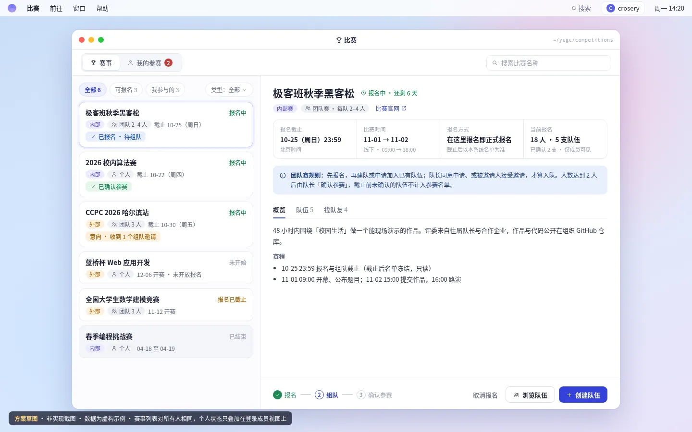
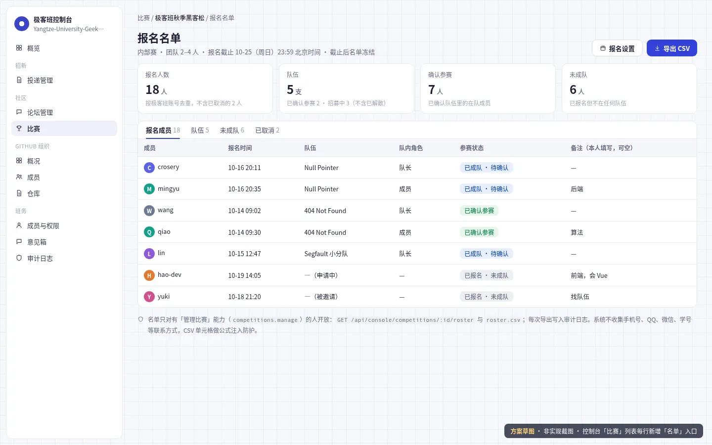
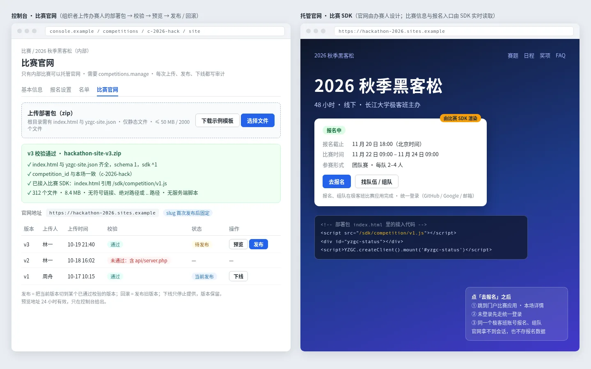
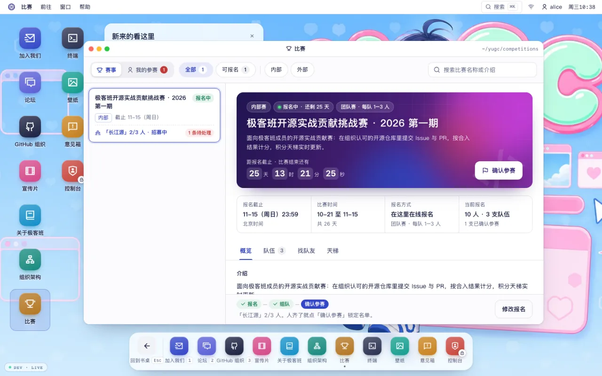
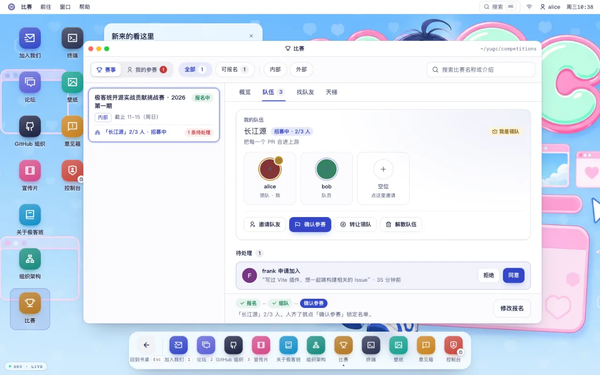
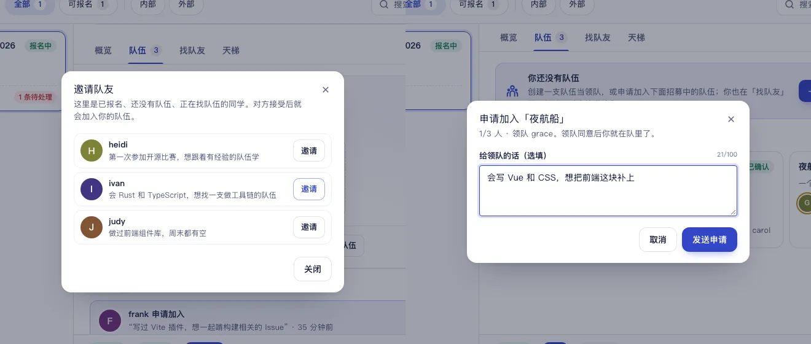
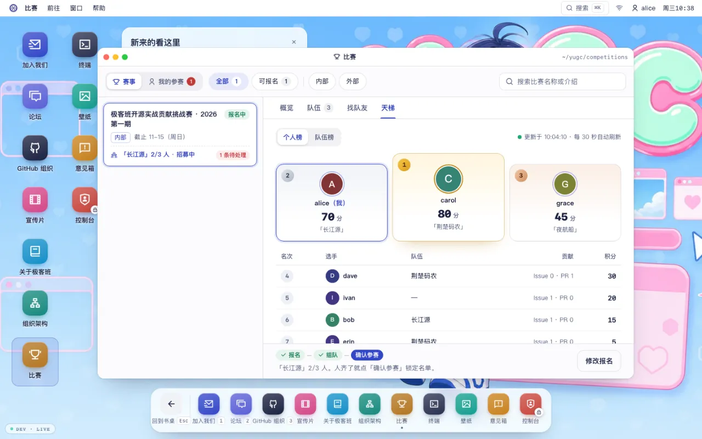
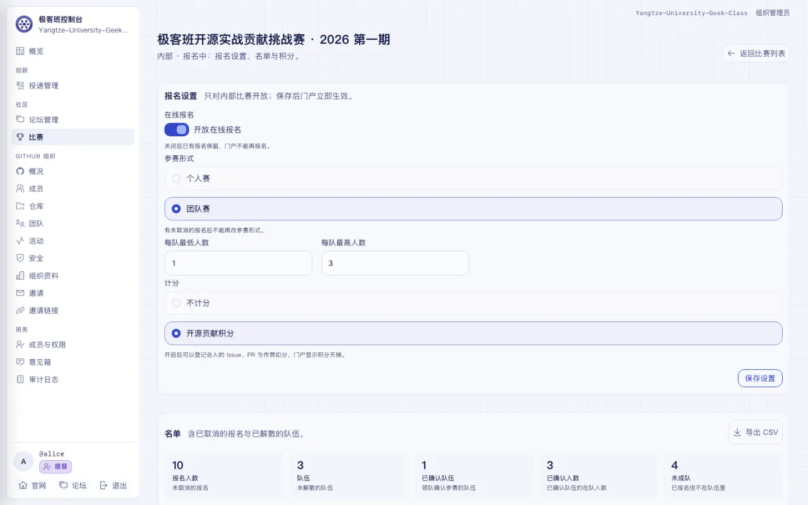
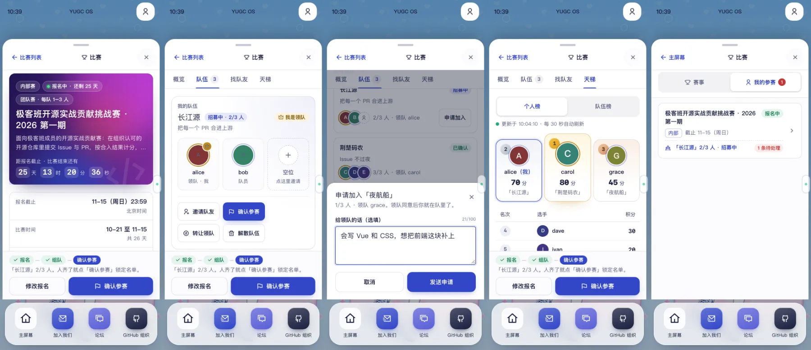

# 比赛应用：报名、组队与我的参赛方案

> #239 的目标方案（未实施）：把官网「比赛」窗口升级为「赛事 / 我的参赛」两个视图的应用——所有人看到同一份赛事，极客班成员在上面叠加自己的报名、组队与参赛状态；参赛者按极客班统一账号（`account_id`）识别，不按 GitHub 账号；同时约定接口、业务规则、数据库草图、控制台报名名单、内部比赛官网托管与 SDK、与统一登录等其他业务的协调，以及与后端草稿 90fc376 的对齐清单。

状态：`accepted`（所有者已接受；报名、组队、我的参赛、名单与积分天梯已由 #239 实施，比赛窗口的浏览部分由 #265 实施；内部比赛官网托管与 SDK 仍待确认、未实施）· 更新：2026-10-21 · 适用：`app/web/sites/portal` 比赛窗口、`app/server` 报名与组队接口及表、`app/console` 报名设置与名单、内部比赛官网托管与比赛 SDK

本文是已采纳的方案：#239 已实施报名、组队、我的参赛、名单、积分天梯与控制台的报名与积分页，#265 已实施比赛窗口的浏览部分；剩余的[内部比赛官网与 SDK](#内部比赛官网与-sdk)仍待确认、未实施。**现行接口与数据以「实施结论」引用的 [server 合同](../services/server/README.md)、[接口行为契约](../services/server/endpoint-contracts.md) 与[数据模型](../services/server/data-model.md) 为准**，下文「接口」「数据库（草图）」保留方案当时的写法，只用于对照。文中图片都是方案时期的草图（静态 HTML 渲染），实现截图见「交付截图」。

## 现状（#238 已有什么）

- 比赛由控制台登记（能力 `competitions.manage`，`app/server/src/lib/roles.ts:87`），官网匿名读 `GET /api/public/competitions`；`competitions` 表（`app/server/src/lib/db.ts:188`）只有赛事信息，没有报名、队伍或成员数据。
- 状态现算：`competitionStatus`（`app/server/src/lib/competition-store.ts:59`）按「已结束 → 报名中 → 进行中 → 未开始 / 报名已截止」判断；**没有报名截止时间的比赛永远不会进入「报名中」**。
- 官网窗口（#265 起）是只读的列表加详情：`CompetitionsApp`（`app/web/sites/portal/components/os/competitions/`，窗口宽 1100），有「全部 / 可报名」快捷筛选、「内部 / 外部」胶囊与搜索，详情有要点三格、介绍、赛程和只放官网按钮的操作条，手机列表点进详情；#238 时是宽 780、只能按「全部 / 内部 / 外部」筛的列表。应用注册在 `app/web/sites/portal/lib/osApps.ts:46`。
- 登录今天只有 GitHub 一种，会话里没有统一账号；所有者 2026-10-19 明确登录改为「长江大学极客班统一登录」，GitHub、Google、邮箱验证码都是绑定到同一账号的登录方式（[ADR-0005](../decisions/0005-sso-extend-core-server.md)，`accepted`，未实施）。
- 缺的是：报名、组队、「我报名了哪些比赛」、待处理的邀请与申请，以及组织者看名单。Yuminghuang738 在 fork 分支 `task/239/competition_signup` 有一版后端草稿（提交 `90fc376`，基于 #243 的旧提交 `a42272d6`），差异见文末[对齐清单](#与后端草稿-90fc376-的对齐清单)；2026-10-19 他按对齐清单重构后开了 [PR #261](https://github.com/Yangtze-University-Geek-Class/admin/pull/261)（目标 `stage`），合并前还要按[与其他业务的协调](#与其他业务的协调)复核。

## 目标、约束与不做

目标：

1. **一个应用，两个视图**：「赛事」是所有人同一份列表与详情；「我的参赛」只属于登录成员——报名了什么、在哪个队、有什么要处理。
2. **报名 → 组队 → 确认参赛**三步在详情底部的操作条上依次完成，任何时刻只给当前能做的主操作。
3. 组织者在控制台按比赛开放报名、设定个人或团队与每队人数，并查看、导出名单。
4. **内部比赛可以有自己的官网**：办赛人交部署包，我们托管；官网通过我们提供的 SDK 读比赛信息，把报名、组队引回比赛应用（同一个统一账号），见[内部比赛官网与 SDK](#内部比赛官网与-sdk)。

约束：

- 规则全部在服务端执行（时间窗口、一人一队、人数上下限、可见性），前端只负责呈现，按钮依据接口返回的可执行操作显示。
- 只新增表，不改 #238 `competitions` 表结构；参赛者按极客班账号 `account_id`（ADR-0005 的 `users.id`）识别，不按 GitHub 登录名或 GitHub id，用哪种方式登录都是同一个人。
- 依赖 ADR-0005 交付第 1 项「统一账号与登录」：会话里有 `account_id` 之后再开放报名，不先做以 GitHub id 为键的过渡版（省掉一次数据迁移，见[待确认](#待所有者确认) 7）。
- 所有状态变化只改状态、记时间和操作人，不物理删除记录。

不做（第一版）：

- 不收集手机号、QQ、微信、邮箱等联系方式；队内沟通走 GitHub 或线下。
- 不做推送、邮件或站内信：应用打开、窗口重新聚焦和每次操作后刷新，「我的参赛」用角标提示待处理数。
- 不替外部比赛办理官网报名，也不做「我已在官网报名」自报（见[待确认](#待所有者确认) 4）。
- 不做跨比赛的个人主页、积分或获奖记录。
- 不托管外部比赛的官网，不运行办赛人的服务端代码，官网里不能直接报名或组队（见[内部比赛官网与 SDK](#内部比赛官网与-sdk)）。

## 结构与呈现

### 桌面：赛事



- 窗口加宽到约 1100px（#265 已加宽）。工具栏左侧是「赛事 / 我的参赛」分段控件，后者带待处理角标；右侧是搜索。
- 左侧列表：「全部 / 可报名 / 我参与的」快捷筛选加类型筛选（内部、外部、个人、团队；官网不用原生下拉框，#265 做成胶囊按钮，先有内部 / 外部，个人 / 团队与「我参与的」随 #239 加）。卡片显示名称、状态、内外部、个人或团队人数、截止日期；登录成员的卡片多一行**我的状态**，如「已报名 · 待组队」「意向 · 收到 1 个组队邀请」。
- 右侧详情：标题与状态、要点四格（报名截止、比赛时间、报名方式、当前报名）、团队赛规则提示，页签「概览 / 队伍 / 找队友」（个人赛只有概览）。
- 底部操作条：左边是三步进度（个人赛只有「报名」一步），右边是当前唯一的主操作与次要操作——未报名时「报名」，已报名未入队时「创建队伍 / 浏览队伍」，队长人数达标时「确认参赛」。截止后操作条只读，显示最终结果。

### 桌面：队伍页签


- 我的队伍置顶：队名、口号、在队成员与空位、招募状态和人数。队长看得到收到的申请（同意 / 拒绝）和自己发出的邀请（可撤回），以及「邀请队友」「确认参赛」。
- 其他队伍只显示在队成员、人数和状态；招募中且未满的队伍有「申请加入」。
- 「找队友」列出已报名、勾选了「在找队伍」且尚未入队的成员和他们自己写的备注，队长可以直接邀请。

### 桌面：我的参赛


- 「待处理」：收到的组队邀请、我当队长的队伍收到的申请，在卡片里直接处理；数量就是分段控件上的角标。
- 「我报名的比赛」：比赛、形式、我的状态（按下文口径）、队伍、截止时间，「打开」回到赛事详情；已结束的保留为历史。

### 手机


沿用现有手机主屏的 sheet：顶部分段控件切换两个视图；在赛事列表点进去推入详情，操作条固定在底部；「我的参赛」把表格换成卡片。390×844 下不得出现横向滚动。

### 控制台：报名设置与名单



- 比赛列表每行加「名单」入口，进入名单页：统计卡（报名人数、队伍、确认参赛、未成队）、页签（报名成员 / 队伍 / 未成队 / 已取消）、「报名设置」和「导出 CSV」。
- 「报名设置」对话框：开放报名、个人或团队、每队人数上下限。没有报名截止时间的比赛不能开放报名。

### 不同身份看到什么

| 身份 | 赛事列表与详情 | 报名人数与队伍 | 操作条 | 我的参赛 |
|---|---|---|---|---|
| 未登录 | 全部可看 | 不显示 | 「登录后可报名」+「统一登录」（进 `/signin?return_to=…`） | 登录提示 |
| 已登录、成员资格待核验 | 全部可看 | 不显示 | 「需要用 GitHub 重新验证成员资格」或「暂时无法核验，请稍后重试」 | 同左 |
| 极客班成员 | 全部可看，卡片带我的状态 | 显示 | 按规则 | 可用 |
| 组织者（`competitions.manage`） | 同成员 | 同成员 | 同成员 | 同成员；名单与导出在控制台 |

按 ADR-0005 决策 4，不是组织成员的人拿不到会话；如果所有者放开建号范围（ADR-0005 待确认 1），非成员账号与「资格待核验」一样只读，提示「报名与组队只对极客班成员开放」。

界面规则沿用现有约定：取消报名、解散、转让、撤销确认要二次确认并在关闭后归还焦点；不可用的操作写明原因，不放点不动的按钮；控制台不用原生下拉框和复选框。

## 业务规则

### 报名设置（组织者）

| 字段 | 取值 | 规则 |
|---|---|---|
| `enabled` | 开 / 关，默认关 | 开启要求比赛有报名截止时间；关闭后已有数据保留，写操作返回 `signup_not_enabled` |
| `participation` | `individual` 个人 / `team` 团队 | 有未取消的报名后不能再改 |
| `team_min` / `team_max` | 1 ≤ min ≤ max ≤ 20，仅团队赛 | max 不能小于任何未解散队伍的在队人数，min 不能大于任何已确认队伍的人数 |

对 #238 现有比赛接口的配套约束：有未取消的报名后不能改「内部 / 外部」；开放报名期间不能清空报名截止时间；有报名记录的比赛不能删除，只能下线。下线后官网整场隐藏（含「我的参赛」）、门户接口返回 404，记录保留，重新上线即恢复。

### 什么时候能写

`可写 = 已开放报名 且 competitionStatus(now) === "registering"`，也就是报名截止前、比赛结束前。报名、取消、建队、申请、邀请、处理、退出、转让、解散、确认与撤销确认**全部**受这一条约束；截止后整场冻结为只读，截止那一刻的状态就是最终名单。未开放时返回 `409 signup_not_enabled`，不在报名中返回 `409 signup_closed`。

### 报名

- 只有极客班成员能报名：统一登录判定为组织 active 成员的账号，不论这次用 GitHub、Google 还是邮箱验证码登录。一人一场一条记录，按 `account_id` 识别。
- 报名可附 200 字以内的备注（极客班成员和组织者都看得到，填写处提示不要写联系方式）；团队赛可勾选「在找队伍」，出现在「找队友」里。
- 重复报名是幂等的：已报名时只更新备注和勾选，已取消时恢复报名。
- 取消报名：普通队员自动退出队伍；队长且队里还有别人时先转让或解散（`409 is_team_leader`）；队伍已确认时先撤销确认（`409 team_locked`）；只有自己一人的队伍随之解散。自己发出和收到的待处理申请、邀请一并关闭。
- 外部比赛的报名在本系统里叫**意向**，用来找人组队和统计，不等于在比赛官网报名；内部比赛的报名就是正式报名。

### 组队（仅团队赛）

- **建队**：须已报名、不在任何队伍。队名 trim 后 2–30 个字符（按 Unicode 字符计，与 #238 比赛名称同口径），同一比赛未解散的队伍不能重名（trim + NFKC + 小写后比较）；口号 60 字以内；建队人即队长。
- **加入只有两条路，都要双方同意**：成员申请（可附 100 字以内的话）后队长同意；或队长邀请已报名、未入队的成员，对方接受。申请人可撤回申请，队长可撤回邀请。
- **一人一队**：同一场比赛一个人最多在一支队伍里。入队成功时，这个人在本场的其他待处理申请和邀请自动关闭。
- **人数**：在队人数不超过 `team_max`；满员时其余待处理申请和邀请自动关闭。
- **退出与解散**：队员可以退出；队长不能直接退出，要先把队长转让给在队成员，或者解散队伍。解散后成员回到「已报名、未入队」。队长移出队员放在 P2。
- **确认参赛（锁定）**：在队人数在 `[team_min, team_max]` 内时队长可以确认；确认后不再接受申请和邀请，成员不能退出或被移出，待处理项自动关闭。截止前队长可以撤销确认回到招募中。截止时没有确认的队伍**不计入参赛名单**（见待确认 1）。

### 个人状态口径

「我的状态」由报名、队伍和比赛类型现算，不单独存储。接口返回 `state`，前端按比赛内外部换成文案：

| 情况 | `state` | 内部比赛 | 外部比赛 |
|---|---|---|---|
| 未报名 | `none` | 未报名 | 未报名 |
| 个人赛已报名 | 内部 `confirmed` / 外部 `signed_up` | **已确认参赛** | 意向 |
| 团队赛已报名、未入队 | `signed_up` | 已报名 · 待组队 | 意向 · 找队伍 |
| 已入队、队伍招募中 | `in_team` | 已成队 · 待确认 | 已成队 |
| 队伍已确认 | `confirmed` | **已确认参赛** | 队伍已确认（以官网报名为准） |
| 截止时未入队或队伍未确认 | `unplaced` | 未成队 · 未计入名单 | 未成队 |

有待处理事项时附在后面，例如「意向 · 收到 1 个组队邀请」。

### 可见性与隐私

- 匿名访客和非成员只看得到赛事信息和报名设置（个人或团队、人数），看不到报名人数、队伍和任何成员（见待确认 3）。
- 极客班成员看得到：统计数字、各队的**在队**成员（账号个人资料里的昵称和头像，昵称旁显示 @用户名；统一资料上线之前是绑定 GitHub 的登录名和头像；不显示 Google 昵称或邮箱）、「找队友」列表和备注。待处理的申请和邀请**只给队长和当事人**，被拒绝、撤回、退出的历史不出现在门户里。
- 组织者在控制台看完整名单（含已取消和历史状态）；导出 CSV 写审计 `competition.roster.export`（比赛 id 与导出行数），单元格沿用 `csvCell`（`app/server/src/routes/console/applications.ts:32`）防公式注入。
- 门户的自助操作不写审计日志，靠行内的时间与操作人追溯；报名设置的修改与 #238 的比赛写入一样，与审计在同一事务里。

### 统计口径

| 数字 | 口径 |
|---|---|
| 报名人数 | 未取消的报名数（外部赛叫「意向人数」） |
| 队伍 | 未解散的队伍数；其中「已确认」为已锁定的队伍 |
| 确认参赛人数 | 内部个人赛 = 报名人数；团队赛 = 已确认队伍的在队人数之和；外部赛叫「队伍已确认人数」，不出现在个人赛 |
| 未成队 | 团队赛中已报名、不在任何队伍的人数 |

## 接口

> 本节是方案当时的接口表；已实施的部分与实现有出入（新增单场公开接口与天梯，积分相关接口不在当初的拆包里），现行契约以 [接口行为契约](../services/server/endpoint-contracts.md)「比赛报名、组队与积分」与 [API](../architecture/API.md) 为准。

除 `GET /api/public/competitions`（及官网用的[单场接口](#内部比赛官网与-sdk)）保持匿名可读外，门户接口都要求登录（`401 not_signed_in`）且是极客班成员（`403 not_member`）；成员资格由统一登录的资格校验给出（ADR-0005 决策 6，草稿里的 `requireOrgMember` 改为调用它），比赛模块不自己查 GitHub，资格待核验或暂不可用时原样返回 `403 membership_verification_required`、`503 membership_unavailable`；写接口每人每分钟 60 次。比赛、队伍或成员关系不存在，或比赛已下线，一律 404。「相对草稿」一列对照 90fc376。

| 方法与路径 | 谁 | 作用 | 相对草稿 |
|---|---|---|---|
| `GET /api/public/competitions` | 匿名 | 每场比赛增加 `signup: { enabled, participation, team_min, team_max }`，不含人数 | #238 接口加字段 |
| `GET /api/me/competitions` | 成员 | 我报名的比赛（状态、队伍）+ 待处理列表与数量，供「我的参赛」和角标 | 新增 |
| `GET /api/competitions/:id/my-status` | 成员 | 我在这场的报名、队伍、待处理、`state`、可执行操作和本场统计 | 沿用，改按 account_id |
| `POST /api/competitions/:id/signup` | 成员 | 报名或更新 `{ note?, looking_for_team? }`，幂等 | 调整：去掉 contact |
| `DELETE /api/competitions/:id/signup` | 成员 | 取消报名（规则见上） | 调整：改状态不删行 |
| `GET /api/competitions/:id/teams` | 成员 | 未解散队伍、在队成员与人数；队长额外看到本队待处理项 | 调整：不给他人待处理与被拒记录 |
| `GET /api/competitions/:id/free-agents` | 成员 | 已报名、在找队伍、未入队的人和备注 | 新增 |
| `POST /api/competitions/:id/teams` | 成员 | 建队 `{ name, slogan? }`；个人赛返回 `409 individual_competition` | 调整：去掉 maxMembers，不隐式报名 |
| `POST /api/teams/:id/apply` | 成员 | 申请加入 `{ message? }` | 沿用，不隐式报名 |
| `POST /api/teams/:id/invite` | 队长 | 邀请 `{ account_id }`，对方须已报名本场且未入队 | 调整：不再收 login |
| `POST /api/teams/:id/respond` | 队长或当事人 | `{ membership_id, action: accept \| decline \| withdraw }` | 调整：校验归属与角色，reject 改为 decline |
| `POST /api/teams/:id/leave` | 队员 | 退出；队长返回 `409 is_team_leader` | 调整：队长退出不再等于解散 |
| `POST /api/teams/:id/transfer` | 队长 | 转让队长 `{ account_id }` | 新增 |
| `DELETE /api/teams/:id` | 队长 | 解散 | 新增 |
| `POST /api/teams/:id/lock`、`DELETE /api/teams/:id/lock` | 队长 | 确认参赛、撤销确认 | 新增 |
| `PATCH /api/teams/:id`（P2） | 队长 | 改队名、口号 | 新增 |
| `DELETE /api/teams/:id/members/:account_id`（P2） | 队长 | 移出队员 | 新增 |
| `PUT /api/console/competitions/:competition_id/signup-settings` | `competitions.manage` | 报名设置，写审计 | 新增 |
| `GET /api/console/competitions/:competition_id/roster` | `competitions.manage` | 设置、统计、全部报名与队伍（含已取消） | 调整：去 contact，按 account_id |
| `GET /api/console/competitions/:competition_id/roster.csv` | `competitions.manage` | 导出名单，写审计 | 调整：去 contact 列，加审计 |
| `PATCH`、`DELETE /api/console/competitions/:competition_id` | `competitions.manage` | #238 现有接口，加上「报名设置」一节的配套约束 | #238 接口加校验 |

主要响应形状（字段名为建议，实施时以 `contracts.ts` 的 Schema 为准）：

```ts
type State = "none" | "signed_up" | "in_team" | "confirmed" | "unplaced";
type Member = { account_id: string } & ProfileCard;  // ProfileCard（handle、display_name、avatar）见统一登录规格「接口」，读取时取统一资料
type PendingItem = {
  membership_id: string;
  type: "applied" | "invited";
  direction: "incoming" | "outgoing";      // 等我处理 / 我发出、等对方处理
  team: { id: string; name: string; member_count: number };
  user: Member;                             // 对方：邀请我的队长，或申请加入我队的人
  message: string;
  created_at: number;
};

// GET /api/competitions/:id/my-status
type MyStatus = {
  writable: boolean;                        // 已开放报名且在报名中
  state: State;
  signup: { note: string; looking_for_team: boolean; created_at: number } | null;
  team: { id: string; name: string; status: "recruiting" | "locked"; role: "leader" | "member"; member_count: number } | null;
  pending: PendingItem[];
  actions: string[];                        // 当前可执行操作，如 signup、cancel_signup、create_team、lock、unlock
  stats: { signups: number; teams: number; confirmed_teams: number; confirmed_participants: number; unplaced: number };
};

// GET /api/competitions/:id/teams
type Teams = {
  teams: {
    id: string; name: string; slogan: string;
    status: "recruiting" | "locked";
    leader: Member;
    members: (Member & { role: "leader" | "member" })[];  // 只含在队成员
    member_count: number;
    my_relation: "none" | "applied" | "invited" | "member" | "leader";
    can_apply: boolean;
    pending?: PendingItem[];                // 只有本队队长能看到
  }[];
};

// GET /api/me/competitions
type MyCompetitions = {
  pending_count: number;                    // 只数 incoming
  pending: (PendingItem & { competition: { id: string; name: string } })[];
  competitions: { competition: PublicCompetition; state: State; team: MyStatus["team"]; signed_up_at: number }[];
};
```

错误码（`{ error }` 形状与现有接口一致）：

| 状态码 | `error` | 场景 |
|---|---|---|
| 400 | 字段级错误，如 `bad_note`、`bad_team_name`、`bad_slogan`、`bad_team_size` | 输入不合法 |
| 401 | `not_signed_in` | 未登录 |
| 403 | `not_member`、`membership_verification_required`、`not_team_leader`；控制台沿用 `requireCapability` | 不是极客班成员；成员资格需用 GitHub 重新验证（ADR-0005）；非队长做队长操作；缺能力 |
| 404 | `not_found` | 比赛、队伍、成员关系不存在，比赛已下线，或成员关系不属于路径上的队伍 |
| 409 | `signup_not_enabled`、`signup_closed` | 未开放报名；不在报名中 |
| 409 | `not_signed_up`、`individual_competition` | 需要先报名；个人赛不能建队 |
| 409 | `already_in_team`、`already_applied`、`already_invited`、`invitee_not_signed_up`、`target_not_member` | 本人或对方已在队；已有待处理申请或邀请；被邀请人未报名本场；对方账号已停用或已不是成员（见[成员资格与权限](#成员资格与权限)） |
| 409 | `team_full`、`team_too_small`、`team_locked`、`duplicate_team_name` | 满员；人数不够不能确认；已确认不能变更；队名重复 |
| 409 | `is_team_leader`、`invalid_state` | 队长须先转让或解散；申请或邀请已被处理 |
| 409 | `competition_has_signups`、`signup_deadline_required`、`team_size_conflict` | 控制台：有报名后改类型或删除；开放报名缺截止时间；改人数会让现有队伍越界 |
| 429 | 沿用现有限流 | 写操作超限 |
| 503 | `membership_unavailable` | 成员资格暂时查不到（ADR-0005），可重试 |

## 数据库（草图）

> 本节是方案当时的表草图；实现多了 `competition_score_events`，并且报名设置多了 `scoring`、`updated_by` 允许为 NULL，现行结构以 [数据模型](../services/server/data-model.md) 为准。

只新增表，不改 #238 的 `competitions`：报名设置单独一张 1:1 表，没有行就是未开放报名，旧数据行为不变，回滚也不用动表。所有写操作在 `db.transaction` 里重新读状态再写，唯一索引兜底并发，冲突映射为对应的 409。主键沿用 `randomUUID()`，时间为毫秒时间戳，外键依赖已开启的 `foreign_keys = ON`。

```sql
CREATE TABLE IF NOT EXISTS competition_signup_settings (
  competition_id TEXT PRIMARY KEY REFERENCES competitions(id) ON DELETE CASCADE,
  enabled INTEGER NOT NULL DEFAULT 0 CHECK (enabled IN (0, 1)),
  participation TEXT NOT NULL CHECK (participation IN ('individual', 'team')),
  team_min INTEGER,
  team_max INTEGER,
  updated_at INTEGER NOT NULL,
  updated_by TEXT NOT NULL REFERENCES users(id),  -- 操作人的 account_id
  CHECK ((participation = 'individual' AND team_min IS NULL AND team_max IS NULL)
      OR (participation = 'team' AND team_min IS NOT NULL AND team_max IS NOT NULL
          AND team_min BETWEEN 1 AND 20 AND team_max BETWEEN team_min AND 20))
);

CREATE TABLE IF NOT EXISTS competition_signups (
  id TEXT PRIMARY KEY,
  competition_id TEXT NOT NULL REFERENCES competitions(id) ON DELETE CASCADE,
  account_id TEXT NOT NULL REFERENCES users(id),  -- 极客班账号（ADR-0005）：身份键
  status TEXT NOT NULL CHECK (status IN ('active', 'cancelled')),
  looking_for_team INTEGER NOT NULL DEFAULT 0 CHECK (looking_for_team IN (0, 1)),
  note TEXT NOT NULL DEFAULT '' CHECK (length(note) <= 200),
  created_at INTEGER NOT NULL,
  updated_at INTEGER NOT NULL,
  cancelled_at INTEGER,
  UNIQUE (competition_id, account_id)
);
CREATE INDEX IF NOT EXISTS idx_competition_signups_account ON competition_signups(account_id);

CREATE TABLE IF NOT EXISTS competition_teams (
  id TEXT PRIMARY KEY,
  competition_id TEXT NOT NULL REFERENCES competitions(id) ON DELETE CASCADE,
  name TEXT NOT NULL,
  name_key TEXT NOT NULL,                   -- trim + NFKC + 小写，用于查重
  slogan TEXT NOT NULL DEFAULT '',
  leader_account_id TEXT NOT NULL REFERENCES users(id),
  status TEXT NOT NULL CHECK (status IN ('recruiting', 'locked', 'disbanded')),
  locked_at INTEGER,
  disbanded_at INTEGER,
  created_at INTEGER NOT NULL,
  updated_at INTEGER NOT NULL
);
CREATE UNIQUE INDEX IF NOT EXISTS uq_competition_teams_name
  ON competition_teams(competition_id, name_key) WHERE status <> 'disbanded';
CREATE INDEX IF NOT EXISTS idx_competition_teams_competition ON competition_teams(competition_id, status);

CREATE TABLE IF NOT EXISTS competition_team_members (
  id TEXT PRIMARY KEY,                      -- 即 membership_id
  team_id TEXT NOT NULL REFERENCES competition_teams(id) ON DELETE CASCADE,
  competition_id TEXT NOT NULL REFERENCES competitions(id) ON DELETE CASCADE,
  account_id TEXT NOT NULL REFERENCES users(id),
  role TEXT NOT NULL CHECK (role IN ('leader', 'member')),
  status TEXT NOT NULL CHECK (status IN
    ('applied', 'invited', 'active', 'declined', 'withdrawn', 'left', 'removed', 'disbanded')),
  message TEXT NOT NULL DEFAULT '' CHECK (length(message) <= 100),
  created_by TEXT NOT NULL REFERENCES users(id),  -- 发起人的 account_id
  decided_by TEXT REFERENCES users(id),
  created_at INTEGER NOT NULL,
  decided_at INTEGER,
  updated_at INTEGER NOT NULL
);
-- 一人一队：同一场比赛只能有一条在队记录
CREATE UNIQUE INDEX IF NOT EXISTS uq_team_members_active
  ON competition_team_members(competition_id, account_id) WHERE status = 'active';
-- 同一支队伍对同一个人只能有一条待处理记录；处理完的历史行保留，可以再次申请
CREATE UNIQUE INDEX IF NOT EXISTS uq_team_members_pending
  ON competition_team_members(team_id, account_id) WHERE status IN ('applied', 'invited');
CREATE INDEX IF NOT EXISTS idx_team_members_team ON competition_team_members(team_id, status);
CREATE INDEX IF NOT EXISTS idx_team_members_account ON competition_team_members(account_id, status);
```

迁移与回滚：

- 启动时 `CREATE TABLE IF NOT EXISTS` / `CREATE INDEX IF NOT EXISTS`，与 `db.ts` 现有做法一致；`tests/server/legacy-database.test.ts` 补「没有这四张表的旧库」重启用例。
- 身份键是会话里的极客班账号 `account_id`（ADR-0005：128 位随机、永不复用）。GitHub 改名、改用 Google 或邮箱验证码登录都还是同一个人；昵称和头像读取时取账号的统一资料，比赛表不存名字或头像快照，被别人复用的旧 GitHub 登录名也认领不到记录。
- 这几张表引用 `users(id)`，所以排在 ADR-0005 第 1 项之后建表。账号合并（ADR-0005 的 `POST /api/identity/merge`）时在同一事务里把这几张表的 `account_id` 改到目标账号；同一场比赛两边都有报名或在队记录时合并回 409，由本人先取消其中一边。
- 回滚运行代码时保留新表和数据（旧代码不读），不删数据，不移动发布 tag。

## 与其他业务的协调

报名组队是第一个建在统一登录之上的新业务，跨业务口径以[统一登录实施规格](./UNIFIED-LOGIN.md)（`accepted`，未实施）的[统一口径](./UNIFIED-LOGIN.md#统一口径)为准，本节是它落到比赛上的细则；两份方案任何一份改口径，另一份同步改。[PR #261](https://github.com/Yangtze-University-Geek-Class/admin/pull/261) 写在本节之前，合并前按本节逐条复核。

### 认人与登录

- **身份键只用会话里的极客班 OpenID**：统一登录交付 1 起会话带 `account_id`（即 `users.id`）。四张表里的 `account_id`、`leader_account_id`、`created_by`、`decided_by`、`updated_by` 都写它，`REFERENCES users(id)` 保留。
- **不兜底**：会话里没有 `account_id` 时，不能退回 `login`、GitHub 数字 id 或邮箱。GitHub 登录名可以改，旧名还能被别人注册，按登录名记的报名和队长身份会落到新主人手里。交付 1 合并前这些路由不注册（[交付拆分](#交付拆分)第 2 条）；所有者如果选[待确认](#待所有者确认) 7 的过渡方案，也只能临时用 GitHub 数字 id（`session.user_id`），统一账号落地时回填。
- **不自己接登录**：操作条的「统一登录」去 `/signin?return_to=<当前页面的同源路径>`，`return_to` 的规则见规格的[回跳与失败结果](./UNIFIED-LOGIN.md#回跳与失败结果)；比赛模块不接 OAuth，也不存渠道账号或令牌。任何一端退出后，比赛接口一律回 `401 not_signed_in`。
- **昵称与头像**：队伍成员与名单按 `account_id` 批量取 `ProfileCard`（昵称、@用户名、头像），和官网、论坛、控制台显示同一份资料（规格的[统一资料](./UNIFIED-LOGIN.md#统一资料交付-4)），本人在 `/account/profile` 改了，比赛里下一次请求就是新的。统一资料上线之前，同样的形状里填绑定 GitHub 的登录名和头像，接口形状不变。不显示 Google 昵称和邮箱；比赛表不存名字或头像快照，名单 CSV 用导出那一刻的昵称和用户名。

### 成员资格与权限

| 接口 | 交付 1（只有 GitHub 会话） | 交付 2 起（多了邮箱、Google 会话） |
|---|---|---|
| 门户报名组队（读和写） | 共享守卫内部调 `resolveAccess(req)`（`middleware/require-capability.ts:12`：本人 token 查组织角色，缓存 60 秒），`orgRole` 为空回 `403 not_member`；GitHub 拒绝本次会话的 token 时照旧回 `401 session_expired` | 同一个守卫改问 `lib/membership.ts`：`active` 放行，`pending`、`not_member` 回 `403 not_member`，`verification_required` 回 `403 membership_verification_required`，`unavailable` 回 `503 membership_unavailable`；不自己降级或放行 |
| 控制台报名设置、名单与导出 | `requireCapability("competitions.manage")`，与 #238 相同 | 不变：称号能力与登录方式无关 |

- 成员判断只写一个共享守卫（例如 `middleware/require-member.ts`），比赛路由只挂它，不在路由文件里直接调 `access.orgRole`；交付 2 只改这一处。
- 比赛的门户与控制台接口只看「是谁」和称号能力，**比赛模块自己不调用 GitHub**：邮箱、Google 会话照常可用，不回 `403 github_session_required`，项目地图里归「只看身份」一类。
- 组织者在门户里也是普通成员，`competitions.manage` 不能绕过时间窗口、一人一队和队长规则。队长、当事人是行级角色，服务端按记录判断（`403 not_team_leader`、`404 not_found`）。
- 被邀请人、被同意的申请人和新队长必须仍是成员，否则回 `409 target_not_member`。这条判断也只写在共享成员守卫里，比赛路由不读 `users` 的列：交付 2 起调资格模块的按账号查询（规格的[成员资格](./UNIFIED-LOGIN.md#成员资格交付-2)），只有 `active` 放行；交付 2 之前守卫按同一规则先实现，`users.status` 与 `org_state` 都是 `active` 才放行，`unknown` 也不放行。都不为此调用 GitHub；交付 2 之前 `org_state` 只会是 `active`，这条实际只挡停用的账号。

### 账号事件

各业务不监听账号事件，下一次请求自然生效（规格的[账号事件对各业务的影响](./UNIFIED-LOGIN.md#账号事件对各业务的影响)）。落到比赛：

| 事件 | 报名与队伍 | 门户 | 控制台名单 |
|---|---|---|---|
| GitHub 改名 | 不变（按 `account_id`） | 读取时显示新名字 | 同左 |
| 绑定、解绑邮箱或 Google，换方式登录 | 不变 | 不变 | 不变 |
| 资格需重新验证、暂时查不到（交付 2 起） | 不变 | 本人只读，写操作回 403、503 | 不标记 |
| 被确认移出组织、邀请撤回 | 保留：不自动取消报名、不自动退队 | 本人会话已撤销；其他成员照常看到他在队里 | 标「已不是成员」（资格模块的按账号查询） |
| 账号停用 | 同上 | 同上 | 标「已停用」（读取时从账号取状态） |
| 账号合并（不在本期） | 按[数据库草图](#数据库草图)末尾的合并规则：同一事务改到目标账号，同一场比赛两边都有记录时回 409 | — | — |

- 队长失效时，队伍停在当前状态：招募中的队伍没人能同意申请、发邀请或确认，其他队员可以退出，截止时没确认就按「未成队」计；已确认的队伍照常计入名单。
- 第一版不做组织者在控制台代为转让队长、移出队员或取消报名（[待确认](#待所有者确认) 8），组织者看名单标记线下处理。

### 审计与留痕

- 沿用 `storage.audit`：`actor` 写 GitHub 登录名，统一登录交付 1 起同时写 `actor_account_id`（规格的[审计与留痕](./UNIFIED-LOGIN.md#审计与留痕)）。
- #238 已有 `competition.create`、`competition.update`、`competition.delete`（`routes/console/competitions.ts:47`、`:68`、`:84`）。#239 新增两种：`competition.signup_settings.update`，`details` 写改动前后的 `enabled`、`participation`、`team_min`、`team_max`，与设置写入同一事务，审计失败一起回滚；`competition.roster.export`，目标是比赛 id，`details` 为 `{ count }`，审计写成功才返回文件，限流同 `application.export`（每分钟 5 次）。
- `details` 不写备注、留言和队名原文。门户自助操作不写 `audit_logs`，也不写 `identity_audit`（那是本人的账号操作），靠行内时间与操作人追溯。

### 不集成

不建论坛帖子或版块；不发邮件、站内信（第一版不做通知）；与招新投递、意见箱没有数据往来，投递邮箱也不是登录方式；不建 GitHub team，不发组织邀请。

### 项目地图、文档与宏观对齐

新流程登记在 `docs/architecture/catalog/ownership.json` 的 `competitions` 域（字段照现有 `competition.create`），`tables` 加四张新表，`tableNotes` 去掉「报名组队尚未实现」，再 `pnpm catalog:generate`。门户流程的 `relatedDomains` 至少有 `identity`、`platform`；控制台流程与 `competition.create` 相同（`identity`、`organization`、`audit`、`platform`）。

| 流程 id（建议） | 操作 |
|---|---|
| `competition.me.list` | `GET /api/me/competitions` |
| `competition.my_status` | `GET /api/competitions/:id/my-status` |
| `competition.signup.upsert`、`competition.signup.cancel` | `POST`、`DELETE /api/competitions/:id/signup` |
| `competition.teams.list`、`competition.free_agents.list` | `GET /api/competitions/:id/teams`、`/free-agents` |
| `competition.team.create` | `POST /api/competitions/:id/teams` |
| `competition.team.apply`、`invite`、`respond`、`leave`、`transfer` | `POST /api/teams/:id/apply`、`/invite`、`/respond`、`/leave`、`/transfer` |
| `competition.team.disband` | `DELETE /api/teams/:id` |
| `competition.team.lock`、`competition.team.unlock` | `POST`、`DELETE /api/teams/:id/lock` |
| `competition.signup_settings.update` | `PUT /api/console/competitions/:competition_id/signup-settings` |
| `competition.roster.read`、`competition.roster.export` | `GET /api/console/competitions/:competition_id/roster`、`/roster.csv` |

已有流程改 `invariants`：`competition.public.list`（多 `signup` 字段，不含人数），`competition.update` 和 `competition.delete`（[报名设置](#报名设置组织者)一节的配套约束）。

同一个 PR 里同步 `docs/services/server/`（`README.md`、`endpoint-contracts.md`、`data-model.md`）、`docs/services/web/portal.md`、`docs/services/console/README.md`、`docs/architecture/API.md` 和 `SECURITY.md`（报名数据的可见范围），各自的「更新：」改成当天。`docs/changes/239.json` 写 `kind: "business"`，八个维度至少写清：

| 维度 | 写清什么 |
|---|---|
| business | 报名、组队、我的参赛、名单四段业务；外部赛只是意向 |
| backend | 新接口与 Schema；`GET /api/public/competitions` 加字段；#238 的 PATCH、DELETE 加约束 |
| permissions | 不新增能力（待确认 2 选新能力时改写）；成员守卫与队长、当事人的行级校验 |
| data | 只新增四张表，不改 `competitions`；外键引用 `users(id)`；旧库重启用例 |
| dependencies | 依赖统一登录交付 1（会话 `account_id`、`users` 表）；不新增包、凭据和第三方服务 |
| documentation | 上一段的服务合同与项目地图 |
| verification | [验证与验收](#验证与验收)的四类测试与人工验收 |
| delivery | 仍由 server、web 镜像交付，不新增运行单元和环境变量 |

### 实施顺序（#239 的 PR 内）

1. 确认目标分支已有统一登录交付 1（会话有 `account_id`，`users` 表存在）；没有就停在这里，不做兜底。
2. 建表与 store：写操作都在 `db.transaction` 里重读再写，唯一索引兜底并发，冲突映射成 409。
3. 共享成员守卫与门户路由，错误码与限流按[接口](#接口)。
4. 控制台报名设置、名单与导出，审计与写入同一事务。
5. portal 比赛应用与控制台名单页。
6. 项目地图、服务合同、`docs/changes/239.json` 与测试，最后跑 `pnpm check` 与 e2e。

## 内部比赛官网与 SDK

所有者 2026-10-19 补充：内部比赛可以有自己的比赛官网，由我们部署；办赛人提供部署包，部署包必须对接我们的比赛接口，所以要提供 SDK 和文档。做法：官网只做展示，比赛信息和报名入口由 SDK 从我们的接口实时读取；报名、组队仍在比赛应用里完成（同一套统一登录、同一个极客班账号），官网不存报名数据，也拿不到登录会话。



**部署包**（办赛人交付；第一版由有 `competitions.manage` 的组织者在控制台上传，见[待确认](#待所有者确认) 10）：

- 只有 `kind = 'internal'` 的比赛能托管官网；外部比赛仍只填 `url` 指向对方官网。
- 一个 zip，解压后根目录必须有 `index.html` 和 `yzgc-site.json`：`{ "schema": 1, "competition_id": "<比赛 id>", "sdk": "^1" }`，`competition_id` 必须与上传到的比赛一致。
- 只放静态文件（HTML、CSS、JS、图片、字体、JSON 等白名单扩展名），解压后合计不超过 50 MB、2000 个文件；拒绝符号链接、绝对路径、含 `..` 的路径和服务端脚本，我们不运行办赛人的任何服务端代码。
- 必须接入 SDK：至少一个页面引用托管脚本 `/sdk/competition/v1.js`，或打包产物里保留 SDK 的版权注释 `/*! @yzgc/competition-sdk`；比赛名称、时间、状态和「去报名 / 组队」入口都由 SDK 给出，不写死在页面里，组织者发布前在预览里核对。
- 校验不过不保存文件，只留一条「未通过」记录和逐条原因，不能发布；通过后生成新版本和预览地址。

**SDK**：`@yzgc/competition-sdk` v1，出 ESM 与 UMD 两种产物；UMD 由每个官网域名下的 `/sdk/competition/v1.js` 统一提供，随我们发布更新，办赛人不用重新打包。

| 方法 | 作用 |
|---|---|
| `createClient({ competitionId? })` | 创建客户端；不传 `competitionId` 时读站点根目录的 `yzgc-site.json` |
| `getCompetition()` | 读 `GET /api/public/competitions/:id`：名称、内外部、时间、服务端算好的状态和 `signup` 摘要；人数是否返回随[待确认](#待所有者确认) 3 |
| `signupUrl()`、`teamUrl()` | 比赛应用里这场比赛的报名、队伍入口（深链格式随 #239 前端定）；未登录先走统一登录，用哪种方式登录都是同一个账号 |
| `mount(selector, options?)` | 渲染现成的状态卡片（状态、截止时间、参赛形式、去报名 / 组队按钮），不依赖框架，样式可用 CSS 变量覆盖，每 60 秒刷新 |

第一版 SDK 只读加跳转（[待确认](#待所有者确认) 11）：官网在独立域名上，拿不到我们的会话；要在官网里直接报名、组队，得给第三方站点授权登录，属于 ADR-0005 决策 8 的对外授权（OIDC），等它立项再做。

**托管**：

- 每场官网在 `https://<slug>.<官网域名>`。官网域名与主站分开注册（[待确认](#待所有者确认) 9）：会话 cookie `sid` 是 `SameSite=Lax`，并按 `COOKIE_DOMAIN`（`app/server/src/config.ts:89`）在子域间共享，官网若放在主站子域下，办赛人的脚本向主站发的请求会带上访客的会话。
- 反向代理只读提供 `data/competition-sites/<比赛 id>/<版本 id>/`，统一加 `X-Content-Type-Options: nosniff`、`Referrer-Policy: strict-origin-when-cross-origin` 和 CSP（`connect-src` 只放行官网自身和我们的 API，`frame-ancestors` 只放行控制台用于预览），不设任何 cookie。
- 发布就是把当前版本切到某个已通过校验的版本，回滚即发布旧版本，下线只停止提供、版本保留；预览地址 24 小时有效，只在控制台给出。
- 比赛下线时官网同时停止提供，SDK 读到 404；已发布官网的比赛不能改成外部赛（`409 competition_site_published`），先下线官网。
- `slug` 首次发布时确定（小写字母、数字和连字符，3–32 位，全局唯一），发布后不改，避免外链失效。

接口（新增；控制台接口都要 `competitions.manage` 并写审计）：

| 方法与路径 | 谁 | 作用 |
|---|---|---|
| `GET /api/public/competitions/:id` | 匿名 | 单场比赛，字段同列表项，另加 `site_url`、`app_url`；只对已发布官网的源开 CORS（只读、不带 cookie），比赛下线或不存在一律 404 |
| `GET /api/public/competitions` | 匿名 | 已发布官网的比赛多回 `site_url`，门户详情显示「比赛官网」入口 |
| `GET /api/console/competitions/:id/site` | 组织者 | slug、当前版本、版本列表与校验报告 |
| `POST /api/console/competitions/:id/site/versions` | 组织者 | 上传 zip（multipart，沿用 `@fastify/multipart`），校验后存为新版本，回校验报告与预览地址；审计 `competition.site.upload` |
| `POST /api/console/competitions/:id/site/publish` | 组织者 | `{ version_id, slug? }` 发布或回滚，只接受本场已通过校验的版本；审计 `competition.site.publish` |
| `DELETE /api/console/competitions/:id/site` | 组织者 | 下线官网，版本保留；审计 `competition.site.unpublish` |

表（只新增，不改 `competitions`）：

```sql
CREATE TABLE IF NOT EXISTS competition_site_versions (
  id TEXT PRIMARY KEY,
  competition_id TEXT NOT NULL REFERENCES competitions(id) ON DELETE CASCADE,
  status TEXT NOT NULL CHECK (status IN ('passed', 'rejected')),
  sha256 TEXT NOT NULL,             -- zip 摘要，用于核对与去重
  size_bytes INTEGER NOT NULL,
  file_count INTEGER NOT NULL,
  sdk_range TEXT,                   -- yzgc-site.json 里的 sdk，未通过时可能为空
  report TEXT NOT NULL,             -- 校验报告 JSON
  created_at INTEGER NOT NULL,
  created_by TEXT NOT NULL REFERENCES users(id)  -- 上传人的 account_id
);
CREATE TABLE IF NOT EXISTS competition_sites (
  competition_id TEXT PRIMARY KEY REFERENCES competitions(id) ON DELETE CASCADE,
  slug TEXT NOT NULL UNIQUE,
  current_version_id TEXT REFERENCES competition_site_versions(id),  -- NULL 表示未发布或已下线
  updated_at INTEGER NOT NULL,
  updated_by TEXT NOT NULL REFERENCES users(id)  -- 操作人的 account_id
);
```

交付与验收（以截图为准）：

- 交付物：SDK 包（建议放 `app/sdk/competition`，含 ESM、UMD 与类型声明）；接入文档 `docs/services/competition-sdk/README.md`（引入方式、API、部署包格式与校验规则、常见错误）；可直接改的示例模板（控制台上传页提供下载）；控制台 `pages/CompetitionSite.vue`（上传、校验报告、版本、预览与发布）。
- server 测试：坏包逐类拒绝（缺 `index.html` 或 `yzgc-site.json`、`competition_id` 不符、`..` 与符号链接、超限、服务端脚本、外部赛）；发布、回滚、下线及审计；CORS 只对已发布官网的源且不带 cookie。
- SDK 测试：ESM 与 UMD 都能 `getCompetition`、`mount`；接口 404 或网络失败时卡片显示「比赛信息暂不可用」，不留空白。
- e2e：控制台上传示例模板 → 校验报告 → 预览 → 发布 → 打开官网，SDK 卡片显示状态 → 点「去报名」进入比赛应用本场详情（未登录先到统一登录）；1440×900 与 390×844 截图附在实施 PR，没有截图不算验收。

## 前端落点

portal（`app/web/sites/portal`）：

| 位置 | 内容 |
|---|---|
| `components/os/competitions/CompetitionsApp.tsx` | 视图切换、加载与聚焦刷新、身份判断 |
| `components/os/competitions/CompetitionList.tsx`、`CompetitionDetail.tsx` | 列表筛选与搜索；详情和页签 |
| `components/os/competitions/TeamsPanel.tsx`、`FreeAgents.tsx` | 队伍与找队友 |
| `components/os/competitions/MyCompetitions.tsx` | 我的参赛与待处理 |
| `components/os/competitions/ActionBar.tsx` | 三步进度与主操作，按接口返回的 `actions` 渲染 |
| `lib/competition-signups.ts` | 接口调用、响应形状校验、状态文案（与「个人状态口径」表一一对应） |
| `components/os/Windows.tsx` | 比赛窗口改为渲染 `CompetitionsApp`、宽约 1100（#265 已完成）；现有时间、状态与排序逻辑（`lib/competitions.ts` 的 `statusAt`、北京时间格式、60 秒重算）原样复用 |
| `styles/os.css` | 新样式；手机 sheet 复用现有容器 |

console（`app/console`）：`pages/Competitions.vue` 每行加「名单」；新增 `pages/CompetitionRoster.vue`（统计、页签、报名设置对话框、导出）；`router.ts` 加路由；权限沿用 `competitions.manage`。后端合并前可先对 `app/web/shared/lib/mock-api.ts` 与控制台样板开发。

## 验证与验收

实施时补齐（文件名为建议）：

- server `tests/server/competition-signups.test.ts`：真实 HTTP 的 401/403/404；时间窗口（未开放、截止前后、已结束）；报名幂等与取消联动；建队、申请、邀请、处理、退出、转让、解散、确认的全流程；一人一队与满员的并发兜底；待处理只对队长和当事人可见；统计口径；名单导出的 CSV 注入防护与审计；#238 PATCH 和 DELETE 的新增约束；成员守卫回 `not_member`（交付 2 起加 `membership_verification_required`、`membership_unavailable`），邀请、同意申请、转让给停用、已不是成员或 `org_state` 为 `unknown` 的账号回 `target_not_member`，两条控制台审计带 `actor_account_id`。
- web `tests/web/portal-competition-app.test.tsx`：四种身份的呈现、状态文案表、操作条按 `actions` 渲染、截止后只读、加载失败与空态。
- console `tests/console/competition-roster.test.ts`：报名设置校验与冲突提示、页签与统计、导出。
- e2e `tests/e2e/competition-app.spec.mts`：1440×900 与 390×844 下走完「报名 → 建队 → 邀请 → 接受 → 确认参赛」，手机无横向溢出。
- 人工验收：两个账号在本机隔离服务上让一支队伍从报名走到确认，截止后名单冻结；外部赛只出现「意向 / 队伍已确认」。
- 本文自身只需 `pnpm check:docs` 通过。

## 与后端草稿 90fc376 的对齐清单

| # | 草稿现状 | 方案 | 级别 |
|---|---|---|---|
| 1 | 报名、队伍、成员都以 `github_login` 为键 | 以极客班账号 `account_id` 为键（依赖 ADR-0005 第 1 项），不存登录名快照 | 必改 |
| 2 | 邀请接受任意 `login`，`userId` 由客户端传 | 只收 `account_id`；对方须已报名本场、未入队 | 必改 |
| 3 | 报名只在报名中，但建队、申请、邀请、接受到比赛结束前都能做，建队和申请还会隐式补报名 | 所有写操作统一「已开放报名且报名中」，不隐式报名，截止后冻结 | 必改 |
| 4 | `GET teams` 向所有成员返回待处理和被拒的成员；报名与 CSV 含 `contact` | 只返回在队成员，待处理只给队长和当事人；去掉 contact | 必改 |
| 5 | 队长建队时自填 `maxMembers`（1–20），个人赛也能建队 | 组织者在报名设置里定个人或团队与人数，个人赛不能建队 | 必改 |
| 6 | `respond` 不校验成员关系属于路径上的队伍 | 校验 `membership.team_id === :id`，并按角色限制 accept、decline、withdraw | 必改 |
| 7 | 取消、退出、解散物理删除；队长退出即解散并删除全部成员 | 只改状态、记时间和操作人；队长先转让或显式解散 | 必改 |
| 8 | 内部团队赛把所有报名都算作确认参赛 | 按个人或团队区分口径（见统计口径） | 必改 |
| 9 | 名单导出不写审计 | 写 `competition.roster.export` | 必改 |
| 10 | 满员自动置为 confirmed | 队长在人数达标后显式确认，截止前可撤销 | 建议（待确认 1） |
| 11 | 报名行存 registered / intent | 只存 active / cancelled，意向与否由比赛内外部决定 | 建议 |
| 12 | 状态冲突多返回 400 | 状态冲突统一 409 与稳定错误码，输入错误才 400 | 建议 |
| 13 | 没有「我的参赛」和「找队友」 | 新增 `GET /api/me/competitions`、`GET /api/competitions/:id/free-agents` | 建议 |

## 实施结论（#239，2026-10-21）

已落地：

- **门户比赛应用**：内部比赛在报名中时出现「赛事 / 我的参赛」两个视图；详情有 Hero（渐变、光斑、倒计时、一键直达）、概览（介绍、赛程时间线、参赛与计分规则）、页签（概览 / 队伍 / 找队友 / 天梯）与按接口 `actions` 渲染的底部操作条。报名、修改报名、取消报名、建队、申请、邀请、转让、退出、解散、确认参赛与撤销确认都在窗口内完成；手机是推入式详情，操作条固定在底部。
- **服务端**：`competition-signups.ts` 的门户接口与 `competition-roster.ts` 的控制台接口，`competition-signup-store` 与 `competition-score-store` 承担全部规则；可写窗口统一为「已开放报名且在报名中」，截止后整场只读，截止时的名单就是最终名单。
- **控制台**：`/console/competitions/:id` 的报名设置、五个统计、报名与队伍名单、CSV 导出、积分登记与撤销；入口只在内部比赛那一行。
- **数据**：`competition_signup_settings`、`competition_signups`、`competition_teams`、`competition_team_members`、`competition_score_events` 五张表；启动时写入一期开源贡献赛 `oss-challenge-2026-1`（团队 1–3 人、开启积分），用 `console_seeds` 标记只插一次。

与方案的差异：

- **多了一张积分表与天梯**：方案「不做」里写了不设积分与获奖记录，主线要求加开源贡献积分，于是多了 `competition_score_events`、控制台的积分登记与撤销，以及门户的个人榜与队伍榜（队伍分是在队成员个人分之和，同分并列并跳号）。积分只对开启 `scoring: "contribution"` 的比赛生效，未开启时接口回 409、页面不显示天梯。
- **界面把「队长」叫「领队」**：`tests/web/portal-org.test.ts` 扫描除 `lib/org.ts` 以外的全部官网源码，出现组织称号的默认名（提督、舰长、队长、舰员、领航员、乘客）即失败；「队长」在组织架构里是部门负责人的称号，比赛的队伍负责人因此统一叫「领队」，服务端错误码仍是 `not_team_leader` / `is_team_leader`。本文前半部分保留方案当时的「队长」写法，实现与 [portal 合同](../services/web/portal.md) 一律用「领队」。
- **写操作限流是每人每分钟 30 次**（方案写 60），名单导出每分钟 5 次；读接口不限流。
- **匿名与成员的区别只有两种结果**：没有会话回 401，登录但不是成员回 403 `not_member`。方案里「资格待核验」的 `membership_verification_required` / `membership_unavailable` 属于统一登录交付 2，尚未出现；成员守卫在 `app/server/src/middleware/require-member.ts` 一处，交付 2 落地时只改这里。
- **待处理的可见范围比方案宽一点**：门户把本队收到的申请也下发给在队队员（只有领队有同意、拒绝按钮），方案原文写的是「只给队长和当事人」。服务端仍按记录判断谁能操作，普通队员拿不到按钮之外的权限。
- **截止后待处理行仍会显示**：处理申请与邀请的按钮不受 `actions` 约束，提交时由服务端回 409 `signup_closed` 并在操作条说明；其余写操作在截止后不渲染。
- **单场公开接口已实现**：`GET /api/public/competitions/:id` 现在返回赛事事实与报名摘要，为比赛官网预留，只在成功响应上放开 CORS。

待所有者确认的条目按推荐方案落地（逐条对照代码）：

| 条目 | 落地情况 |
|---|---|
| 1 团队赛保留领队「确认参赛」锁定 | 已保留：`POST /api/teams/:id/lock` 要求人数达到最低人数，`DELETE` 撤销；截止后不可变更，未确认的队伍在「我的参赛」里是「未成队」。 |
| 2 名单权限复用 `competitions.manage` | 已复用：没有新增能力，报名设置、名单、CSV 与积分都按它判定。 |
| 3 匿名不显示报名人数和队伍数 | 已按推荐做：公开接口只给报名摘要，人数、队伍与成员只对成员下发；匿名按要求也看不到单场统计。 |
| 4 外部比赛不做「已在官网报名」自报 | 已按推荐做：没有自报字段，报名只记本人意愿，外部比赛在「我的状态」里落到「意向」；门户只在内部比赛显示在线报名，控制台也只给内部比赛报名设置与积分入口。服务端是否可报名只看报名设置，不按内外部拦截。 |
| 8 第一版不做组织者代办 | 已按推荐做：控制台没有代为转让、移出队员或取消报名，只能看名单。 |
| 9–11 比赛官网托管、独立域名与 SDK | 仍待确认、未实施：没有 `competition_sites` / `competition_site_versions` 表、没有上传与发布接口，也没有 SDK。 |

## 交付截图

以下截图来自本机隔离服务（真实接口与内存数据，比赛是启动时的种子比赛），前五张是门户比赛窗口，最后两张是控制台与手机。桌面在 1440×900 视口下截取窗口区域（输出 1280×800，两个弹窗并排的特写 1320×560），手机是 390×844 视口的五个画面，拼成 1800×779。



桌面详情：Hero 上的类型、状态、参赛形式与倒计时，下面四格要点（报名截止、比赛时间、报名方式、当前报名），底部操作条给出报名 → 组队 → 确认参赛的进度与当前主操作。



队伍页签：领队在前、空位补到每队上限，空位可点邀请；待处理里是收到的一条申请与「拒绝 / 同意」，底部进度说明还差几人才能确认参赛。



两个弹窗：左边是领队按「找队友」名单逐个邀请，右边是向其他队伍申请时写给领队的话（100 字上限与字数计数）。



天梯：前三名上领奖台，第四名起进表格（名次、选手、队伍、Issue 与 PR 数、积分）；右上写更新时刻与每 30 秒自动刷新，我在榜上时整行高亮。


「我的参赛」视图：分段控件带待处理角标，列表只留我报名的比赛；详情照常显示 Hero、四格要点与页签，底部操作条是「修改报名」与确认参赛进度。



控制台 `/console/competitions/oss-challenge-2026-1`：在线报名、参赛形式、每队人数与计分开关，下面是五个统计与「导出 CSV」。



手机：详情 Hero、队伍、申请加入、天梯与我的参赛五个画面拼成一张；详情是推入的，操作条固定在底部，天梯表收起队伍与贡献两列。

## 交付拆分

1. **#243（#238）**：只做比赛信息发布；本方案和草图以 `accepted`（未实施）随它入库，不改报名组队的运行代码。
2. **前置：统一账号**：ADR-0005 第 1 项（#237 方案已确认，候选 1 批准后实施）；统一资料（第 4 项）不是前置，上线之前名单按同一形状显示 GitHub 登录名和头像。在它之前只上线 #238 的赛事浏览。
3. **#239 后端**：Yuminghuang738 按对齐清单调整 90fc376，待 #243 合并、统一账号可用后基于最新 `stage` 开 PR，同步 API、数据模型、接口行为契约和 server 合同。2026-10-19 已提前开 PR #261，合并前按[与其他业务的协调](#与其他业务的协调)复核。
4. **#239 前端**：portal 比赛应用与控制台报名设置、名单（实施人待定；是否另开 `ui:*` issue 由所有者决定）。
5. **内部比赛官网与 SDK**：#239 报名组队上线后做；`GET /api/public/competitions/:id` 可先做。实施人和是否单独立 issue 由所有者决定。
6. 各部分落地后，本文压缩为实施结论，现行契约迁回 `docs/services/*`。

## 待所有者确认

1. 团队赛是否保留队长「确认参赛」锁定。推荐保留：截止前名单就是确定的；不保留则截止时人数达标的队伍自动视为确认。
2. 名单权限复用 `competitions.manage`（推荐），还是新增只读的 `competitions.roster`。
3. 匿名访客不显示报名人数和队伍数（推荐），还是公开这些数字。
4. 外部比赛第一版不做「已在官网报名」自报（推荐），以后需要再加一个本人勾选的标记。
5. 交付顺序与实施人：后端由 Yuminghuang738 调整后先开 PR；前端由谁做、是否拆 issue。
6. 本方案与草图随 #243 入库（当前做法），还是只留在 #239 的讨论里。
7. 如果报名必须先于统一账号上线：临时以 GitHub 数字 id 记录，统一账号落地时按 ADR-0005 的迁移规则回填并切到 `account_id`。不推荐：多一次迁移和一段双口径。
8. 队长或队员被移出组织、账号停用后，第一版不做组织者在控制台代为转让队长、移出队员或取消报名（推荐），组织者按名单标记线下处理；以后需要再加 `competitions.manage` 下的代办操作并写审计。
9. 比赛官网用与主站分开注册的独立域名（推荐，每场 `<slug>.<官网域名>`），还是用主站子域（那样要先把 `sid` 的 cookie 域收窄到具体主机，否则官网脚本发的请求会带上会话）。
10. 第一版由有 `competitions.manage` 的组织者代办赛人上传部署包（推荐），还是给办赛人单独的「比赛官网」权限、只管自己那场。
11. SDK 第一版只读加跳转回比赛应用报名（推荐）；官网里直接报名、组队等 ADR-0005 决策 8 的对外授权（OIDC）立项后再做。

## 来源

- 需求：[issue #239](https://github.com/Yangtze-University-Geek-Class/admin/issues/239)；所有者 2026-10-19 对比赛窗口的反馈：不应只有「内部 / 外部 / 全部」，要做成包含报名信息、组队信息和已报名赛事的应用。
- 官网托管与 SDK：所有者 2026-10-19 补充：内部比赛可以有比赛官网，由我们帮忙部署，办赛人提供部署包，部署包必须对接我们的比赛接口，因此要出 SDK 和相关文档；比赛要有报名、组队；所有内容都要有截图认证。
- 现有实现：`app/server/src/lib/competition-store.ts:59`、`app/server/src/lib/db.ts:188`、`app/server/src/lib/roles.ts:87`、`app/web/sites/portal/components/os/competitions/CompetitionsApp.tsx`（#265；#238 时在 `Windows.tsx`）、`app/web/sites/portal/lib/osApps.ts:46`。
- 后端草稿：fork `Yuminghuang738/admin` 分支 `task/239/competition_signup` 的提交 `90fc376`（基于 `a42272d6`；2026-10-19 重构后开 [PR #261](https://github.com/Yangtze-University-Geek-Class/admin/pull/261)）：`app/server/src/lib/competition-signup-store.ts`、`app/server/src/routes/portal/competition-signups.ts`、`app/server/src/routes/console/competition-roster.ts`。
- 身份：[ADR-0005](../decisions/0005-sso-extend-core-server.md)（`accepted`，未实施；PR #242）；所有者 2026-10-19：「我们的登录不再是github登录了，是长江大学极客班统一登录的」，GitHub、Google、邮箱验证码都绑定到同一个极客班账号；跨业务口径见[统一登录实施规格](./UNIFIED-LOGIN.md)（`accepted`，未实施）；统一资料来自所有者同日的「全局的头像还有相关的信息比赛，首页，管理后端，论坛都是用一套的，而且可以同步的更改」。
- 草图：`docs/assets/competition-app/*.webp`，由静态 HTML 渲染，数据虚构。