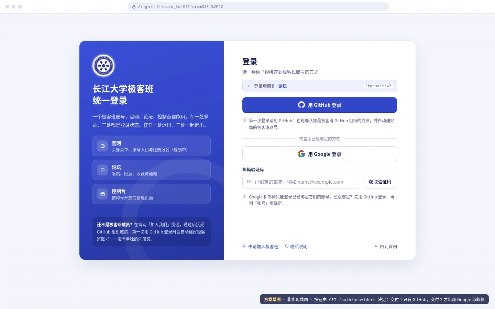
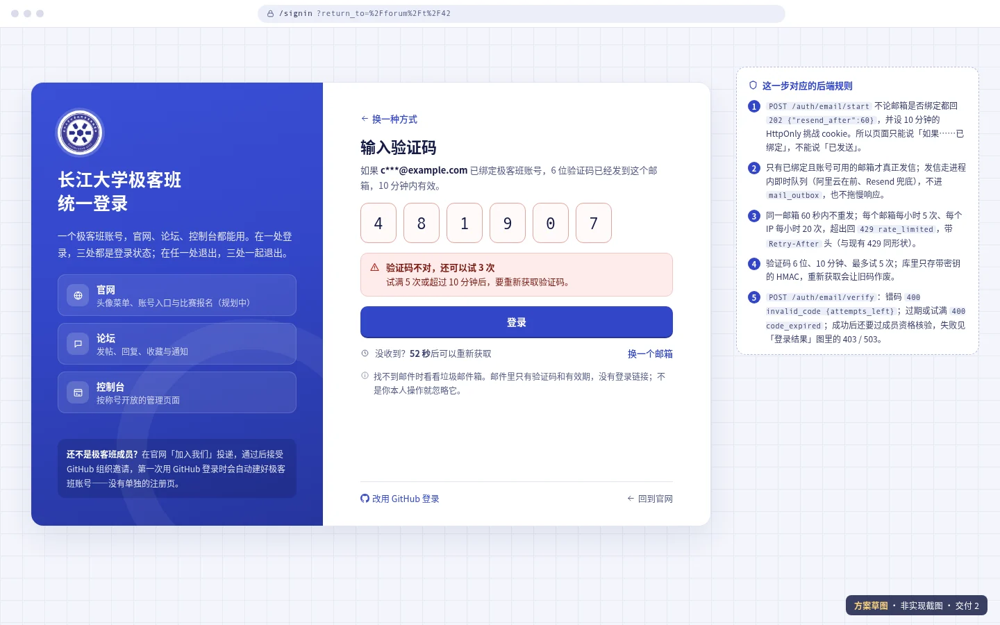
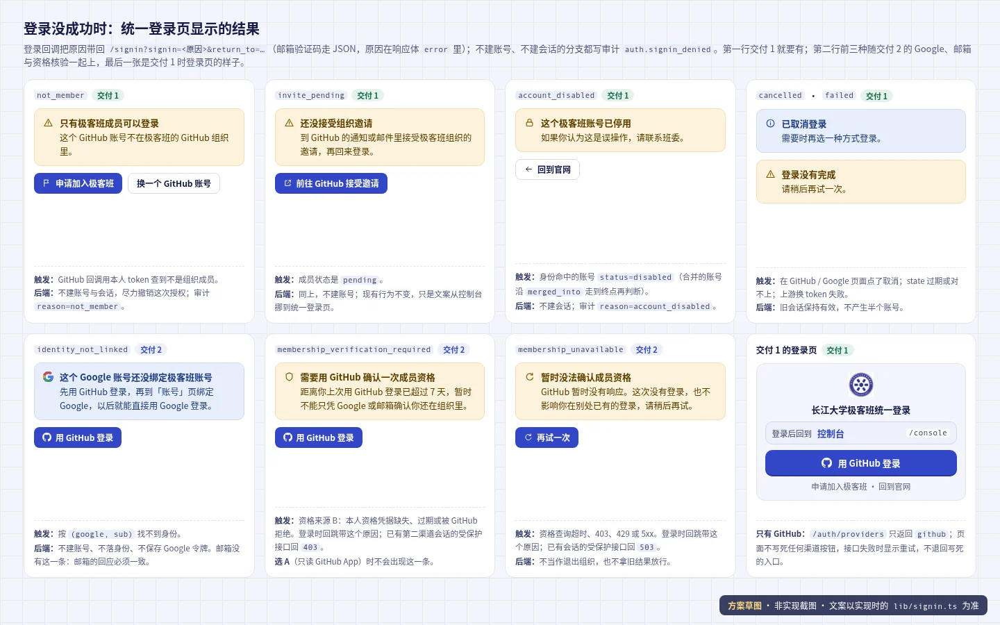
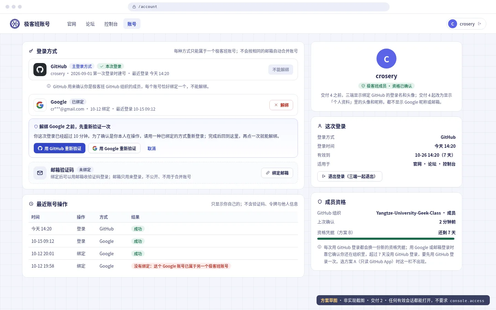
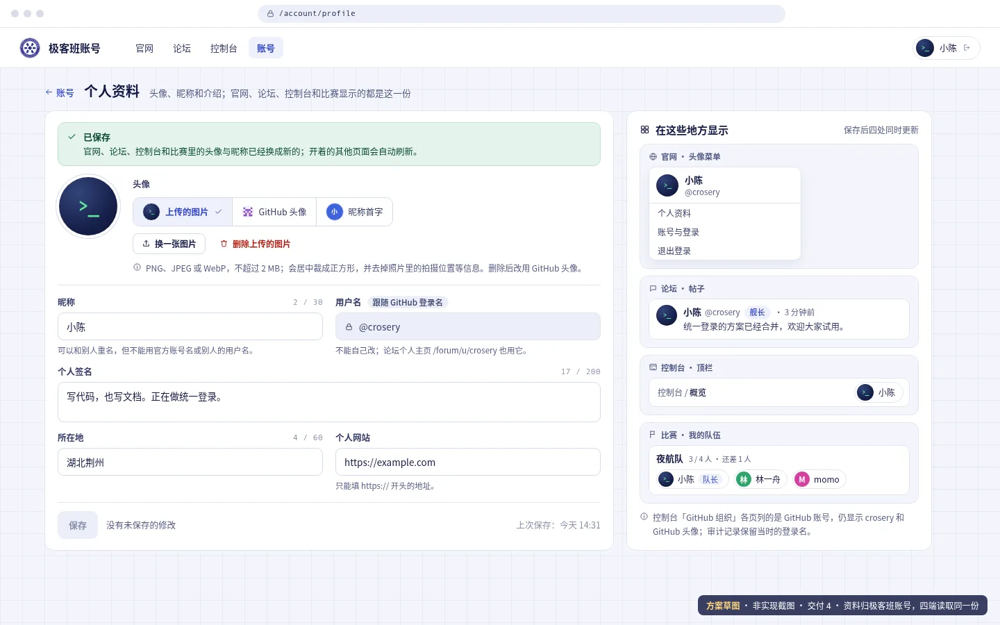
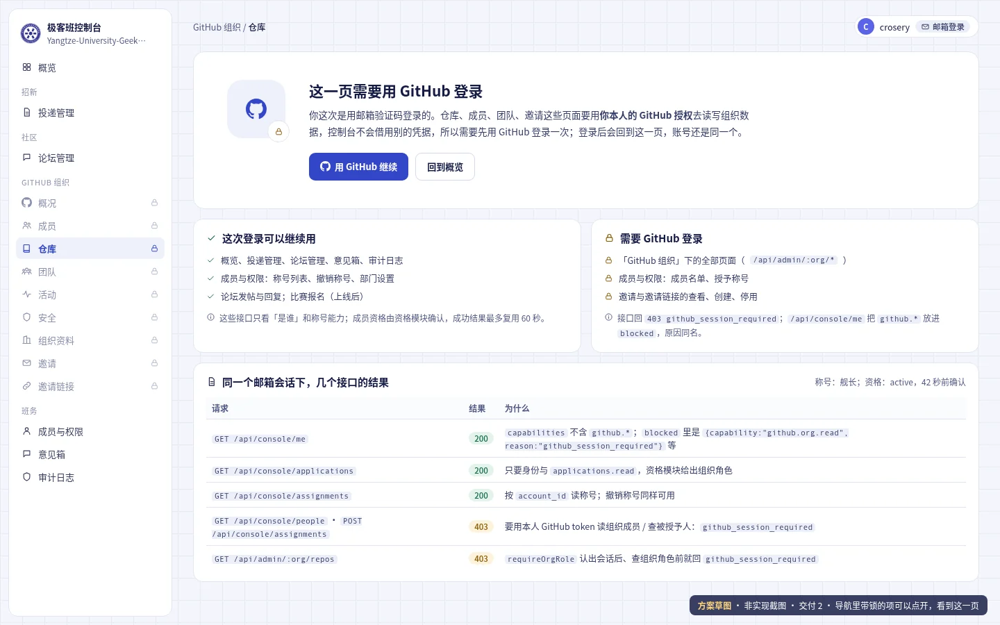
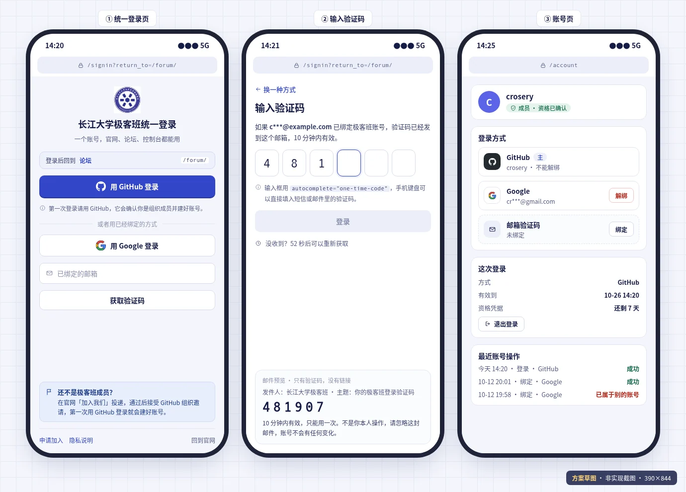
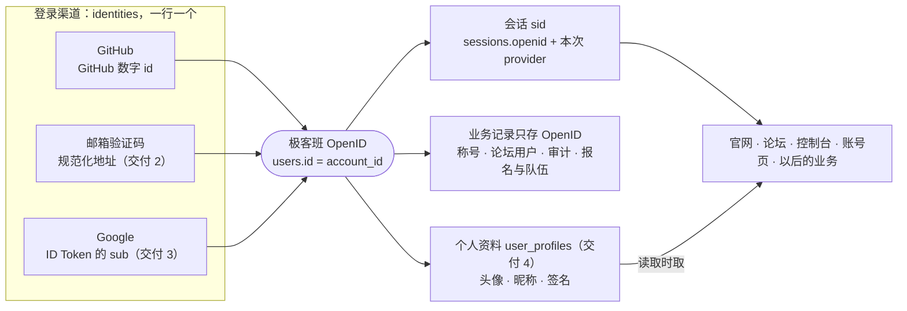

# 统一登录：极客班账号、登录页与跨业务对齐方案

> #237 的实施规格（未实施）：把 ADR-0005 落到可以直接开工的颗粒度——统一登录页 `/signin`、账号页 `/account` 与控制台的界面状态，三种登录方式的后端流程，全站一套的个人资料（头像、昵称），新表与迁移，要会话的接口在邮箱或 Google 会话下怎么处理，以及各业务要改什么、怎么验收；按四个候选 issue 拆分交付。

状态：`accepted`（所有者已接受，未实施；四个候选 issue 仍要逐个批准后才建单开工）· 更新：2026-10-20 · 适用：`app/server` 的身份、会话、成员资格、个人资料与登录接口及表，`app/console` 的 `/signin`、`/account` 与导航，官网、论坛、控制台和比赛的登录入口、头像与昵称显示

**一句话**：一个人只有一个极客班 OpenID（`users.id`）。GitHub、邮箱验证码、Google 都是绑定在它名下的登录渠道，不管用哪个登录，落到的都是同一个 OpenID；官网、论坛、控制台和以后上线的业务共用这一套登录和会话，业务只认这个 OpenID。

本文是已接受、未实施的方案：下面的接口、表和界面都**还不存在**，现行行为以 [server 合同](../services/server/README.md)、[接口行为契约](../services/server/endpoint-contracts.md) 和 [SECURITY](../architecture/SECURITY.md) 为准。为什么这样选见 [ADR-0005](../decisions/0005-sso-extend-core-server.md)（`accepted`），本文只写怎么做；两者不一致时先改 ADR 再改本文。文中图片都是**方案草图**（静态 HTML 渲染，数据虚构），不是实现截图。

## 给开工 Agent 的读法

1. 先读 ADR-0005 的「决策」1–10 和「登录方式」一节；本文把它展开到字段、错误码、文件和测试，不重复理由。
2. 文末四个[候选 issue](#候选-issue未建单) 各对应一项交付。**Crosery 逐个批准之前不建单、不开 task 分支、不写 `app/` 代码**（[ISSUES](../conventions/ISSUES.md) §1）。批准后按候选正文建单；PR 正文按 [PULL-REQUESTS](../conventions/PULL-REQUESTS.md)，`docs/changes/<issue>.json` 按 [ARCHITECTURE-ALIGNMENT](../conventions/ARCHITECTURE-ALIGNMENT.md) 声明 `business`。
3. 一个交付一个 PR：数据库、接口、三端界面、文档和测试在同一个 PR 里改完；不按层拆，也不把「表建好了」单独报完成（ADR「后果」第 1 条）。
4. 字段名和错误码是建议值，以实施时 `contracts.ts` 的 Schema 为准；改了名字同步回本文。
5. 测试里 GitHub、Google、发信商一律只注入虚构响应（[TESTING](../conventions/TESTING.md)，`tests/server/helpers.ts`）；真实 OAuth 往返和真实收信另记在 PR 里，不能用模拟结果代替。
6. 每个交付合并时，把本文对应小节压缩成「已实施」结论，现行契约迁回 `docs/services/*`；四项都落地后按 [plan/](./README.md) 的保质期约定删除或压缩本文。

## 现状（stage 上已有什么）

- **登录**：`GET /auth/github`（`app/server/src/routes/admin/auth.ts:37`，`return_to` 缺省回 `/console`）→ `GET /auth/callback`（`:44`）用本人 token 查 `GET /user/memberships/orgs/{CONSOLE_ORG}`，只有 `active` 才 `createSession`（`app/server/src/lib/auth.ts:32`）并写 `auth.signin`；`pending` 与非成员写 `auth.signin_denied`、尽力撤销授权、不建会话。失败带 `?signin=<原因>` 回发起登录的页面（`withSigninOutcome`，`auth.ts:14`）。`GET /auth/me`（`:98`）返回 `signed_in`、`login`、`user_id`、`avatar_url`、`console_link`；`POST /auth/signout`（`:81`）。
- **会话**：`sessions` 一行（`app/server/src/lib/db.ts:23`）存登录名、GitHub 数字 id、头像、加密的 GitHub token（`NOT NULL`）；7 天、不续期（`lib/auth.ts:27`），过期行每小时清理（#128）。三端同域共用 host-only 的 `sid`。
- **访问判定**：`createAccess`（`app/server/src/lib/access.ts:19`）每次用会话里本人 token 查组织角色，缓存键 `console:orgrole:<login>`、60 秒；`computeAccess`（`lib/roles.ts:273`）由组织角色与称号算能力，`github.*` 受本人组织角色上限（`githubCeiling`，`roles.ts:256`）。`requireCapability` 缺能力回 `403 missing_capability`（带 `reason`）；`requireOrgRole`（`middleware/require-org-role.ts`）供 `routes/admin/` 下 11 个文件使用，同样用本人 token。
- **项目地图**（`docs/architecture/catalog/catalog.json`）：98 条业务流程里 79 条读会话——41 条要调用者本人的 GitHub token，38 条只看「是谁」和称号能力（明细见[要本人 GitHub 令牌的接口](#要本人-github-令牌的接口交付-2)）。#243 合入后多 4 条只看身份的比赛控制台流程（42）。
- **业务数据以 GitHub 账号为主语**：`role_assignments` 存 `github_login` 与 `github_user_id`（`db.ts:154`），`assignmentsFor`（`lib/role-store.ts:182`）先按 GitHub id、没有 id 的行按小写登录名；授予称号时用调用者 token 查对方 id（`routes/console/assignments.ts:80`）。论坛 `forum_users.id = m<GitHub id>`（`db.ts:199`），`ensureMember`（`lib/forum-store.ts:394`）每次请求刷新、改名跟随。意见箱存 `submitter_login` / `submitter_id`；审计 `audit_logs.actor` 是登录名（`db.ts:98`），论坛用 `auth.signin` 的 actor 挡游客冒名（`signedInLogins`，`lib/auth.ts:117`）。
- **资料**：只有论坛有个人资料。`forum_users`（`db.ts:199`）存昵称、个人签名、所在地、个人网站、头像底色、GitHub 头像地址和上传头像的哈希，图在 `forum_avatars`（`db.ts:193`）。改资料走 `PATCH /api/forum/me/profile`（`routes/forum-api/people.ts:32`：昵称 NFKC 后 1–30 字、不能是官方账号或别人的用户名，签名不超过 200 字、所在地不超过 60 字，网站只收 `https://`）；换头像走 `PUT /api/forum/me/avatar`（`:80`，PNG、JPEG、WebP 不超过 2 MB，`lib/forum-avatar.ts` 用 sharp 摆正、居中裁成 256×256 WebP 并去掉元数据，每小时 10 次）；图按内容哈希寻址，`GET /api/forum/avatars/:file`（`:99`）是 `/api`、`/auth` 里唯一不加 `no-store`、可以长期缓存的响应（`middleware/http-policy.ts:39`）。官网（`app/web/sites/portal/lib/account.ts:10-20`）和控制台（`components/ConsoleNav.vue:74`）只显示 `/auth/me` 的 GitHub 登录名和头像：同一个人在论坛改了昵称和头像，官网和控制台看不到。
- **发信**：`mail_outbox` 队列每 15 秒发一次，阿里云在前、Resend 兜底，失败按 1 分钟到 6 小时退避（`lib/mail/outbox.ts`）；`MAIL_RECIPIENTS` 缺省是 `allowlist`，只发 `MAIL_ALLOWLIST` 里的地址（`app/server/src/config.ts:75`）。
- **前端**：控制台 `/signin`（`app/console/src/pages/SignIn.vue`）只收 `/console`、`/admin` 回跳；401 文案是「请重新用 GitHub 登录。」（`lib/errors.ts:36`），任何 401 都当作退出（`lib/http.ts:56`）；`signInHref` 写死 `/auth/github`（`lib/runtime.ts:41`）。官网登录地址在 `app/web/sites/portal/lib/account.ts:14`（缺省回 `/forum/`），头像菜单在 `components/os/YugcOs.tsx:316`；论坛在 `app/forum/app/composables/useSiteLinks.ts:14`、`data/account-menu.ts`、`components/LoginModal.vue`、`shared/signin-outcomes.ts`。网关只把 `/admin`、`/console`、`/signin` 交给控制台（`app/web/Dockerfile:203`、`app/server/src/app.ts:24`）。
- **迁移方式**：没有迁移框架，建表一律 `CREATE TABLE IF NOT EXISTS` + 启动时幂等回填 + `console_seeds` 标记（[data-model](../services/server/data-model.md)）。**至今没有 `ALTER` 过已有表**：本方案的加列与表重建是第一次，要按[数据库](#数据库)一节的做法写，并补旧库测试。

## 目标、约束与不做

目标：

1. **一个人一个极客班 OpenID**：就是 ADR 说的「内部 OpenID」——`users.id`，接口和业务表里叫 `account_id`，会话表里叫 `sessions.openid`，三处是同一个值，不另起第二套编号。GitHub、邮箱验证码、Google 都只是绑定在它名下的登录渠道（`identities` 一行一个渠道）；用哪个渠道登录，拿到的都是同一个 OpenID、同一份称号、帖子和记录。
2. **整个服务一套登录**：官网、论坛、控制台、账号页和以后上线的业务（例如 #239 的比赛报名组队）共用一个登录页 `/signin` 和一个会话 `sid`：一处登录处处可用、任一处退出全部退出（现有能力保留）。业务不自己接登录、不存渠道账号或令牌、不按 GitHub 登录名认人，一律从会话拿 `account_id`，所以 GitHub 改名不丢任何东西。以后不在同一域名下的应用按 ADR 决策 8 接 OIDC，认的也是这个 OpenID（对外的 `sub` 由它映射，不直接暴露）。
3. **统一登录页** `/signin` 按后端返回的方式列表渲染；所有登录结果（包括被拒的原因）都在这一页说明，并带回原页面。
4. **账号页** `/account`：本人的登录方式、这次登录、成员资格、最近账号操作，以及绑定、解绑；交付 4 起加「个人资料」（`/account/profile`）。
5. **资料全站一套**：头像、昵称、个人签名、所在地和个人网站归极客班账号，一个账号一份（`user_profiles`）。官网、论坛、控制台和比赛显示的都是这一份，读取时按 `account_id` 取、不各存快照；在资料页改一次，各处的下一次请求就是新的，开着的其他页面自动刷新。

约束：

- 准入不变（ADR 决策 4）：只有 `CONSOLE_ORG` 的 `active` 成员能建号、能拿到会话；GitHub 是唯一能建号的方式。
- 控制台 `github.*` 只认本次 GitHub 会话里的本人 token，不借用资格凭据、不换成组织级凭据（决策 6）。
- 不新增容器、进程和生产依赖；Google ID Token 验签用 Node 自带的 `crypto`。
- `/auth/me` 只加字段，已有字段语义不变（`user_id` 仍是 GitHub 数字 id）；`sid` cookie、7 天不续期不变。
- 每一步迁移可以重跑；独立回滚只到「还没有非 GitHub 身份」为止，之后只向前修复（决策 3）。
- 资料沿用论坛现有的昵称规则、长度限制与头像处理（`sharp` 已是 `app/server` 的依赖），不新增依赖；昵称只用于显示，会话、审计和权限照旧认账号与 GitHub 登录名。

不做：

- 不开放注册，不做密码、二步验证、通行密钥，不做账号合并（`POST /api/identity/merge` 另立），不做对外 OIDC（决策 8），不接微信、QQ。
- 不做「退出所有设备」、会话续期和「记住我」。
- 不做账号停用的管理界面：本期只保证 `users.status='disabled'` 时拒绝登录并撤销会话，怎么设置另立事项。
- 不改招新投递、GitHub 组织邀请与邀请链接的流程。
- 不导入 Google 的昵称和头像，不接 Gravatar；资料里不放姓名、学号、手机号这类实名信息；用户名不能自己改（跟随 GitHub 登录名）。

## 交付总览

| 交付 | 用户看到的结果 | 主要改动 | 依赖 |
|---|---|---|---|
| 1 统一账号与登录（候选 1） | 三端都进统一登录页、登录后回原页面；被拒原因在登录页说清楚；GitHub 改名不丢称号和帖子 | `users`、`identities`、`identity_audit`；`sessions`、`role_assignments`、`forum_users`、`audit_logs` 加列并回填；登录事务；`GET /auth/providers`；`/auth/me` 加字段；`/signin` 改版；官网、论坛入口改指 `/signin` | ADR-0005 确认 |
| 2 邮箱验证码与账号页（候选 2） | 在 `/account` 绑定邮箱后可以用验证码登录；邮箱会话打开要 GitHub 的页面时有明确说明；成员资格失效时有提示 | 成员资格模块；`sessions` 重建；`email_challenges`（资格来源 B 时加 `identity_credentials`）；即时发信；`/account`；`github_session_required` 守卫与导航锁定 | 1；资格来源的决定（ADR 待确认 2）；发件域名 SPF、DKIM、DMARC |
| 3 Google 登录（候选 3） | 在 `/account` 绑定 Google 后可以用 Google 登录 | Google OIDC 登录与绑定、`google_oauth_state` | 2；Google 凭据、官网隐私政策页、域名验证 |
| 4 统一资料（候选 4） | 在 `/account/profile` 改一次头像和昵称，官网、论坛、控制台和比赛同时换成新的，开着的页面自动刷新 | `user_profiles` 及回填；`/api/identity/profile`、`/api/identity/avatar`、`GET /api/avatars/:file`；`/auth/me` 加 `profile`；论坛资料接口改写同一份；四端头像统一按 `avatar` 显示；管理员重置资料 | 1；可与 2 并行 |

ADR 的交付 2 在这里拆成 2、3 两个候选（待确认 4）：邮箱只依赖已有的发信商，Google 要等所有者建凭据和隐私页，绑在一起会互相拖。ADR 的交付 3（对外 OIDC）不在本文。交付 4 对应 ADR 决策 10 与交付清单第 4 项（2026-10-19 所有者新提的要求），只依赖交付 1 的账号表，可以和 2 并行（待确认 9）。

## 结构与呈现

### 统一登录页（桌面）



- 地址 `/signin?return_to=<同源路径>`，由控制台前端包渲染（网关已经把 `/signin` 交给它）。左栏是品牌、三端说明和「还不是极客班成员？」引导；右栏是登录方式。
- 「登录后回到」条按 `return_to` 前缀显示目标：`/forum` 论坛，`/console`、`/admin` 控制台，`/account` 账号，其余官网；缺省 `/forum/`（与官网现在的缺省一致）。
- 按钮全部来自 `GET /auth/providers`，前端不写死任何方式。交付 1 只有「用 GitHub 登录」；交付 2 起出现邮箱表单，交付 3 起出现 Google 按钮；某种方式没配置（没有发信商、没有 Google 凭据）就不出现。
- 加载中显示骨架；接口失败显示「登录方式暂时加载不出来」和「重试」，**不退回写死的 GitHub 入口**；列表为空显示「暂时没有可用的登录方式」。
- 已登录时打开 `/signin` 直接跳到 `return_to`；带 `reauth=1`（[重新验证](#重新验证step-up交付-2)）时不跳，标题改为「重新验证」，只列这个账号已绑定的方式。
- 底部：「申请加入极客班」（`/join-us`）、「回到官网」；「隐私说明」在官网隐私政策页上线后出现（交付 3 的前置）。

### 邮箱验证码（交付 2）



- 填邮箱 →「获取验证码」→ 换到 6 位验证码页，文案「如果 c***@example.com 已绑定极客班账号，验证码已经发到这个邮箱」——**已绑定与未绑定看到的完全一样**。
- 输入框 `inputmode="numeric"`、`autocomplete="one-time-code"`，粘贴 6 位自动填满；倒计时按响应的 `resend_after`，到点才能「重新获取」；「换一种方式」回到登录页。
- 错误：验证码不对显示「还能试 N 次」；失效或次数用完显示「验证码已失效，请重新获取」；限流显示「操作太频繁」并按 `Retry-After` 倒计时。

### 登录结果



所有失败都回到 `/signin?signin=<原因>&return_to=<原页面>`，在按钮上方用提示条说明，按钮照常可用（重试或换一种方式）。原因与文案见[错误码](#错误码)一节的登录结果表。

### 账号页（交付 2）



- 任何有效会话都能打开，不要求 `console.access`；未登录跳 `/signin?return_to=/account`。顶部导航：官网、论坛、控制台（只在 `console_link` 为真时出现）、账号。
- 「登录方式」：GitHub（主登录方式，不能解绑）、Google、邮箱验证码各一行，显示掩码后的标识、绑定时间、最近登录；未绑定的给「绑定」，没配置的方式不出现。
- 绑定或解绑时，这次登录已超过 10 分钟就在该行下方展开「先重新验证一次」：重新登录后回到这里，**再点一次**才执行，不自动继续。
- 「这次登录」：方式、登录时间、有效到（7 天，不续期）、适用于三端、「退出登录（三端一起退出）」。
- 「成员资格」：组织与状态、上次确认时间；资格来源选 B 时多一行「资格凭据还剩 N 天」（每次 GitHub 登录换一份新的 7 天凭据）。
- 「最近账号操作」：本人最近 20 条登录、绑定、解绑、冲突与会话撤销，不含验证码、令牌、IP 和他人信息。
- 右上的账号卡片：交付 2 显示绑定 GitHub 的登录名和头像；交付 4 起显示个人资料里的头像、昵称和 @用户名，并多一个「编辑个人资料」去 `/account/profile`（[下一节](#个人资料交付-4)）；「最近账号操作」也会列出改资料和资料被重置。

### 个人资料（交付 4）



- 地址 `/account/profile`，和 `/account` 一样任何有效会话都能打开；未登录跳 `/signin?return_to=/account/profile`。官网、论坛、控制台头像菜单里的「个人资料」都到这里，左上「← 账号」回 `/account`。
- 头像三选一：「上传的图片」「GitHub 头像」「昵称首字」，选中即预览、保存后生效。「换一张图片」打开系统的图片选择（PNG、JPEG、WebP，不超过 2 MB），上传成功立即生效并切到「上传的图片」；服务器居中裁成 256×256，预览就是最终效果。没上传过时第一项显示为「上传图片」；「删除上传的图片」删掉这张图并改用 GitHub 头像。
- 昵称 1–30 字，标签右侧实时计数；可以和别人重名，但不能是官方账号名或别人的用户名。用户名只读，标「跟随 GitHub 登录名」，论坛个人主页 `/forum/u/<用户名>` 也用它。
- 个人签名不超过 200 字、所在地不超过 60 字，都有计数；个人网站只收 `https://` 开头的地址。不合规则时在字段下方说明原因（文案与论坛相同），「保存」不可用。
- 「保存」只在有改动且都合规则时可用，否则旁边显示「没有未保存的修改」；保存成功显示「已保存。官网、论坛、控制台和比赛里的头像与昵称已经换成新的；开着的其他页面会自动刷新。」和上次保存时间。有未保存的修改时离开页面要先确认。
- 别的页面或设备在这期间改过资料时，保存回 `409 profile_conflict`：顶部提示「资料刚在别处改过，你的修改还没保存」，给「载入最新内容」（放弃这次修改）和「保留我的修改」（以最新内容为底，再点一次「保存」才覆盖）。
- 右栏「在这些地方显示」按四端的样式预览当前草稿：官网头像菜单、论坛帖子、控制台顶栏、比赛「我的队伍」；底部说明 GitHub 组织页仍显示 GitHub 账号、审计保留当时的登录名。
- 手机：预览排到表单下面、默认收起；头像三个选项改成竖排的单选行，按钮和选项高度不小于 44px。

### 控制台：需要 GitHub 会话的页面（交付 2）



- 用邮箱或 Google 登录时，导航里「GitHub 组织」各项（含邀请、邀请链接）带锁但**可以点**，进去是「这一页需要用 GitHub 登录」：说明原因，「用 GitHub 继续」去 `/auth/github?return_to=<当前页>`（登录后回到这一页，账号不变），「回到概览」。
- 其余页面（概览、投递、论坛管理、意见箱、审计、成员与权限里的称号与部门）照常可用；「成员与权限」里列成员名单和授予称号的位置显示同样的锁和说明。
- 顶栏头像旁显示本次登录方式（如「邮箱登录」），GitHub 会话不显示。

### 手机



390×844 下不得出现横向滚动，触控目标不小于 44px；验证码页下方的邮件预览只为示意邮件内容；账号页的表格换成列表。

### 不同身份看到什么

| 身份 | 统一登录页 | 官网与论坛 | 控制台 | 账号页 |
|---|---|---|---|---|
| 未登录 | 全部已启用的方式 | 游客，头像位置是「登录」 | 跳 `/signin` | 跳 `/signin` |
| 非成员、邀请未接受（拿不到会话） | 回来时显示 `not_member`、`invite_pending` 引导 | 游客 | 同未登录 | 同未登录 |
| 成员 · GitHub 会话 | 直接回 `return_to` | 成员 | 按称号能力，`github.*` 受 GitHub 角色上限（现状） | 可用 |
| 成员 · 邮箱或 Google 会话，资格已确认 | 直接回 `return_to` | 成员 | 按称号能力，`github.*` 全部锁定为 `github_session_required` | 可用 |
| 第二渠道 · 资格需重新验证 | 直接回 `return_to` | 读按游客；写回 `403 membership_verification_required`，顶部提示「用 GitHub 重新验证」 | 受保护接口回同样的 403，页面显示重新验证卡片 | 可用，资格栏提示重新验证 |
| 第二渠道 · 资格暂时查不到 | 直接回 `return_to` | 依赖身份的请求回 `503 membership_unavailable`，提示稍后重试（与现在 GitHub 查询出错不降级一致） | 同左 | 可用，资格栏提示暂时查不到 |
| 被确认移出组织、账号停用 | 会话已撤销；再登录显示 `not_member`、`account_disabled` | 游客 | 跳 `/signin` | 跳 `/signin` |

## 业务规则

### 账号与登录方式



- **极客班 OpenID** 是 `users` 一行的 `id`（接口里叫 `account_id`）：128 位随机、永不复用、永不删除；状态 `active`、`disabled`、`merged`（`merged` 只为以后的合并预留）。它是我们自己发的编号，不是 GitHub id、不是 Google 的 `sub`，也不是以后微信给的 `openid`——代码里叫 `account_id`，就是为了不和这些渠道自己的 id 混淆。文中的「极客班账号」「账号」都指它。
- 登录方式（渠道）是 `identities` 的行，`(provider, provider_uid)` 唯一，所以一个 GitHub 账号、一个邮箱、一个 Google 账号只能绑定在一个 OpenID 上：GitHub 用不可变的数字 id，Google 用 ID Token 的 `sub`，邮箱用规范化地址。**每个账号每种方式最多一个**（待确认 7）；GitHub 每个账号恰好一个，不能解绑。
- 只有 GitHub 能建号：GitHub 登录通过组织门槛、且这个 GitHub id 还没有账号时，在登录事务里同时建 `users` 与 `identities`（交付 4 起还有 `user_profiles`）。邮箱与 Google 只能命中已绑定的账号，未命中不建任何行。
- **用哪种方式登录都落到同一个 OpenID**：登录事务按渠道找到身份，再走到它所属的账号（见[下一节](#登录事务三种方式共用)），会话只记 OpenID 和本次方式。业务代码从会话拿 `account_id`，不读 `identities`（只有身份模块读写它），也不按登录方式区分权限；唯一按方式区分的是[要本人 GitHub 令牌的接口](#要本人-github-令牌的接口交付-2)。
- 显示的名字和头像取账号的个人资料（见[统一资料](#统一资料交付-4)）；交付 4 之前是绑定 GitHub 的当前登录名与头像（每次 GitHub 登录刷新）。任何时候都不显示 Google 昵称或邮箱。
- GitHub 登录名可以改，旧名字也可能被别人注册：任何地方都**不能只凭登录名认领**账号、称号或论坛用户。有 GitHub id 时按 id；没有 id 的旧记录只读、不认领（见[数据库](#数据库)）。
- `canonical_email` 只是已绑定邮箱的副本（解绑时清空），不用于登录查找、不用于合并；Google 返回的邮箱即使相同也不会自动绑定邮箱方式。

### 登录事务（三种方式共用）

外部请求（换 token、查 GitHub 用户与组织资格、Google token 端点与验签）全部在事务**之外**做完，然后在一个 `BEGIN IMMEDIATE` 事务里：

1. 按 `(provider, provider_uid)` 查 `identities`。GitHub 未命中：新建 `users`（`org_state='active'`）和 GitHub 身份（交付 4 起再建一行资料，初始值见[统一资料](#统一资料交付-4)）。邮箱、Google 未命中：结束，回 `identity_not_linked`，不写任何行。
2. 沿 `merged_into` 走到终点，最多 8 跳；超长或成环按 `failed` 处理并写错误日志。终点 `status='disabled'` → `account_disabled`，写 `auth.signin_denied`。
3. 只对 GitHub 登录：刷新身份的 `login`、`avatar_url`、`last_login_at`，`users.org_state='active'`、`org_checked_at=now`；把 `account_id` 为空、`github_user_id` 等于本人 id 的 `role_assignments` 与 `forum_users` 行认领到这个账号（幂等）。交付 2 选资格来源 B 时同时写入新的资格凭据。交付 4 起，登录名变了且新名字没被占用时，资料的用户名跟着改，昵称还等于旧用户名（没改过）的一起改。
4. 插入新会话：新的随机 `sid`，`openid` = 账号，`provider` = 本次方式；`login`、`user_id`、`avatar_url` 一律取绑定 GitHub 的值（第二渠道也是）；只有 GitHub 会话存本次 token。
5. 请求里带着旧 `sid` 时删除那一行（换号登录、重复登录时旧会话作废）。
6. 写 `identity_audit`（`login`）和 `audit_logs`（`auth.signin`，`details.provider`）。

提交之后才 `Set-Cookie: sid` 并跳转。事务里任何一步失败都整体回滚：不留半个账号，请求带来的旧会话照常有效，回跳 `failed`。

### 回跳与失败结果

- `return_to` 只收同源路径：以 `/` 开头、不以 `//` 开头、不含反斜杠与控制字符、不超过 2048 字符。服务端照旧用 `safeReturnTo`（`app/server/src/lib/safe-return.ts:4`）兜底，前端做同样的预检；控制台从「只收 `/console`、`/admin`」改为接受任意同源路径。
- 成功跳 `return_to`。失败一律跳 `/signin?signin=<原因>&return_to=<原 return_to>`（**与现状不同**：现在回原页面带 `?signin=`；待确认 6）。`invalid_state` 与缺参数仍回 400 JSON（现状）。
- 被拒的 GitHub 登录照旧尽力撤销这次授权（`revokeGrant`），不建会话。

### 退出

不变：`POST /auth/signout` 删除当前会话、清 cookie、写 `auth.signout`；同一账号在其他设备上的会话不受影响。

### 重新验证（step-up，交付 2）

- 绑定、解绑前要求**本次会话创建不超过 10 分钟**（待确认 5）；用任何已绑定的方式重新登录都可以，重新登录就是一次普通登录（新 `sid`，旧的作废）。
- 超时回 `403 step_up_required`，体里带 `reauth: { return_to: "/account?resume=unlink:google" }`；前端带着它去 `/signin?reauth=1&return_to=…`，回来后高亮原来的操作，用户**再点一次**才提交。
- `step_up_required` 不是退出：前端不清身份；只有 401 才按退出处理。

### 绑定与解绑（交付 2、3）

- **绑定邮箱**：`POST /api/identity/email/start` 给要绑定的地址发验证码（不论地址是否已属于别的账号都发，用来证明本人收得到）→ `POST /api/identity/email/verify`。地址已属于别的账号回 `409 identity_conflict`，不说属于谁；本账号已有邮箱回 `409 identity_exists`（想换邮箱先解绑再绑）。成功写身份、`canonical_email`、`identity_audit`、`audit_logs`。
- **绑定 Google**：`POST /api/identity/link { provider: "google" }` 拿授权地址后整页跳转；回调按 state 里的账号和会话指纹核对后写身份，结果用 `/account?link=<结果>&provider=google` 带回（`linked`、`conflict`、`exists`、`cancelled`、`failed`）。
- **解绑**：`POST /api/identity/unlink { provider }`；GitHub 回 `409 github_required`，未绑定回 `404 not_found`。成功删除身份行，并撤销这个账号**用这种方式登录的全部会话**（包括当前会话时响应 `signed_out: true`，前端回登录页），写 `auth.session_revoked { reason: "identity_unlinked" }`。
- 绑定冲突写 `identity.link_conflict`，不含对方账号或第三方标识。

### 邮箱验证码（交付 2）

在 ADR「邮箱验证码登录」之上补齐实现细节：

- **规范化**：去首尾空白、整体转小写、域名转 ASCII（`domainToASCII`，与 `lib/mail/outbox.ts` 一致）；总长不超过 254、只有一个 `@`、两边非空，否则 `400 bad_email`。`a+tag@x` 与 `a@x` 是两个不同的地址。
- **`start`**：先过限流——同一邮箱 60 秒内只能获取一次、每小时 5 次，同一 IP（IPv6 按 /64）每小时 20 次；超出回 `429 rate_limited` 并带 `Retry-After`（与现有 429 同形状，#191），已绑定、未绑定的地址一样计数。然后**无论是否绑定都建一行挑战**，回 `202 { resend_after: 60 }` 并设 cookie。已绑定且账号可用：生成验证码，把发信交给即时队列；未绑定或账号不可用：挑战的 `account_id` 为空，生成一个不发送的随机码。重新获取会让同一邮箱之前未用的挑战立即失效。
- **验证码**：6 位数字（`crypto.randomInt`），10 分钟有效，库里只存 `HMAC-SHA256(k_code, 挑战 id ‖ 验证码)`。`k_code = HKDF(SESSION_SECRET, "yzgc:email-code:v1")`，邮箱指纹与 IP 指纹各用一个 info（`yzgc:email-id:v1`、`yzgc:ip:v1`），**不新增环境变量**；`SESSION_SECRET` 轮换只会让未用的验证码失效。
- **`verify`**：凭 cookie 里的挑战 id 找未用、未过期、错误次数小于 5 的挑战，在一个同步事务里比较（`timingSafeEqual`）并计数——better-sqlite3 同步执行、中间没有 `await`，并发请求不能多试。错了 `attempts + 1`，回 `400 invalid_code { attempts_left }`；第 5 次错、已过期、已用或 cookie 缺失回 `400 code_expired`。对了之后在事务外实时查账号状态与成员资格，再开一个事务用条件更新占用验证码（`UPDATE … SET used_at = ? WHERE id = ? AND used_at IS NULL`，只有一个请求能成功）并按登录事务建会话，回 `200 { return_to }`，前端整页跳转。资格暂时查不到回 `503 membership_unavailable` 且**不占用验证码**，用户可以用原码重试。
- **cookie**：`email_challenge`，签名、`HttpOnly`、`SameSite=Lax`，`Secure` 跟随 `cookieSecure`；登录用 `path=/auth/email`，绑定用 `path=/api/identity/email`；`Max-Age=600`；值只有挑战 id。
- **发信**：进程内即时队列，响应之后投递，阿里云在前、失败立即改走 Resend；不写 `mail_outbox`，不带 Reply-To（两家都能用）。遵守现有的 `MAIL_RECIPIENTS` / `MAIL_ALLOWLIST`（预发布缺省只发白名单）和「没配发信商不发」；一个发信商都没有时 `/auth/providers` 不列邮箱方式。投递结果只记日志（发信商、HTTP 状态、错误码），不记地址和验证码，也不影响响应。
- **邮件**：发件人「长江大学极客班」（`MAIL_SENDER_NAME`），主题「你的极客班登录验证码」，正文只有验证码、10 分钟内有效、只能用一次、「不是你本人操作请忽略，账号不会有任何变化」，**没有链接**；复用 `lib/mail/envelope.ts` 的信封渲染，绑定用的信把「登录」换成「绑定」。
- **清理**：随会话清理（每小时）删除过期超过 1 小时的挑战；限流按 1 小时窗口从这张表计数，所以至少保留 1 小时。

### Google（交付 3）

- `GET /auth/google?return_to=…`：生成 state、nonce 和 PKCE `code_verifier`（S256），写签名 cookie `google_oauth_state`（`path=/auth/google`、10 分钟、`kind: "google-signin"`），跳 Google，`scope=openid email profile`、`prompt=select_account`。绑定由 `POST /api/identity/link` 发起，cookie 为 `kind: "google-link"` 并带账号 id 与会话指纹（沿用 `sessionFingerprint`，`middleware/oauth-state.ts:16`）。
- `GET /auth/google/callback`：读取并清除 cookie、核对 state → 用 code、client secret 与 verifier 换 token → 校验 ID Token：RS256 签名（Google JWKS，按 `kid` 缓存并遵守 `Cache-Control`，遇到未知 `kid` 重取一次）、`iss` 是 `https://accounts.google.com` 或 `accounts.google.com`、`aud` 是本站 client id、`exp` 未过、`iat` 不晚于现在 5 分钟、`nonce` 一致 → 登录或绑定。不保存 Google 的 access token 与 ID Token。
- 只有 `email_verified` 为真时才把邮箱存进身份行，供账号页掩码展示；不写 `canonical_email`，不绑定邮箱方式。
- 用户在 Google 取消回 `cancelled`，其余失败回 `failed`；未绑定回 `identity_not_linked`，不写任何行、不写审计（没有账号可记，也不落 Google `sub`）。

### 成员资格（交付 2）

新模块 `app/server/src/lib/membership.ts`。所有业务都通过它判断「这个账号现在是不是组织 `active` 成员」，**业务模块不自己查 GitHub**。

- 输入账号与会话，输出 `{ state, role }`：`state` 是 `active`、`pending`、`not_member`、`verification_required`、`unavailable` 之一，`role` 是 `admin`、`member` 或空，供称号计算（组织 owner 是提督）。
- **查别的账号**：邀请对象、新队长这类「对方现在还算不算成员」的检查也问本模块，用按账号查询：只读已记录的 `users.status` 与 `org_state`，两者都是 `active` 才回 `active`，其余（包括 `unknown`）一律回 `not_member`。不带会话、不调用 GitHub，结果只用于这类检查，不能用来签发或保留会话；业务模块不自己读 `org_state` 判断资格。交付 2 之前还没有本模块，第一个用到的业务（#239 的报名组队）把同一条规则写进它的共享成员守卫，交付 2 再搬进来；在那之前 `org_state` 只会是 `active`，这项检查实际只看账号是否启用。
- **GitHub 会话**：沿用现状，用本次会话的 token 查组织角色（`lib/access.ts`，60 秒缓存）。
- **第二渠道 · 资格来源 B**：读该账号 GitHub 身份的资格凭据，调 `GET /user/memberships/orgs/{CONSOLE_ORG}`。`200` 且 `active` → `active`，`200` 且 `pending` → `pending`，`404` → `not_member`；`401` → 删除凭据并回 `verification_required`；凭据缺失或过期 → `verification_required`；超时、`403`、`429`、`5xx` → `unavailable`。凭据在每次 GitHub 登录时换新、有效 7 天，普通请求和第二渠道登录都不延长它。
- **第二渠道 · 资格来源 A**：用只读 GitHub App 的 installation token，先按 GitHub 数字 id 取当前登录名（`GET /user/{account_id}`：这里的 `account_id` 是 GitHub 文档里的参数名，填 GitHub 身份的 `identities.provider_uid`，不是极客班 OpenID），再查 `GET /orgs/{org}/memberships/{username}`，状态映射同上（没有 `verification_required`）。`POST /webhooks/github` 校验 `X-Hub-Signature-256`，收到 `organization` 事件的 `member_removed` 就按 GitHub id 找到账号并立即撤销。
- **缓存**：新登录一律实时查、不读缓存；已有会话的成功结果按 `(账号, 组织, 凭据版本)` 缓存，从查询开始计时最多 60 秒；失败不缓存、不延长旧结果；进程重启即失效；时间戳在未来视为过期。
- **撤销**：确认 `pending`、`not_member` 或账号停用时，在一个事务里 `membership_version + 1`、更新 `org_state`、删除这个账号**全部**会话（不分方式）、删除资格凭据，写 `auth.session_revoked`（`reason` 为 `membership_lost` 或 `account_disabled`）。每次异步查询带着开始时的版本号，只在版本没变时落库或签发会话，撤销之后的旧结果不能把人恢复回来。
- **与现状不同**：现在 GitHub 会话的主人被移出组织后会话保留、论坛按游客处理（`routes/forum-api/viewer.ts` 的 `forumViewer` 注释）；交付 2 起统一为撤销该账号全部会话（待确认 8）。
- 资格模块自己接住资格凭据的 401，不能让它流到 `middleware/http-policy.ts` 错误处理器里「GitHub 拒绝了令牌 → 结束会话 → `401 session_expired`」那一支：那一支只适用于本次 GitHub 会话的 token。

### 要本人 GitHub 令牌的接口（交付 2）

决策 6 规定 GitHub 管理操作只用本次 GitHub 会话里本人的 token。按项目地图，79 条要会话的流程分两类：

| 类别 | 数量 | 流程（`docs/architecture/catalog/catalog.json` 的 id） | 邮箱或 Google 会话下 |
|---|---|---|---|
| 要本人 GitHub 令牌 | 41 | github 29 条（`/api/admin/:org/*` 全部，加上 `github.organizations.list` 即 `/api/me/orgs`）；invitations 6 条（`invitation.admin.list`、`invitation.admin.cancel`、`invitation.links.list`、`invitation.links.create`、`invitation.links.toggle`、`invitation.links.delete`）；feedback 3 条（`feedback.admin.list`、`feedback.admin.update`、`feedback.admin.delete`）；organization 2 条（`organization.people`、`organization.assignments.grant`）；audit 1 条（`audit.organization.read`） | `403 github_session_required`，在调用 GitHub 之前返回 |
| 只看身份与称号 | 38（#243 合入后 42） | forum 17 条；organization 10 条（`console.identity`、`console.summary`、`organization.catalogue`、`organization.departments.list/create/update/delete`、`organization.titles.update`、`organization.assignments.list`、`organization.assignments.revoke`）；recruitment 4 条（`application.list`、`application.detail`、`application.export`、`application.review`；同一 PATCH 路由上的 `application.cancel` 也属此类）；feedback 4 条（`feedback.submit`、`feedback.console.list/update/delete`）；identity 2 条（`identity.signout`、`identity.current`）；audit 1 条（`audit.console.read`）；#243 的比赛控制台 4 条 | 照常；组织角色由成员资格模块给出 |

落点：

- 新守卫 `app/server/src/middleware/require-github-session.ts`：会话的 `provider` 不是 `github` 时回 `403 { error: "github_session_required", message: "这一步需要用 GitHub 登录", request_id }`。
- 挂在 `requireOrgRole` 的会话检查之后、调用 `getOrgRole` 之前，覆盖 `routes/admin/` 下 11 个文件里的 38 条；另外挂到 `GET /api/me/orgs`（`routes/admin/orgs.ts:10`）、`GET /api/console/people`（`routes/console/people.ts:20`）、`POST /api/console/assignments`（`routes/console/assignments.ts:54`）。
- `computeAccess` 增加「这次会话有没有 GitHub token」：没有时所有 `github.*` 能力进 `blocked`，`reason: "github_session_required"`，优先于现有两种上限；非 `github.*` 能力照常由称号和组织角色给出。`/api/console/me` 因此原样告诉前端哪些页面要锁。
- 列成员和授予称号要的能力是 `roles.manage` / `roles.department.manage`，不是 `github.*`，`blocked` 里不会出现它们；前端在「成员与权限」页按 `/auth/me` 的 `provider` 显示锁，服务端以守卫为准。
- `tests/server/github-session.test.ts` 遍历服务端注册的路由：`/api/admin/:org/*` 全部与上面 3 条，在邮箱会话下都回 `github_session_required`，而且**没有发出任何 GitHub 请求**；其余要会话的路由都不回这个错误。以后新增要本人 token 的路由，必须加进这份清单，并在项目地图流程的 `invariants` 里写明。

### 统一资料（交付 4）

所有者 2026-10-19 的原话：「还有因为统一sso登录了，所有用户是我们自己维护的一套，全局的头像还有相关的信息比赛，首页，管理后端，论坛都是用一套的，而且可以同步的更改」。

- **一个账号一份资料**：`user_profiles` 一行对应一个 `account_id`（[DDL](#交付-4资料表)），存用户名、昵称、个人签名、所在地、个人网站、头像来源、上传头像的哈希和头像底色。称号和部门本来就按账号统一（`role_assignments`），资料卡片上一起显示，本人不能改。
- **读取时取，不存快照**：业务表只存 `account_id`，显示时按它取资料，接口照旧 `no-store`。改一处，别处的下一次请求就是新的；不用通知各业务，也不会出现「这里改了、那里还是旧的」。已有的名字列（审计的 `actor`、意见箱的 `submitter_login` 等）记的是当时的事实，不动。
- **头像一条显示规则**：服务端把头像解析成 `avatar: { url, color, initial }` 下发——来源 `upload` 时 `url` 是 `/api/avatars/<哈希>.webp`，`github` 时是绑定 GitHub 的头像地址，`initial` 时为空。前端只做三件事：有 `url` 显示图片；没有就在 `color` 底色上显示 `initial`（昵称的第一个字）；图片加载失败也退回首字。各端不再自己判断来源，三端用同一份 `/auth/me` 样例做测试。
- **换图就换地址**：上传的图按内容哈希寻址、一年 `immutable`（沿用论坛头像），换一张图就是一个新地址，浏览器和网关不会显示旧图。没人再用的旧图删掉，判断「没人用」要同时查 `user_profiles` 与 `forum_users`。
- **开着的页面自动刷新**：保存成功后，资料页通过 `BroadcastChannel("yzgc-account")` 发 `{ type: "profile", version }`；同一浏览器里开着的官网、论坛、控制台页面收到后重新取 `/auth/me`，换掉顶栏的头像和昵称（论坛同时刷新当前页的数据）。页面回到前台（`visibilitychange`）时也取一次 `/auth/me`，`profile.version` 变了就刷新，覆盖在别的设备上改的情况。
- **防冒名**：昵称可以重名，但不能等于官方账号名或别人的用户名（沿用论坛的 `isAllowedName` 与 `displayNameTaken`）；帖子、队伍名单、控制台成员列表这些认人的地方，昵称旁一律显示 @用户名。用户名就是 GitHub 登录名，规则同论坛现状：GitHub 改名后新名字没被占用才跟着改，没改过的昵称（还等于旧用户名）一起改。用户名在 `user_profiles` 与 `forum_users` 里一起查重。
- **并发**：保存带上读到的 `version`，不一致回 `409 profile_conflict` 和最新资料，不静默覆盖别处刚保存的内容；换头像、删头像同样让 `version` 加一。
- **初始值**：交付 4 上线时，已有论坛资料的成员沿用论坛里的昵称、签名、所在地、网站、头像和底色；没有论坛资料的用 GitHub 登录名作昵称、用 GitHub 头像，底色按论坛现有做法从 `AVATAR_PALETTE`（`lib/forum-rules.ts:64`）里取。以后新建的账号同样从 GitHub 登录名和头像开始。**不导入 Google 的昵称和头像**，不接 Gravatar。
- **不跟资料走的地方**：控制台「GitHub 组织」各页列的是 GitHub 账号，照旧显示 GitHub 登录名和头像；审计记录保留当时的登录名；招新投递人还不是账号，不显示资料；论坛游客不是账号，昵称规则和显示照旧。
- **管理**：有 `profile.moderate` 能力的人（默认给有 `forum.post.moderate` 的称号，待确认 12）在论坛个人主页 `/forum/u/<用户名>` 可以「重置资料」：勾选要重置的项（昵称回到用户名；签名、所在地、网站清空；头像回到 GitHub 头像）并写原因。写审计 `profile.reset`，本人在「最近账号操作」里看到「资料被管理员重置」和原因。
- **论坛怎么接**：成员的资料改从 `user_profiles` 读——论坛用户的昵称和头像地址只在 `toUser`（`lib/forum-store.ts:123`）里算，改这一处；`PATCH /api/forum/me/profile` 的资料字段与 `PUT`、`DELETE /api/forum/me/avatar` 保留路径，改为写同一份资料（同一套校验），论坛自己的通知设置照旧存 `forum_users`。论坛「偏好设置」页的资料部分换成只读卡片和「去个人资料修改」。`forum_users` 的资料列在同一个事务里同步写一份，只为回滚到旧镜像时论坛照常显示（见[交付 4：资料表](#交付-4资料表)）。
- **以后的 OIDC**：对外授权的 `profile` scope（`name`、`preferred_username`、`picture`）直接取这一份，不另建资料。

## 各业务怎么对齐

### 统一口径

所有业务按这几条执行，具体到每个业务域见下表：

1. **认人用极客班 OpenID（`account_id`）**。新表一律引用 `users(id)`；旧表加可空的 `account_id`，旧列（`github_login`、`github_user_id`、`actor` 等）照写不删，回滚到旧镜像时旧代码照常读旧列。
2. **不自己接登录**：新业务（包括以后的服务）只用 `/signin` 和 `sid` 会话，要知道「是谁」就读会话的 `account_id`；不自己接 OAuth、不保存渠道账号或令牌、不按 GitHub 登录名或邮箱认人。
3. **显示用账号的个人资料**（昵称、@用户名、头像；交付 4 之前是绑定 GitHub 的登录名与头像），读取时按 `account_id` 取，业务表不新增名字或头像快照（已有的快照列不动）；匿名可读的接口只给 `ProfileCard`，不带 `account_id`（见[统一资料](#统一资料交付-4)）。
4. **是不是成员只问资格模块**，检查别的账号（邀请对象、新队长）也用它的按账号查询（见[成员资格](#成员资格交付-2)）；拿到 `verification_required`、`unavailable` 时原样回 `403 membership_verification_required`、`503 membership_unavailable`，不自己降级或放行。
5. **要本人 GitHub 令牌的操作**只在 GitHub 会话里做，否则 `403 github_session_required`；不借用资格凭据，不换组织级凭据。
6. **审计** `actor` 继续写 GitHub 登录名（论坛靠 `auth.signin` 的 actor 挡游客冒名），新行同时写 `actor_account_id`。
7. **账号停用、确认移出组织**时撤销该账号全部会话，业务数据保留不删；各业务不需要监听事件，下一次请求自然没有会话。

### 按业务域

| 业务域 | 现在怎么认人 | 交付 1 | 交付 2、3 | 不改 | 回归 |
|---|---|---|---|---|---|
| identity（登录与会话） | `sessions.login`、`user_id` | 新表、登录事务、`/auth/providers`、`/auth/me` 加 `account_id` 与 `provider`、失败回 `/signin` | 邮箱与 Google 登录、`/api/identity/*`、step-up、`sessions` 重建 | `sid` cookie、7 天不续期、退出语义 | `tests/server/core.test.ts`、`identity.test.ts`（新） |
| organization（称号、部门、成员与权限） | `role_assignments` 按 GitHub id，缺 id 按小写登录名 | 加 `account_id` 并回填；`assignmentsFor` 依次按账号、GitHub id、登录名（最后一种只读不认领）；授予称号时对方已有账号就写 `account_id`，还没有就留空、等对方第一次登录认领 | 列成员、授予称号要 GitHub 会话；撤销称号、部门、称号设置不需要 | `UNIQUE(github_login, role, department_id)`、`granted_by` 文本 | `tests/server/console.test.ts`：改名不丢称号；旧登录名被别人注册后认领不到 |
| github（控制台 GitHub 组织页） | 本人 token | 不变 | 第二渠道回 `github_session_required`，导航带锁 | 本人 token 与角色上限 | `github-session.test.ts`（新） |
| invitations（邀请与邀请链接） | 本人 token；门户加入用链接里存的发起人 token（`routes/portal/join.ts`） | 不变 | 管理 6 条要 GitHub 会话；只有 GitHub 会话能建链接，所以链接里存的一定是 GitHub token | 门户加入流程 | `tests/server/invitations.test.ts` |
| feedback（意见箱） | `feedback.submitter_id` 是 GitHub 数字 id | 不加列：第二渠道会话的 `user_id` 也是绑定的 GitHub id，语义不变 | 控制台 GitHub 页里的 3 条要 GitHub 会话；班务意见箱与官网匿名提交不变 | 管理列表不返回提交人 id（`core.test.ts:237`） | `tests/server/feedback-org.test.ts` |
| recruitment（招新投递与审核） | 投递人不登录、按邮箱联系；审核人存登录名 | 不变 | 不变；**投递邮箱不是登录方式**，相同也不会绑定或登录 | 投递、取消与招新信 | `tests/server/applications.test.ts` |
| forum（论坛） | `forum_users.id = m<GitHub id>`，`ensureMember` 刷新 | 加 `account_id`（部分唯一索引）并回填；`forumViewer` 改按会话的账号；论坛登录入口与 `LoginModal` 改去 `/signin` | 资格需重新验证：读按游客、写回 403；暂时查不到：503；头像菜单加「账号」 | `m<id>` 主键、帖子作者、游客昵称规则 | `tests/server/forum.test.ts`、`app/forum/tests/` |
| audit（审计） | `actor` 是登录名 | 加 `actor_account_id`，新行写入、旧行不回填；新事件见[审计与留痕](#审计与留痕) | 同左 | 审计页查询与 `idx_audit_signin_actor` | `tests/server/console.test.ts` 的审计用例 |
| mail（发信） | `mail_outbox` 队列 | 不变 | 验证码走进程内即时通道，不进队列；遵守收件人白名单 | 招新四种信与退避 | `email-signin.test.ts`（新）、`tests/server/mail-outbox.test.ts` |
| platform（网关、入口、配置） | `/admin`、`/console`、`/signin` 交给控制台 | `/signin` 改版，路径不变 | `/account` 加进 `app/web/Dockerfile:203` 与 `ADMIN_SPA_PATHS`；资格来源 A 的 App 变量；交付 3 的 Google 变量 | CSP：Google 是整页跳转、不加载 Google 脚本，不用改 | `core.test.ts:210`、`tests/tooling/web-nginx.test.ts` |
| competitions（#243 合入后） | 赛事没有个人数据 | 不变 | 控制台 4 条只看身份，第二渠道照常；#239 的报名与队伍在交付 1 之后按 `account_id` 建表；#239 新增的门户与控制台流程同样只看身份、不调用 GitHub，细则见[比赛应用方案](./COMPETITION-APP.md#与其他业务的协调)的「与其他业务的协调」 | 公开列表匿名可读 | #239 自己的测试 |
| public_content（公开内容） | 不读会话 | 不变 | 不变 | 全部 | — |

交付 4（统一资料）对各域的改动集中写在[统一资料](#统一资料交付-4)：论坛成员资料改读 `user_profiles`、资料接口改写同一份；官网与控制台顶栏、控制台成员单元格显示资料；比赛的队伍与名单返回 `ProfileCard`；审计加 `profile.update`、`profile.reset`；平台的缓存例外加 `/api/avatars/`。其余域不变。

### 账号事件对各业务的影响

| 事件 | 身份与会话 | 称号 | 论坛 | 比赛（#239） | 审计 |
|---|---|---|---|---|---|
| 第一次 GitHub 登录（建号） | 建 `users` 与 GitHub 身份，签发会话 | 认领 `github_user_id` 相同、`account_id` 为空的行 | 认领 `m<id>`；没有就照旧在第一次访问时建 | 无 | `auth.signin`、`identity_audit` 的 `login` |
| GitHub 改登录名 | 下一次 GitHub 登录刷新身份与会话的 `login`；交付 4 起资料的用户名跟着改（新名字没被占用时），没改过的昵称一起改 | 按账号或 id 匹配，不受影响 | 新名字没人占就跟着改（现状） | 读取时取新名字 | 新行用新名字；旧行不改 |
| 改资料或头像（交付 4） | 写 `user_profiles`、`version` 加一；会话不变 | 无 | 同一事务写 `forum_users` 的镜像列；帖子作者显示新资料 | 名单读取时取新资料 | `profile.update`；本人的 `identity_audit` 记 `profile_update` |
| 绑定、解绑邮箱或 Google | 写或删身份；解绑撤销该方式的会话 | 无 | 无 | 无 | `identity.link`、`identity.unlink`、`auth.session_revoked` |
| 被确认移出组织或邀请撤回（交付 2 起） | 撤销全部会话、作废资格版本 | 指派保留；重新入组登录后照旧生效 | 论坛用户与帖子保留，之后按游客 | 报名与队伍保留，写操作因没有会话而失败 | `auth.session_revoked { reason: "membership_lost" }` |
| 账号停用 | 拒绝登录、撤销全部会话 | 同上 | 同上 | 同上 | `auth.session_revoked { reason: "account_disabled" }` |
| 账号合并（不在本期） | — | 另立事项时一并迁移 | 同左 | 按 #239 方案的合并规则 | — |

## 接口

登录流程放在 `/auth/*`（和 `/auth/github` 同级，不带 `/api`），账号页的读写放在 `/api/identity/*`（要会话，走现有 `requireAuth` 与 `Origin` 校验）。JSON 错误沿用 `{ error, message, request_id }`（`middleware/http-policy.ts`），时间字段一律是毫秒时间戳（同现有接口）。

| 方法与路径 | 会话 | 请求 | 成功 | 失败 | 限流 | 交付 |
|---|---|---|---|---|---|---|
| `GET /auth/providers` | 不要 | — | `200 { providers }`（类型见下） | — | — | 1 |
| `GET /auth/github` | 不要 | `?return_to=` | `302` 去 GitHub（现状） | — | — | 1：缺省回跳仍是 `/console` |
| `GET /auth/callback` | 不要 | `code`、`state` | `302` 到 `return_to`，`Set-Cookie: sid` | `302 /signin?signin=<原因>&return_to=…`；`400 invalid_state`（现状） | — | 1 |
| `POST /auth/signout` | 要 | — | 现状 | 现状 | — | 不变 |
| `GET /auth/me` | 可选 | — | 现有字段，加 `account_id`、`provider`；交付 2 再加 `membership_state`；交付 4 再加 `profile` | — | — | 1、2、4 |
| `POST /auth/email/start` | 不要 | `{ email, return_to? }` | `202 { resend_after: 60 }`，设 `email_challenge` | `400 bad_email`、`429 rate_limited` | 邮箱 60 秒 1 次、每小时 5 次；IP 每小时 20 次 | 2 |
| `POST /auth/email/verify` | 不要（凭挑战 cookie） | `{ code }` | `200 { return_to }`，`Set-Cookie: sid` | `400 invalid_code`、`400 code_expired`；`403 account_disabled`、`not_member`、`invite_pending`、`membership_verification_required`；`503 membership_unavailable` | 每个挑战 5 次 | 2 |
| `GET /auth/google` | 不要 | `?return_to=` | `302` 去 Google | `404 provider_not_enabled` | — | 3 |
| `GET /auth/google/callback` | 不要 | `code`、`state` | 登录：`302` 到 `return_to`；绑定：`302 /account?link=linked&provider=google` | 登录：`302 /signin?signin=…`；绑定：`302 /account?link=<结果>&provider=google`；`400 invalid_state` | — | 3 |
| `GET /api/identity/me` | 要 | — | `200 AccountView`（类型见下） | `401` | — | 2 |
| `POST /api/identity/email/start` | 要，step-up | `{ email }` | `202 { resend_after: 60 }`，设 `email_challenge`（`path=/api/identity/email`） | `400 bad_email`、`403 step_up_required`、`409 identity_exists`、`429 rate_limited` | 同登录，另加每会话每分钟 10 次 | 2 |
| `POST /api/identity/email/verify` | 要，且是发起绑定的那个会话 | `{ code }` | `200 { ok: true }` | `400 invalid_code`、`400 code_expired`、`409 identity_conflict`、`409 identity_exists` | 每个挑战 5 次 | 2 |
| `POST /api/identity/link` | 要，step-up | `{ provider: "google" }` | `200 { authorize_url }`，设 `google_oauth_state`（`kind: "google-link"`） | `403 step_up_required`、`404 provider_not_enabled`、`409 identity_exists` | 每会话每分钟 10 次 | 3 |
| `POST /api/identity/unlink` | 要，step-up | `{ provider }`（`github`、`google`、`email`） | `200 { ok: true, signed_out }` | `403 step_up_required`、`404 not_found`、`409 github_required` | 每会话每分钟 10 次 | 2 |
| `POST /webhooks/github` | 不要（校验 `X-Hub-Signature-256`） | `organization` 事件 | `204` | `401 bad_signature` | — | 2，只在资格来源 A |
| `GET /api/identity/profile` | 要 | — | `200 Profile`（类型见下） | `401` | — | 4 |
| `PATCH /api/identity/profile` | 要 | `{ version, display_name?, bio?, location?, website?, avatar_source?, avatar_color? }` | `200 Profile` | `400 invalid_profile`（带 `field`）、`409 profile_conflict`（带最新的 `profile`）、`429 rate_limited` | 每会话每分钟 10 次 | 4 |
| `PUT /api/identity/avatar` | 要 | 图片本身，格式与大小同论坛头像接口 | `200 Profile`（`avatar_source` 变成 `upload`） | `400 invalid_image`、`413 avatar_too_large`、`415 unsupported_media_type`、`429 rate_limited` | 每账号每小时 10 次，和论坛头像共用落库计数 | 4 |
| `DELETE /api/identity/avatar` | 要 | — | `200 Profile`（删掉上传的图，改用 GitHub 头像） | — | 每会话每分钟 10 次 | 4 |
| `GET /api/avatars/:file` | 不要 | `<哈希>.webp` | `200 image/webp`，一年 `immutable`，响应头同 `GET /api/forum/avatars/:file`（后者保留） | `404` | — | 4 |
| `POST /api/console/profiles/:handle/reset` | 要，`profile.moderate` | `{ fields, reason }`，`fields` 取 `display_name`、`bio`、`location`、`website`、`avatar` | `200 { ok: true }` | `400 invalid_profile`、`403 missing_capability`、`404 not_found` | 每会话每分钟 10 次 | 4 |

- 邮箱的两种限流跨进程重启也要成立，所以**从 `email_challenges` 表计数**，不用 `@fastify/rate-limit`（它在进程内存里按 IP 计）；每会话每分钟 10 次用路由的 `config.rateLimit`，`keyGenerator` 取会话 id。超限一律是现有的 `429 rate_limited` 加 `Retry-After` 头（#191）。
- 绑定邮箱的 `verify` 不再检查 step-up（`start` 已检查），改为核对挑战里的会话指纹与当前会话一致，不一致按 `code_expired`；这样 `start` 后第 9 分钟输码不会因为跨过 10 分钟而失败。
- `start` 里的 `return_to` 先过 `safeReturnTo` 再存进挑战行，`verify` 原样返回，前端整页跳转。
- 资料的三个写接口（`PATCH`、`PUT`、`DELETE`）都返回完整的 `Profile`（含新的 `version`），页面用它替换本地状态，下一次保存不会误报冲突；广播由页面发，服务端不推送。资料接口只看是谁、不调用 GitHub，邮箱或 Google 会话照常可用（不在 41 条之列）。

```ts
// GET /auth/providers：按这个顺序返回；前端不写死任何渠道
type Providers = {
  providers: {
    id: "github" | "google" | "email";
    name: string;              // 「GitHub」「Google」「邮箱验证码」
    kind: "redirect" | "email_code";
    start: string;             // redirect：整页跳转地址，前端追加 return_to；email_code：POST /auth/email/start
    can_register: boolean;     // 只有 github 为 true；false 的方式在页面上标「已绑定才能用」
  }[];
};
// github 恒在；email 在配了任一发信商时出现；google 在配了 GOOGLE_CLIENT_ID 与 GOOGLE_CLIENT_SECRET 时出现

// GET /auth/me：已登录时新增的字段（现有字段与语义不变，user_id 仍是 GitHub 数字 id）
type MeAdditions = {
  account_id: string;        // 极客班 OpenID（users.id）：用 GitHub、邮箱、Google 登录都是同一个值
  provider: "github" | "google" | "email";
  membership_state?: "active" | "verification_required" | "unavailable"; // 交付 2；不是 active 时 console_link 为 false
  profile?: ProfileCard & { version: number };  // 交付 4；官网、论坛、控制台的头像菜单都用它
};

// GET /api/identity/me：账号页的唯一数据源
type AccountView = {
  account_id: string;        // 同上
  github: { login: string; avatar_url: string | null };          // 绑定的 GitHub 账号；交付 4 起显示用 profile
  identities: {
    provider: "github" | "google" | "email";
    label: string;             // GitHub 登录名；邮箱与 Google 邮箱掩码成 c***@example.com
    linked_at: number;
    last_login_at: number | null;
    can_unlink: boolean;
    unlink_blocked_reason: "github_required" | null;
  }[];
  available: ("google" | "email")[];                               // 本站已启用、本账号还没绑定的方式
  session: {
    provider: "github" | "google" | "email";
    created_at: number;
    expires_at: number;
    step_up_until: number;     // created_at + 10 分钟；过了再绑定或解绑会回 step_up_required
  };
  membership: {
    state: "active" | "verification_required" | "unavailable";
    checked_at: number | null;
    credential_expires_at: number | null;                          // 只有资格来源 B
    source: "github_session" | "credential" | "github_app";
  };
  recent: { at: number; action: string; provider: string | null; result: "ok" | "denied" | "failed" }[]; // identity_audit 最近 20 条
};

// 交付 4：个人资料。头像由服务端解析好，前端不判断来源
type Avatar = { url: string | null; color: string; initial: string };          // url 为空时在 color 底色上显示 initial
type ProfileCard = { handle: string; display_name: string; avatar: Avatar };   // 认人的地方显示 display_name 和 @handle；不含 account_id
type Profile = ProfileCard & {    // GET、PATCH /api/identity/profile 与 PUT、DELETE /api/identity/avatar 都返回它
  bio: string;
  location: string;
  website: string;                 // 空串或 https:// 开头
  avatar_source: "upload" | "github" | "initial";
  avatar_color: string;            // AVATAR_PALETTE 之一，avatar.color 就是它
  has_upload: boolean;             // 有上传过的图，avatar_source 才能是 upload
  version: number;                 // 保存时带回；不一致回 409 profile_conflict
  updated_at: number;
};
```

交付 2 起，已有接口的变化：

- 41 条要本人 GitHub 令牌的流程，在邮箱或 Google 会话下回 `403 github_session_required`（见[上文](#要本人-github-令牌的接口交付-2)）。
- `GET /api/console/me` 的 `blocked[].reason` 多一个 `github_session_required`。
- 第二渠道会话的资格需要重新验证时：论坛读接口按游客返回，写接口回 `403 membership_verification_required`；控制台接口回同一个 403；资格暂时查不到时一律 `503 membership_unavailable`。

## 错误码

| 状态 | `error` | 什么时候 | 附加字段 | 前端怎么处理 |
|---|---|---|---|---|
| 400 | `bad_email` | 邮箱格式不对 | — | 输入框下提示「邮箱格式不对」 |
| 400 | `invalid_code` | 验证码不对 | `attempts_left` | 「验证码不对，还可以试 N 次」 |
| 400 | `code_expired` | 过期、试满 5 次、已用、cookie 缺失或不是发起绑定的会话 | — | 「验证码已失效，请重新获取」，回到输邮箱一步 |
| 400 | `invalid_profile` | 资料不合规则：昵称为空、超过 30 字、含不允许的字符，或是官方账号名、别人的用户名；签名、所在地超长或含控制字符；网址不是 `https://` | `field`、`message` | 在对应字段下方显示 `message`（文案与论坛相同） |
| 400 | `invalid_image` | 图片解不开，或宽高超过 4096 | — | 「这张图片打不开，换一张试试」 |
| 401 | `not_signed_in`、`session_expired` | 现状 | — | **唯一**按退出处理的状态：清身份，带 `return_to` 去 `/signin` |
| 403 | `step_up_required` | 绑定、解绑时这次登录超过 10 分钟 | `reauth.return_to` | 去 `/signin?reauth=1&return_to=…`；不清身份 |
| 403 | `github_session_required` | 邮箱或 Google 会话调用要本人 GitHub 令牌的接口 | — | 页面内显示「这一页需要用 GitHub 登录」与「用 GitHub 继续」（回到当前页）；不清身份 |
| 403 | `membership_verification_required` | 第二渠道会话或登录，资格凭据缺失、过期或被 GitHub 拒绝 | — | 「需要用 GitHub 确认一次成员资格」与「用 GitHub 登录」；不清身份 |
| 403 | `account_disabled`、`not_member`、`invite_pending` | 邮箱 `verify` 时实时核对的结果 | — | 同下表对应的登录结果 |
| 404 | `not_found` | 解绑没有绑定的方式 | — | 刷新账号页 |
| 404 | `provider_not_enabled` | 这种方式本站没启用 | — | 隐藏入口 |
| 409 | `identity_conflict` | 要绑定的邮箱或 Google 已属于别的账号 | — | 「这个邮箱（Google 账号）已经绑定了别的极客班账号」，不说是谁 |
| 409 | `identity_exists` | 本账号已经有这种方式 | — | 「已经绑定了邮箱，想换先解绑」 |
| 409 | `github_required` | 解绑 GitHub | — | 按钮本来就是禁用的，兜底提示「GitHub 不能解绑」 |
| 409 | `profile_conflict` | 保存时的 `version` 不是最新 | `profile`（最新资料） | 「资料刚在别处改过，你的修改还没保存」，给「载入最新内容」与「保留我的修改」 |
| 413 | `avatar_too_large` | 图片超过 2 MB | — | 「图片不能超过 2 MB」 |
| 415 | `unsupported_media_type` | 不是 PNG、JPEG、WebP | — | 「只支持 PNG、JPEG 和 WebP 图片」 |
| 429 | `rate_limited` | 超过限流 | `Retry-After` 头 | 按秒数倒计时，期间按钮禁用 |
| 503 | `membership_unavailable` | 资格查询超时、`403`、`429` 或 `5xx` | — | 「暂时没法确认成员资格，请稍后再试」；不清身份，邮箱验证码不作废 |

`lib/http.ts:56` 现在把所有 401 当退出，这条保持；交付 2 要保证新出现的 403 与 503 不会被任何封装改成退出（`tests/console/` 里加用例）。现有的 `403 missing_capability`、`403 invalid_origin` 不变。

登录回调失败时的 `?signin=` 结果（`/signin` 显示，见[登录结果](#登录结果)草图）：

| 值 | 来源 | 什么时候 | 标题 | 说明与操作 |
|---|---|---|---|---|
| `not_member` | 现有 | GitHub 查到不是组织成员 | 只有极客班成员可以登录 | 「这个 GitHub 账号不在极客班的 GitHub 组织里。」申请加入极客班 · 换一个 GitHub 账号 |
| `invite_pending` | 现有 | 组织邀请还没接受 | 还没接受组织邀请 | 「到 GitHub 的通知或邮件里接受极客班组织的邀请，再回来登录。」前往 GitHub 接受邀请 |
| `cancelled` | 现有 | 在 GitHub 或 Google 页面点了取消 | 已取消登录 | 「需要时再选一种方式登录。」 |
| `failed` | 现有 | state 过期或对不上、换 token 失败、登录事务失败 | 登录没有完成 | 「请稍后再试一次。」 |
| `account_disabled` | 交付 1 | 命中的账号已停用 | 这个极客班账号已停用 | 「如果你认为这是误操作，请联系班委。」回到官网 |
| `identity_not_linked` | 交付 3 | Google 账号没有绑定 | 这个 Google 账号还没绑定极客班账号 | 「先用 GitHub 登录，再到『账号』页绑定 Google。」用 GitHub 登录 |
| `membership_verification_required` | 交付 2 | 第二渠道登录时资格凭据缺失或过期（只在资格来源 B） | 需要用 GitHub 确认一次成员资格 | 「距离你上次用 GitHub 登录已超过 7 天。」用 GitHub 登录 |
| `membership_unavailable` | 交付 2 | 第二渠道登录时资格暂时查不到 | 暂时没法确认成员资格 | 「这次没有登录，也不影响你在别处已有的登录。」再试一次 |

- 文案的唯一来源是 `app/console/src/lib/signin.ts`，其他端不再各写一份；草图里的说明行（「触发」「后端」）不进界面。
- 邮箱登录没有 `identity_not_linked`：邮箱是否绑定不能从任何响应里看出来，页面一律说「如果……已绑定，验证码已经发到这个邮箱」。

## 审计与留痕

两处记录，用途不同：`audit_logs` 给管理员查（审计页），`identity_audit` 给本人看（账号页「最近账号操作」）。

`audit_logs`：`actor` 继续写 GitHub 登录名（第二渠道会话取绑定 GitHub 的名字），新行同时写 `actor_account_id`；`storage.audit`（`lib/db.ts:357`）加一个可选参数。

| `action` | 来源 | `details` | 什么时候 | 交付 |
|---|---|---|---|---|
| `auth.signin` | 现有 | 加 `provider` | 登录成功 | 1 |
| `auth.signin_denied` | 现有 | `{ org, reason, provider }`；`reason` 多 `account_disabled`、`membership_verification_required`、`membership_unavailable` | 命中了账号或 GitHub 身份、但没有签发会话 | 1、2 |
| `auth.signout` | 现有 | 不变 | 退出 | — |
| `auth.session_rejected` | 现有（`middleware/require-auth.ts:61`） | 不变 | GitHub 拒绝了本次会话的 token | — |
| `auth.session_revoked` | 新 | `{ reason, count }`，`reason` 是 `membership_lost`、`account_disabled` 或 `identity_unlinked` | 撤销了一个账号的一批会话；`actor` 是触发的人，系统核对触发时写 `system` | 2 |
| `identity.link`、`identity.unlink` | 新 | `{ provider }` | 绑定、解绑成功 | 2、3 |
| `identity.link_conflict` | 新 | `{ provider }` | 要绑定的方式已属于别的账号；不写对方账号与第三方标识 | 2、3 |
| `identity.backfill` | 新 | 回填计数（见[数据库](#数据库)） | 启动回填第一次完成，以及之后再补到非零计数时；`actor` 为 `system` | 1 |
| `profile.update` | 新 | `{ fields }`；改了昵称时加 `display_name: { from, to }`，换了头像时加 `avatar_hash` | 本人改资料、换或删头像 | 4 |
| `profile.reset` | 新 | `{ account_id, handle, fields, reason }`；`actor` 是操作的管理员 | 管理员重置资料 | 4 |

- 没命中任何账号的尝试（没绑定的邮箱、没绑定的 Google）**不写**审计：没有可记的账号，也不能为此落邮箱或 Google `sub`。
- `identity_audit` 每行只有 `user_id`、`action`（`login`、`login_denied`、`logout`、`link`、`unlink`、`link_conflict`、`session_revoked`，交付 4 加 `profile_update`、`profile_reset`）、`provider`、`result`（`ok`、`denied`、`failed`）、`reason` 和时间；不存 IP、UA、邮箱原文和第三方标识。
- 资料审计只记改了哪些字段：签名、所在地和网址的内容不进审计，昵称记前后两个值（查冒名用）。
- 日志里不出现验证码、邮箱原文、token、Google `sub` 与 ID Token；发信结果只记发信商、HTTP 状态和错误码。

## 数据库

做法沿用 [data-model](../services/server/data-model.md)：`CREATE TABLE IF NOT EXISTS` 建新表，启动时幂等迁移。新增的规则只有两条——**加列前先用 `PRAGMA table_info(<表>)` 判断列在不在**（SQLite 的 `ADD COLUMN` 不支持 `IF NOT EXISTS`），**重建表在 `PRAGMA foreign_keys = OFF` 下做**（`db.ts:10` 默认打开外键；这条 PRAGMA 在事务里不生效，要在 `BEGIN` 之前关、`COMMIT` 之后开）。

### 交付 1：新表

```sql
CREATE TABLE IF NOT EXISTS users (
  id TEXT PRIMARY KEY,                    -- 26 位 Crockford Base32，128 位随机；不用自增、不用渠道 id
  status TEXT NOT NULL DEFAULT 'active' CHECK (status IN ('active','disabled','merged')),
  merged_into TEXT REFERENCES users(id),
  canonical_email TEXT,                   -- 已绑定邮箱的副本，只用于展示；解绑时清空
  org_state TEXT NOT NULL DEFAULT 'active' CHECK (org_state IN ('active','pending','not_member','unknown')),
  org_checked_at INTEGER,
  membership_version INTEGER NOT NULL DEFAULT 0,  -- 撤销时 +1，异步资格结果按它防回滚
  created_at INTEGER NOT NULL,
  updated_at INTEGER NOT NULL,
  CHECK ((status = 'merged') = (merged_into IS NOT NULL)),
  CHECK (merged_into <> id)
);

CREATE TABLE IF NOT EXISTS identities (
  id TEXT PRIMARY KEY,                    -- ULID
  user_id TEXT NOT NULL REFERENCES users(id),
  provider TEXT NOT NULL CHECK (provider IN ('github','google','email')),
  provider_uid TEXT NOT NULL,             -- GitHub 数字 id 的十进制串；Google sub；规范化邮箱
  provider_union_id TEXT,                 -- 给以后的微信 unionid 预留，本期恒为空
  email TEXT,                             -- Google：email_verified 为真时的邮箱；邮箱方式：同 provider_uid
  email_verified INTEGER NOT NULL DEFAULT 0,
  login TEXT,                             -- 只有 GitHub：当前登录名
  avatar_url TEXT,                        -- 只有 GitHub
  created_at INTEGER NOT NULL,
  last_login_at INTEGER,
  UNIQUE (provider, provider_uid)
);
CREATE INDEX IF NOT EXISTS idx_identities_user ON identities(user_id);
CREATE UNIQUE INDEX IF NOT EXISTS uq_identities_github_user ON identities(user_id) WHERE provider = 'github';
CREATE INDEX IF NOT EXISTS idx_identities_union ON identities(provider, provider_union_id) WHERE provider_union_id IS NOT NULL;

CREATE TABLE IF NOT EXISTS identity_audit (
  id INTEGER PRIMARY KEY AUTOINCREMENT,
  user_id TEXT NOT NULL REFERENCES users(id),
  action TEXT NOT NULL,
  provider TEXT,
  result TEXT NOT NULL CHECK (result IN ('ok','denied','failed')),
  reason TEXT,
  created_at INTEGER NOT NULL
);
CREATE INDEX IF NOT EXISTS idx_identity_audit_user ON identity_audit(user_id, created_at DESC);
```

邮箱的 `provider_uid` 存规范化地址原文、不存 HMAC：HMAC 的密钥从 `SESSION_SECRET` 派生，轮换密钥会让所有已绑定邮箱失效。

### 交付 1：已有表加列

```sql
ALTER TABLE sessions ADD COLUMN openid TEXT REFERENCES users(id);         -- 账号；名字沿用 ADR 决策 2
ALTER TABLE sessions ADD COLUMN provider TEXT;                            -- 交付 2 重建时改成 NOT NULL
CREATE INDEX IF NOT EXISTS idx_sessions_openid ON sessions(openid);

ALTER TABLE role_assignments ADD COLUMN account_id TEXT REFERENCES users(id);
CREATE INDEX IF NOT EXISTS idx_role_assignments_account ON role_assignments(account_id);

ALTER TABLE forum_users ADD COLUMN account_id TEXT REFERENCES users(id);
CREATE UNIQUE INDEX IF NOT EXISTS uq_forum_users_account ON forum_users(account_id) WHERE account_id IS NOT NULL;

ALTER TABLE audit_logs ADD COLUMN actor_account_id TEXT;                  -- 不加外键：审计行要比任何账号状态活得久
CREATE INDEX IF NOT EXISTS idx_audit_actor_account ON audit_logs(actor_account_id) WHERE actor_account_id IS NOT NULL;
```

`feedback`、`applications`、`invite_links`、`mail_outbox` 不加列（理由见[按业务域](#按业务域)）。

### 交付 1：回填

每次启动在一个事务里跑，全部是带条件的更新，可以重跑；**不只跑一次**——回滚到旧镜像期间产生的会话、称号和论坛用户，重新上线时由同一段回填补上。

1. **建号**：未过期会话里出现过、还没有 GitHub 身份的每个 `user_id`，各建一个 `users` 和 GitHub 身份（`login`、`avatar_url` 取该 id 最新的一条会话）。没登录过的人不预先建号，第一次登录时由登录事务建。
2. **映射会话**：`UPDATE sessions SET openid = <该 user_id 的账号>, provider = 'github' WHERE openid IS NULL AND user_id IS NOT NULL`。`user_id` 为空的旧会话不映射，切读后视为未登录（要求重新登录一次），计数写进报告。
3. **认领称号**：`role_assignments` 里 `account_id` 为空、`github_user_id` 等于某个 GitHub 身份的行，写上账号。`github_user_id` 为空的行**不认领**：只能按登录名匹配，旧登录名可能已被别人注册；它们照旧按登录名读，计数写进报告，等本人登录后由授予人重新授予或由迁移脚本人工核对。
4. **认领论坛用户**：`forum_users.github_user_id` 等于某个 GitHub 身份的行写上账号（论坛用户表本来就按 GitHub id 唯一）。
5. **报告**：第一次跑完写 `console_seeds` 的 `identity_v1` 和一条 `identity.backfill` 审计，计数为 `users`、`identities`、`sessions_mapped`、`sessions_unmapped`、`assignments_claimed`、`assignments_unclaimed`、`forum_claimed`；之后的启动只有补到非零计数时才再写一条。

**读写切换**：同一个 PR 里完成，不留开关。写——`createSession` 新旧列都写（旧列 `login`、`user_id`、`avatar_url`、`access_token_encrypted` 照旧，供回滚后的旧镜像读）；读——`getSession` 联 `users` 查会话，`openid` 为空或账号不是 `active` 的会话按未登录处理并删除。

**核对**（PR 里贴迁移前后的真实输出）：

```sql
SELECT COUNT(*) FROM sessions WHERE expires_at > :now AND openid IS NULL;                 -- 等于报告的 sessions_unmapped
SELECT COUNT(*) FROM role_assignments r JOIN identities i
  ON i.provider = 'github' AND CAST(i.provider_uid AS INTEGER) = r.github_user_id
  WHERE r.account_id IS NULL;                                                            -- 0
SELECT COUNT(*) FROM forum_users f JOIN identities i
  ON i.provider = 'github' AND CAST(i.provider_uid AS INTEGER) = f.github_user_id
  WHERE f.account_id IS NULL;                                                            -- 0
SELECT user_id FROM identities WHERE provider = 'github' GROUP BY user_id HAVING COUNT(*) <> 1;  -- 空
SELECT COUNT(*) FROM users u WHERE NOT EXISTS
  (SELECT 1 FROM identities i WHERE i.user_id = u.id AND i.provider = 'github');         -- 0
```

**回滚**：直接换回旧镜像。旧代码不认识新表和新列，`INSERT` 不写新列也不会失败（新列都可空）；数据不用动。再上线时回填补齐回滚期间的数据。

### 交付 2：表

```sql
-- sessions 重建（console_seeds 标记 sessions_v2；PRAGMA foreign_keys = OFF 之后、BEGIN IMMEDIATE 之内）
CREATE TABLE sessions_v2 (
  id TEXT PRIMARY KEY,
  openid TEXT NOT NULL REFERENCES users(id),
  provider TEXT NOT NULL CHECK (provider IN ('github','google','email')),
  login TEXT NOT NULL,                    -- 一律是绑定 GitHub 的登录名
  user_id INTEGER NOT NULL,               -- 一律是绑定 GitHub 的数字 id
  avatar_url TEXT,
  access_token_encrypted TEXT,            -- 只有 GitHub 会话有
  created_at INTEGER NOT NULL,
  expires_at INTEGER NOT NULL,
  CHECK ((provider = 'github') = (access_token_encrypted IS NOT NULL))
);
INSERT INTO sessions_v2 SELECT id, openid, provider, login, user_id, avatar_url, access_token_encrypted, created_at, expires_at
  FROM sessions WHERE openid IS NOT NULL AND user_id IS NOT NULL;   -- 丢弃的行数写进报告
DROP TABLE sessions;
ALTER TABLE sessions_v2 RENAME TO sessions;
CREATE INDEX idx_sessions_login ON sessions(login);
CREATE INDEX idx_sessions_openid ON sessions(openid);
-- COMMIT 前 PRAGMA foreign_key_check 必须为空；COMMIT 之后再 PRAGMA foreign_keys = ON

CREATE TABLE IF NOT EXISTS email_challenges (
  id TEXT PRIMARY KEY,                    -- 128 位随机；cookie 里只有它
  purpose TEXT NOT NULL CHECK (purpose IN ('signin','link')),
  email_hmac TEXT NOT NULL,               -- HMAC(k_email, 规范化邮箱)：限流与作废旧挑战
  email TEXT,                             -- 只有 link：验证通过后写进身份行的地址
  account_id TEXT REFERENCES users(id),   -- signin：命中的可用账号或空；link：发起绑定的账号
  session_hash TEXT,                      -- 只有 link：sessionFingerprint(当前 sid)
  return_to TEXT,                         -- 只有 signin：已过 safeReturnTo
  code_hmac TEXT NOT NULL,
  attempts INTEGER NOT NULL DEFAULT 0,
  ip_key TEXT NOT NULL,                   -- HMAC(k_ip, IPv4 或 IPv6 的 /64)
  created_at INTEGER NOT NULL,
  expires_at INTEGER NOT NULL,
  used_at INTEGER,
  CHECK (purpose = 'signin' OR (email IS NOT NULL AND account_id IS NOT NULL AND session_hash IS NOT NULL)),
  CHECK (purpose = 'link' OR (email IS NULL AND session_hash IS NULL))
);
CREATE INDEX IF NOT EXISTS idx_email_challenges_email ON email_challenges(email_hmac, created_at);
CREATE INDEX IF NOT EXISTS idx_email_challenges_ip ON email_challenges(ip_key, created_at);

-- 只在资格来源 B
CREATE TABLE IF NOT EXISTS identity_credentials (
  identity_id TEXT PRIMARY KEY REFERENCES identities(id) ON DELETE CASCADE,  -- 只挂 GitHub 身份
  github_user_id INTEGER NOT NULL,
  token_encrypted TEXT NOT NULL,          -- 与会话 token 同一套 encrypt()（ENCRYPTION_KEY）
  version INTEGER NOT NULL,               -- 写入时的 users.membership_version
  obtained_at INTEGER NOT NULL,
  credential_expires_at INTEGER NOT NULL  -- obtained_at + 7 天；只在 GitHub 登录时换新
);

-- 每个账号每种方式一个（待确认 7），取代交付 1 只管 GitHub 的那条
CREATE UNIQUE INDEX IF NOT EXISTS uq_identities_user_provider ON identities(user_id, provider);
DROP INDEX IF EXISTS uq_identities_github_user;
```

`email_challenges` 不存邮箱原文（`link` 除外，它本来就要写进身份行），也不存验证码原文。`identity_credentials` 在 `tableNotes` 里登记为「含加密的上游凭据，目录不读取记录」，同 `invite_links`。

**回滚**：只能回到交付 1 的镜像（它写 `openid` 与 `provider`，满足重建后的 `NOT NULL`；交付 1 之前的镜像不写，会插不进会话）。回滚前执行 `DELETE FROM sessions WHERE provider <> 'github'`（交付 1 的代码假定每个会话都有 token）；新表留着不动。**已经有人绑定了邮箱或 Google 之后**，回滚会让这些方式静默失效，所以只向前修复（决策 3）。

### 交付 3

不加表。Google 身份写进 `identities`；绑定用的 state 在签名 cookie 里，不落库。新增运行时变量 `GOOGLE_CLIENT_ID`、`GOOGLE_CLIENT_SECRET`（凭据库条目按 ADR 叫 `YZGC_GOOGLE_*`，注入进 `.env` 时用左边的名字，做法同 `OAUTH_CLIENT_*`）。

### 交付 4：资料表

```sql
CREATE TABLE IF NOT EXISTS user_profiles (
  account_id TEXT PRIMARY KEY REFERENCES users(id),
  handle TEXT NOT NULL COLLATE NOCASE UNIQUE,     -- 用户名：GitHub 登录名；与 forum_users.username 一起查重
  display_name TEXT NOT NULL,                     -- NFKC 后 1–30 字
  bio TEXT NOT NULL DEFAULT '',                   -- 不超过 200 字
  location TEXT NOT NULL DEFAULT '',              -- 不超过 60 字
  website TEXT NOT NULL DEFAULT '',               -- 空串或 https:// 开头，不超过 200 字
  avatar_source TEXT NOT NULL DEFAULT 'github' CHECK (avatar_source IN ('upload','github','initial')),
  avatar_hash TEXT,                               -- 上传过的图（forum_avatars.hash）；改用 GitHub 头像或首字时也保留，方便切回
  avatar_color TEXT NOT NULL,                     -- AVATAR_PALETTE 之一
  version INTEGER NOT NULL DEFAULT 1,
  updated_at INTEGER NOT NULL,
  updated_by TEXT REFERENCES users(id),           -- 本人或重置的管理员；回填时为空
  CHECK (avatar_source <> 'upload' OR avatar_hash IS NOT NULL)
);
```

- 图仍存在 `forum_avatars`，不改表名、不搬数据。`avatar_hash` **不加外键**：回滚到旧镜像时，旧代码删「论坛里没人用」的旧图，不会因为这张表的引用而失败；新代码删图时两张表一起查，启动时把指向已删除图片的行改回 GitHub 头像。
- **镜像写**：本人或管理员改资料时，同一个事务里把这个成员 `forum_users` 行的 `display_name`、`bio`、`location`、`website`、`avatar_color`、`username` 写成同样的值，`avatar_hash` 写「来源是 `upload` 时的哈希，否则 `NULL`」；论坛还没有这个成员的行时不建。

**回填**（每次启动，带条件、可重跑；`console_seeds` 标记 `profile_v1`）：

1. **建资料**：每个不是 `merged`、还没有资料的账号建一行。有论坛成员行（`forum_users.account_id` 是这个账号）就取它的用户名、昵称、签名、所在地、网站、头像哈希和底色，有哈希时来源是 `upload`，否则是 `github`；没有论坛行的，用户名和昵称取 GitHub 登录名，底色从调色板取。
2. **同步回滚期间的修改**：镜像列和资料不一致时以 `forum_users` 为准写回——正常运行时两边在同一个事务里写，只有回滚期间旧代码会单独改论坛这一份。论坛的 `avatar_hash` 被清空时来源回到 `github`（原来是 `initial` 的不变）；用户名冲突时保留原值并计数。
3. **修头像**：`avatar_hash` 指向的图已经不在 `forum_avatars` 时清空，来源是 `upload` 的改回 `github`。
4. **报告**：计数 `profiles_created`、`profiles_from_forum`、`profiles_synced`、`handle_conflicts`、`avatars_missing` 写进 `identity.backfill` 审计，规则同交付 1（第一次写，之后只有非零时再写）。

**核对**：

```sql
SELECT COUNT(*) FROM users u WHERE u.status <> 'merged'
  AND NOT EXISTS (SELECT 1 FROM user_profiles p WHERE p.account_id = u.id);                -- 0
SELECT COUNT(*) FROM user_profiles p JOIN forum_users f ON f.account_id = p.account_id
  WHERE f.display_name <> p.display_name OR f.bio <> p.bio OR f.location <> p.location
     OR f.website <> p.website OR f.avatar_color <> p.avatar_color OR f.username <> p.handle
     OR f.avatar_hash IS NOT (CASE WHEN p.avatar_source = 'upload' THEN p.avatar_hash END);   -- 0
SELECT COUNT(*) FROM user_profiles p WHERE p.avatar_hash IS NOT NULL
  AND NOT EXISTS (SELECT 1 FROM forum_avatars a WHERE a.hash = p.avatar_hash);             -- 0
```

**回滚**：换回交付 4 之前的镜像即可。论坛读 `forum_users`（镜像列是最新的），官网和控制台回到显示 GitHub 登录名和头像；`user_profiles` 留着不动，`/api/avatars/` 只出现在新接口的响应里。再上线时由回填第 2、3 步补上回滚期间在论坛改的资料。

## 代码落点

只列要动的文件；行号是 `stage` 当前位置，开工前按函数名重新定位。

**服务端 `app/server/src/`**

| 位置 | 改什么 | 交付 |
|---|---|---|
| `lib/db.ts` | 新表 DDL；`migrateIdentity`：`PRAGMA table_info` 判断后加列、回填与报告；交付 2 的 `sessions` 重建；`audit()`（`:357`）加可选的 `actorAccountId` | 1、2 |
| `lib/identity-store.ts`（新） | 账号与身份读写、`merged_into` 解析、登录事务（[上文](#登录事务三种方式共用)）、认领、`identity_audit` 写入 | 1 |
| `lib/auth.ts` | `createSession`（`:32`）改为在登录事务里调用并写 `openid`、`provider`；`getSession` 联 `users`；每小时的清理顺带删过期挑战 | 1、2 |
| `routes/admin/auth.ts` | 回调走登录事务；失败改回 `/signin`（去掉 `withSigninOutcome` 回原页面）；`/auth/me` 加字段 | 1 |
| `routes/identity/providers.ts`、`email.ts`、`google.ts`、`account.ts`（新） | 上面[接口](#接口)表里的新路由，各自的 Schema 放 `routes/identity/contracts.ts` | 1–3 |
| `lib/membership.ts`（新） | [成员资格](#成员资格交付-2)：GitHub 会话、来源 A 或 B、缓存与撤销 | 2 |
| `lib/access.ts` | 第二渠道会话的组织角色改由资格模块给出；GitHub 会话照旧用本人 token | 2 |
| `lib/roles.ts` | `computeAccess`（`:273`）在没有 GitHub token 时把 `github.*` 放进 `blocked`，原因 `github_session_required` | 2 |
| `middleware/require-github-session.ts`（新）、`require-org-role.ts` | 守卫，挂法见[上文](#要本人-github-令牌的接口交付-2) | 2 |
| `middleware/oauth-state.ts` | `OAuthCookie` 加 `google_oauth_state`，`setOAuthState` 加 `path` 参数；`kind` 加 `google-signin`、`google-link`，state 里带 nonce、PKCE verifier 与账号 id。现有的 `forum-login`、`forum-bind` 没有调用方，不要复用 | 3 |
| `routes/admin/orgs.ts`、`routes/console/people.ts`、`routes/console/assignments.ts` | 挂守卫；授予称号时对方已有账号就写 `account_id` | 1、2 |
| `lib/role-store.ts` | `assignmentsFor`（`:182`）依次按账号、GitHub id、小写登录名（最后一种只读不认领） | 1 |
| `routes/forum-api/viewer.ts`、`lib/forum-store.ts` | `forumViewer` 按会话的账号认人；`ensureMember`（`:394`）建用户时写 `account_id`；资格状态映射成游客、403 或 503 | 1、2 |
| `lib/mail/` | 新增即时发送（复用 `providers.ts` 的两家发信商与 `envelope.ts` 的信封，不带 Reply-To，不写 `mail_outbox`）和验证码信模板 | 2 |
| `app.ts` | `ADMIN_SPA_PATHS.exact`（`:24`）加 `/account`（交付 2）与 `/account/profile`（交付 4）；注册新路由 | 2、4 |
| `config.ts` | 交付 2 资格来源 A 的 `GITHUB_APP_ID`、`GITHUB_APP_PRIVATE_KEY`、`GITHUB_APP_INSTALLATION_ID`、`GITHUB_WEBHOOK_SECRET`；交付 3 的 `GOOGLE_CLIENT_ID`、`GOOGLE_CLIENT_SECRET`；邮箱方式是否启用由「配了发信商」推出，不另加开关 | 2、3 |
| `lib/profile-store.ts`（新） | 资料读写、`version` 检查、镜像写 `forum_users`、回填与同步、按账号批量取 `ProfileCard`（给论坛、比赛和控制台用）；昵称与字段校验从 `routes/forum-api/people.ts` 抽成共用函数，论坛接口和新接口调同一个 | 4 |
| `routes/identity/profile.ts`（新） | `GET`、`PATCH /api/identity/profile`，`PUT`、`DELETE /api/identity/avatar`，`GET /api/avatars/:file`；头像处理原样复用 `lib/forum-avatar.ts` 的 `processAvatar` | 4 |
| `lib/forum-store.ts`、`routes/forum-api/people.ts` | `toUser`（`:123`）的成员按账号读资料；`setAvatar`（`:541`）与资料更新改走资料模块；`deleteAvatarIfUnused`（`:302`）同时查两张表；`ensureMember`（`:394`）改名跟随时同步 `handle`；`PATCH /api/forum/me/profile`（`people.ts:32`）的资料字段与头像接口（`:80`、`:91`）改调资料模块，通知设置照旧 | 4 |
| `middleware/http-policy.ts`（`:39`） | `immutable` 例外加 `/api/avatars/` | 4 |
| `routes/admin/auth.ts`、`routes/console/profiles.ts`（新）、`lib/roles.ts` | `/auth/me` 加 `profile`；管理员重置资料；新能力 `profile.moderate`，默认给有 `forum.post.moderate` 的称号 | 4 |

**控制台 `app/console/src/`**

| 位置 | 改什么 | 交付 |
|---|---|---|
| `pages/SignIn.vue` | 统一登录页：按 `/auth/providers` 渲染、结果区、`reauth=1` 模式；接口失败显示重试，不退回写死的 GitHub 按钮 | 1、2 |
| `lib/signin.ts` | 登录结果表加 `account_disabled` 等新值（[上文](#错误码)）；`return_to` 预检与服务端同一规则 | 1–3 |
| `router.ts` | 加 `/account`，和 `/signin` 一样放在 `ConsoleRoot` 之外 | 2 |
| `pages/Account.vue`（新） | 账号页，数据只来自 `GET /api/identity/me` | 2 |
| `lib/types.ts`（`:9`）、`lib/nav.ts` | `BlockReason` 加 `github_session_required`；`BLOCK_REASON_TEXT` 加文案；`navState` 增加 `locked`：能力只因 `github_session_required` 被挡时导航显示带锁的项（现在被挡的项直接隐藏） | 2 |
| `components/CapabilityGate.vue`、`components/GithubSessionRequired.vue`（新） | 被挡原因是 `github_session_required` 时渲染说明页与「用 GitHub 继续」 | 2 |
| `lib/errors.ts`（`:36`）、`lib/http.ts`（`:56`）、`lib/runtime.ts`（`:41`） | 401 文案改「登录已失效，请重新登录。」；只有 401 退出；`signInHref` 指向 `/signin` | 1 |
| `mock/console.ts` | 加「邮箱会话的舰长」等身份，`tests/console/mock-sync.test.ts` 跟着改 | 2 |
| `router.ts`、`pages/Profile.vue`（新） | `/account/profile`：表单、头像三选一、四端预览、`409` 处理、离开前确认未保存的修改；保存后广播 | 4 |
| `components/ConsoleNav.vue`（`:74`）、`components/UserCell.vue`、`lib/account-sync.ts`（新） | 顶栏头像和昵称取 `/auth/me` 的 `profile`，菜单加「个人资料」；成员单元格显示昵称和 @用户名（GitHub 组织页照旧显示 GitHub 账号）；订阅 `BroadcastChannel` 与 `visibilitychange` | 4 |

**官网、论坛与网关**

| 位置 | 改什么 | 交付 |
|---|---|---|
| `app/web/sites/portal/lib/account.ts`（`:14`） | 登录地址改 `/signin?return_to=<当前页>` | 1 |
| `app/web/sites/portal/components/os/YugcOs.tsx` | 菜单（`:316`）加「账号」（交付 2）；登录按钮（手机 `:341`、桌面 `:361` 起）改为「登录」，去掉 GitHub 图标 | 1、2 |
| `app/forum/app/composables/useSiteLinks.ts`（`:14`）、`components/LoginModal.vue` | 登录入口改 `/signin`；弹窗文案不再写「用 GitHub 登录」 | 1 |
| `app/forum/app/data/account-menu.ts` | 交付 2 加 `account` 项「登录方式」；交付 4 加「个人资料」（去 `/account/profile`），已有的「账号资料」改名「偏好设置」（和页面标题一致，只剩论坛自己的设置） | 2、4 |
| `app/forum/shared/signin-outcomes.ts`、`composables/useSiteAccount.ts` | 回跳结果改由统一登录页显示，删掉这个文件和 `useSiteAccount.ts:58` 的调用；会话中途失效的提示（`server.signinLapse`、`data/access.ts` 的 `signinLapsedToast`）保留 | 1 |
| `app/web/Dockerfile`（`:203`） | 控制台入口的正则加 `account$`（交付 2）与 `account/profile$`（交付 4） | 2、4 |
| `deploy/env/.env.preview`、`.env.production`、两条部署工作流、`docs/ops/ENVIRONMENTS.md`、`docs/ops/CICD.md`、`docs/ops/ENVIRONMENT.md` | 新变量（密钥留空、由 CI 注入），`pnpm check:environments` 通过 | 2、3 |
| `app/web/sites/portal/lib/account.ts`（`:10-20`）、`components/os/YugcOs.tsx`（`:316`） | 解析 `/auth/me` 的 `profile`；头像菜单显示资料里的头像和昵称，加「个人资料」；订阅资料变化 | 4 |
| `app/forum/shared/site-account.ts`（`:7-20`）、`components/UserAvatar.vue`、`pages/u/[username]/preferences.vue` | 解析 `profile`；头像按 `avatar` 显示（有 `url` 用图，否则首字，加载失败退回首字）；偏好设置页的资料部分换成只读卡片和「去个人资料修改」，通知设置留着；有 `profile.moderate` 时个人主页显示「重置资料」 | 4 |
| 比赛（#239 实现时） | 队伍成员与名单按 `account_id` 批量取 `ProfileCard`；名单 CSV 用导出那一刻的昵称和用户名 | 4 之后 |

## 项目地图与文档同步

**项目地图**：新流程登记在 `docs/architecture/catalog/ownership.json` 的 `identity` 域（`id`、`operation`、`reads`、`writes`、`invariants`、`evidence` 的 `path` 与 `needle`、`tests`、`docs`，格式照 `identity.callback`），然后 `pnpm catalog:generate`；`identity` 域的 `tables` 加新表，`tableNotes` 加 `identity_credentials` 与 `email_challenges`。

| 流程 id | 操作 | 交付 |
|---|---|---|
| `identity.providers` | `GET /auth/providers` | 1 |
| `identity.email.start`、`identity.email.verify` | `POST /auth/email/start`、`/verify` | 2 |
| `identity.account.read` | `GET /api/identity/me` | 2 |
| `identity.link.email.start`、`identity.link.email.verify` | `POST /api/identity/email/start`、`/verify` | 2 |
| `identity.unlink` | `POST /api/identity/unlink` | 2 |
| `identity.github.webhook` | `POST /webhooks/github`（只在资格来源 A） | 2 |
| `identity.google.authorize`、`identity.google.callback` | `GET /auth/google`、`/auth/google/callback` | 3 |
| `identity.link` | `POST /api/identity/link` | 3 |
| `identity.profile.read`、`identity.profile.update` | `GET`、`PATCH /api/identity/profile` | 4 |
| `identity.avatar.upload`、`identity.avatar.clear`、`identity.avatar.read` | `PUT`、`DELETE /api/identity/avatar`，`GET /api/avatars/:file` | 4 |
| `identity.profile.reset` | `POST /api/console/profiles/:handle/reset` | 4 |

已有流程要改 `invariants`：`identity.callback`（失败回 `/signin`、登录事务、认领）、`identity.current`（新字段）、41 条要本人令牌的流程（交付 2 起写明「第二渠道会话回 `github_session_required`，不调用 GitHub」）；交付 4 起，`forum.profile.update`、`forum.avatar.upload`、`forum.avatar.clear` 改为写统一资料，`identity` 域的 `tables` 加 `user_profiles`。

**文档**：按 [docs/README](../README.md) 的对照表，同一个 PR 里改 `docs/services/server/`（`README.md`、`endpoint-contracts.md`、`data-model.md`、`mail.md`）、`docs/services/console/README.md`、`docs/services/web/`（`portal.md`、`README.md`）、`docs/services/forum/README.md`，以及 `docs/architecture/API.md` 与 `SECURITY.md`（登录门槛、会话、第二渠道），并把各自的「更新：」改成当天；动了 `deploy/` 或工作流时同步 `docs/ops/` 对应文档。`docs/changes/<issue>.json` 的 `business` 写真实的域、流程和表。

## 验证与验收

测试只注入虚构的 GitHub、Google 与发信商响应（`tests/server/helpers.ts`）；每个交付的 PR 另附真实验收记录。

**候选 1**

- `tests/server/identity.test.ts`（新）：第一次登录建号；再次登录复用；GitHub 改名后称号与论坛用户都在；旧登录名被别人注册后，新人认领不到旧称号；`disabled` 拒绝并写 `auth.signin_denied`；`merged` 链走到终点、超过 8 跳和成环按 `failed`；事务中途失败时请求带来的旧会话仍有效、没有半个账号；登录后旧 `sid` 被删；失败回 `/signin?signin=…&return_to=…`；`/auth/me` 新字段；`/auth/providers` 只有 `github`。
- `tests/server/legacy-database.test.ts`：用现有的旧库夹具升级，核对上面五条计数 SQL；重跑一次计数不变；`identity_v1` 只写一次；`user_id` 为空的旧会话变成未登录；模拟「回滚期间」新增的会话与称号，再次启动后被补齐。
- 改期望：`tests/server/core.test.ts`（回跳地址）、`console.test.ts`（审计、称号按账号）、`forum.test.ts`（按账号认人）；`tests/console/signin.test.ts`（`return_to` 规则与结果文案）、`tests/console/http.test.ts`；`tests/web/site-links.test.ts`、`tests/web/portal-os-entries.test.tsx`；`app/forum/tests/` 里的登录入口用例。
- e2e：`tests/e2e/workflows.spec.ts`（`:167` 已断言去 `/signin?return_to=`，按钮名随新页面改），桌面 1440×900 与手机 390×844；在官网登录后打开论坛和控制台不再要求登录，三处 `/auth/me` 的 `account_id` 相同，任一处退出后另外两处再请求显示未登录。

**候选 2**

- `tests/server/email-signin.test.ts`（新）：已绑定且可用、已绑定但停用、未绑定三种地址的状态码、响应体与 cookie 形状完全一致；60 秒、每小时 5 次与 IP 20 次限流；试满 5 次；过期；重新获取后旧码失效；邮箱大小写与域名 IDN；两个并发 `verify` 只建一个会话；绑定后用验证码登录，`/auth/me` 与 `/api/identity/me` 的 `account_id`、称号和论坛用户都和 GitHub 登录时相同；未绑定不调用发信（检查 `mailFetch` 没被调用）；`MAIL_RECIPIENTS=allowlist` 时名单外不发；阿里云失败改走 Resend；发信失败不影响响应；资格 503 时验证码不作废。
- `tests/server/membership.test.ts`（新）：来源 B 的 7 天到期、401 删凭据、超时/403/429/5xx 映射为 `unavailable`；60 秒缓存边界（假时钟）；进程重启后不读旧缓存；未来时间戳视为过期；撤销与查询并发时版本号阻止「复活」；撤销写 `auth.session_revoked`。选来源 A 时加 webhook 签名错误、`member_removed` 撤销。
- `tests/server/github-session.test.ts`（新，见[上文](#要本人-github-令牌的接口交付-2)）、`tests/server/identity-link.test.ts`（新：step-up、冲突、已有、解绑撤销该方式会话并返回 `signed_out`、GitHub 不能解绑）。
- 控制台：`tests/console/nav.test.ts`（带锁项）、`http.test.ts`（403、503 不退出）、账号页组件测试；e2e 加邮箱会话打开 GitHub 页面看到说明页。

**候选 3**

- `tests/server/google-signin.test.ts`（新）：state 不符、过期与重放；nonce 不符；缺 PKCE verifier；`aud` 不符；`iss` 两种写法都接受、其他拒绝；`exp` 过期与 `iat` 超前；签名错误；未知 `kid` 重取一次后成功、再失败；`email_verified` 为假时不存邮箱；未绑定时数据库没有任何新行、没有审计；绑定冲突；绑定回调的会话指纹不符；绑定后用 Google 登录得到的 `account_id` 与 GitHub 登录时相同。

**候选 4**

- `tests/server/profile.test.ts`（新）：回填（有论坛资料的沿用、没有的取 GitHub）与重跑后计数不变；改昵称后 `/auth/me`、论坛帖子作者、控制台成员列表读到的都是新昵称；昵称为空、超长、含控制字符、是官方账号名或别人的用户名都回 `400 invalid_profile` 和对应的 `field`；`version` 不一致回 `409 profile_conflict`；上传 PNG、JPEG、WebP 都得到 256×256 WebP 和新地址，旧图没人用时删除、另一张表还在用时不删；选首字时 `avatar.url` 为空；GitHub 改名后用户名跟随、改过的昵称不变；没有 `profile.moderate` 重置回 403，重置写 `profile.reset`、本人「最近账号操作」可见；镜像核对 SQL 为 0；模拟回滚期间在论坛改资料，再启动后补回。
- 三端：同一份 `/auth/me` 响应样例喂给官网、论坛、控制台的解析函数，得到相同的昵称、用户名和头像；头像组件在图片加载失败时退回首字。
- e2e：在资料页改昵称和头像后，同一浏览器里开着的官网、论坛、控制台页面不刷新就换成新的，新开的页面直接是新的；桌面 1440×900 与手机 390×844。

**真实验收**（写进 PR，不能用测试代替）：预发布环境的 GitHub 登录往返与被拒路径；交付 2 用五个真实收件箱（飞书企业邮、QQ 邮箱、两个 Gmail、Outlook）各收一次验证码，记录到达时间与是否进垃圾箱，并截邮件；交付 3 用 Google 测试账号走一遍登录与绑定；交付 4 在预发布环境改一次昵称和头像，截官网、论坛、控制台（和已上线的比赛页面）的图。

**PR 证据**（[ISSUES](../conventions/ISSUES.md) 标签表）：`func:auth` 给游客、成员、有称号成员各一条通过与拒绝路径；`func:data` 给迁移前后的计数输出与回滚演练；`func:external` 说明外部响应只用虚构数据注入；`ui:*` 给改前改后的桌面与手机截图（实现截图，不是本文草图）；`infra:deploy` 给 `pnpm check:environments` 的真实输出。

**与现状不同的行为**（PR 正文逐条写明）：

1. 登录失败回统一登录页，不再回发起登录的页面。
2. `/signin` 接受任意同源路径作为 `return_to`。
3. 三端入口从「用 GitHub 登录」改成「登录」。
4. 401 文案从「请重新用 GitHub 登录。」改成「请重新登录。」。
5. 交付 2 起，被确认移出组织会撤销这个账号的全部会话（现在 GitHub 会话会留着，论坛按游客）。
6. 交付 2 起，403 与 503 明确不按退出处理。
7. 登录成功时删除请求带来的旧 `sid`。
8. `user_id` 为空的旧会话在交付 1 上线后要重新登录。
9. 交付 4 起，官网和控制台显示个人资料里的头像与昵称，不再是 GitHub 登录名与头像。
10. 交付 4 起，论坛菜单的「账号资料」改名「偏好设置」，头像、昵称、签名等到 `/account/profile` 修改。

## 实施顺序（每个 PR 内）

1. 表、迁移与旧库测试（`legacy-database.test.ts` 先红后绿）。
2. 身份存储与登录事务，`identity.test.ts`。
3. 接口与 Schema，接口测试。
4. 三端界面与 e2e，按草图核对文案和状态。
5. 项目地图、文档、`docs/changes/<issue>.json`；`pnpm check` 全绿后开 PR。

每一步都能单独跑测试，但只在第 5 步之后报完成（ADR「后果」第 1 条）。

## 候选 issue（未建单）

按 [ISSUES](../conventions/ISSUES.md) 需求正文的顺序写好，Crosery 批准后照抄建单，正文链接本文作为方案。四张单都要写「与现状不同的行为」里属于自己的条目。

查重（2026-10-19）：#226、#228、#203 是 `not planned`；#229 的 PR 已关闭、只借用它的 DDL；#128（过期会话清理）、#164（GitHub 收回授权后会话失效）、#191（429 形状）已完成，本方案沿用；#237 是规划单；#239 的报名依赖候选 1；#57（已完成）做了论坛资料，候选 4 把它升到账号。没有重复的开放 issue。

### 候选 1：`server：长江大学极客班统一登录——GitHub 登录落到极客班账号`

标签：`enhancement`、`server`、`P1`、`func:auth`、`func:data`、`func:api`、`ui:content`、`ui:layout`

- **确认依据**：建单时写 Crosery 批准本候选的原话与时间、批准的范围。本文与 ADR-0005 已被接受（`accepted`），但那只是定了方向，不能当作对本候选的批准。
- **现状与问题**：登录和业务数据都以 GitHub 账号为主语，称号缺 GitHub id 时按登录名匹配，改名或旧名被别人注册会认错人；官网、论坛、控制台各写一份「用 GitHub 登录」，被拒原因带回发起页各自解释；没有能挂第二种登录方式的账号。
- **期望的结果**：GitHub 登录落到一个极客班账号；三端都进统一登录页，登录后回到原页面，被拒原因在登录页讲清楚；GitHub 改名不丢称号和帖子。
- **范围与不做什么**：做交付 1（[交付总览](#交付总览)）。不做邮箱、Google、账号页、成员资格模块、账号合并和停用管理界面。
- **相关 issue**：#237、#229、#226、#128、#164、#191、#239。
- **涉及接口**：`GET /auth/providers`（新）；`GET /auth/callback` 失败去向改为 `/signin`；`GET /auth/me` 加 `account_id`、`provider`；接口测试见[验证与验收](#验证与验收)候选 1。
- **验收条件**：桌面 1440×900 与手机 390×844 上，从官网、论坛、控制台进入同一个登录页并回到原页面；四种已有原因和 `account_disabled` 在登录页显示；旧库升级的计数核对与回滚演练通过；改名后称号和论坛用户都在；三端读到同一个 `account_id`，任一处退出另外两处跟着退出。
- 建单时附**现状截图**（GitHub 托管的图片链接）：三端现在的登录入口、控制台登录页、被拒时的提示。本文草图不能代替现状截图。

### 候选 2：`server：邮箱验证码登录、账号页与成员资格核验`

标签：`enhancement`、`server`、`P1`、`func:auth`、`func:data`、`func:api`、`func:external`、`ui:content`、`ui:layout`、`infra:deploy`

- **确认依据**：同上，另写资格来源选 A 还是 B（ADR 待确认 2）。
- **现状与问题**：只能用 GitHub 登录；本人看不到、也管不了自己的登录方式；成员资格只能在 GitHub 会话里用本人 token 查，第二种登录方式没有核验来源。
- **期望的结果**：在 `/account` 绑定邮箱后可以用验证码登录；邮箱会话打开要 GitHub 的页面时看到说明，而不是报错或被退出；成员资格需要重新验证或暂时查不到时有明确提示。
- **范围与不做什么**：做交付 2。不做 Google（候选 3）、短信、登录链接、记住设备、注册与合并。
- **相关 issue**：候选 1、#237、#228、#191、#164。
- **涉及接口**：`POST /auth/email/start`、`/verify`；`GET /api/identity/me`；`POST /api/identity/email/start`、`/verify`、`POST /api/identity/unlink`；资格来源 A 时 `POST /webhooks/github`；`GET /auth/me` 的 `membership_state`；41 条要本人令牌的接口回 `github_session_required`；`GET /api/console/me` 的 `blocked`。
- **验收条件**：五个真实收件箱各收到一次验证码并记录到达时间；用邮箱验证码登录后与 GitHub 登录是同一个 `account_id`，称号和论坛用户不变；邮箱会话下 41 条接口回 403、没有发出 GitHub 请求，其余接口照常；账号页与控制台说明页的桌面、手机截图；发件域名 SPF、DKIM、DMARC 的查询输出。

### 候选 3：`server：Google 登录与绑定`

标签：`enhancement`、`server`、`P2`、`func:auth`、`func:api`、`func:external`、`ui:content`、`infra:deploy`

- **确认依据**：同上，另写所有者已建好 Google 凭据。
- **现状与问题**：只有 GitHub 和（候选 2 之后的）邮箱两种方式。
- **期望的结果**：在 `/account` 绑定 Google 后可以用 Google 登录；没绑定的 Google 账号登录时被告知先用 GitHub 登录再绑定。
- **范围与不做什么**：做交付 3。不用 Google 建号，不同步 Google 昵称与头像，不加载 Google 的前端脚本。
- **相关 issue**：候选 2、#237。依赖：候选 2 已合并；所有者在 Google Cloud 建项目与「Web 应用」客户端；官网有隐私政策页；域名已验证。
- **涉及接口**：`GET /auth/google`、`/auth/google/callback`、`POST /api/identity/link`；`/auth/providers` 出现 `google`。
- **验收条件**：Google 测试账号走通绑定、登录、解绑与未绑定被拒，登录后与 GitHub 登录是同一个 `account_id`；`google-signin.test.ts` 覆盖的错误路径全部通过；同意屏幕显示应用名「长江大学极客班」。

### 候选 4：`server：极客班统一资料——头像和昵称全站一套`

标签：`enhancement`、`server`、`P1`、`func:data`、`func:api`、`ui:content`、`ui:layout`

- **确认依据**：同上。需求来自所有者 2026-10-19 的原话（见[统一资料](#统一资料交付-4)），建单仍要单独批准。
- **现状与问题**：只有论坛有个人资料；官网和控制台只显示 GitHub 登录名和头像，同一个人在论坛改了昵称和头像，别处看不到；比赛报名名单（#239）没有统一的显示来源。
- **期望的结果**：在 `/account/profile` 改一次头像、昵称和签名，官网、论坛、控制台和比赛同时换成新的，开着的页面自动刷新；认人的地方昵称旁显示 @用户名，不能冒充官方或别人。
- **范围与不做什么**：做交付 4。不导入 Google 昵称与头像，不接 Gravatar，不放实名信息，用户名不能自己改，论坛游客的昵称规则不变。
- **相关 issue**：候选 1、#237、#239、#57。依赖：候选 1 已合并；可与候选 2 并行，谁先合并谁建 `/account` 页面框架。
- **涉及接口**：`GET`、`PATCH /api/identity/profile`，`PUT`、`DELETE /api/identity/avatar`，`GET /api/avatars/:file`，`POST /api/console/profiles/:handle/reset`；`GET /auth/me` 加 `profile`；论坛 `PATCH /api/forum/me/profile` 与头像接口改写同一份资料。
- **验收条件**：回填核对 SQL 通过；改昵称和头像后，官网头像菜单、论坛帖子、控制台顶栏（以及已上线的比赛名单）不用重新登录就显示新的，已开页面自动刷新；冲突、规则不符、图片过大或格式不对都有明确提示；回滚演练后论坛资料不丢；资料页与各端的桌面、手机截图。

## 待所有者确认

前三条是 ADR-0005「登录方式」一节的待确认，第 4–12 条是本文新增的；没确认之前按括号里的默认写，确认后同步改 ADR 与本文。

1. 建号范围：只有 GitHub 能建号（默认，同 #226）。
2. 资格来源：A 只读 GitHub App（ADR 推荐），或 B 7 天本人凭据。本文两种都写了，选定后删掉另一种。
3. 对外 OIDC：等第一个独立应用出现再做（默认，决策 8），本文不涉及。
4. 把 ADR 的交付 2 拆成候选 2（邮箱、账号页、资格）与候选 3（Google）。
5. 绑定、解绑前的重新验证窗口 10 分钟。
6. 登录失败统一回 `/signin`，不再回发起登录的页面。
7. 每个账号每种方式最多一个（换邮箱要先解绑）。
8. 交付 2 起，确认移出组织即撤销这个账号的全部会话。
9. 统一资料单列为交付 4（候选 4），只依赖交付 1，可与交付 2 并行。
10. 用户名就是 GitHub 登录名，不能自己改，GitHub 改名后跟着改。
11. 昵称可以和别人的昵称相同，但不能等于官方账号名或别人的用户名；认人的地方旁边显示 @用户名。
12. 能重置别人资料的是新能力 `profile.moderate`，默认给有 `forum.post.moderate` 的称号。

## 来源

- 需求：#237 正文与 ADR-0005「背景」里记录的所有者原话；本方案的颗粒度要求来自 2026-10-19 的会话（「要考虑业务逻辑和后端以及数据库模型等等的协调和颗粒度对齐」）。
- 统一资料：2026-10-19 的会话（「还有因为统一sso登录了，所有用户是我们自己维护的一套，全局的头像还有相关的信息比赛，首页，管理后端，论坛都是用一套的，而且可以同步的更改，其他的你看看有没有更好的解决方案」）。现状在 `4e9caa24` 上核对：`app/server/src/lib/db.ts:193`、`:199`，`lib/forum-store.ts:111`、`:123`、`:302`、`:394`、`:541`，`lib/forum-avatar.ts`，`lib/forum-rules.ts:64`，`routes/forum-api/people.ts:32`、`:80`、`:91`、`:99`，`middleware/http-policy.ts:39`，`app/web/sites/portal/lib/account.ts`，`app/console/src/components/ConsoleNav.vue:74`，`app/forum/app/pages/u/[username]/preferences.vue`；#57 是论坛资料的来源。
- 现状：文中的 `file:line` 在本分支 `b44bcb2d` 上核对（本分支只改文档，`app/` 与分出时的 `stage` 相同）；流程数量来自 `docs/architecture/catalog/catalog.json`。
- 外部规范：同 ADR-0005「参考资料」——OpenID Connect Core 1.0、RFC 9700（PKCE 与回调）、Google OpenID Connect、GitHub REST 的组织成员资格接口与 `organization` webhook 事件。
